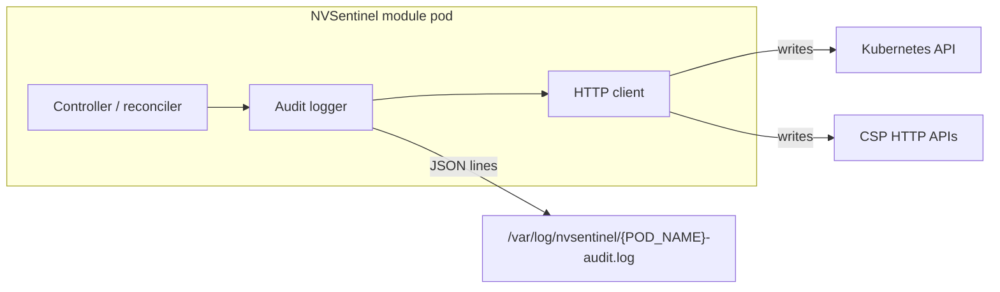

# Audit Logging

## Overview

NVSentinel can record a **durable, file-based audit trail** of the **HTTP write operations** (POST, PUT, PATCH, DELETE) that its controllers make. These operations go to the **Kubernetes API** and to **cloud provider (CSP) HTTP APIs**. Each line in the audit log is a JSON object. It has a timestamp, the NVSentinel component name, the HTTP method and URL, and the response status code. It can also have the request body, if you explicitly enable request body logging.

### Why Do You Need This?

- **Forensics and accountability**: To investigate who cordoned a node or what actions NVSentinel took, you can use a dedicated audit file. You do not have to search through high-volume application logs.
- **Separation from debug logs**: Audit entries are **structured JSON** (one object per line) at a known path. They do not depend on the `slog` verbosity or on drops in the log pipeline.
- **CSP and Kubernetes coverage**: Audit logging also covers CSP API calls for janitor and janitor-provider actions.

## How It Works

1. **Initialization**: At startup, each component that supports audit logging reads `AUDIT_ENABLED`. If the value is true, the component starts its audit logger. If it is not true, the component creates no log file.
2. **HTTP wrapping**: The controllers send their requests to the Kubernetes API and to CSP HTTP APIs through the audit logger. Only **write** methods produce audit entries: POST, PUT, PATCH, DELETE.
3. **Execution**: For each such request, after the response returns, the audit logger appends one JSON **audit entry** to a rotating file. See [Log file location and format](#log-file-location-and-format).

## Architecture



When Helm enables audit logging, the chart also mounts a **hostPath** volume at `/var/log/nvsentinel` and runs an init container that sets the permissions. Thus the logs persist on the node, and your log agent can collect them.

## What Gets Logged

| Field | Description |
|-------|-------------|
| **Method** | One of POST, PUT, PATCH, DELETE |
| **URL** | Full request URL of the write |
| **Response code** | HTTP status code from the server (or `0` if unavailable) |
| **Component** | NVSentinel service name (for example, `fault-quarantine` or `node-drainer`) |
| **Timestamp** | UTC, RFC3339 |
| **Request body** | Only if `logRequestBody` / `AUDIT_LOG_REQUEST_BODY` is enabled (see [Security considerations](#security-considerations)) |

**Not audited** by this mechanism: the audit logger records only **write** methods. Read-only calls (for example, GET, list and watch) do not produce audit log lines.

The **modules** that use the audit logger include **fault-quarantine**, **node-drainer**, **fault-remediation**, **platform-connectors**, **janitor** (K8s client), **janitor-provider** (CSP HTTP clients), and **labeler**. The list in your cluster depends on the Helm subcharts that you enable.

## Log file location and format

- **Default directory**: `/var/log/nvsentinel`. To override it, extend the chart to set `AUDIT_LOG_BASE_PATH`.
- **Default file name**: `{POD_NAME}-audit.log`. If `{POD_NAME}` is unset, the audit logger uses the component name.
- **Rotation**: lumberjack-style rotation, with a maximum file size, retained backups, a maximum age and optional gzip of rotated files. Helm values control the rotation through the `AUDIT_LOG_*` environment variables (see [Configuration](#configuration)).

Example line (pretty-printed; on disk, each request is one line):

```json
{
  "timestamp": "2026-04-22T12:00:00Z",
  "component": "fault-quarantine",
  "method": "PATCH",
  "url": "https://10.96.0.1:443/apis/nvidia.com/v1alpha1/namespaces/nvsentinel/healthwithevents/...",
  "response_code": 200
}
```

If you enable request body logging, a `requestBody` field can appear. Treat these files as **highly sensitive**.

## Configuration

Configure audit logging in Helm under `global.auditLogging`:

```yaml
global:
  auditLogging:
    enabled: false       # Master switch: if false, no audit file and no AUDIT_ENABLED=true
    logRequestBody: false  # If true, may log secrets or PII in request bodies — use only when required
    maxSizeMB: 100        # Max size in MB per log file before rotation
    maxBackups: 7         # Number of old log files to keep
    maxAgeDays: 30        # Max age in days for rotated files
    compress: true        # Gzip rotated files
```

The umbrella chart injects these **environment variables** into the components that support audit logging. The values mirror the configuration above. The exact wiring is in `distros/kubernetes/nvsentinel/templates/_helpers.tpl`, under `nvsentinel.auditLogging.envVars`:

| Environment variable | Meaning |
|----------------------|--------|
| `AUDIT_ENABLED` | `"true"` or `"false"`. Must be true, or the component writes no audit file |
| `AUDIT_LOG_REQUEST_BODY` | Log HTTP bodies for write requests when `true` |
| `AUDIT_LOG_MAX_SIZE_MB` | Log file size threshold for rotation |
| `AUDIT_LOG_MAX_BACKUPS` | Number of rotated files to keep |
| `AUDIT_LOG_MAX_AGE_DAYS` | Max age of rotated files |
| `AUDIT_LOG_COMPRESS` | Compress rotated files |
| `AUDIT_LOG_BASE_PATH` | (Optional) Base directory. The code default is `/var/log/nvsentinel` |
| `POD_NAME` | Used to build the log file name `{POD_NAME}-audit.log` |

### Tenant / platform integration

DGX Cloud and similar platforms often expose NVSentinel settings through a **cluster spec** and templates that render into this Helm `global` section. The NVSentinel config schema of your platform documents the exact keys (for example, `auditLoggingEnabled` and `auditLogging` blocks). The **runtime behavior** always comes from the same Helm `global.auditLogging` and the environment variables above.

## Security considerations

- **Request bodies** can contain long texts with much more detailed information. Unless a compliance requirement explicitly needs the bodies, keep `logRequestBody: false`.
- **Host path** storage means that **any process with host access** to that directory can read the logs. Use node-level permissions and your organization’s log-shipping and retention policies.

## Operations

### Verifying that audit logging is active

- Confirm that the target pod has `AUDIT_ENABLED=true` in its environment.
- On the node, or through a debug sidecar, list `/var/log/nvsentinel/`. Find the `*audit.log` files.

### Collecting and retaining logs

Point your log forwarder at `/var/log/nvsentinel/*.log`, according to your retention and compliance requirements. Examples of log forwarders are a DaemonSet agent and node-level Fluent Bit. If `compress: true`, also include the rotated `*.gz` files.

## Troubleshooting

**Q: I enabled `global.auditLogging.enabled` but the audit file is empty or missing**  
- Confirm that the container’s env has `AUDIT_ENABLED=true`. Also confirm that the component makes **write** HTTP calls in the time window that you examine.  
- Confirm that the pod spec has the `audit-logs` volume mount and the hostPath. The umbrella chart adds them only when audit logging is enabled for that workload.  
- Check **disk space** and **permissions** on `/var/log/nvsentinel`. The init container runs `chown` for the non-root UID of the workload.


**Q: Do audit logs include database or gRPC calls?**  
- This feature records only the **HTTP write** operations to the Kubernetes API and to CSP HTTP APIs that pass through the audit logger. It does not replace database audit products or gRPC-level logging.

**Q: What is the performance impact?**  
- Each audited write appends a small JSON line and uses **lumberjack** rotation. The overhead is usually small compared to the HTTP call. **Request body** logging adds body buffering. Enable it only when necessary.
