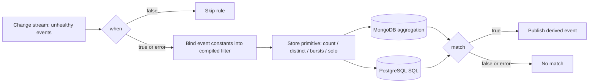

# ADR-066: Health Events Analyzer — Datastore-Neutral Rules

Status: Proposed for upstream review (tracking issue #606). Maintainer acceptance is pending; no implementation lands before it.

## Context

[ADR-007](007-event-correlation-and-analysis.md) made the health-events-analyzer correlate events inside the database, and it chose MongoDB aggregation pipelines as the rule language: each rule is a TOML `stage` list of MongoDB stages. The datastore later gained PostgreSQL ([#456](https://github.com/NVIDIA/NVSentinel/pull/456)), but the analyzer still sends MongoDB stages to `DatabaseClient.Aggregate`. On PostgreSQL, no default rule runs:

- The mandatory first stage has a top-level `$or` with `$exists: false` (ADR-025). The PostgreSQL translator handles `$or` only inside `$expr`, so it binds the whole array as one SQL parameter, and lib/pq rejects it ([#2079](https://github.com/NVIDIA/NVSentinel/issues/2079)).
- Without that stage, 21 of the 22 default rules still fail or change meaning. The translator builds one `SELECT`, so it loses stage order. It drops `$shift`, `$cond` and `$arrayToObject`, and rejects `$lookup`, `$replaceRoot` and `$not`. PostgreSQL also stores protobuf JSON names with `omitempty`, so `isHealthy: false` is absent while the rules compare it with `false`.
- The analyzer E2E tests run only with the `mongodb` build tag (`tests/health_events_analyzer_test.go:40-42`).

The only rule logic that runs on PostgreSQL is a Go XID burst detector that copies one MongoDB rule. It has drifted: it reads a rule name that [#471](https://github.com/NVIDIA/NVSentinel/pull/471) renamed, does not exclude XID 31 and 45, cannot be turned off, and loses its history on restart. [#1191](https://github.com/NVIDIA/NVSentinel/issues/1191) was an earlier instance of the same drift.

The 22 default rules have five shapes. Each is scoped to the trigger's node and to a window that ends at the trigger's `generatedTimestamp`. Only the look-up in the 4 solo rules differs: it covers the 24 h before `$$NOW`, with no upper bound.

| Shape | Rules | Windows |
|---|---|---|
| Count of matching events ≥ N | 11 (MultipleRemediations, NIC, XID 74 register rules) | 1 h, 24 h, 7 d |
| Distinct values ≥ N (GPU; GPC and TPC pair) | 2 | 24 h |
| Bursts: group by time gap, sticky XIDs continue a burst, count bursts | 4 | 24 h |
| Solo: a GPU with no other active XID | 4 | 24 h |
| Trigger only (register bits of the trigger) | 1 | none |

Options considered:

1. Extend the MongoDB-to-SQL translator until `stage` rules run on PostgreSQL.
2. Keep one rule set per datastore.
3. Fetch each node's history and evaluate the rules in memory with CEL.
4. Replace the rule language with CEL filters and typed aggregates that each datastore compiles into a native query.

## Decision

Option 4: replace the rule language, not the evaluation model. A portable rule states a CEL filter over stored events, one typed aggregate (`count`, `distinct`, `bursts` or `solo`) and a CEL `match` on the aggregate's result. The store-client compiles each rule into a native MongoDB or PostgreSQL query, so the work still runs in the database, as ADR-007 requires. The portable form replaces `stage`. During the migration, `stage` stays as a deprecated path on MongoDB only, so existing custom rules keep loading, and it is removed after a deprecation period. Kubernetes NodeHealth mode (proposed in [#2015](https://github.com/NVIDIA/NVSentinel/pull/2015)) and change-stream behaviour are non-goals.

## Implementation

### Rule form

The new fields are additive. During the migration, a rule sets either `stage` or `[rules.history]`, not both.

```toml
[[rules]]
name = "RepeatedNICDriverError"
recommended_action = "CONTACT_SUPPORT"
evaluate_rule = true
when = """
event.agent == 'syslog-health-monitor' && event.checkName == 'SysLogsNICDriverError'
&& event.isFatal == false && event.isHealthy == false && size(event.errorCode) > 0
&& event.errorCode[0] in ['netdev_watchdog', 'port_module_high_temp', 'pci_power_insufficient', 'module_unplugged', 'mlx5_tx_timeout_detected', 'mlx5_rx_timeout_detected']
"""
match = """
event.agent == 'syslog-health-monitor' && event.checkName == 'SysLogsNICDriverError'
&& event.isFatal == false && event.isHealthy == false && size(event.errorCode) > 0
&& event.errorCode[0] in ['netdev_watchdog', 'port_module_high_temp', 'pci_power_insufficient', 'module_unplugged', 'mlx5_tx_timeout_detected', 'mlx5_rx_timeout_detected']
&& count >= 3
"""

[rules.history]
window = "1h"
filter = "e.agent == 'syslog-health-monitor' && e.checkName == 'SysLogsNICDriverError' && !e.isFatal && !e.isHealthy && e.errorCode[0] == event.errorCode[0]"
aggregate = "count"
```

`when`, `history.filter` and `match` split the work:

| Field | Sees | Runs in | On error |
|---|---|---|---|
| `when` | the trigger `event` | the analyzer, before the query | the rule runs anyway |
| `history.filter` and the aggregate's condition parameters | each stored event `e`, with `event` as constants | the database | rejected at load |
| `match` | the aggregate result and `event` | the analyzer, after the query | no match |

- `when` keeps its meaning: it only saves a query that cannot match. So `match` repeats every condition on the trigger, and `when` must be true for every trigger that `filter` and `match` can accept. Removing `when` then never changes a result.
- `when` errors count in the existing `health_event_analyzer_rule_when_errors_total`. `match` errors count in a new `health_event_analyzer_rule_match_errors_total`.
- `history.window` is a duration. The window is `[t − window, t]` on `generatedTimestamp`, where `t` is the trigger's time.
- `history.aggregate` selects the primitive, and its parameters sit in the same table.
- A rule without `[rules.history]` decides on the trigger alone. Its `match` sees only `event`, and a reference to an aggregate result fails validation at load. XID74Reg2Bit13Set uses this form and needs no query.

### CEL vocabulary

Extend `commons/pkg/celevent` additively, so that the analyzer, platform-connector overrides and the event-exporter filter keep one vocabulary ([#1724](https://github.com/NVIDIA/NVSentinel/pull/1724)):

- Add `generatedTimestamp`, `processingStrategy` and `entitiesImpacted`, plus stored status on `e` only (`e.status.faultRemediated`).
- Add entity helpers: `entities(type)` (all values of a type), `entity(type)` (the first value or null), and `register(name)` (the 32-character `REG0`–`REG6` string; the last value wins on duplicates).
- Missing booleans read as `false`, a missing strategy as `UNSPECIFIED`, and a missing entity as null.
- `errorCode[0]` reads as null when `errorCode` is missing or empty, on `e` and on `event`. Comparisons follow CEL's null semantics: `==` and `in` are false, and `!=` is true. SQL renders `!=` as `IS DISTINCT FROM`; MongoDB's `$ne` already matches a missing element.
- One mapping in the store-client defines all of this for both datastores.

### Compiling the filter

`history.filter` and the aggregate's condition parameters (`target`, `others`, `active`) must stay in a CEL subset that has an exact query form on every datastore: comparisons, `in`, `&&`, `||`, `!`, list literals, `all` over a list literal (unrolled into one condition per element), `e.errorCode[0]`, `e.errorCode.exists(c, c == '31')`, `sets.intersects(e.entities(T), event.entities(T))`, `v in e.entities(T)` for a constant `v`, `e.entity(T) == event.entity(T)` and `e.register(R) in [...]`. Key parameters (`keys`, `group_by`, `state_key`) are single field references, such as `e.errorCode[0]`, `e.entity(T)` or `e.register(R)`. `event.*` references, and `group` in `solo`, are constants for one evaluation, as `this.` values are today.

A compiler in `store-client/pkg/query` walks the checked AST, as `commons/pkg/celfields` does, and emits a `query.Condition` tree, which already renders `ToMongo()` and `ToSQL()`. The work adds missing-field, array-contains and entity-element conditions, and typed casts.

Everything about a portable rule is checked when the config loads: CEL syntax, types and field names against the typed vocabulary, the subset above, and the aggregate's parameters. What remains for evaluation time is the data and the datastore: missing values follow the null rules above, a `when` or `match` error has the outcome in the table above, and a datastore error is handled per event as today ([#1794](https://github.com/NVIDIA/NVSentinel/pull/1794)). A rule that fails these checks is logged and skipped, and increments a new counter, `rule_config_invalid_total{rule_name}`; the analyzer keeps running. This is a policy change: today, a `when` that fails to compile stops the analyzer at startup (open question 2). A portable rule that loads therefore runs on every supported datastore.

### Aggregate primitives

New `HealthEventStore` methods take the node, the window and the compiled condition. Each store adds the base predicate itself: the analyzer's own events are excluded, and the strategy must be `EXECUTE_REMEDIATION`, `STORE_AND_ANALYSE` or missing (ADR-025). Rule authors cannot remove the node scope or the base predicate (ADR-056, [#1676](https://github.com/NVIDIA/NVSentinel/pull/1676)). The trigger is a candidate, as today.

| Primitive | Parameters | Result for `match` | MongoDB | PostgreSQL |
|---|---|---|---|---|
| `count` | — | `count` | `$match`, `$count` | `COUNT(*)` |
| `distinct` | `keys`: one or two key expressions | `distinct` | `$group` on keys | `COUNT(DISTINCT (k1, k2))` |
| `bursts` | `gap`, `sticky_codes`, `sticky_window`, `target` | `bursts`, `latestTargets` | `$setWindowFields` with `$shift`, as today | `LAG()` and a running `SUM()` |
| `solo` | `group_by`, `others`, `state_key`, `active` | `soloGroups` | `$group`, then `$lookup` | newest row per key, then `NOT EXISTS` |

`bursts` and `solo` order events by `generatedTimestamp`, then by the stored record (`_id` in MongoDB; `created_at`, then `id`, in PostgreSQL), so tied timestamps have one order on each datastore. Windows and gaps compare whole seconds, as today.

- `bursts` walks the candidates in that order, and the first candidate starts the first burst. After that, a candidate whose `errorCode[0]` is in `sticky_codes` continues the current burst when the latest earlier sticky candidate is at most `sticky_window` before it; otherwise a gap over `gap` since the previous candidate starts a new burst. `bursts` counts the bursts with at least one `target` candidate, and `latestTargets` counts the `target` candidates in the latest burst.
- `solo` groups the candidates by `group_by`. For each group, it takes the events in the window that satisfy `others` and not `filter`, with `group` bound to the group's key, and keeps the newest event per `state_key`. The group is solo when none of those events satisfies `active`. `soloGroups` counts the solo groups. Because a candidate is never one of the others, the trigger cannot be its own active state; today's look-up excludes only one candidate, by ID.

Each burst rule's latest-burst behaviour becomes a `match` expression, so the primitive stays simple and each rule's semantics stay visible in its config.

### Examples

Two rules from today's chart, each with every parameter in the new form. The `stage` form is collapsed and copied from `values.yaml` ([RepeatedXIDErrorOnSameGPU](https://github.com/NVIDIA/NVSentinel/blob/d8e26169133881ea350ccf6d77095995178c41c9/distros/kubernetes/nvsentinel/charts/health-events-analyzer/values.yaml#L142-L416), [XID74Reg0SoloNVLinkError](https://github.com/NVIDIA/NVSentinel/blob/d8e26169133881ea350ccf6d77095995178c41c9/distros/kubernetes/nvsentinel/charts/health-events-analyzer/values.yaml#L1451-L1672)).

**RepeatedXIDErrorOnSameGPU** (`bursts`)

<details>
<summary>Today</summary>

```toml
[[rules]]
name = "RepeatedXIDErrorOnSameGPU"
description = "Detect occurrence of XID errors (any XID except 31 and 45) on the same GPU 5 times within 24 hours where the burst window is 3 minutes and sticky XIDs window is 3 hours"
recommended_action = "CONTACT_SUPPORT"
evaluate_rule = {{ .Values.enableRepeatedXIDErrorOnSameGPURule }}
when = "event.checkName == 'SysLogsXIDError' && (size(event.errorCode) == 0 || (event.errorCode[0] != '31' && event.errorCode[0] != '45'))"
stage = [
  '''
  {
    "$match": {
      "$expr": {
        "$and": [
          {
            "$gte": [
              "$healthevent.generatedtimestamp.seconds",
              {"$subtract": ["this.healthevent.generatedtimestamp.seconds", 86400]}
            ]
          },
          {
            "$lte": [
              "$healthevent.generatedtimestamp.seconds",
              "this.healthevent.generatedtimestamp.seconds"
            ]
          }
        ]
      }
    }
  }
  ''',
    # Gate current event: only XID events carry GPU_UUID entities; without
    # this guard, non-GPU events (e.g. NIC diagnostics) would reach the
    # $setIntersection stage below and hit "$size on null".
    '''
  {
    "$match": {
      "$expr": {
        "$and": [
          {"$eq": ["this.healthevent.checkname", "SysLogsXIDError"]},
          {
            "$ne": [
              "this.healthevent.errorcode.0",
              "31"
            ]
          },
          {
            "$ne": [
              "this.healthevent.errorcode.0",
              "45"
            ]
          }
        ]
      }
    }
  }
  ''',
  # Candidate docs must also be XID events so non-XID unhealthy events on
  # the same node are not merged into GPU burst counts.
  #
  # Excluded codes: 31 has its own dedicated rules; 45 is preemptive channel cleanup that
  # the Xid catalogue resolves as "Not Solo: IGNORE (follow other Xid)", and a repeat is
  # never solo.
  '''
  {
    "$match": {
      "healthevent.checkname": "SysLogsXIDError",
      "healthevent.ishealthy": false,
      "healthevent.nodename": "this.healthevent.nodename",
      "$expr": {
        "$and": [
          {"$not": [{"$in": [{"$arrayElemAt": ["$healthevent.errorcode", 0]}, ["31", "45"]]}]},
          {
            "$gt": [
              {
                "$size": {
                  "$setIntersection": [
                    {
                      "$map": {
                        "input": {
                          "$filter": {
                            "input": {"$ifNull": ["$healthevent.entitiesimpacted", []]},
                            "cond": {"$eq": ["$$this.entitytype", "GPU_UUID"]}
                          }
                        },
                        "in": "$$this.entityvalue"
                      }
                    },
                    {
                      "$map": {
                        "input": {
                          "$filter": {
                            "input": "this.healthevent.entitiesimpacted",
                            "cond": {"$eq": ["$$this.entitytype", "GPU_UUID"]}
                          }
                        },
                        "in": "$$this.entityvalue"
                      }
                    }
                  ]
                }
              },
              0
            ]
          }
        ]
      }
    }
  }
  ''',
  '''
  {
    "$setWindowFields": {
      "sortBy": {"healthevent.generatedtimestamp.seconds": 1},
      "output": {
        "prevTimestamp": {
          "$shift": {
            "output": "$healthevent.generatedtimestamp.seconds",
            "by": -1
          }
        }
      }
    }
  }
  ''',
  '''
  {
    "$addFields": {
      "isStickyXid": {
        "$in": [
          {"$arrayElemAt": ["$healthevent.errorcode", 0]},
          ["74", "79", "95", "109", "119"]
        ]
      }
    }
  }
  ''',
  # Only the most recent previous sticky XID can satisfy the 3 hour bound, so a
  # scalar $max over the same window answers the question without materialising
  # every previous event. Pushing $$ROOT made this stage quadratic in both data
  # and work; see issue #1851.
  '''
  {
    "$setWindowFields": {
      "sortBy": {"healthevent.generatedtimestamp.seconds": 1},
      "output": {
        "lastStickyTimestamp": {
          "$max": {
            "$cond": {
              "if": "$isStickyXid",
              "then": "$healthevent.generatedtimestamp.seconds",
              "else": null
            }
          },
          "window": {"documents": ["unbounded", -1]}
        }
      }
    }
  }
  ''',
  '''
  {
    "$addFields": {
      "stickyXidWithin3Hours": {
        "$cond": {
          "if": "$isStickyXid",
          "then": {
            "$and": [
              {"$ne": ["$lastStickyTimestamp", null]},
              {"$lte": [{"$subtract": ["$healthevent.generatedtimestamp.seconds", "$lastStickyTimestamp"]}, 10800]}
            ]
          },
          "else": false
        }
      }
    }
  }
  ''',
  '''
  {
    "$setWindowFields": {
      "sortBy": {"healthevent.generatedtimestamp.seconds": 1},
      "output": {
        "burstId": {
          "$sum": {
            "$cond": {
              "if": {"$eq": ["$prevTimestamp", null]},
              "then": 1,
              "else": {
                "$cond": {
                  "if": {
                    "$and": [
                      "$isStickyXid",
                      "$stickyXidWithin3Hours"
                    ]
                  },
                  "then": 0,
                  "else": {
                    "$cond": {
                      "if": {"$gt": [{"$subtract": ["$healthevent.generatedtimestamp.seconds", "$prevTimestamp"]}, 180]},
                      "then": 1,
                      "else": 0
                    }
                  }
                }
              }
            }
          },
          "window": {"documents": ["unbounded", "current"]}
        }
      }
    }
  }
  ''',
  '''
  {
    "$group": {
      "_id": {"burstId": "$burstId"},
      "uniqueXidsInBurst": {"$addToSet": {"$arrayElemAt": ["$healthevent.errorcode", 0]}},
      "targetXidCount": {
        "$sum": {
          "$cond": [
            {"$eq": [{"$arrayElemAt": ["$healthevent.errorcode", 0]}, "this.healthevent.errorcode.0"]},
            1,
            0
          ]
        }
      }
    }
  }
  ''',
  '''
  {
    "$setWindowFields": {
      "sortBy": {"_id.burstId": 1},
      "output": {"maxBurstId": {"$max": "$_id.burstId"}}
    }
  }
  ''',
  '''
  {
    "$match": {
      "$expr": {
        "$and": [
          {"$in": ["this.healthevent.errorcode.0", "$uniqueXidsInBurst"]},
          {
            "$or": [
              {"$ne": ["$_id.burstId", "$maxBurstId"]},
              {"$eq": ["$targetXidCount", 1]}
            ]
          }
        ]
      }
    }
  }
  ''',
  '''
  {
    "$group": {
      "_id": null,
      "count": {"$sum": 1},
      "bursts": {"$push": {"burstId": "$_id.burstId", "uniqueXids": "$uniqueXidsInBurst"}}
    }
  }
  ''',
  '''
  {
  "$match": {
      "$expr": {
      "$gte": [
          "$count", 5
        ]
      }
  }
  }
  '''
]
```

</details>

```toml
[[rules]]
name = "RepeatedXIDErrorOnSameGPU"
description = "Detect occurrence of XID errors (any XID except 31 and 45) on the same GPU 5 times within 24 hours where the burst window is 3 minutes and sticky XIDs window is 3 hours"
recommended_action = "CONTACT_SUPPORT"
evaluate_rule = {{ .Values.enableRepeatedXIDErrorOnSameGPURule }}
when = "event.checkName == 'SysLogsXIDError' && (size(event.errorCode) == 0 || (event.errorCode[0] != '31' && event.errorCode[0] != '45'))"
match = "event.checkName == 'SysLogsXIDError' && (size(event.errorCode) == 0 || (event.errorCode[0] != '31' && event.errorCode[0] != '45')) && bursts - (latestTargets > 1 ? 1 : 0) >= 5"

[rules.history]
window = "24h"
filter = """
e.checkName == 'SysLogsXIDError' && !e.isHealthy
&& !(e.errorCode[0] in ['31', '45'])
&& sets.intersects(e.entities('GPU_UUID'), event.entities('GPU_UUID'))
"""
aggregate = "bursts"
gap = "180s"
sticky_codes = ["74", "79", "95", "109", "119"]
sticky_window = "3h"
target = "e.errorCode[0] == event.errorCode[0]"
```

`match` repeats the trigger condition from `when`, as today's second stage does, and keeps today's latest-burst rule: the latest burst counts only while it holds exactly one event with the trigger's XID.

**XID74Reg0SoloNVLinkError** (`solo`)

<details>
<summary>Today</summary>

```toml
[[rules]]
  name = "XID74Reg0SoloNVLinkError"
  description = "Detect if XID 74 occurred with register 0 bits 1 or 20 set with no other active errors in the last 24 hours"
  recommended_action = "CONTACT_SUPPORT"
  message = "one of the bits (1 or 20) is set in register 0, unexpected error please open an NVBug"
  evaluate_rule = {{.Values.enableXID74Reg0SoloNVLinkErrorRule}}
  when = "size(event.errorCode) > 0 && event.errorCode[0] == '74'"
  stage = [
    '''
    {
      "$match": {
        "$expr": {
          "$and": [
            {
              "$gte": [
                "$healthevent.generatedtimestamp.seconds",
                {"$subtract": ["this.healthevent.generatedtimestamp.seconds", 86400]}
              ]
            },
            {
              "$lte": [
                "$healthevent.generatedtimestamp.seconds",
                "this.healthevent.generatedtimestamp.seconds"
              ]
            }
          ]
        }
      }
    }
    ''',
    '''
    {
      "$match": {
        "$expr": {
          "$in": [
            "this.healthevent.errorcode.0",
            ["74"]
          ]
        }
      }
    }
    ''',
    '''
    {
      "$addFields": {
        "registers": {
          "$arrayToObject": {
            "$map": {
              "input": {
                "$filter": {
                  "input": "$healthevent.entitiesimpacted",
                  "cond": {
                    "$in": ["$$this.entitytype", ["REG0", "REG1", "REG2", "REG3", "REG4", "REG5", "REG6"]]
                  }
                }
              },
              "as": "reg",
              "in": {
                "k": "$$reg.entitytype",
                "v": "$$reg.entityvalue"
              }
            }
          }
        }
      }
    }
    ''',
    '''
    {
      "$match": {
        "$expr": {
          "$and": [
            {
              "$or": [
                {"$eq": ["$registers.REG0", "00000000000000000000000000000010"]},
                {"$eq": ["$registers.REG0", "00000000000100000000000000000000"]}
              ]
            },
            {"$eq": ["$registers.REG1", "00000000000000000000000000000000"]},
            {"$eq": ["$registers.REG2", "00000000000000000000000000000000"]},
            {"$eq": ["$registers.REG3", "00000000000000000000000000000000"]},
            {"$eq": ["$registers.REG4", "00000000000000000000000000000000"]},
            {"$eq": ["$registers.REG5", "00000000000000000000000000000000"]},
            {"$eq": ["$registers.REG6", "00000000000000000000000000000000"]}
          ]
        }
      }
    }
    ''',
    # Collapse to one document per GPU before the $lookup below. That
    # sub-query reads only currentNodeName, which the mandatory first stage
    # already pins to a single node, and gpuUuid. Every event on the same GPU
    # therefore asks it the same question, so running it once per event makes
    # cost grow with the square of the node's event rate. Grouping first caps
    # the sub-queries at the number of GPUs on the node.
    '''
    {
      "$group": {
        "_id": {
          "$arrayElemAt": [
            {
              "$map": {
                "input": {
                  "$filter": {
                    "input": {"$ifNull": ["$healthevent.entitiesimpacted", []]},
                    "cond": {"$eq": ["$$this.entitytype", "GPU_UUID"]}
                  }
                },
                "in": "$$this.entityvalue"
              }
            },
            0
          ]
        },
        "doc": {"$first": "$$ROOT"}
      }
    }
    ''',
    # Restore the document shape the $lookup expects.
    '{"$replaceRoot": {"newRoot": "$doc"}}',
    '''
    {
      "$lookup": {
        "from": "HealthEvents",
        "let": {
          "currentEventId": "$_id",
          "currentNodeName": "$healthevent.nodename",
          "gpuUuid": {
            "$arrayElemAt": [
              {
                "$map": {
                  "input": {
                    "$filter": {
                      "input": {"$ifNull": ["$healthevent.entitiesimpacted", []]},
                      "cond": {"$eq": ["$$this.entitytype", "GPU_UUID"]}
                    }
                  },
                  "in": "$$this.entityvalue"
                }
              },
              0
            ]
          }
        },
        "pipeline": [
          {
            "$match": {
              "$expr": {
                "$and": [
                  {
                    "$gte": [
                      "$healthevent.generatedtimestamp.seconds",
                      {"$subtract": [{"$divide": [{"$toLong": "$$NOW"}, 1000]}, 86400]}
                    ]
                  },
                  {"$ne": ["$_id", "$$currentEventId"]},
                  {"$eq": ["$healthevent.nodename", "$$currentNodeName"]},
                  {"$ne": [{"$arrayElemAt": ["$healthevent.errorcode", 0]}, "74"]},
                  {
                    "$gt": [
                      {
                        "$size": {
                          "$filter": {
                            "input": {"$ifNull": ["$healthevent.entitiesimpacted", []]},
                            "cond": {
                              "$and": [
                                {"$eq": ["$$this.entitytype", "GPU_UUID"]},
                                {"$eq": ["$$this.entityvalue", "$$gpuUuid"]}
                              ]
                            }
                          }
                        }
                      },
                      0
                    ]
                  }
                ]
              }
            }
          },
          {
            "$sort": {
              "healthevent.generatedtimestamp.seconds": -1
            }
          },
          {
            "$group": {
              "_id": {
                "$arrayElemAt": ["$healthevent.errorcode", 0]
              },
              "mostRecentEvent": {
                "$first": {
                  "id": "$_id",
                  "isHealthy": {"$ifNull": ["$healthevent.ishealthy", false]},
                  "timestamp": "$healthevent.generatedtimestamp.seconds"
                }
              }
            }
          },
          {
            "$match": {
              "mostRecentEvent.isHealthy": false
            }
          }
        ],
        "as": "otherXidEvents"
      }
    }
    ''',
    '''
    {
      "$match": {
        "$expr": {
          "$eq": [{"$size": "$otherXidEvents"}, 0]
        }
      }
    }
    ''',
    # The reconciler only tests whether the result is non-empty, so stop at
    # the first match rather than returning every surviving document.
    '{"$limit": 1}'
  ]
```

</details>

```toml
[[rules]]
name = "XID74Reg0SoloNVLinkError"
description = "Detect if XID 74 occurred with register 0 bits 1 or 20 set with no other active errors in the last 24 hours"
recommended_action = "CONTACT_SUPPORT"
message = "one of the bits (1 or 20) is set in register 0, unexpected error please open an NVBug"
evaluate_rule = {{.Values.enableXID74Reg0SoloNVLinkErrorRule}}
when = "size(event.errorCode) > 0 && event.errorCode[0] == '74'"
match = "size(event.errorCode) > 0 && event.errorCode[0] == '74' && soloGroups >= 1"

[rules.history]
window = "24h"
filter = """
e.register('REG0') in ['00000000000000000000000000000010', '00000000000100000000000000000000']
&& ['REG1', 'REG2', 'REG3', 'REG4', 'REG5', 'REG6'].all(r, e.register(r) == '00000000000000000000000000000000')
"""
aggregate = "solo"
group_by = "e.entity('GPU_UUID')"
others = "e.errorCode[0] != '74' && group in e.entities('GPU_UUID')"
state_key = "e.errorCode[0]"
active = "!e.isHealthy"
```

Two things differ from today, both listed in Notes: the look-up window ends at the trigger's time instead of `$$NOW`, and the look-up applies the base predicate.

### Flow



The derived event and the metric names do not change. `mongo_query_execution_duration_seconds` also measures portable rule queries on both datastores.

### Indexes and compatibility

- PostgreSQL has no index on event time. Add a `generated_at` column, set at insert as `node_name` is, and an index on `(node_name, generated_at, created_at, id)`. Both schema paths need them: the chart's `initdb` script for new databases, and the store's setup path for existing ones, which adds the column with `ADD COLUMN IF NOT EXISTS` and backfills it from the document. The compiled SQL filters on the `node_name` and `generated_at` columns, not on JSONB paths, so the index applies. MongoDB keeps the [#1901](https://github.com/NVIDIA/NVSentinel/pull/1901) indexes.
- During the migration, `stage` rules, defaults and custom, run on MongoDB unchanged. On PostgreSQL, the analyzer skips them at startup with one warning each; today they fail on every event. After the default switches, `stage` logs a deprecation warning, and step 5 removes it.
- The chart ports the 22 default rules. `healthEventsAnalyzer.ruleFormat` selects `stage` or `portable`. The default stays `stage` on MongoDB until the equivalence and benchmark gates pass, and PostgreSQL always uses `portable`. The toggle reports through `nvsentinel_feature_flag_enabled` (ADR-032).
- The Go XID burst detector is removed once `bursts` runs on PostgreSQL. The ADR-059 recovery boundary becomes a `query.Condition`, so recovery can also run on PostgreSQL.

### Testing

- Compiler: golden `ToMongo()` and `ToSQL()` output for each supported construct, and a load error for each unsupported one.
- Conformance: one table of primitive cases (absent fields, missing and empty `errorCode`, duplicate registers, sticky XIDs, empty windows, tied timestamps, and an `others` that also matches candidates) runs against an in-memory reference store, MongoDB and PostgreSQL in CI.
- Equivalence: replay a recorded MongoDB dataset, in the style of #1901, through the `stage` and portable forms of every default rule. Zero differences are required, except the two solo-rule changes in Notes and differences that come from events in the same second, which have no defined order today. Each default rule must also give the same results with `when` removed.
- E2E: portable rule tests drop the `mongodb` build tag, and the 9 default rules without an E2E test get one.
- Benchmarks: events/s per worker, ms per event, queries per event and database CPU per event, before and after, on both datastores, in the format of [#1912](https://github.com/NVIDIA/NVSentinel/pull/1912) and [#1913](https://github.com/NVIDIA/NVSentinel/pull/1913).

### Rollout

1. The vocabulary, the compiler, `count`, the base predicate and the PostgreSQL index; port the 11 count rules and the trigger-only rule (12 of 22).
2. `distinct` and `solo` (18 of 22).
3. `bursts` (22 of 22); remove the Go XID detector.
4. Switch the MongoDB default to `portable` after the gates pass; enable recovery on PostgreSQL; warn on `stage`.
5. After a deprecation period announced in the release notes (proposed: two minor releases), remove `stage`, the `healthEventsAnalyzer.ruleFormat` toggle and the analyzer's `Aggregate` calls.

Each step is a separate PR, and MongoDB behaviour stays unchanged until step 4.

## Rationale

- ADR-007 rejected "loading events into memory". Each primitive returns one number from the database, so XID floods stay a database concern, and nothing truncates history.
- ADR-007 rejected a rules engine. CEL is already the repo's single expression language (ADR-003, ADR-011, ADR-021, [#1913](https://github.com/NVIDIA/NVSentinel/pull/1913)), and the primitives are store-client methods, not an engine.
- One definition per rule replaces a MongoDB pipeline plus a Go copy, so the drift in #1191 and #471 cannot recur.
- Load-time compilation proves portability before any event arrives.
- Typed primitives let each datastore use its native tools: window functions in SQL, `$setWindowFields` in MongoDB.

## Consequences

### Positive
- All 22 default rules run on PostgreSQL, and the analyzer E2E tests run in the PostgreSQL matrix.
- Rule authors write CEL, as they do for fault-quarantine and platform-connector overrides.
- Rules can be tested against an in-memory reference store, without a database.
- The analyzer stops depending on the `Aggregate` translator in `postgresql_client.go`.

### Negative
- A new public rule schema to document and support.
- A new aggregate shape needs code in every datastore.
- Two rule forms coexist during migration.
- The restricted CEL subset rejects some valid CEL.

### Mitigations
- Load errors name the unsupported construct and the rule.
- One conformance suite runs every primitive case against every datastore.
- The 22 ported default rules serve as the porting guide.
- `stage` keeps loading on MongoDB through the deprecation period, so custom rules can move at their own pace.

## Alternatives Considered

### Extend the MongoDB-to-SQL translator until `stage` rules run
**Rejected** because it does not end. Three translators already disagree, and the defaults need stage ordering, `$lookup`, `$setWindowFields` with `$shift`, and absent-versus-false handling. Every new MongoDB operator in a rule reopens the gap, and it keeps the MongoDB syntax that #606 asks to remove.

### Per-datastore rule sets
**Rejected** because every rule exists twice and the copies drift, as the Go XID detector shows.

### Fetch history and evaluate it in memory with CEL
**Rejected** because it loads events into memory, which ADR-007 rejected. ADR-039 stores repeated observations as `STORE_AND_ANALYSE`, which is analyzer input, so an XID flood of 120 events/s, the lowest rate in #2015, stores more than 400,000 events on one node in an hour. A fetch limit would change results, and in-process state breaks across restarts. This was the auto-generated plan on #606.

### Rules engine, scripting, or a MongoDB pipeline interpreter in Go
**Rejected** because ADR-007 and ADR-003 rejected a rules engine and scripting, and an interpreter loads history into memory and reimplements about 40 MongoDB operators.

## Open Questions

1. Are the four primitives the right set? `solo` could instead be a general "newest state per key" primitive plus `count`.
2. The ADR proposes skipping a portable rule that fails validation, with a metric. Should it stop startup instead?
3. Should the solo rules' look-up window end at the trigger's time, as proposed, or keep `$$NOW`?
4. Should the PostgreSQL event-time index go through the current setup path, or through the versioned migrations of [#1777](https://github.com/NVIDIA/NVSentinel/pull/1777)?
5. Should the compiler live in `store-client/pkg/query`, as proposed, or in `commons`?

## Notes

- Non-goals: Kubernetes NodeHealth mode, change-stream and checkpoint behaviour, and PostgreSQL re-delivery of updates.
- The solo rules change in two ways. Their look-up window ends at the trigger's time instead of `$$NOW`, so a replay gives the same result. Their look-up also gets the base predicate, so the analyzer's own events and `STORE_ONLY` events no longer count as active codes.
- The derived event keeps the trigger's entities. Reporting the matched identity, for example another GPU in a solo rule, is a separate decision.
- Until step 3, `docs/postgresql-provider.md` must not claim full feature parity for the analyzer.

## References

- Tracking issue: #606
- [ADR-007](007-event-correlation-and-analysis.md), superseded in part: the rule language only.
- ADR-003, ADR-021, ADR-025, ADR-032, ADR-039, ADR-056, ADR-059; the Kubernetes NodeHealth mode proposal in #2015.
- [#2079](https://github.com/NVIDIA/NVSentinel/issues/2079), [#1706](https://github.com/NVIDIA/NVSentinel/pull/1706), [#1191](https://github.com/NVIDIA/NVSentinel/issues/1191), [#1901](https://github.com/NVIDIA/NVSentinel/pull/1901), [#1912](https://github.com/NVIDIA/NVSentinel/pull/1912), [#1913](https://github.com/NVIDIA/NVSentinel/pull/1913).
- `health-events-analyzer/pkg/reconciler/reconciler.go`, `store-client/pkg/client/postgresql_client.go`, `store-client/pkg/query/builder.go`, `commons/pkg/celevent`.
