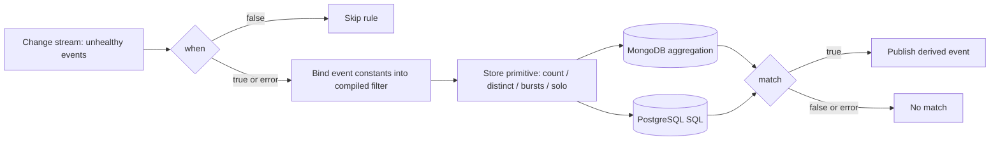

# ADR-066: Health Events Analyzer — Datastore-Neutral Rules

Status: Proposed for upstream review (tracking issue #606). Maintainer acceptance is pending; no implementation lands before it.

## Context

[ADR-007](007-event-correlation-and-analysis.md) made the health-events-analyzer correlate events inside the database, and it chose MongoDB aggregation pipelines as the rule language: each rule is a TOML `stage` list of MongoDB stages. The datastore later gained PostgreSQL ([#456](https://github.com/NVIDIA/NVSentinel/pull/456)), but the analyzer still sends MongoDB stages to `DatabaseClient.Aggregate`. On PostgreSQL, no default rule runs:

- The mandatory first stage has a top-level `$or` with `$exists: false` (ADR-025). The PostgreSQL translator handles `$or` only inside `$expr`, so it binds the whole array as one SQL parameter, and lib/pq rejects it ([#2079](https://github.com/NVIDIA/NVSentinel/issues/2079)).
- Without that stage, 21 of the 22 default rules still fail or change meaning. The translator builds one `SELECT`, so it loses stage order. It drops `$shift`, `$cond` and `$arrayToObject`, and rejects `$lookup`, `$replaceRoot` and `$not`. PostgreSQL also stores protobuf JSON names with `omitempty`, so `isHealthy: false` is absent while the rules compare it with `false`.
- The analyzer E2E tests run only with the `mongodb` build tag (`tests/health_events_analyzer_test.go:40-42`).

The only rule logic that runs on PostgreSQL is a Go XID burst detector that copies one MongoDB rule. It has drifted: it reads a rule name that [#471](https://github.com/NVIDIA/NVSentinel/pull/471) renamed, does not exclude XID 31 and 45, cannot be turned off, and loses its history on restart. [#1191](https://github.com/NVIDIA/NVSentinel/issues/1191) was an earlier instance of the same drift.

The 22 default rules have five shapes. Each is scoped to the trigger's node and to a window that ends at the trigger's `generatedTimestamp`:

| Shape | Rules | Windows |
|---|---|---|
| Count of matching events ≥ N | 11 (MultipleRemediations, NIC, XID 74 register rules) | 1 h, 24 h, 7 d |
| Distinct values ≥ N (GPU; GPC and TPC pair) | 2 | 24 h |
| Bursts: group by time gap, sticky XIDs continue a burst, count bursts | 4 | 24 h |
| Solo: a GPU with no other active XID | 4 | 24 h |
| Trigger only (register bits of the trigger) | 1 | none |

Options considered:

1. Extend the MongoDB-to-SQL translator until `stage` rules run on PostgreSQL.
2. Keep one rule set per datastore.
3. Fetch each node's history and evaluate the rules in memory with CEL.
4. Replace the rule language with CEL filters and typed aggregates that each datastore compiles into a native query.

## Decision

Option 4: replace the rule language, not the evaluation model. A portable rule states a CEL filter over stored events, one typed aggregate (`count`, `distinct`, `bursts` or `solo`) and a CEL `match` on the aggregate's result. The store-client compiles each rule into a native MongoDB or PostgreSQL query, so the work still runs in the database, as ADR-007 requires. `stage` rules keep working on MongoDB unchanged. Kubernetes NodeHealth mode (proposed ADR-063, [#2015](https://github.com/NVIDIA/NVSentinel/pull/2015)) and change-stream behaviour are non-goals.

## Implementation

### Rule form

The new fields are additive. A rule sets either `stage` or `[rules.history]`, not both.

```toml
[[rules]]
name = "MultipleRemediations"
recommended_action = "CONTACT_SUPPORT"
evaluate_rule = true
match = "count >= 5"

[rules.history]
window = "168h"
filter = "e.status.faultRemediated && e.isFatal == event.isFatal"
aggregate = "count"
```

- `when` keeps its meaning: a CEL gate on the trigger that fails open.
- `history.window` is a duration. The window is `[t − window, t]` on `generatedTimestamp`, where `t` is the trigger's time.
- `history.filter` is CEL over a stored event `e` and the trigger `event`. `history.aggregate` selects the primitive, and its parameters sit in the same table.
- `match` is CEL over the aggregate result and `event`. An error in `match` means no match and increments an error metric; it never fails open.
- A rule without `[rules.history]` decides on the trigger alone through `match`. XID74Reg2Bit13Set uses this form and needs no query.

### CEL vocabulary

Extend `commons/pkg/celevent` additively, so that the analyzer, platform-connector overrides and the event-exporter filter keep one vocabulary ([#1724](https://github.com/NVIDIA/NVSentinel/pull/1724)):

- Add `generatedTimestamp`, `processingStrategy` and `entitiesImpacted`, plus stored status on `e` only (`e.status.faultRemediated`).
- Add entity helpers: `entities(type)` (all values of a type), `entity(type)` (the first value or null), and `register(name)` (the 32-character `REG0`–`REG6` string; the last value wins on duplicates).
- Missing booleans read as `false`, a missing strategy as `UNSPECIFIED`, and a missing entity as null. One mapping in the store-client defines this for both datastores.

### Compiling the filter

`history.filter` must stay in a CEL subset that has an exact query form on every datastore: comparisons, `in`, `&&`, `||`, `!`, list literals, `e.errorCode[0]`, `e.errorCode.exists(c, c == '31')`, `sets.intersects(e.entities(T), event.entities(T))`, `e.entity(T) == event.entity(T)` and `e.register(R) in [...]`. `event.*` references are constants for one evaluation, as `this.` values are today.

A compiler in `store-client/pkg/query` walks the checked AST, as `commons/pkg/celfields` does, and emits a `query.Condition` tree, which already renders `ToMongo()` and `ToSQL()`. The work adds missing-field, array-contains and entity-element conditions, and typed casts. Any other construct makes the rule invalid at load: the analyzer logs the construct, skips the rule, increments `rule_config_invalid_total{rule_name}` and keeps running ([#1794](https://github.com/NVIDIA/NVSentinel/pull/1794)). A portable rule that loads therefore runs on every supported datastore.

*Open question for maintainers:* skip an invalid portable rule with a metric, as proposed, or fail at startup?

### Aggregate primitives

New `HealthEventStore` methods take the node, the window and the compiled condition. Each store adds the base predicate itself: the analyzer's own events are excluded, and the strategy must be `EXECUTE_REMEDIATION`, `STORE_AND_ANALYSE` or missing (ADR-025). Rule authors cannot remove the node scope or the base predicate (ADR-056, [#1676](https://github.com/NVIDIA/NVSentinel/pull/1676)). The trigger is a candidate, as today.

| Primitive | Parameters | Result for `match` | MongoDB | PostgreSQL |
|---|---|---|---|---|
| `count` | — | `count` | `$match`, `$count` | `COUNT(*)` |
| `distinct` | `keys`: one or two key expressions | `distinct` | `$group` on keys | `COUNT(DISTINCT (k1, k2))` |
| `bursts` | `gap`, `sticky_codes`, `sticky_window`, `target` | `bursts`, `latestTargets` | `$setWindowFields` with `$shift`, as today | `LAG()` and a running `SUM()` |
| `solo` | `group_by`, `others` | `soloGroups` | `$group`, then `$lookup` | latest state per code, then `NOT EXISTS` |

Each burst rule's latest-burst behaviour becomes a `match` expression, for example `bursts - (latestTargets > 1 ? 1 : 0) >= 5` for RepeatedXIDErrorOnSameGPU. The primitive stays simple, and each rule's semantics stay visible in its config.

### Flow



The derived event and the metric names do not change. `mongo_query_execution_duration_seconds` also measures portable rule queries on both datastores.

### Indexes and compatibility

- PostgreSQL has no index on event time. Add a `generated_at` column set at insert, as `node_name` is, and an index on `(node_name, generated_at, created_at, id)`. MongoDB keeps the [#1901](https://github.com/NVIDIA/NVSentinel/pull/1901) indexes.
- `stage` rules, defaults and custom, run on MongoDB unchanged. On PostgreSQL, the analyzer skips them at startup with one warning each; today they fail on every event.
- The chart ports the 22 default rules. `healthEventsAnalyzer.ruleFormat` selects `stage` or `portable`. The default stays `stage` on MongoDB until the equivalence and benchmark gates pass, and PostgreSQL always uses `portable`. The toggle reports through `nvsentinel_feature_flag_enabled` (ADR-032).
- The Go XID burst detector is removed once `bursts` runs on PostgreSQL. The ADR-059 recovery boundary becomes a `query.Condition`, so recovery can also run on PostgreSQL.

*Open question for maintainers:* add the PostgreSQL index through the current setup path, or through the versioned migrations of [#1777](https://github.com/NVIDIA/NVSentinel/pull/1777)?

### Testing

- Compiler: golden `ToMongo()` and `ToSQL()` output for each supported construct, and a load error for each unsupported one.
- Conformance: one table of primitive cases (absent fields, duplicate registers, sticky XIDs, empty windows) runs against an in-memory reference store, MongoDB and PostgreSQL in CI.
- Equivalence: replay a recorded MongoDB dataset, in the style of #1901, through the `stage` and portable forms of every default rule. Zero differences are required, except the two solo-rule changes in Notes.
- E2E: portable rule tests drop the `mongodb` build tag, and the 9 default rules without an E2E test get one.
- Benchmarks: events/s per worker, ms per event, queries per event and database CPU per event, before and after, on both datastores, in the format of [#1912](https://github.com/NVIDIA/NVSentinel/pull/1912) and [#1913](https://github.com/NVIDIA/NVSentinel/pull/1913).

### Rollout

1. The vocabulary, the compiler, `count`, the base predicate and the PostgreSQL index; port the 11 count rules and the trigger-only rule (12 of 22).
2. `distinct` and `solo` (18 of 22).
3. `bursts` (22 of 22); remove the Go XID detector.
4. Switch the MongoDB default to `portable` after the gates pass; enable recovery on PostgreSQL; warn on `stage`.

Each step is a separate PR, and MongoDB behaviour stays unchanged until step 4.

## Rationale

- ADR-007 rejected "loading events into memory". Each primitive returns one number from the database, so XID floods stay a database concern, and nothing truncates history.
- ADR-007 rejected a rules engine. CEL is already the repo's single expression language (ADR-003, ADR-011, ADR-021, [#1913](https://github.com/NVIDIA/NVSentinel/pull/1913)), and the primitives are store-client methods, not an engine.
- One definition per rule replaces a MongoDB pipeline plus a Go copy, so the drift in #1191 and #471 cannot recur.
- Load-time compilation proves portability before any event arrives.
- Typed primitives let each datastore use its native tools: window functions in SQL, `$setWindowFields` in MongoDB.

## Consequences

### Positive
- All 22 default rules run on PostgreSQL, and the analyzer E2E tests run in the PostgreSQL matrix.
- Rule authors write CEL, as they do for fault-quarantine and platform-connector overrides.
- Rules can be tested against an in-memory reference store, without a database.
- The analyzer stops depending on the `Aggregate` translator in `postgresql_client.go`.

### Negative
- A new public rule schema to document and support.
- A new aggregate shape needs code in every datastore.
- Two rule forms coexist during migration.
- The restricted CEL subset rejects some valid CEL.

### Mitigations
- Load errors name the unsupported construct and the rule.
- One conformance suite runs every primitive case against every datastore.
- The 22 ported default rules serve as the porting guide.
- `stage` stays for MongoDB custom rules, with a deprecation warning only after the default switches.

## Alternatives Considered

### Extend the MongoDB-to-SQL translator until `stage` rules run
**Rejected** because it does not end. Three translators already disagree, and the defaults need stage ordering, `$lookup`, `$setWindowFields` with `$shift`, and absent-versus-false handling. Every new MongoDB operator in a rule reopens the gap, and it keeps the MongoDB syntax that #606 asks to remove.

### Per-datastore rule sets
**Rejected** because every rule exists twice and the copies drift, as the Go XID detector shows.

### Fetch history and evaluate it in memory with CEL
**Rejected** because it loads events into memory, which ADR-007 rejected. ADR-039 stores repeated observations as `STORE_AND_ANALYSE`, which is analyzer input, so an XID flood of 120 events/s (proposed ADR-063) stores more than 400,000 events on one node in an hour. A fetch limit would change results, and in-process state breaks across restarts. This was the auto-generated plan on #606.

### Rules engine, scripting, or a MongoDB pipeline interpreter in Go
**Rejected** because ADR-007 and ADR-003 rejected a rules engine and scripting, and an interpreter loads history into memory and reimplements about 40 MongoDB operators.

## Notes

- Non-goals: Kubernetes NodeHealth mode, change-stream and checkpoint behaviour, and PostgreSQL re-delivery of updates.
- The solo rules change in two ways. Their look-up window ends at the trigger's time instead of `$$NOW`, so a replay gives the same result. Their look-up also gets the base predicate, so the analyzer's own events and `STORE_ONLY` events no longer count as active codes. *Open question for maintainers:* keep `$$NOW` instead?
- The derived event keeps the trigger's entities. Reporting the matched identity, for example another GPU in a solo rule, is a separate decision.
- Until step 3, `docs/postgresql-provider.md` must not claim full feature parity for the analyzer.

## References

- Tracking issue: #606
- [ADR-007](007-event-correlation-and-analysis.md), superseded in part: the rule language only.
- ADR-003, ADR-021, ADR-025, ADR-032, ADR-039, ADR-056, ADR-059; proposed ADR-063 (#2015).
- [#2079](https://github.com/NVIDIA/NVSentinel/issues/2079), [#1706](https://github.com/NVIDIA/NVSentinel/pull/1706), [#1191](https://github.com/NVIDIA/NVSentinel/issues/1191), [#1901](https://github.com/NVIDIA/NVSentinel/pull/1901), [#1912](https://github.com/NVIDIA/NVSentinel/pull/1912), [#1913](https://github.com/NVIDIA/NVSentinel/pull/1913).
- `health-events-analyzer/pkg/reconciler/reconciler.go`, `store-client/pkg/client/postgresql_client.go`, `store-client/pkg/query/builder.go`, `commons/pkg/celevent`.
