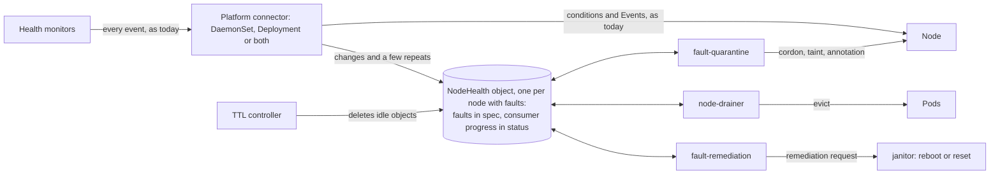
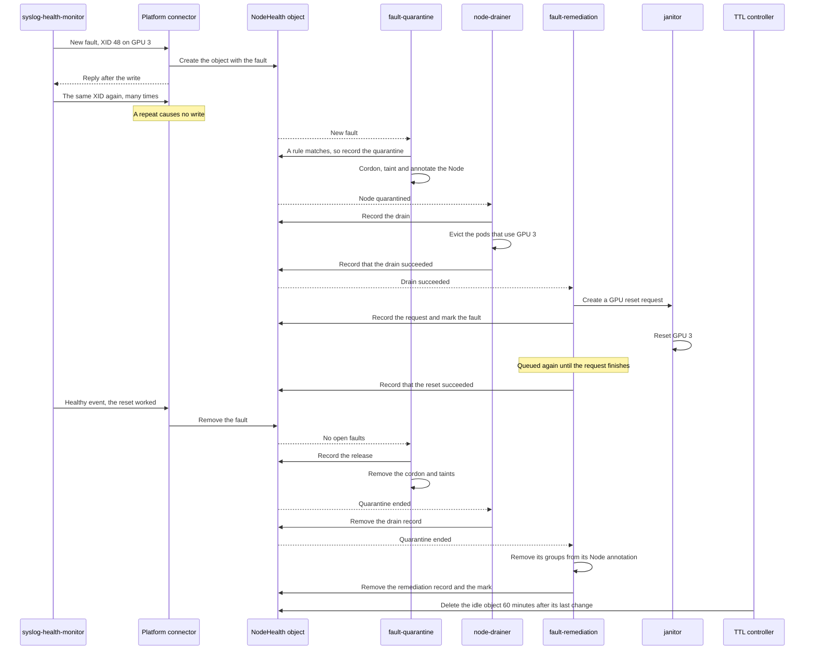

# ADR-067: Kubernetes-Native Remediation Without a Database

## Summary

- **Remediation without a database.** In Kubernetes mode, which `global.datastore.provider: kubernetes` selects, the three consumers of health events, fault-quarantine, node-drainer and fault-remediation, work from one `NodeHealth` object per node with faults, instead of MongoDB or PostgreSQL. The default does not change. The mode is for small clusters and for environments with no storage or managed database. Large clusters keep a database.
- **Only open faults, written only when they change.** A NodeHealth object keeps the faults that are open now, not a history of events, and each consumer records its progress in its own section. Monitors keep sending every event, but the platform connector writes only changes, and a configurable write limit for each node bounds them. So a GPU that logs an XID (a GPU driver error) 600 times a second causes only a few writes.
- **A simple, generic connector.** The connector reads one NodeHealth object and its Node by name, and only for nodes that it gets events for. It never lists or watches NodeHealth objects or Nodes, so a connector on every node adds no list or watch load. It has no rules for particular monitors or events. Instead, monitors set optional metadata keys on the few events that need other handling.
- **One store-client provider.** All NodeHealth code is in a new `kubernetes` provider of store-client, which each module uses as a library, in its own process. In the connector, it writes the faults. In each consumer, it builds today's events from the open faults, so the consumers keep their decision code. The connector keeps nothing in memory that it needs after a restart, so the DaemonSet connector and the deployment platform connector of [ADR-052](052-deployment-platform-connector.md) run the same code.
- **A node is released only on evidence.** Before fault-quarantine removes a node's cordon and taints, a newer write must show that the fault cleared. Missing data never releases a node.
- **What we give up.** Rules can no longer match a few rarely used event details, such as the event message ([list](#changes-for-rules)). The health-events-analyzer, the event exporter and csp-health-monitor are not supported in this mode. Kubernetes mode supports up to about 2,500 nodes, with a 16 GB etcd and the circuit breaker's standing limit at 10% of GPU nodes ([details](#scale-and-etcd-usage)).

## Context

[Issue #1950](https://github.com/NVIDIA/NVSentinel/issues/1950) names three problems:

1. **Integration cost.** Many new clouds have no managed database, so operators export health events and build their own remediation.
2. **Deployment friction.** A plain Helm install cannot remediate, because the user must also run a second stateful system.
3. **Lost events.** The consumers act on each event once, so a lost event is a fault that is never remediated. For example, fault-remediation could lose events after a requeue and a restart, until a cold start fix ([#798](https://github.com/NVIDIA/NVSentinel/issues/798)).

## Decision

We add **Kubernetes** as a third datastore option, next to MongoDB and PostgreSQL. It is for small clusters, where running a database costs more than it gives, and for environments with no storage or managed database service. We do not recommend it for large clusters at this time. ADR-027, which stores one object for each health event, is proposed to be superseded by this ADR ([why](#one-object-per-health-event-adr-027)). Kubernetes mode is selected with `global.datastore.provider: kubernetes`, and the default does not change. In this mode:

1. Each node that has faults gets one cluster-scoped `NodeHealth` object.
2. Monitors keep sending every event, as today. The platform connector, in either role (a DaemonSet on each node, or the Deployment of [ADR-052](052-deployment-platform-connector.md)), compares each event with the node's open faults, and it writes new faults, changed faults and clears before it replies to the monitor. A clear is a healthy event that removes a fault. A repeat of an open fault causes no write, except in four cases: the first repeat after a remediation attempt on the fault's device or on the whole node has finished, the first repeat after the node's quarantine ends, the first repeat after fault-quarantine skipped the fault, and a repeat on which its monitor sets `forcePublish` ([details](#how-the-connector-writes-events)).
3. The three consumers, fault-quarantine, node-drainer and fault-remediation, read the NodeHealth objects instead of the database. The provider builds today's events from the open faults, so their decision code does not change. Before every cordon, eviction, reboot or reset, they read the current state again. A node is released only when a newer write shows that its faults cleared.
4. No database runs, so three components that use the database for more than remediation are not supported, and the chart refuses to install them in this mode. The health-events-analyzer finds patterns over time, and 21 of its 22 default rules read past events, also in the datastore-neutral form of [ADR-066](066-health-events-analyzer-datastore-neutral-rules.md). The event exporter sends every stored event to an HTTP endpoint ([ADR-012](012-health-events-exporter.md)). The csp-health-monitor keeps each planned maintenance event and its status in the database ([ADR-008](008-cloud-provider-integration.md)). A NodeHealth object keeps no history, so installs that need the analyzer stay in database mode. Support for the event exporter and csp-health-monitor is future scope.
5. All code that reads or writes NodeHealth objects is in the `kubernetes` provider of store-client, next to the MongoDB and PostgreSQL providers. Each module uses it as a library, in its own process, so no new component stands between the modules and the API server ([why not a proxy](#a-store-proxy-deployment)). In the platform connector, the provider writes the faults. In each consumer, it watches the objects, builds today's events and writes the consumer's section of `status`. The provider does not implement the store-client methods that read health events, because they assume one stored document per event, so the consumers call the provider's own methods to read. It implements the same status methods as the database providers.



## Implementation

### The NodeHealth object

A NodeHealth object is named after its Node and owned by it, so there is at most one per Node, and deleting the Node deletes it. The connector creates the object when it writes the first fault of a node. The consumers and the TTL controller never create one. The TTL controller deletes an object that has been idle for a while ([Deleting idle objects](#deleting-idle-objects)).

If a Node is deleted and a new Node with the same name appears before Kubernetes removes the old object, the old object still names the UID of the old Node. The connector and the consumers compare that UID with the UID of the Node. The consumers treat such an object as missing. Until the garbage collector deletes the old object, a few seconds later, the connector rejects events for the node as unavailable (gRPC `UNAVAILABLE`), and the monitor sends them again. The next event then creates a new object.

Each object has two parts:

- **Open faults in `spec`, written by the connector.** `spec.checks` has one entry for each monitor check that has open faults. The faults come from monitors on the node and from cross-node monitors, which send events about other nodes, such as lifecycle-manager ([ADR-051](051-maintenance-request.md)) or kubernetes-object-monitor. The connector tells the two kinds apart with node binding ([Rules for every write](#rules-for-every-write)).
- **Consumer sections in `status`.** Each of the three consumers writes only its own section, to record what it did. Role-based access control (RBAC) keeps the connector out of `status` and the consumers out of `spec`.

**Faults and devices.** A fault is one error code that one check reports for one device. An event with no error code is one fault too, and an event with several error codes gives one fault for each code. Database mode tracks faults in a similar way: fault-quarantine keeps one entry in its Node annotation for each error code and single entity. Inside a check entry, the object groups the faults by device, so it stores the entities of each device only once. A device entry holds the faults of one check that name exactly the same identifying entities. For example, XID 48 and XID 64 on GPU 3 are two faults in one device entry of the XID check. XID 48 on GPU 5 is in a second device entry, because it names another GPU, and XID 74 on GPU 3 is in a third one, because it also names an NVLink. An error that gpu-health-monitor reports for GPU 3 is in the check entry of that monitor. So one GPU can have several device entries, in one check or in several, and a device in this document is one set of identifying entities, not always one piece of hardware.

Each fault keeps its own `isFatal`, action, override flags, attributes and time, because one device can have errors that need different actions. The consumers get one event for each fault, and repeats and clears match a fault by its check entry, entities and error code. So a clear for one error code removes only that fault, and a device entry goes when its last fault goes. A device entry with no entities covers the whole node, and only a healthy event with no entities clears its faults.

**Size and caps.** An object with one fault is about 1.6 KB. Each device entry has at most 8 entities. Monitors on the node and cross-node monitors each have their own share of the object:

| Share | Device entries | Faults |
|---|---|---|
| Monitors on the node | 128 | 256 |
| Cross-node monitors | 4 | 8 |

The share of monitors on the node holds a complete failure of any common GPU node, in which every GPU, NVSwitch and NIC port fails ([sizes](#scale-and-etcd-usage)). A new fault needs room in the share of its kind: one more fault, and one more device entry if its device is new. For example, a NIC port with two fatal counters over their limits is one device entry with 2 faults. The cross-node monitor nvcre-certification-monitor reports each failed test category as its own error code for the whole node, so 5 failed categories use 1 device entry and 5 faults of the cross-node share. Repeats, changes and clears add no fault, so a full share never rejects them.

- When the share of monitors on the node is full, the connector rejects their new faults as unavailable, and a metric counts them. Each shipped health monitor sends the fault again later, so it is late, not lost. A preflight check runs once, so its fault comes again only if the check runs again. If a fault already in the object holds the node, the node stays quarantined meanwhile.
- When the cross-node share is full, the connector rejects a new cross-node fault for good, with the gRPC code `InvalidArgument`, and a metric counts it. The publish client of the monitors does not retry this code, so one full node does not stop a monitor's events about other nodes. Only lifecycle-manager sends such a fault again later, from its own reconcile. For kubernetes-object-monitor, nvcre-certification-monitor and slurm-drain-monitor, the fault is lost. With their default policies, the shipped cross-node monitors normally fit in the share. A node fills it only when it fails more than 5 NVCRE test categories while the other cross-node monitors also hold a fault on it, or through extra policies or another cross-node monitor.

**Marks.** A consumer marks each fault that it handled, as it marks each event in database mode today. A mark is the 12-character hash in the fault's event ID ([`id`](#how-the-consumers-get-todays-events)), so all the marks of a full object take about 4 KB. The hash changes with `reportedAt`, so a fault that the connector writes again has no mark, and the consumer handles it again, as it handles a new event today. In its next write, a consumer also removes the marks of faults that are gone. Node-drainer needs no marks, because its records and the `drainOverrides` flags of the faults say what it did. The drain and remediation records are in the next table.

**Fields.** The object stores nothing that can be derived from other data: no summary of the faults, no history of remediations and no count of repeats. These fields need explanation:

| Field | Meaning |
|---|---|
| `checks` | One entry for each monitor check that has open faults. `agent`, `check`, `componentClass` and `version` are stored once for all faults of the check. All four are part of what makes two faults the same, so none can be dropped. `crossNode` is `true` on the check entry of a cross-node monitor, so that its faults count against the cross-node share |
| `entities` | The identifying entities of the device, each as one `TYPE=value` string, such as `PCI=0002:00:03`. The connector rejects an event with an entity type that is empty or contains `=`, with `InvalidArgument`, so a value may contain `=`. It drops the entity types that the event lists in `detailEntities` ([Keys that monitors set](#keys-that-monitors-set)). It keeps the others in the event's order, and if more than 8 are left, it keeps the first 8 and drops the rest |
| `faults` | One entry for each open error code of the device, or one entry without `errorCode` when the event has no error code. Each fault has its own `isFatal`, `recommendedAction`, override flags, `attributes` and `reportedAt`. `isFatal` stays `true` while the fault is open |
| `attributes` | The metadata keys that the event asks the connector to keep. The connector drops all other metadata |
| `reportedAt` | When the connector first wrote the fault, or last changed it or wrote it again ([when](#how-the-connector-writes-events)). It becomes the time and part of the ID of the event that the consumers get. So a fault that changes, or that survives a remediation, reaches the consumers as a newer event |
| `writes` | The node's [write limit](#the-write-limit): `left` is how many writes the connector may still make, and `refilledAt` is when writes last came back |
| `faultQuarantine.state` | `Quarantined`, `Released` or `Cancelled`, or `WouldQuarantine` when fault-quarantine runs in dry run |
| `faultQuarantine.startedAt` and `endedAt` | When the current quarantine started, and when the last one ended, by a release, by an uncordon or untaint from someone else, or when dry run is turned off. Records that started before `endedAt` no longer count, and faults reported before it count again only when the connector writes them again |
| `faultQuarantine.skipped` | Skip marks for the faults that no rule matched. Fault-quarantine does not evaluate a marked fault again. A change of the rules or of a Node label reaches the fault at its next event, which the connector writes while the node is not quarantined. In database mode, it marks such an event completed |
| `nodeDrainer.drains` | One record for each drain scope, which is one entity as `TYPE=value`, or `Node` for the whole node. A record has a state, `Running`, `Succeeded` or `Failed`, the times when it started and finished and, for a custom drain, the name of the custom drain in `request`. An attempt has finished when it is no longer `Running` |
| `faultRemediation.remediations` | One record for each remediation target, in the same form as a drain record, but with `target` instead of `scope` and with the name of its remediation request. Fault-remediation's equivalence groups, which group the actions that need the same remediation, and its attempt count stay in its Node annotation, as today |
| `faultRemediation.remediated` and `notRemediated` | Marks for the faults that fault-remediation handled, as it sets `faultRemediated` to `true` or `false` on each event today |
| `handledEndedAt` | In the sections of node-drainer and fault-remediation: the `endedAt` that the consumer has already handled ([how](#how-the-consumers-get-todays-events)) |

**Example.** Node `gpu-node-17` has six open faults in five device entries. The example assumes that partial drains and GPU resets are turned on, which are both off by default. The faults are numbered in the order of the object, not in the order in which they arrived. The previous quarantine ended at 11:52, and a new one started at 12:39:

1. GPU 3 logged XID 48 and then XID 64, two memory errors that call for a GPU reset. These are faults 1 and 2, in one device entry. Fault-quarantine quarantined the node, node-drainer evicted the pods that use GPU 3, and fault-remediation started one GPU reset for both faults.
2. Then gpu-health-monitor reported a PCIe error on GPU 3 that needs a person. That is fault 5, in a second device entry for GPU 3, in the check entry of that monitor. Only a GPU reset allows a partial drain, so node-drainer drained the whole node for it. Fault-remediation has no remediation for it, so it marked it `notRemediated`.
3. Then Slurm's own health check drained the node in Slurm, and the cross-node monitor slurm-drain-monitor reported that. That is fault 6, and its event has no error code. No shipped rule matches it, so fault-quarantine marked it `skipped`.
4. In the last few seconds, GPU 5 logged XID 48 too, which is fault 3, and GPU 6 fell off the bus, which is fault 4 in another check of syslog-health-monitor. Fault-quarantine has not handled them yet.

The provider builds six events, one for each fault, but it does not give fault-quarantine fault 6, or fault-remediation faults 1 and 5, because they marked them. The example leaves out fields that exist only when an event sets them, such as override flags and attributes.

```yaml
apiVersion: healthevents.dgxc.nvidia.com/v1alpha1
kind: NodeHealth
metadata:
  name: gpu-node-17
  uid: 0d4b6c3e-2a91-4f7e-b8d5-6c1f0e9a2b47     # starts the event ID of every fault
  ownerReferences: [{apiVersion: v1, kind: Node, name: gpu-node-17, uid: 78ff5c0a-e565-4211-8378-6ddb47ee2a6b}]
spec:
  writes: {left: 11, refilledAt: "2026-09-16T12:43:26.104512Z"}   # 16 by default, 6 used by the faults, 1 back after 4 minutes
  checks:
  - agent: syslog-health-monitor              # check entry 1: the XID check
    check: SysLogsXIDError
    componentClass: GPU
    version: 1
    devices:                                  # one device entry for each device with open faults
    - entities: ["PCI=0002:00:03", "GPU_UUID=GPU-67fec4a7-a3e1-385c-0c98-4361b4a372ca"]   # GPU 3
      faults:                                 # one fault for each error code, each with the latest action
      - {errorCode: "48", isFatal: true, recommendedAction: COMPONENT_RESET, reportedAt: "2026-09-16T12:39:26.104512Z"}   # fault 1
      - {errorCode: "64", isFatal: true, recommendedAction: COMPONENT_RESET, reportedAt: "2026-09-16T12:39:26.104513Z"}   # fault 2
    - entities: ["PCI=0002:00:05", "GPU_UUID=GPU-1b9d4e20-77c3-4f0a-9e65-2c8a0d5b13f7"]   # GPU 5
      faults: [{errorCode: "48", isFatal: true, recommendedAction: COMPONENT_RESET, reportedAt: "2026-09-16T12:43:58.511870Z"}]   # fault 3
  - agent: syslog-health-monitor              # check entry 2: the same monitor, another check
    check: SysLogsGPUFallenOff
    componentClass: GPU
    version: 1
    devices:
    - entities: ["PCI=0002:00:06"]            # GPU 6
      faults: [{errorCode: GPU_FALLEN_OFF_BUS, isFatal: true, recommendedAction: RESTART_BM, reportedAt: "2026-09-16T12:43:59.002914Z"}]   # fault 4
  - agent: gpu-health-monitor                 # check entry 3: another monitor, so GPU 3 has a second device entry
    check: GpuPcieWatch
    componentClass: GPU
    version: 1
    devices:
    - entities: ["GPU=3", "PCI=0002:00:03", "GPU_UUID=GPU-67fec4a7-a3e1-385c-0c98-4361b4a372ca"]
      faults: [{errorCode: DCGM_FR_PCI_REPLAY_RATE, isFatal: true, recommendedAction: CONTACT_SUPPORT, reportedAt: "2026-09-16T12:41:30.552108Z"}]   # fault 5
  - agent: slurm-drain-monitor                # check entry 4: a cross-node monitor
    check: SlurmHealthCheck
    componentClass: NODE
    version: 1
    crossNode: true                           # counts against the cross-node share
    devices:
    - entities: ["v1/Pod=slurm/slurmd-gpu-node-17"]
      faults: [{isFatal: false, recommendedAction: CONTACT_SUPPORT, reportedAt: "2026-09-16T12:42:50.317044Z"}]   # fault 6: no error code
status:
  faultQuarantine:
    state: Quarantined
    startedAt: "2026-09-16T12:39:40.120931Z"
    endedAt: "2026-09-16T11:52:10.004211Z"   # the previous quarantine: older records and faults no longer count
    skipped: [5d08f3b2c9e1]                   # fault 6: no rule matches it
  nodeDrainer:
    handledEndedAt: "2026-09-16T11:52:10.004211Z"   # node-drainer has handled the end of the previous quarantine
    drains:                                   # one record for each drain scope
    - {scope: GPU_UUID=GPU-67fec4a7-a3e1-385c-0c98-4361b4a372ca, state: Succeeded, startedAt: "2026-09-16T12:40:01.220931Z", finishedAt: "2026-09-16T12:40:44.871203Z"}   # faults 1 and 2
    - {scope: Node, state: Succeeded, startedAt: "2026-09-16T12:41:52.904417Z", finishedAt: "2026-09-16T12:42:36.118502Z"}   # fault 5
  faultRemediation:
    handledEndedAt: "2026-09-16T11:52:10.004211Z"
    remediations:                             # one record for each target
    - {target: GPU_UUID=GPU-67fec4a7-a3e1-385c-0c98-4361b4a372ca, state: Running, startedAt: "2026-09-16T12:41:10.031877Z", request: maintenance-gpu-node-17-0d4b6c3e-2a91-4f7e-b8d5-6c1f0e9a2b47-3f9c1d4e7a20}   # one GPU reset for faults 1 and 2
    remediated: [3f9c1d4e7a20]                # fault 1, which the reset was created for. Fault 2 gets its mark when the reset finishes
    notRemediated: [a7c2e91f04b6]             # fault 5: no remediation for CONTACT_SUPPORT, so the node waits for a person
```

**Compatibility.** The NodeHealth type becomes a public interface that must stay backwards compatible. Its Go types live in an `api/v1alpha1` directory, so the repository's backwards compatibility review, which covers every `api/v1alpha1` directory, includes them, and the CRD schema is generated from them. The stored times use `metav1.MicroTime`, as Lease does, because `metav1.Time` keeps only seconds. `helm upgrade` does not update CRDs, so each component checks at start that the installed NodeHealth CRD has every field that it writes. A writer keeps the fields that it does not know, so during a rolling upgrade an older connector does not drop fields that a newer one added. The fault fields come from today's `HealthEvent` proto, and a unit test lists every proto field as stored, rebuilt or dropped, so a new proto field fails the test until someone decides where it goes. The consumer sections hold the same information as today's `HealthEventStatus` of each event. The `kubernetes` provider implements the same status methods as the database providers, and the consumers call these methods, so a new status field must be added to every provider.

### Rules for every write

- **Monitors on the node.** Some rules treat monitors on the node differently from cross-node monitors. The connector counts a caller as a monitor on the node only when node binding ([authentication](../configuration/authentication.md)) ties the caller to that node and every event of its batch names that node. Node binding ties a caller that sends no token on the local socket of a DaemonSet connector pod to the node of that pod. A caller on the cross-node allowlist, such as kubernetes-object-monitor, never counts as on the node, even when its pod runs there. A caller that node binding could not verify does not count as on the node either. Today such a caller looks like one that sent no token, so node binding must flag it as not verified. In Kubernetes mode, the DaemonSet connector refuses to start while `global.platformConnectorAuth.enabled` is `false`. Audit mode, which logs failed checks instead of rejecting the caller, is enough for it. The deployment platform connector always enforces node binding.
- **Conditional writes.** Every write, and the delete of an idle object, fails if the object changed after the writer read it. Kubernetes does this with `metadata.resourceVersion`, so no writer overwrites or deletes a change that it has not seen. Each writer patches only its own section, so a writer from an older release never changes another writer's section. After a failed write, the connector reads the object again and handles the event once more. If it still cannot write, it rejects the event as unavailable. It stops handling a batch when the caller's request ends, so a slow replica cannot apply an old event after the monitor sent it again. A consumer whose write fails is queued again with a backoff.
- **Batches.** For each batch, the connector first writes every event that it can. Then it replies `UNAVAILABLE` if a rejected event can succeed later, `InvalidArgument` if every rejected event is rejected for good, and success otherwise.
- **Ordered times.** Every new fault, drain, remediation and quarantine time that a writer stores is later than every such time already in the object, with microsecond precision. A writer uses its own clock, or one microsecond after the latest stored time when its clock is behind. So these times are in the order of the writes, whatever the clocks of the hosts say, and the rules below can compare them, also when different writers stored them milliseconds apart. Database mode does not need this, because fault-quarantine handles every event in the order of the change stream. `handledEndedAt` copies `endedAt`, and `writes.refilledAt` moves on in steps of the refill interval, so neither is part of this order. Durations, such as drain timeouts and the refill interval, still use each writer's own clock, so they assume that host clocks differ by far less than these durations.

### How the connector writes events

The connector keeps a copy of the object of each node that it gets events for, only to save reads. When an event arrives and it holds no copy, it reads the object by name. With each read of an object, and before it creates one, it also reads the Node by name, for the UID that it puts in the owner reference of a new object and compares with the owner reference of an existing one. If the Node does not exist, it accepts the event and writes nothing. Its own writes keep the copy current. Earlier events for the node may have gone through another connector replica, so it reads the object again at the first event for that node on each new monitor connection. All events of one connection must then reach the same replica, as they do with a Kubernetes Service and the default gRPC client. It also reads the object again when a repeat finds the copy more than a minute old, so it sees the consumers' records without one read per event. It drops a copy when no event for that node arrived for a configurable time, `global.datastore.kubernetes.copyIdleTime`, 10 minutes by default. So a DaemonSet connector pod that carries no cross-node events holds at most the copy of its own node.

The connector reads the object and the Node from the API server, not from an informer cache, because such a cache can miss a clear that another connector replica wrote. The connector never lists or watches NodeHealth objects or Nodes. If a read fails, the connector rejects the event as unavailable. Every write is conditional, so a write from a stale copy fails, and the connector reads the object again.

For each event, the connector looks for the same fault in its copy: the same check entry, error code and identifying entities. Fault-quarantine's annotation keeps one key for each error code and single entity instead. So for clears, the connector uses fault-quarantine's matching code, which moves into the provider, and a fault clears only when every one of its entities would clear. The connector and fault-quarantine then agree on when a fault has cleared. This code has one special rule for GPUs: a healthy GPU event also clears the faults of an earlier GPU in the same slot, which was replaced. The connector does not use this rule. Instead, gpu-health-monitor sets the `detailEntities` key on its healthy events, which has the same effect ([Keys that monitors set](#keys-that-monitors-set)). The definition does not depend on fault-quarantine's rules, which stay separate and configurable, so a fault that no rule matches stays in the object until it clears. Then:

- **A new or changed fault** is written with a new `reportedAt` before the connector replies to the monitor. A new fault needs room in the share of its kind, and a changed fault does not. A fault changes when it becomes fatal, or when its action, override flags or attributes change. A fatal fault stays fatal while it is open.
- **A clear** removes the fault ([Clearing faults](#clearing-faults)).
- **A repeat of an open fault** causes no write, except in four cases, which the connector writes with a new `reportedAt`:
  - **After a remediation attempt.** The first event of the fault after fault-remediation's newest attempt on the fault's device or on the whole node finished, so a reboot counts for a GPU fault. Only events from monitors on the node count, because a cross-node monitor can send a maintenance fault again after the reboot, and that does not mean the reboot failed. So fault-remediation retries or escalates for faults from monitors on the node, as today, and never reboots twice for one maintenance. It does not retry a fault from a cross-node monitor, which keeps the node quarantined until it clears.
  - **After a quarantine ends.** The first event of the fault after fault-quarantine recorded `endedAt`. So when someone else uncordons or untaints the node, fault-quarantine quarantines the node again, as today.
  - **After fault-quarantine skipped it.** While the node is not quarantined, the first event of a fault that fault-quarantine marked as skipped. So fault-quarantine evaluates the new event with the current rules and Node labels, as it evaluates each new event in database mode. For example, after an operator removes the label `k8saas.nvidia.com/ManagedByNVSentinel=false`, which the shipped rules of fault-quarantine skip, an old fault does not quarantine the node, but its next event does.
  - **When its monitor asks.** An event with the metadata key `forcePublish: "true"`. A monitor sets this key when it sends a fault again on purpose, and the monitor decides when. For example, gpu-health-monitor sends each fault only once, so it sets the key on the first event of each fault after it starts. The monitor restarts with a reboot, so its first events after a reboot have the key too. As in database mode, where every event is stored, a forced event after the start of an attempt counts as a newer event of the fault.

The connector writes a repeat after a remediation attempt only if the fault's `reportedAt` is earlier than the start of the newest such attempt. It writes a repeat after a quarantine ends only if `reportedAt` is earlier than fault-quarantine's `endedAt`, whatever fault-quarantine's state is now. Stored times are ordered, so the new `reportedAt` is later than both times, and each of these repeats is written once. It writes a repeat after a skip only while a skip mark names the fault. The new `reportedAt` changes the hash, so the old skip mark no longer names the fault, and each skip lets one event through. Each forced event uses a write.

For example, a GPU that floods XID 137 and 145 at 120 to 600 events per second costs its node at most 2 writes when the flood starts, and none after that until a remediation attempt or the end of a quarantine. Those 2 writes keep about 3.5 KB of etcd history when the node had no other faults (estimate). If no rule matches the two faults, for example on a node with the opt-out label, each skip lets one more event through. The flood then uses half of the node's write limit, and fault-quarantine writes a skip mark after each of those writes.

**Which events the writer uses.**

- The writer handles each event after the connector's stages that add Node metadata and apply override rules, and before the optional deduplication stage of [ADR-039](039-health-event-deduplication.md), which is off by default. Today the database writer gets the batch only after every stage. The deduplication stage never drops an event. It only changes a repeated event to `STORE_AND_ANALYSE`, so that fault-quarantine and the Node conditions ignore it. The NodeHealth writer reads each event before that change, so a stale duplicate decision cannot hide a fault that came back, for example when a replica of the deployment platform connector missed the clear.
- Like fault-quarantine today, the writer uses only `EXECUTE_REMEDIATION` events, healthy or unhealthy. `STORE_ONLY` and `STORE_AND_ANALYSE` mean that an event must not change the cluster, so such an event never opens or clears a fault or uses the write limit. [ADR-025](025-processing-strategy-for-health-checks.md) stores these events in database mode. Kubernetes mode keeps no record of them, so an install that needs them can forward them with the gRPC sink connector of [ADR-033](033-grpc-sink-connector.md).
- The writer skips unhealthy events that are not fatal from monitors on the node, unless `global.datastore.kubernetes.recordNonFatal` is `true` or the event sets `quarantineOverrides.force`. No shipped ruleset quarantines on such an event, but a forced event quarantines the node without a ruleset. The writer keeps events that are not fatal from cross-node monitors, because a MaintenanceRequest ([ADR-051](051-maintenance-request.md)) is usually not fatal, and the shipped ruleset for it does not check `isFatal`.

### Keys that monitors set

The connector has no rules for particular monitors, checks, entity types or error codes. A monitor that needs one of its events handled in another way marks the event with an optional metadata key. The keys are metadata, so the `HealthEvent` schema does not change. The connector does not store them in the object, and in database mode they are stored with the other metadata and change nothing. A key that lists items separates them with commas.

| Key | What the connector does | Where it is set |
|---|---|---|
| `forcePublish: "true"` | Writes this repeat of an open fault | The first event of each fault after gpu-health-monitor starts |
| `detailEntities` | Removes the listed entity types from the event before it compares the event with the open faults and before it stores a fault. A healthy event also clears faults whose entities of these types differ ([Clearing faults](#clearing-faults)) | The SXID events of syslog-health-monitor, with `NVLINK`. Its XID 74 events, with `REG0` to `REG6`, and its XID 13 events, with `GPC`, `TPC` and `SM`. The healthy events of gpu-health-monitor, with `GPU_UUID` |
| `keepMetadata` | Stores the listed metadata keys in the fault's `attributes` | The events of lifecycle-manager, with `maintenanceRequestName`, which the shipped ruleset for maintenance requests reads. A tool that forces a quarantine lists `creator_id`, which the `cordon-by` Node label reads |

These keys keep today's behaviour. An SXID event names one NVLink of an NVSwitch, but the SXID check clears only as a whole, after a reboot, so the links of one NVSwitch and GPU need no faults of their own. Without the key, the SXIDs of a complete failure of an HGX A100 node would need 96 device entries. XID 74 keeps its NVLink as an identifying entity, so the healthy event of a GPU reset, which names no link, does not clear it, as today. The healthy events of gpu-health-monitor name the GPU's current UUID. With the key, they also clear the faults of a GPU that was replaced in the same slot, as fault-quarantine's matching code does today.

Monitors keep sending the entities that they list in `detailEntities`, because database mode stores them, and the health-events-analyzer reads some of them, such as XID 13's `GPC` and `TPC` and XID 74's register values. A monitor that sets none of these keys, such as a custom monitor, gets safe defaults: every entity identifies its fault, and no metadata is stored. A missing key never clears a fault early.

### The write limit

Each node has a write limit: 16 writes by default, and one write comes back every 4 minutes by default. `global.datastore.kubernetes.writeLimit` and `global.datastore.kubernetes.writeRefillInterval` set these two numbers. The limit counts writes, not bytes, because the caps already bound the size of each write. The object keeps the state of the limit in `writes`, so every connector replica sees the same count, also after a restart:

- `left` is how many writes the connector may still make for the node. Each event that the connector writes uses one, also when one batch has several such events. The consumers' writes to `status` do not count.
- `refilledAt` is when writes last came back. Before it decides whether it can write an event, the connector adds one write for each full refill interval since `refilledAt`, up to the limit, and moves `refilledAt` on by the same number of intervals. When all writes are back, it sets `refilledAt` to now.

A clear from a monitor on the node, and a repeat after a skip, cannot use the last half of the writes, 8 by default. So a fault that no rule matches cannot take the writes that new and changed faults need. These writes stay for new and changed faults and for the other repeats that the consumers need, which may use all of them. A monitor sends one batch at a time, so a new fault that it sends after its own rejected clear waits behind that clear. Cross-node monitors send few clears, and some send a clear only once, so their clears may use every write.

When an event cannot be written because its node has no write left for it, the connector rejects the event as unavailable at once, and the monitor sends it again later. A preflight check sends it again only if the check runs again. When many events wait, for example when every device of a node fails at once, one more of them is written every refill interval. The connector rejects the batch, but first it writes the other events of the batch for which it has writes. When the monitor sends the batch again, those events are repeats and need no write.

### Clearing faults

A healthy event removes the faults that it matches from the object immediately. It matches an open fault of its own check entry when it has the fault's error code or no error code, and when it has no entities or names every entity of the fault. Entities of the types that the event lists in `detailEntities` do not count, but at least one other entity must match. A fault with no entities matches only a healthy event with no entities. This is fault-quarantine's matching code, applied to each entity of the fault, without its rule for replaced GPUs. So a healthy event that names only some of the entities leaves the fault open, just as fault-quarantine keeps the node quarantined for it in database mode today. Two such healthy events that together name all the entities also leave it open, while database mode releases the node after both. The node then stays quarantined until one healthy event clears the fault.

In the example, a healthy event for XID 48 on GPU 5 removes only fault 3, and with it the device entry of GPU 5. After a successful GPU reset, syslog-health-monitor sends a healthy event for GPU 3 with no error code. It removes faults 1 and 2, but not fault 5, which belongs to the check of gpu-health-monitor. After a reboot, syslog-health-monitor sends one healthy event with no entities for each check, which clears every fault of that check. The one for the XID check removes faults 1 to 3, and only the one for the GPU-fallen-off check removes fault 4.

For each fault that fault-quarantine tracks in its Node annotation and that a newer version of the same object no longer has, the provider gives fault-quarantine one healthy event with the fault's check, error code and entities. So fault-quarantine handles it as today, and it releases the node when the last fault of the quarantine clears, which [ADR-062](062-fault-quarantine-release-at-session-end.md) calls the session end. The provider never gives a healthy event that would also clear a fault that is still open. For example, a cleared fault with no entities and no error code would give a healthy event for the whole check, so the provider does not give it while another fault of that check is open. After a restart, it does the same for each fault in the annotation that the object no longer has, but only if the object still has the UID that starts the fault's event ID. A missing or re-created object releases nothing.

As in database mode, a clear needs no delay, and a device that keeps failing and recovering releases and quarantines its node again on each cycle. The [write limit](#the-write-limit) bounds these cycles. Handling such devices is out of scope for this ADR.

The connector applies each monitor's events in the order they arrive, not by their timestamps. After a reboot, syslog-health-monitor first sends a clear for each check and then reads the new boot's log from the start. So an XID that the GPU logged before the clear arrives after it, and it opens the fault again.

A full share never rejects a clear, but it can delay one. For example, syslog-health-monitor reads each check's log in order and does not skip a line that it could not deliver. So if a new fault is rejected because the share of monitors on the node is full, a later line of the same check that reports a finished GPU reset waits behind it, and the node stays quarantined until it reboots or an operator acts. This needs a full share and GPU resets, which are off by default.

### How the consumers get today's events

The consumers keep the code that decides what to do with an event: fault-quarantine's rules, node-drainer's drain choices, and fault-remediation's actions and request templates. The provider builds today's `HealthEvent` from each open fault, and the consumers pass it to that code:

| `HealthEvent` field | Taken from |
|---|---|
| `nodeName` | The object's name |
| `agent`, `checkName`, `componentClass`, `version` | The fault's check entry |
| `errorCode`, `isFatal`, `recommendedAction`, `customRecommendedAction`, `quarantineOverrides`, `drainOverrides` | The fault. A fault without an error code gives an event without one |
| `message` | Empty, because the object keeps no message (see below) |
| `entitiesImpacted` | The entities of the fault's device entry, each split at its first `=` into a type and a value |
| `metadata` | The fault's attributes |
| `generatedTimestamp`, and the stored event's creation time | `reportedAt` |
| `isHealthy` | False for each open fault. For each fault that cleared, fault-quarantine also gets one healthy event ([how](#clearing-faults)) |
| `processingStrategy` | Always `EXECUTE_REMEDIATION`, because [other events never change the object](#how-the-connector-writes-events) |
| `id` | The object's UID, a dash, and a 12-character lowercase hexadecimal hash of the check, the error code, the type and value of each entity, and `reportedAt`. So it stays the same after a restart. It is valid in the names that node-drainer and the shipped remediation templates build from it. Fault-quarantine's annotation shows which object each fault came from. It changes when `reportedAt` changes. Fault-quarantine's Node annotation keeps the event that it first recorded and replaces it only when the recommended action changes, so the consumers match a fault in the annotation by its check entry, error code and entities |

**No event message.** The object keeps no event message, because repeats are not written, so a stored message would describe only the first event of a fault. So the events that the consumers get have an empty `message`. The `cordon-reason` Node label of a forced quarantine gets the check name instead. Templates that read `.HealthEvent.Message` get an empty string, so a custom drain or a remediation request made from one, such as an ExternalRemediationRequest ([ADR-040](040-external-remediation-request.md)), has no message. The `quarantineHealthEvent` Node annotation has no message either. Operators still see the messages in Node conditions and Events, as today.

**The provider in each consumer.** The consumer's decision code stays. The provider replaces the code around it, which reads the database today:

- It watches the NodeHealth objects with an informer, the shared cache of Kubernetes controllers, instead of a database change stream. Its cache keeps only the fields that the consumer uses. Instead of the change stream lag metrics of [ADR-054](054-changestream-lag-metrics.md), it reports the length of each consumer's queue and how long its oldest node has waited.
- It keeps a queue that holds each node at most once. When a node leaves the queue, the provider runs one pass for it: it builds one event for each fault of the current object, in the order of the object, and passes them to the consumer's decision code. The events of open faults come before any healthy event, so a new fault holds the node before a clear can release it.
- It queues the node again with a backoff when the consumer fails, and after a delay while a drain or remediation request that the consumer started still runs, as the consumers requeue today. An update that arrives during a pass also queues the node again.
- In each pass, the consumer acts only on work that its own section does not record yet, so a repeated pass changes nothing. The provider does not give fault-quarantine or fault-remediation a fault that their own marks name. For node-drainer, it reports a fault that has `drainOverrides.skip` as already drained, for that fault only, as node-drainer marks such an event today. The consumer's own writes to `status` do not queue the node again. The provider queues the node only for the changes that the consumer needs:

| Consumer | Queued when this changes |
|---|---|
| fault-quarantine | `spec`, or the Node's cordon, its taints or fault-quarantine's annotations on it, so that an uncordon or untaint by someone else starts a pass |
| node-drainer | `spec`, fault-quarantine's section, or fault-quarantine's annotation on the Node, because node-drainer drains the devices listed there |
| fault-remediation | `spec`, the sections of fault-quarantine and node-drainer, or fault-quarantine's annotation on the Node, because fault-remediation acts on the faults listed there |

**When a quarantine ends**, the provider gives node-drainer and fault-remediation one event that says that the quarantine ended, as today. It gives this event first in a pass, and the pass stops if the consumer cannot write the result. On this event, both stop the work that started before `endedAt`. First, node-drainer deletes the custom drains that its old records name, and fault-remediation removes the groups of its Node annotation that started before `endedAt`. Then, in one write, each removes its old records, fault-remediation also removes the marks of faults reported before `endedAt`, and each records that `endedAt` as its `handledEndedAt`. So a crash between the steps only repeats them. Work that started after `endedAt` belongs to the next quarantine and stays. The provider gives this event whenever fault-quarantine's `endedAt` is later than the consumer's `handledEndedAt`. So a consumer still gets the event after a restart, and also when a new quarantine has already started.

**Records.** Each consumer acts on the faults in `spec` and on live state: the Node, its pods and the remediation requests. It records what it did in its own section, and the next consumer reads that section to pick up the work, as the Deployment controller reads ReplicaSet status. As today, fault-quarantine lists the faults that hold the node in its `quarantineHealthEvent` Node annotation, which it writes with the cordon, and the other two consumers read them there. Node-drainer writes a drain record before it creates a custom drain, keeps the custom drain's name in the record, and checks, waits for and deletes a custom drain only by that name. Fault-remediation creates the remediation request first. Then, in one write, it records the request and marks the fault, as it creates the request and then marks the event today. Request names come from the event ID, so after a crash between the two steps, the next pass finds the request instead of creating a second one. A request that someone deleted is never created again for a fault that is marked, for example when an operator takes a node back from an external repair ([ADR-040](040-external-remediation-request.md)). After a restart, the consumers read the current objects instead of replaying events.

### Safety rules

- **Release only on evidence.** Before fault-quarantine releases a node, a newer write of the same object must no longer hold its faults. Before it records `Released` or `Cancelled` and `endedAt`, it handles every open fault in the version of the object that it read, and the write is conditional on that version. So a fault that arrives during a release or an uncordon is handled before `endedAt` can hide it. A missing, unsynced or re-created object releases nothing. A lost `status`, for example after a restore, releases nothing either, because the faults in `spec` still hold the node.
- **Re-check before acting.** Each consumer reads the object and the Node again from the API server, not from its cache, before it acts. A remediation starts only after a drain that covers its target succeeded: a drain of one GPU covers only a reset of that GPU, and a reboot needs a drain of the whole node. In database mode, fault-remediation also acts after a partial drain when its action reboots the node, for example when partial drains are on and `COMPONENT_RESET` maps to a reboot. In Kubernetes mode it waits for a drain of the whole node, so such a node stays quarantined until an operator acts. A remediation starts only for a fault that is still open, and never while janitor still runs another remediation request for the node. It is never retried on a timer. Fault-remediation handles each fault once until the connector writes the fault again, as it handles each event once today.
- **Circuit breaker.** The circuit breaker of [ADR-022](022-circuit-breaker-reset-mechanism.md) and its [settings](../configuration/fault-quarantine.md#circuit-breaker) decide how many nodes fault-quarantine quarantines, as today. Kubernetes mode adds no cluster-wide limits of its own. The breaker trips when too many nodes are cordoned within a time window, by default 50% of GPU nodes in 5 minutes. It also has two standing limits, which cap how many nodes are cordoned at one time, `fault-quarantine.circuitBreaker.maxCordonedNodes` and `fault-quarantine.circuitBreaker.maxCordonedPercentage`, and both are off by default. Clusters close to the limits in [Scale and etcd usage](#scale-and-etcd-usage) should set one, and the figure of about 2,500 nodes assumes `maxCordonedPercentage: 10`. A breaker reset cannot skip open faults: fault-quarantine evaluates every open fault that it has not marked as skipped, whichever cursor (`RESUME` or `CREATE`) the reset names.
- **Uncordons and untaints by someone else.** An operator or another controller can end a quarantine while a fault is open, by uncordoning the node or by removing a taint that fault-quarantine applied. Fault-quarantine then records `Cancelled` and `endedAt` before it removes its annotations from the Node. It finds the change in every pass by comparing the Node with its own annotations, so if the write fails, the next pass tries again. If the node has no NodeHealth object, it records nothing and goes on. As today, it leaves its taints and the labels of its rules on the Node after an uncordon. If it stops after it records a quarantine but before it cordons the node, the next pass does not take the missing cordon for an uncordon. The provider gives it only faults reported after `endedAt`, so it quarantines the node again only when the connector writes the fault again, also after a restart.
- **Records from an earlier quarantine.** A drain or remediation record counts only while fault-quarantine's state is `Quarantined`, or `WouldQuarantine` for a consumer in dry run, and only if the record started after `endedAt`. So after an uncordon, node-drainer drains again before fault-remediation acts, and pods that started on the node in between are evicted first.
- **Dry run.** In dry run, fault-quarantine records `WouldQuarantine`. Records that node-drainer and fault-remediation write in this state count only for consumers that are also in dry run, so both run their own dry run for the node, as in database mode. A consumer that is not in dry run treats `WouldQuarantine` as no quarantine, so it does nothing for the node until a real quarantine starts. When dry run is turned off, fault-quarantine records `Cancelled` and `endedAt` for each object in `WouldQuarantine`, as it cancels dry-run quarantines in database mode.
- **Release at session end ([ADR-062](062-fault-quarantine-release-at-session-end.md)).** When a fault opens, fault-quarantine applies the taints and the cordon that its rules require, also when the node is already quarantined. It removes them only when every fault of the quarantine has cleared.
- **Validation after remediation ([ADR-049](049-node-validation.md)).** A NodeHealth object drops a fault once it clears, so fault-quarantine keeps recording which faults need validation in its Node annotation, as today. When the last fault clears, it checks the drain in `status.nodeDrainer` and creates the `ValidationRequest` before it records the release, because node-drainer removes its records after the quarantine ends. After a restart, it finds the `ValidationRequest` and leaves the cordon and taints for lifecycle-manager, which removes them after validation passes, as today. If the test selection of [#2080](https://github.com/NVIDIA/NVSentinel/pull/2080) is accepted, fault-quarantine's annotation keeps the pending events themselves in this mode, not only their IDs, because a cleared fault is no longer in the object.
- **Safe restarts.** Every step is safe to repeat. Fault-quarantine and node-drainer record what they will do before they do it. Fault-remediation creates its request before it records it, as today, and a repeated step finds the request by its name. A crash test restarts each component after each write and checks the result.
- **A full etcd.** When etcd is full, no new cordon, drain or remediation request starts.

### Example: one GPU fault from detection to recovery

GPU 3 on node `gpu-node-17` logs XID 48, a memory error that calls for a GPU reset. Like the example above, this one assumes that partial drains and GPU resets are turned on.



### Deleting idle objects

Kubernetes has no built-in expiry for custom resources. So the TTL controller of [ADR-037](037-janitor-cr-ttl-cleanup.md) moves out of janitor into its own small Deployment with one replica, a layout that ADR-037 deferred until its TTL covers kinds outside janitor. It keeps deleting janitor's remediation requests as today, when their time to live runs out, whatever their state, with the same Helm values. It also deletes idle NodeHealth objects. It runs whenever janitor is installed or `global.datastore.provider` is `kubernetes`, so Kubernetes mode does not depend on janitor. It watches the NodeHealth objects with an informer, which lists them once when it starts, and it never lists them to find idle objects. For NodeHealth objects, it needs three options that janitor's remediation requests do not use:

- **A check before the delete.** It deletes an object only when no fault is open and no consumer holds the node: fault-quarantine's state is not `Quarantined`, no drain or remediation record is `Running`, and the Node has no quarantine annotation of fault-quarantine and no remediation annotation of fault-remediation.
- **Idle time instead of a fixed expiry.** It deletes an object only when the object has not changed for a configurable time, `global.datastore.kubernetes.objectIdleTime`, 60 minutes by default. It times this in memory and writes no annotation, because each write to a NodeHealth object costs etcd history and makes the connector's copy stale. With the default values, the node has at least 15 of its 16 writes back when the object is deleted, so a new object gives the node at most one extra write. A shorter idle time can give more, because each new object starts with a full write limit. A restart of the TTL controller only delays a delete.
- **A conditional delete.** Before it deletes, it reads the object and the Node by name and checks the conditions again. The delete is conditional on the object's version, so it fails if a connector wrote a new fault in between. A connector whose copy is older than the delete gets "not found" on its next write. It then drops its copy and handles the event as for a node that has no object.

### Changes in each component

| Component | Change for Kubernetes mode |
|---|---|
| Health monitors and lifecycle-manager | They keep sending every event in today's format. Of the shipped components, gpu-health-monitor, syslog-health-monitor and lifecycle-manager add the keys of [Keys that monitors set](#keys-that-monitors-set) to some events. A tool that forces a quarantine lists `creator_id` in `keepMetadata`. Other monitors need no change |
| store-client | Adds the `kubernetes` provider, with all code that reads or writes NodeHealth objects, such as the connector's writer, the consumers' informers, queues and event rebuild, and the idle check of the TTL controller |
| Platform connector, both roles | The provider's writer replaces the database writer. In both roles, the connector replies to the monitor only after the write. This changes [ADR-006](006-platform-connector-reliability.md) for the DaemonSet role: the NodeHealth writer has no ring buffer, so a monitor waits for each write, as it does with the deployment platform connector. Node binding flags a caller that it could not verify, and the DaemonSet connector refuses to start without authentication ([Rules for every write](#rules-for-every-write)). Node conditions and Events stay as today, because other tools read them |
| fault-quarantine | Gets today's events from the provider instead of the database, and a healthy event for each fault that cleared. Records each quarantine and its start, `endedAt` when it ends, and a skip mark for each fault that no rule matched |
| node-drainer | Drains for the devices in fault-quarantine's Node annotation, using the action of each matching fault, and records each drain. A provider helper tells it whether a scope is already drained for a fault that is still in fault-quarantine's annotation, as today, and it times each drain from its own record. Its work is keyed by node instead of the event priority queue of [ADR-041](041-node-drainer-priority-queue.md): a node whose drain still runs waits outside the queue, so new nodes do not wait behind it. A fault with `drainOverrides.skip` gets no drain record and counts as drained for that fault only. Every fault in the annotation goes through the decision code in each pass, also when its scope has a `Running` record, so `drainOverrides.force` works as today |
| fault-remediation | Starts a remediation only after a drain that covers its target succeeded. It decides as today, from the equivalence groups in its Node annotation and the live state of their requests. A request covers a fault only for the fault's own group or a group that outranks it, as restart outranks reset, and only when the fault's `reportedAt` is not later than the start of the request's record. A request that failed or was deleted covers nothing. So a reboot does not stand in for an external repair, a GPU reset does not stand in for a reboot, and a fault that waited behind a failed request gets its own attempt, as today. It records each request and marks each fault that it handled. While the node stays quarantined, it recomputes its remediation state label on the Node from these marks in each pass |
| janitor and its TTL controller | The TTL controller of [ADR-037](037-janitor-cr-ttl-cleanup.md) moves out of janitor into its own small Deployment and image, built with ko like the other Go images. It keeps deleting janitor's remediation requests when their time to live runs out, 14 days by default, whatever their state, and it also deletes idle NodeHealth objects ([how](#deleting-idle-objects)). Janitor still carries out the remediation requests |
| health-events-analyzer, event exporter and csp-health-monitor | Not supported in this mode ([why](#decision)) |
| Helm chart | Adds `kubernetes` as a value of `global.datastore.provider`, and these keys under `global.datastore.kubernetes`: `recordNonFatal` (default `false`), `copyIdleTime` (10 minutes), `writeLimit` (16), `writeRefillInterval` (4 minutes) and `objectIdleTime` (60 minutes). Many templates switch to the datastore ConfigMap as soon as `global.datastore` has any value, so the default `values.yaml` keeps `global.datastore` unset and shows these keys only in comments, and the templates apply the defaults only when the provider is `kubernetes`. The NodeHealth CRD, with the short name `nh`, goes in the existing `k8sdatastore-crds` chart in `charts/k8s-datastore`, which `global.k8sdatastoreCrds.enabled` installs, next to its HealthEventResource CRD of ADR-027. The TTL controller keeps reading janitor's `ttl` values. The chart adds the RBAC rules |
| Helm checks | The chart refuses Kubernetes mode while `global.k8sdatastoreCrds.enabled` or `global.platformConnectorAuth.enabled` is `false`, while `global.mongodbStore.enabled` or `postgresql.enabled` is `true`, or while the health-events-analyzer, the event exporter or csp-health-monitor is enabled. The two database flags install a database, and `global.mongodbStore.enabled` also turns on the connector's MongoDB writer |

### Changes for rules

The events that the provider builds have the same 18 fields as today ([How the consumers get today's events](#how-the-consumers-get-todays-events)), and all 8 shipped rulesets of fault-quarantine keep matching. The rulesets that [ADR-064](064-node-and-device-selection.md) proposes for node-drainer and fault-remediation read the same events. ADR-064 decides for each event, and a stop applies to one fault only. So if it is accepted, the sections of node-drainer and fault-remediation keep its decision for each fault, named by its check entry, error code and entities. For ADR-064, the quarantine session is the time after the last `endedAt`, or the whole life of the object if there is none. But rules can no longer select on:

- the event message, because the object keeps none,
- entities that the event lists in `detailEntities`, such as XID 74's register values,
- metadata that the event does not ask the connector to keep, which includes the provider ID and the Node labels that the connector adds,
- unhealthy events that are not fatal from monitors on the node, unless `global.datastore.kubernetes.recordNonFatal` is `true` or the event sets `quarantineOverrides.force`,
- more than 8 entities per fault,
- a new fault while the share of its kind is full: a fault from a monitor on the node waits until another fault clears, and a cross-node fault is lost, except one from lifecycle-manager, which sends it again,
- two error codes of one event together, because each code becomes its own fault. No shipped monitor or ruleset does this.

### Scale and etcd usage

Kubernetes mode is for small clusters. With the caps above, it supports up to about 2,500 nodes, when one 16 GB etcd also holds the Node objects and the circuit breaker's standing limit is set to 10% of GPU nodes (`fault-quarantine.circuitBreaker.maxCordonedPercentage: 10`). Larger clusters keep a database. The etcd cost grows with the number of nodes and with how often faults change, not with how many events the monitors see, so even 10 to 100 times today's peak event rate does not change it. The sizes and node counts in this section are estimates.

**A complete failure fits the caps.** The next table shows common GPU nodes on which every GPU, every path between an NVSwitch and a GPU, and every NIC port fails at once: 3 XIDs on each GPU, 2 SXIDs on each path, every GPU fallen off the bus, 2 errors in each of 3 gpu-health-monitor checks for each GPU, a lost DCGM connection, the port state and 3 error counters on each NIC port, and a device file error on each NIC. An HGX node has 10 NICs with 12 ports, and a GB200 tray has 5 NICs with 6 ports. This cannot all happen at once, so the rows are upper bounds. Fault-quarantine's Node annotation needs about 0.5 KB for each fault, as in database mode, and Kubernetes allows 256 KiB for all annotations of an object.

| Node with everything failed | Device entries | Faults | Object with all consumer records | Fault-quarantine's annotation |
|---|---|---|---|---|
| HGX A100: 8 GPUs, 6 NVSwitches, 12 NIC ports | 123 | 235 | 49 KB | 121 KB |
| HGX H100: 8 GPUs, 4 NVSwitches, 12 NIC ports | 107 | 203 | 43 KB | 104 KB |
| HGX B200: 8 GPUs, 2 NVLink switch chips, 12 NIC ports | 91 | 171 | 37 KB | 88 KB |
| GB200 NVL72 compute tray: 4 GPUs, 6 NIC ports | 38 | 70 | 19 KB | 36 KB |
| Any node at the caps, with 8 entities in each device entry and a full cross-node share | 132 | 264 | 74 KB | 136 KB |

**Worst case for etcd.** The worst case counts the live object and every old version that etcd keeps. With the default compaction interval of kube-apiserver, 5 minutes, etcd keeps each old version for up to 10 minutes, or 15 during an API server failover ([more](#a-counter-that-changes-on-every-repeat-the-issues-proposal)). It assumes that every object is at the caps, with values about as long as those of the shipped monitors, that every node uses its full write limit, that every cleared fault opens again, and that every consumer works at full speed. Each write of the connector can then cause one write of a consumer, such as a skip mark. With the breaker's defaults, which have no standing limit, every GPU node can be quarantined and carry the consumers' records. With the 10% standing limit, only one node in ten does at a time.

| Worst case for each node | Breaker defaults | 10% standing limit, average |
|---|---|---|
| Live object | 74 KB | 66 KB |
| Connector writes: 16 at once, then one for every 4 minutes of history | 1.4 to 1.5 MB | 1.2 to 1.3 MB |
| Consumer writes that the connector's writes cause, at most one for each | 1.4 to 1.5 MB | 1.2 to 1.3 MB |
| Consumer writes for one quarantine: 9 with one drain and one remediation (2 by fault-quarantine, 3 by node-drainer and 4 by fault-remediation, one of them for the marks of faults that its request covers), and 4 more for each further GPU that is drained and reset, so about 21 for 4 GPUs | 0.7 to 1.5 MB | 70 to 150 KB |
| Total | About 3.5 to 4.5 MB | About 2.6 to 2.8 MB |

Each row of the next table gives the largest cluster whose worst case fits in half of the etcd space that the Node objects leave, at about 55 KB for each Node ([#1705](https://github.com/NVIDIA/NVSentinel/issues/1705)). The other half is for the rest of the cluster, including the old versions of the Node objects. The ranges cover 10 and 15 minutes of etcd history and 9 to 21 consumer writes for each quarantine.

| etcd size | Largest cluster with the breaker's defaults | Largest cluster with a 10% standing limit |
|---|---|---|
| 2 GiB (self-managed) | About 240 to 310 nodes | About 380 to 410 nodes |
| 8 GB (EKS standard, AKS) | About 880 to 1,100 nodes | About 1,400 to 1,500 nodes |
| 16 GB (EKS Provisioned) | About 1,800 to 2,300 nodes | About 2,800 to 3,100 nodes |

For example, 2,500 Node objects take about 0.14 GB of a 16 GB etcd. Half of the rest, about 7.9 GB, is for the NodeHealth objects. Their worst case is about 6.4 to 7.1 GB with the 10% standing limit, but 8.6 to 11.3 GB with the breaker's defaults, which does not fit.

These sizes are JSON bytes, and KB, MB and GB mean powers of 1,000. Because etcd stores data in whole 4 KiB pages, it needs some more space, so the scale test measures the size of the etcd database. The 10% column assumes that the same nodes stay quarantined for the 10 to 15 minutes. With GPU resets, which take minutes, quarantines can end and start on other nodes within that time, and the largest cluster with a 10% standing limit then drops by about a tenth, to about 2,500 nodes for 16 GB. If a fault that holds a node keeps failing and recovering, the node can be quarantined up to 6 times in 10 or 15 minutes, because clears from monitors on the node cannot use the last half of the writes. This costs more than the worst case above only when faults that do not hold the node keep the object at the caps, for example faults that are not fatal and that `recordNonFatal: true` records. If every node did that, the 16 GB row would drop to about 1,300 nodes with the breaker's defaults and about 2,600 with the 10% standing limit. The breaker's default window, 50% of GPU nodes in 5 minutes, trips before every node can do that. The figure of about 2,500 nodes covers these cases too.

### Switching an existing install

A new install sets `global.datastore.provider` to `kubernetes`. Kubernetes mode has no data migration: an existing install that switches starts with no NodeHealth objects, and the new consumers do not take over work that started before the switch. So an existing install switches in three steps:

1. Wait until fault-quarantine has handled every open fault, no drain or remediation request still runs, and the circuit breaker is not tripped.
2. Apply the chart's CRDs, because `helm upgrade` does not install them. Then upgrade with `global.datastore.provider: kubernetes`, `global.k8sdatastoreCrds.enabled: true` and `global.platformConnectorAuth.enabled: true`, with `global.mongodbStore.enabled` and `postgresql.enabled` set to `false`, and with the unsupported components turned off.
3. Make sure that each node that is still quarantined is healthy, and then uncordon or untaint it, so that fault-quarantine removes its annotations as for a manual uncordon. Also remove fault-remediation's `latestFaultRemediationState` annotation from these nodes. A missing object never releases a node, so these nodes stay quarantined until then.

A fault from before the switch counts only when its monitor sends it again, also a fault that an old connector pod wrote to the database during the upgrade. A switch back to a database needs an empty database, because the consumers would act on events left from before the switch.

## Rationale

- **Each node's open faults are stored, not every event.** The number of NodeHealth objects grows with the number of nodes that have faults, and the number of writes grows with how often faults change. This avoids the failures in [Lessons from other projects](#appendix-lessons-from-other-projects).
- **Only bounded objects go to etcd.** [ADR-002](002-storage-layer-selection.md) rejected etcd as the store for health events, because events can be large and because analysis needs aggregation queries. This design answers both reasons. A NodeHealth object keeps no message and no detail entities, and it holds at most 264 faults on 132 device entries of at most 8 entities each. That is about 74 KB with every consumer record (estimate), far below the 1.5 MiB that etcd accepts in one request. Kubernetes mode runs no aggregation, because it does not support the health-events-analyzer. Database mode keeps the store that ADR-002 chose.
- **Faults go in `spec`, and consumer progress goes in `status`.** Creating an object with its faults in `spec` takes one write, and `status` would need a second. Consumer writes to `status` do not change `metadata.generation`, so a consumer can tell a fault change from another consumer's write. RBAC can then separate the connector from the consumers. [KEP-2527](https://github.com/kubernetes/enhancements/tree/master/keps/sig-architecture/2527-clarify-status-observations-vs-rbac) calls access control an emergent use of the split and accepts it, and it drops the rule that `status` must be rebuildable from observation, so the consumers can keep their records there. A restore that drops `status`, as [Velero](https://velero.io/docs/main/restore-reference/) does by default, cannot drop open faults. Lease, CSINode and ResourceSlice also keep what node agents report in `spec`.
- **Monitors keep sending today's events, and the connector drops repeats.** The connector already receives every event in both roles, so it is the right place to compare an event with the open faults. Everything else lives in the NodeHealth object, so any connector replica can handle any event. Kubernetes treats repeated Events in a similar way: the event recorder in client-go updates the count on one Event instead of creating an Event for each repeat, and since [kubernetes#47367](https://github.com/kubernetes/kubernetes/pull/47367) it also limits how often a source writes Events about one object. The consumers keep their decision code, so the rules and their tests carry over.
- **Releasing a node is the risky action, so it needs evidence.** A wrong release puts a faulty GPU back into service. Stale state was the largest class of the controller bugs that [Sieve](https://www.usenix.org/system/files/osdi22-sun.pdf) found (19 of 46). Releasing only on evidence, conditional writes and fresh reads before each action close those paths.

## Consequences

### Positive

- Remediation works without MongoDB or PostgreSQL. A plain Helm install can remediate, and a database outage can no longer stop remediation.
- During XID floods, the connector writes only changes, instead of one database write per event.
- Monitors, including custom monitors, keep sending today's events. The only additions are optional metadata keys, so the connector needs no rules for particular monitors or events.
- The same design works with the DaemonSet connector, the deployment platform connector or both, so customers can turn the DaemonSet off.
- A crash or restart no longer loses a fault. Both connector roles write a fault or a clear before they reply, while today the DaemonSet connector replies before it writes. After a restart, the consumers read the current NodeHealth objects instead of replaying old events, so a missed event no longer means a missed fault.
- Operators can list the nodes that have faults, or had one in the last hour, with `kubectl get nh` and see their open faults with `kubectl describe nh`.

### Negative

- **Fewer event details.** Rules and templates get no event message and only the metadata that an event asks the connector to keep, so some custom rulesets and templates may need changes. An ExternalRemediationRequest made in this mode also carries less detail. Today the database writer adds a `trace_id` to each event, and the consumers use it to join one trace ([ADR-031](031-OTEL-traces.md)). The events that the provider builds have no `trace_id`, so each consumer starts its own trace.
- **No history.** An object keeps only open faults, and the TTL controller deletes it about an hour after the last fault clears. `STORE_ONLY` and `STORE_AND_ANALYSE` events, which include the events of a node with the `nvsentinel.dgxc.nvidia.com/managed=false` label, are not stored, although [ADR-025](025-processing-strategy-for-health-checks.md) stores them in database mode. Investigations must rely on logs, Node conditions and Events.
- **Unsupported components.** The health-events-analyzer, the event exporter and csp-health-monitor cannot run in this mode, so patterns over time, such as an XID that keeps coming back, are not detected.
- **Late events.** When a node has used its write limit, the connector rejects its events that need a write until writes come back, and it rejects a clear from a monitor on the node, or a repeat after a skip, already when half of the writes are left. A full share of monitors on the node also rejects their new faults until one clears. Each shipped health monitor sends a rejected event again, so a change is late, not lost, but a late clear keeps the node quarantined longer. A preflight check runs once, so its rejected fault comes again only if the check runs again. A monitor sends one batch at a time, so its later events wait meanwhile.
- **Some nodes stay quarantined longer.** Two healthy events that each name some of a fault's entities do not clear it, while database mode releases the node after both. With partial drains on, fault-remediation does not reboot a node after a partial drain, so such a node waits for an operator.
- **Circuit breaker resets.** A reset with the `CREATE` cursor of [ADR-022](022-circuit-breaker-reset-mechanism.md) no longer skips the faults that arrived while the breaker was tripped, so such a reset can trip the breaker again at once.
- **Cluster size.** Kubernetes mode supports up to about 2,500 nodes, and only with a 16 GB etcd and a 10% standing limit (estimate). The memory use of the API server and the consumers is unknown until the scale test.
- **More load on the control plane.** The remediation load moves from the database to the API server and etcd, which a managed control plane may not let an operator scale. The consumers read the object and the Node again before they act, and the connector reads the Node with each read of an object, so they make more API calls than in database mode. With the default client limit of fault-quarantine and node-drainer, 5 requests a second, a fault on many nodes at once takes longer to handle.
- **No data migration** from or to a database ([Switching an existing install](#switching-an-existing-install)).

## Alternatives Considered

### A counter that changes on every repeat (the issue's proposal)

**Rejected** because the counter does not scale. A patch that changes one small field is small to send, but the API server still writes the whole object to etcd as a new version and sends it to every watcher. A counter in `status` costs the same, because the API server stores `spec` and `status` as one object. With the default compaction interval of kube-apiserver, 5 minutes, each old version stays in etcd for up to 10 minutes, or 15 during an API server failover ([compactor](https://github.com/kubernetes/kubernetes/blob/master/staging/src/k8s.io/apiserver/pkg/storage/etcd3/compact.go)). So a node that repeats an error 600 times a second would cause 600 full writes a second, about 1 GB of etcd history every 10 minutes (estimate). No decision uses how often a fault repeated. This design keeps the issue's core idea: one object per node that holds current state.

### One object per health event (ADR-027)

**Rejected** because the number of objects follows the event rate, which is how Kyverno filled etcd. Even one object per open fault would mean up to 264 objects for each node instead of one.

### A store proxy Deployment

**Rejected** for now. A Deployment could run the provider once for all three consumers, as a proxy does for a database. It would save no writes, which are what etcd pays for, and it would not make reads faster, because the API server already serves watches from memory and each consumer must re-check with the API server before it acts. Also, every install would need it, all remediation would stop while it is down, and it would need failover and a backwards-compatible API. The provider lets us add a proxy later without changing the consumers, if the scale test shows that their memory or watches cost too much.

### Deleting the object when its last fault clears

**Rejected** because the consumers still need their sections until the drain and remediation records end. A new object also starts with a full write limit, so a device that keeps failing and recovering would get a new write limit each time.

### An event database on each node (for example SQLite on the host)

**Rejected.** Each node would keep its events in a database file on the host, written by its DaemonSet connector. That would cost no etcd space, keep a full event history on each node, and keep an XID flood on its own node. But the consumers run centrally, so they would have to poll thousands of node databases, which have no watch, through an API on every node. The circuit breaker of [ADR-022](022-circuit-breaker-reset-mechanism.md) limits quarantines across the cluster, so fault-quarantine cannot move to the nodes. The deployment platform connector and the cross-node monitors cannot write files on other nodes, so the design would need the DaemonSet, which [ADR-052](052-deployment-platform-connector.md) lets customers turn off. The history would fail with the node, and a VM replacement or a re-image would delete it. Every node would also need retention and disk limits, because one GPU can log 600 XID events a second, and a schema change would need a migration on every node.

### An OpenTelemetry backend as the datastore

**Rejected** because these backends have no watch and no in-place update, and an outage of the observability stack would stop remediation. Exporting events to such a backend for analysis stays possible.

### The NVIDIA maintenance operator for cordon and drain

**Not part of this ADR.** The [maintenance operator](https://github.com/Mellanox/maintenance-operator) coordinates node maintenance through `NodeMaintenance` objects. A requestor creates one for a node, the operator cordons and drains the node within cluster-wide limits, and the requestor deletes the object to give the node back. The Network Operator can use it for driver upgrades ([Network Operator](https://docs.nvidia.com/networking/display/kubernetes2670/life-cycle-management.html)), and a user asked whether NVSentinel could use it too ([discussion #2087](https://github.com/NVIDIA/NVSentinel/discussions/2087)). It does not store faults, so it cannot replace the database or the NodeHealth objects. At most it could take over the cordon and drain steps, in both modes, but today it covers less than those steps need. It sets no taints. It cannot evict only the pods of one GPU, and it has one drain mode for all selected pods, while node-drainer chooses a mode for each pod ([ADR-055](055-pod-drain-policies.md), [ADR-063](063-pod-drain-policies-owner-kinds.md)) and supports custom drains. It also gives a node back after `maxNodeMaintenanceTimeSeconds`, one hour by default, unless the request has the annotation `maintenance.nvidia.com/garbage-collector.ignore: "true"`. Sharing one coordinator with driver and network maintenance is still worth its own ADR, so that one limit covers all of them.

## Notes

- Numbers marked "(estimate)", and the sizes and node counts in [Scale and etcd usage](#scale-and-etcd-usage), are calculated from the design's limits and caps, not measured. A scale test will measure them. All limits and times in this design are fixed, unless the text calls them configurable.
- Future scope: support for the event exporter and csp-health-monitor in this mode, and a ValidatingAdmissionPolicy that lets a DaemonSet connector pod change only the object of its own node.

## Appendix: Lessons from other projects

Other projects that kept a lot of state in custom resources hit etcd and API server limits. This design avoids each of their mistakes:

| Project | What went wrong | What this design does instead |
|---|---|---|
| Kyverno | It created one report object for each admission request, faster than it could merge and delete them. 1.6 million objects (9.4 GB) made etcd read-only ([kyverno#8974](https://github.com/kyverno/kyverno/issues/8974)) | The number of NodeHealth objects can never exceed the number of Nodes, and the connector has a write limit for each node |
| Crossplane | Hundreds of CRDs overloaded API servers ([crossplane#2649](https://github.com/crossplane/crossplane/issues/2649)). Providers that shared one ServiceAccount kept replacing each other's owner references on it, and API server requests rose fourfold ([crossplane#5458](https://github.com/crossplane/crossplane/issues/5458)) | One new CRD, and one writer for each section of a NodeHealth object |
| Dex | It created more than 500,000 objects in under 24 hours, and its cleanup, which listed them all, timed out ([dex#1292](https://github.com/dexidp/dex/issues/1292)) | Each idle object is deleted by name, and no list call looks for idle objects |
| Rancher Fleet | A status list with an entry for every resource on about 70 clusters went over etcd's request size limit ([fleet#3482](https://github.com/rancher/fleet/issues/3482)). An empty cache read as "not found" and uninstalled workloads ([fleet#5406](https://github.com/rancher/fleet/issues/5406), fixed in [fleet#5585](https://github.com/rancher/fleet/pull/5585)) | No list of nodes inside one shared object. An empty or unsynced cache never releases a node |

The Kubernetes documentation describes the best fit for custom resources as a relatively small number of relatively small objects that change relatively infrequently ([Declarative APIs](https://kubernetes.io/docs/concepts/extend-kubernetes/api-extension/custom-resources/#declarative-apis)). So this design stores one object per node with faults, writes it only when something changes, and never stores one object per health event. The same page lists more than a few kB per object, more than thousands of objects, and tens of requests a second as signs of a poor fit. A NodeHealth object with one fault is about 1.6 KB. It grows past a few kB only when a node has many open faults, up to about 74 KB at the caps, and the object count and the write rate reach these signs only when thousands of nodes have faults.

## References

- NVSentinel: [issue #1950](https://github.com/NVIDIA/NVSentinel/issues/1950); [ADR-027](027-kubernetes-data-store.md) (proposed to be superseded by this ADR) and its series [#640](https://github.com/NVIDIA/NVSentinel/pull/640), [#787](https://github.com/NVIDIA/NVSentinel/pull/787), [#882](https://github.com/NVIDIA/NVSentinel/pull/882), [#970](https://github.com/NVIDIA/NVSentinel/pull/970); issues [#798](https://github.com/NVIDIA/NVSentinel/issues/798), [#1705](https://github.com/NVIDIA/NVSentinel/issues/1705); proposal [#2080](https://github.com/NVIDIA/NVSentinel/pull/2080); [discussion #2087](https://github.com/NVIDIA/NVSentinel/discussions/2087); the `HealthEvent` prototype [#795](https://github.com/NVIDIA/NVSentinel/pull/795)
- Related ADRs: [ADR-002](002-storage-layer-selection.md), [ADR-006](006-platform-connector-reliability.md), [ADR-008](008-cloud-provider-integration.md), [ADR-012](012-health-events-exporter.md), [ADR-022](022-circuit-breaker-reset-mechanism.md), [ADR-025](025-processing-strategy-for-health-checks.md), [ADR-031](031-OTEL-traces.md), [ADR-033](033-grpc-sink-connector.md), [ADR-037](037-janitor-cr-ttl-cleanup.md), [ADR-039](039-health-event-deduplication.md), [ADR-040](040-external-remediation-request.md), [ADR-041](041-node-drainer-priority-queue.md), [ADR-049](049-node-validation.md), [ADR-051](051-maintenance-request.md), [ADR-052](052-deployment-platform-connector.md), [ADR-054](054-changestream-lag-metrics.md), [ADR-055](055-pod-drain-policies.md), [ADR-062](062-fault-quarantine-release-at-session-end.md), [ADR-063](063-pod-drain-policies-owner-kinds.md), [ADR-064](064-node-and-device-selection.md), [ADR-066](066-health-events-analyzer-datastore-neutral-rules.md)
- Kubernetes: [custom resources](https://kubernetes.io/docs/concepts/extend-kubernetes/api-extension/custom-resources/); [KEP-2527](https://github.com/kubernetes/enhancements/tree/master/keps/sig-architecture/2527-clarify-status-observations-vs-rbac); [event spam filter #47367](https://github.com/kubernetes/kubernetes/pull/47367); [etcd compactor](https://github.com/kubernetes/kubernetes/blob/master/staging/src/k8s.io/apiserver/pkg/storage/etcd3/compact.go); closed proposals close to node health: [KEP-4212](https://github.com/kubernetes/enhancements/issues/4212) (node maintenance, replaced by [KEP-5683](https://github.com/kubernetes/enhancements/issues/5683)), [KEP-5233](https://github.com/kubernetes/enhancements/issues/5233) (node readiness gates, now the [node-readiness-controller](https://github.com/kubernetes-sigs/node-readiness-controller)), [KEP-5283](https://github.com/kubernetes/enhancements/issues/5283) (device health, moved into the DRA device taints of [KEP-5055](https://github.com/kubernetes/enhancements/issues/5055)), [KEP-5770](https://github.com/kubernetes/enhancements/issues/5770) (pod network health)
- Lessons from other projects: [Kyverno #8974](https://github.com/kyverno/kyverno/issues/8974); [Crossplane #2649](https://github.com/crossplane/crossplane/issues/2649) and [#5458](https://github.com/crossplane/crossplane/issues/5458); [Dex #1292](https://github.com/dexidp/dex/issues/1292); [Rancher Fleet #3482](https://github.com/rancher/fleet/issues/3482), [#5406](https://github.com/rancher/fleet/issues/5406) and [#5585](https://github.com/rancher/fleet/pull/5585); [Sieve](https://www.usenix.org/system/files/osdi22-sun.pdf); [Velero restore reference](https://velero.io/docs/main/restore-reference/)
- Maintenance coordination: [NVIDIA maintenance operator](https://github.com/Mellanox/maintenance-operator); [Network Operator life-cycle management](https://docs.nvidia.com/networking/display/kubernetes2670/life-cycle-management.html)
- Storage and scale: [EKS Provisioned Control Plane](https://docs.aws.amazon.com/eks/latest/userguide/eks-provisioned-control-plane.html); [AKS etcd limit](https://learn.microsoft.com/en-us/troubleshoot/azure/azure-kubernetes/create-upgrade-delete/troubleshoot-apiserver-etcd)
