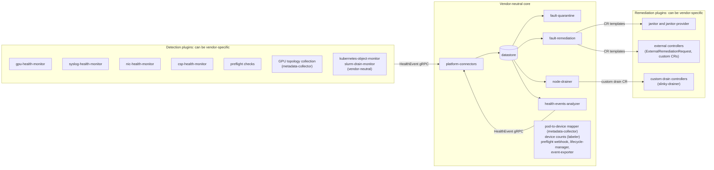

# ADR-070: Architecture — Vendor-Neutral Core and Vendor Plugins

Status: Proposed (tracking issue [#2247](https://github.com/NVIDIA/NVSentinel/issues/2247)). Maintainer acceptance is pending. No implementation lands before it.

## Table of Contents

1. [Context](#context)
   - [Gaps](#gaps)
     - [Recovery policy is not fully configurable](#recovery-policy-is-not-fully-configurable)
     - [Public surfaces carry NVIDIA names](#public-surfaces-carry-nvidia-names)
     - [Core components contain GPU logic](#core-components-contain-gpu-logic)
     - [Core defaults expect the GPU Operator](#core-defaults-expect-the-gpu-operator)
     - [Datastore and licenses](#datastore-and-licenses)
     - [Core dependencies beyond the datastore](#core-dependencies-beyond-the-datastore)
   - [Existing extension points](#existing-extension-points)
2. [Decision](#decision)
   - [Core and plugins](#core-and-plugins)
   - [One dependency direction](#one-dependency-direction)
   - [Versioned contracts](#versioned-contracts)
   - [Core dependencies](#core-dependencies)
   - [Recovery policy as configuration](#recovery-policy-as-configuration)
     - [Custom actions in overrides](#custom-actions-in-overrides)
     - [Escalation ladder](#escalation-ladder)
     - [Raw check results](#raw-check-results)
   - [Device scope from configuration](#device-scope-from-configuration)
   - [No new vendor actions in the enum](#no-new-vendor-actions-in-the-enum)
   - [Public names change by addition](#public-names-change-by-addition)
   - [Core works without vendor software](#core-works-without-vendor-software)
3. [Implementation](#implementation)
   - [Component classification](#component-classification)
   - [Phases](#phases)
     - [Phase 1: Record](#phase-1-record)
     - [Phase 2: Make hardcoded logic configurable](#phase-2-make-hardcoded-logic-configurable)
     - [Phase 3: Add contracts](#phase-3-add-contracts)
     - [Phase 4: Move vendor code](#phase-4-move-vendor-code)
     - [Phase 5: Remove deprecated names](#phase-5-remove-deprecated-names)
   - [Backwards compatibility](#backwards-compatibility)
4. [Rationale](#rationale)
   - [Safety](#safety)
   - [Testability](#testability)
   - [Adoption](#adoption)
   - [Scope](#scope)
5. [Consequences](#consequences)
   - [Positive](#positive)
   - [Negative](#negative)
   - [Mitigations](#mitigations)
6. [Alternatives Considered](#alternatives-considered)
   - [Vendor-neutral monitors and remediation plugins](#vendor-neutral-monitors-and-remediation-plugins)
   - [Configuration only](#configuration-only)
   - [Rename all vendor names in one release](#rename-all-vendor-names-in-one-release)
   - [Add a fault taxonomy to the event](#add-a-fault-taxonomy-to-the-event)
   - [Escalation ladder only in fault-remediation configuration](#escalation-ladder-only-in-fault-remediation-configuration)
   - [A separate fork for each vendor](#a-separate-fork-for-each-vendor)
7. [Notes](#notes)
   - [Non-goals](#non-goals)
8. [Open Questions](#open-questions)
   - [Who owns the escalation ladder?](#who-owns-the-escalation-ladder)
9. [References](#references)

## Context

NVSentinel started as a tool for NVIDIA GPU nodes that run the GPU Operator. Most of the pipeline does not depend on that hardware: the gRPC event API, the CEL quarantine rules, the drain, the remediation templates, and the analyzer engine work for any fault. But vendor assumptions are spread through the components between detection and remediation. A platform with a different accelerator, a managed driver stack, or its own recovery policy must fork NVSentinel or work around it ([#2247](https://github.com/NVIDIA/NVSentinel/issues/2247)).

### Gaps

The gaps are in six areas.

#### Recovery policy is not fully configurable

- An override ([ADR-021](021-health-event-property-overrides.md)) can set only a value of the `RecommendedAction` enum (`platform-connectors/pkg/transformers/overrides/config.go:99-113`). It cannot set `customRecommendedAction`, so a platform cannot send a fault to an action of its own.
- An event has one action. No component tries a different action when the first action does not repair the fault, for example a host repair after a reboot. fault-remediation stops at `maxRemediationAttempts` and labels the node `remediation-failed` (`fault-remediation/pkg/reconciler/reconciler.go:1321`).
- `HealthEvent` has no field for raw check results, such as counter values and diagnostic results. Monitors put them only in the text of `message`. A controller that a platform writes for a check with no recommended action, or with `CONTACT_SUPPORT`, has no structured data for its decision.

#### Public surfaces carry NVIDIA names

`RecommendedAction` contains `RUN_FIELDDIAG = 6` and `RUN_DCGMEUD = 26`, which are names of NVIDIA tools (`data-models/protobufs/health_event.proto:79,83`). Nothing in the repository emits `RUN_FIELDDIAG`. Two default analyzer rules emit `RUN_DCGMEUD` (`charts/health-events-analyzer/values.yaml:421,773`). No default remediation template maps either action.

The core charts define four CRD groups: `nvsentinel.dgxc.nvidia.com`, `healthevents.dgxc.nvidia.com`, `nvsentinel.nvidia.com`, and `preflight.nvsentinel.nvidia.com`. Core components write node labels and annotations with four prefixes: `nvsentinel.dgxc.nvidia.com/`, `dgxc.nvidia.com/`, `nvsentinel.nvidia.com/`, and the cordon label prefix `k8saas.nvidia.com/`. event-exporter sends the CloudEvent type `com.nvidia.nvsentinel.health.v1`. External automation reads all of these.

#### Core components contain GPU logic

- Partial drain and scoped remediation know one entity type. `EntityTypeToResourceNames` maps only `GPU_UUID` to `nvidia.com/gpu`, `nvidia.com/pgpu`, and `gpu.nvidia.com` (`data-models/pkg/model/pod_device_annotation.go:27-34`). Partial drain runs only for `COMPONENT_RESET` (`commons/pkg/drain/drain.go:143`).
- fault-quarantine and platform-connectors have recovery code for replaced GPUs that matches `componentClass == "GPU"` and the `GPU_UUID` and `PCI` entities (`fault-quarantine/pkg/healthEventsAnnotation/health_events_annotation_map.go:446-552`, `platform-connectors/pkg/connectors/kubernetes/process_node_events.go:356-391`).
- The fault-quarantine circuit breaker counts the nodes with `nvidia.com/gpu.present` (configurable with `gpuNodeLabel`).
- The health-events-analyzer runs a Go XID burst detector on PostgreSQL for every unhealthy `GPU` event with an error code. It counts DCGM error codes as XIDs (`health-events-analyzer/pkg/reconciler/reconciler.go:737-745`).
- metadata-collector collects GPU and NIC topology with NVML and `nvidia-smi`. Its pod-to-device mapper hardcodes the NVIDIA resource names and the NVIDIA DRA device name format `gpu-%d` (`metadata-collector/pkg/mapper/grpcclient.go:38-42`).
- The labeler reads the DCGM version from the DCGM image tag (`.*dcgm:4\..*`) and detects the driver from GPU Operator pods (`labeler/pkg/labeler/labeler.go:56-69`). Only the detection plugins read these labels. Its device-count engine is vendor-neutral.

#### Core defaults expect the GPU Operator

metadata-collector has a fixed nodeSelector on `nvidia.com/gpu.present` (`charts/metadata-collector/templates/daemonset.yaml:134`) and runs with the `nvidia` RuntimeClass. The log-collector Job that fault-remediation starts runs `nvidia-bug-report.sh` in the driver pod and reads the `gpu-operator` namespace. Core chart defaults also name vendor values, for example `nvidia.com/cuda.*` in the platform-connectors label allowlist and `gpu-operator` in the node-drainer system namespaces. An operator can change most of these values, but the change is necessary on each non-GPU-Operator cluster.

#### Datastore and licenses

[ADR-066](066-health-events-analyzer-datastore-neutral-rules.md) makes the analyzer rules run on MongoDB and PostgreSQL. It makes the Kubernetes datastore ([#2015](https://github.com/NVIDIA/NVSentinel/pull/2015)) a non-goal, so the analyzer cannot run in that mode.

The chart can install MongoDB or Percona Server for MongoDB from a bundled subchart. Both use the SSPL. The subchart is off by default. Core modules link four MPL-2.0 libraries: `hashicorp/go-multierror` and `hashicorp/errwrap` (fault-quarantine, node-drainer, health-events-analyzer), `hashicorp/golang-lru/v2`, and `hashicorp/go-uuid` (indirect, through `prometheus/common`). metadata-collector builds on the `nvcr.io/nvidia/cuda` base image and compiles in the NVML header from `go-nvml`. Both use NVIDIA licenses.

#### Core dependencies beyond the datastore

The core needs more than Kubernetes and a datastore:

| Dependency | Needed when | Behaviour that only it has |
|---|---|---|
| Prometheus Operator CRDs | Always, at install time. The umbrella chart creates a `PodMonitor` by default (`podMonitor.enabled: true`). No core component queries Prometheus | none |
| cert-manager | The datastore is PostgreSQL with client certificates, which is the default when no password secret is set | `Certificate` and `Issuer` resources |
| cert-manager | The deployment platform connector runs with `tls.mode: required`, the default | Publishers trust the `ca.crt` key that cert-manager writes into the server secret |
| cert-manager or the OpenShift service CA | lifecycle-manager or the preflight webhook is enabled | The `cert-manager.io/inject-ca-from` annotation sets the webhook CA bundle |
| OpenTelemetry collector | Tracing is enabled | none |

No chart accepts certificates from another source, for example a Secret that the user creates or a managed certificate service.

### Existing extension points

NVSentinel already has these extension points:

| Extension point | Record |
|---|---|
| HealthEvent gRPC API for monitors in any language | [ADR-001](001-health-event-detection-interface.md) |
| CEL quarantine rule sets | [ADR-003](003-rule-based-node-quarantine.md) |
| Custom drain CR, with the Slurm drainer as a plugin | [ADR-015](015-custom-drain-extensibility.md) |
| Event overrides and `STORE_ONLY` | [ADR-021](021-health-event-property-overrides.md) |
| `CUSTOM` action with a free action name | [ADR-036](036-custom-remediation-actions.md) |
| `ExternalRemediationRequest`: an external system repairs the node | [ADR-040](040-external-remediation-request.md) |
| `MaintenanceRequest` from external systems | [ADR-051](051-maintenance-request.md) |
| Rule sets that select drain and remediation for each node group and device | [ADR-064](064-node-and-device-selection.md) |
| Datastore-neutral analyzer rules | [ADR-066](066-health-events-analyzer-datastore-neutral-rules.md) |
| Kubernetes as a datastore, with no database | [#2015](https://github.com/NVIDIA/NVSentinel/pull/2015) (proposed) |

fault-remediation maps each action to a CR only through configuration (`fault-remediation/pkg/config/config.go:31-84`).

These extension points let a vendor add code, but they do not remove vendor code from the core components. The six gaps remain.

## Decision

NVSentinel separates a **vendor-neutral core** from **vendor plugins** at the two ends of the pipeline. Detection plugins and remediation plugins can contain vendor logic. The core between them cannot. Plugins connect to the core only through versioned contracts. Existing users keep their behaviour: the change is additive, and old names continue to work.

### Core and plugins

- **Detection plugins** read a device or a system and publish health events. They can be vendor-specific. kubernetes-object-monitor and slurm-drain-monitor are vendor-neutral detection plugins. The GPU topology collection of metadata-collector serves only the detection plugins, so it moves to the NVIDIA plugin.
- **The core** stores events, quarantines, drains, decides the remediation, and correlates events. It also includes the pod-to-device mapper of metadata-collector, the device counts of the labeler, the preflight webhook, lifecycle-manager, and event-exporter.
- **Remediation plugins** repair the node. They can be vendor-specific. janitor and janitor-provider are remediation plugins, so the GPU reset and the cloud clients stay in them.

### One dependency direction

Plugins depend on the core. The core never imports plugin code, and it has no vendor resource names, labels, namespaces, or tool names in code. Each vendor default moves to the plugin chart, also when it has no effect on a cluster without that vendor's software, for example an entry in a label allowlist. The core chart has only vendor-neutral defaults.

### Versioned contracts

A plugin uses only these contracts. They are versioned, and they change only by addition:

- The HealthEvent gRPC API, for detection.
- CR templates, for remediation, custom drain, and validation.
- Configuration: CEL rules, event overrides, analyzer rules, the entity-type map ([Device scope from configuration](#device-scope-from-configuration)), and the device selection of [ADR-064](064-node-and-device-selection.md).

### Core dependencies

The core requires only Kubernetes and a datastore. cert-manager, the Prometheus Operator, and an OpenTelemetry collector are optional. Each TLS path of the core accepts a certificate from any source: a Secret with `tls.crt` and `tls.key`, and a CA bundle given as a value. With cert-manager, the charts create these as at this time. No core component relies on behaviour that only cert-manager has, such as the CA injector or the `ca.crt` key.

### Recovery policy as configuration

`checkName`, `errorCode`, `componentClass`, and `entitiesImpacted` identify the fault. `recommendedAction` is the default that the monitor suggests. A platform replaces the default with the overrides of [ADR-021](021-health-event-property-overrides.md) for the full cluster, and with the rule sets of [ADR-064](064-node-and-device-selection.md) for each node group. A platform does not change monitor code or monitor mappings. Three additive changes close the gaps in [Recovery policy is not fully configurable](#recovery-policy-is-not-fully-configurable).

#### Custom actions in overrides

An override can set `CUSTOM` and `customRecommendedAction`. A platform can then send one fault, for example an NVLink failure, to its own CR template. The other `CONTACT_SUPPORT` faults, such as `MultipleRemediations`, keep their action.

#### Escalation ladder

A follow-up ADR adds an optional, ordered list of actions to `HealthEvent`. `recommendedAction` stays the first step, so current consumers do not change. The follow-up ADR defines when fault-remediation moves to the next step. An override can replace the list, so the platform, not the monitor, owns the final policy.

#### Raw check results

A follow-up ADR adds an optional field to `HealthEvent` for raw check results, such as counter values and diagnostic results. A check with no recommended action, or with `CONTACT_SUPPORT`, then gives a platform controller the data for its own decision.

### Device scope from configuration

A partial drain evicts only the pods that use the failed device, and a scoped remediation repairs only that device. To do this, the core must find the pods that use a device. At this time only GPUs have this map: `EntityTypeToResourceNames` maps the entity type `GPU_UUID` to the resources `nvidia.com/gpu` and `nvidia.com/pgpu` and to the DRA driver `gpu.nvidia.com`. The map moves to configuration. An operator adds an entry for each device type, with its resource names and DRA driver. Partial drain and scoped remediation then work for each device type in the map, and for each action that is scoped to a device, not only `COMPONENT_RESET`. The NVIDIA plugin supplies the `GPU_UUID` entry as its default.

### No new vendor actions in the enum

`RUN_FIELDDIAG` and `RUN_DCGMEUD` stay in `RecommendedAction` with their numbers. Removal of an enum value breaks the proto, and external monitors can send these values through the gRPC API. The CRD schemas of `HealthEvent`, `MaintenanceRequest`, and `ExternalRemediationRequest` list them, and stored events contain `RUN_DCGMEUD`. The core has no code for them. The two analyzer rules that emit `RUN_DCGMEUD` move to the NVIDIA plugin. A new vendor-specific action uses `CUSTOM` with a namespaced name ([ADR-036](036-custom-remediation-actions.md)), for example `example.com/run-diagnostics`. Only vendor-neutral actions, such as `RESTART_VM`, get an enum value.

### Public names change by addition

A follow-up ADR selects one neutral domain for the CRD groups, labels, and annotations of the core, and the migration for each surface. The old names continue to work for at least two minor releases. Removal is a separate maintainer decision.

### Core works without vendor software

The core installs and runs with its default values on a cluster with no vendor software and with a datastore that the user supplies. It then detects, quarantines, drains, and remediates a fault. A CI job proves this with a vendor-neutral detection plugin, such as kubernetes-object-monitor, and a vendor-neutral remediation plugin, such as the janitor `kind` provider.

## Implementation

### Component classification

The detection and remediation plugins keep their vendor logic, so they have no row. These are the health monitors, the preflight checks, janitor, janitor-provider, and gpu-reset. The core components move their vendor parts to a plugin:

| Core component | Moves to a plugin | Stays in the core |
|---|---|---|
| platform-connectors | Replaced-GPU recovery (becomes entity-type configuration), `nvidia.com/cuda.*` and cloud entries in `allowedLabels`, `SysLogsXIDError` and `SysLogsSXIDError` in the deduplication `includeChecks` | gRPC ingest, transformers, node conditions |
| store-client | none | MongoDB provider (Apache-2.0 driver; the user supplies the server) and PostgreSQL provider |
| fault-quarantine | Replaced-GPU recovery (becomes entity-type configuration), `gpuNodeLabel` default | CEL rule sets, circuit breaker |
| node-drainer | `GPU_UUID` partial drain (becomes the entity-type map, see [Device scope from configuration](#device-scope-from-configuration)), `gpu-operator`, `network-operator`, `skyhook`, and `gmp-system` in `systemNamespaces` | Eviction, custom drain, pod policies |
| fault-remediation | Log-collector Job template and its GPU Operator settings | Action templates, equivalence groups, `CUSTOM` |
| health-events-analyzer | XID burst detector, XID/SXID/NVLink default rules, `RepeatedNICDriverError`, GPU entity metric allowlist | Engine, `MultipleRemediations`, `RepeatedNICDegradation` |
| metadata-collector | NVML and `nvidia-smi` collection, `gpu_metadata.json` schema, the NVIDIA DRA device name format `gpu-%d`, the `nvidia.com/gpu.present` nodeSelector, the `nvidia` RuntimeClass, the CUDA base image | Pod-to-device mapper (kubelet PodResources API) with configured resource names and DRA device names |
| labeler | `dcgm.version`, `driver.installed`, GPU Operator pod discovery, `nvidia.com/*` count classes | Device-count engine, Kata detection, `managed` opt-out |
| preflight webhook | `nvidia.com/gpu` and `gpu.nvidia.com` defaults, vendor entries in `networkResourceNames`, NCCL injection | Webhook, gang discovery, check injection |
| lifecycle-manager | DCGM readiness probe default | Validation providers and tests |
| event-exporter | none | All |

The issues that implement each row will name file paths. The rows are the scope of this ADR.

### Phases

Each phase is a set of small PRs. Each PR keeps the current behaviour of the default installation.

#### Phase 1: Record

Write a page in `docs/` that lists the extension points, with one example for each. Add a license check for the third-party dependencies of the core modules.

#### Phase 2: Make hardcoded logic configurable

- Add the entity-type map ([Device scope from configuration](#device-scope-from-configuration)). Move the GPU recovery cases in fault-quarantine and platform-connectors to it.
- Make the metadata-collector nodeSelector and the labeler driver informer configurable. Each default stays the same.
- Let overrides set `customRecommendedAction` ([Custom actions in overrides](#custom-actions-in-overrides)).
- Add a `certProvider` option for certificates that the user supplies to the webhooks, the deployment platform connector, and PostgreSQL ([Core dependencies](#core-dependencies)). cert-manager stays the default.
- Replace `go-multierror` and `errwrap` with `errors.Join` from the standard library. Review the other MPL-2.0 items in [Datastore and licenses](#datastore-and-licenses).

Each PR that changes remediation or drain adds a test that proves it does not act in the healthy case.

#### Phase 3: Add contracts

Write a follow-up ADR for each of these:

- The [escalation ladder](#escalation-ladder).
- The field for [raw check results](#raw-check-results).
- The neutral domain and the migration of names ([Public names change by addition](#public-names-change-by-addition)).

#### Phase 4: Move vendor code

Move each "moves to a plugin" item into its own module and chart. When a module is split, add a lint rule that stops the core part from importing the plugin module. The umbrella chart installs the NVIDIA plugins by default, so existing installations keep their behaviour. Their images and subcharts change.

A new core-only profile installs no plugin, no MongoDB subchart, and no `PodMonitor`. It uses the PostgreSQL subchart, the Kubernetes datastore ([#2015](https://github.com/NVIDIA/NVSentinel/pull/2015)), or an external PostgreSQL or MongoDB database that the user supplies. MongoDB stays a supported datastore. After ADR-066 is implemented, the profile includes the analyzer with PostgreSQL or MongoDB. With the Kubernetes datastore, the profile runs without the analyzer. The CI job in [Core works without vendor software](#core-works-without-vendor-software) installs this profile.

#### Phase 5: Remove deprecated names

After the deprecation period, maintainers decide whether to remove the old names.

### Backwards compatibility

| Surface | Rule |
|---|---|
| Protobuf | Only new optional fields. `RUN_FIELDDIAG` and `RUN_DCGMEUD` keep their numbers and meaning |
| CRDs | The current groups continue to be served until a later ADR removes them. That ADR includes a migration for objects in etcd |
| Labels, annotations, conditions, and metrics | Components write the old name and the new name, and read both, during the deprecation period |
| CloudEvent type | event-exporter sends one event for each health event, with one type. The type becomes configurable, and the default stays `com.nvidia.nvsentinel.health.v1` until the deprecation period ends. A consumer that expects the new type changes the configuration. event-exporter never sends two events for one health event |
| Helm values | No key is renamed or removed. Vendor defaults move to the plugin charts, and the umbrella chart sets them for existing installations |
| Images | The current images continue to contain the vendor parts until phase 4. Then the umbrella chart installs the plugin images in their place |

## Rationale

### Safety

Vendor logic in core code paths can act on the wrong device. For example, the XID detector counts DCGM error codes as XIDs. When vendor logic lives in plugins with clear contracts, it is easier to review, and the core can test the healthy case without vendor mocks.

### Testability

At this time the local environment needs a fake DCGM, a fake driver DaemonSet, and GPU Operator labels on KWOK nodes. The core-only profile runs with none of these.

### Adoption

Other vendors and platforms can contribute monitors, remediation plugins, and recovery policies without a fork. Fixes to the core then reach all users.

### Scope

Most of the work is already done. The [existing extension points](#existing-extension-points) show that detection, drain, and remediation can already be extended. This ADR finishes the separation and does not redesign the pipeline.

## Consequences

### Positive

- A platform can run NVSentinel with its own accelerator, driver stack, or recovery policy, and does not need a fork.
- The core can be tested in CI with no GPU, DCGM, or GPU Operator mocks.
- A platform can send each fault to its own action and escalation ladder, and keep the loop protection of `MultipleRemediations`.
- Vendor logic stays in the detection and remediation plugins, where the vendor knowledge is used.

### Negative

- More artifacts to build and release: more modules, images, and charts.
- During the deprecation period, components write two names for each label and annotation. This adds API writes and code paths.
- The contracts become public API. A change to them needs the same care as the HealthEvent proto.
- The split takes several releases. Until phase 4, the code and this ADR describe different layouts.
- A core installation without the analyzer, for example on the Kubernetes datastore, has no protection against remediation loops unless `maxRemediationAttempts` in fault-remediation is above 0. Its default is 0, which sets no limit.

### Mitigations

- Phase 4 keeps the umbrella chart, so the number of charts that an operator installs does not change.
- The follow-up ADR for names ([Public names change by addition](#public-names-change-by-addition)) limits the dual writes to the surfaces that external automation reads, and gives a removal release.
- After each split, the import lint rule and the core-only CI job ([Core works without vendor software](#core-works-without-vendor-software)) stop new vendor coupling in the core.

## Alternatives Considered

### Vendor-neutral monitors and remediation plugins

Make every component vendor-neutral, including the health monitors and janitor.

**Rejected** because: a health monitor reads a vendor device, and a remediation plugin calls a vendor tool or API. Vendor-neutral versions need an extra layer that only one vendor implements. The vendor knowledge belongs at the two ends of the pipeline, where it is used.

### Configuration only

Keep all code in place and add a value for each vendor assumption.

**Rejected** because: vendor code would still be compiled into core images, and NVML would stay in the core. The core still could not be tested without vendor mocks. Configuration also does not close the gaps in recovery policy.

### Rename all vendor names in one release

**Rejected** because: NVSentinel upgrades with a rolling Helm release. Old and new components run together and read data that the previous version wrote. External automation reads the labels and conditions. A rename in one release breaks both.

### Add a fault taxonomy to the event

Add a vendor-neutral fault class to `HealthEvent`, and make each monitor map its error codes to it.

**Rejected** because: the existing fields already identify the fault, and overrides can match them. A taxonomy needs a mapping in each monitor and agreement between vendors, with no consumer that needs it at this time. If policies must list too many codes from different monitors for one fault, a later ADR can add the taxonomy as an optional field.

### Escalation ladder only in fault-remediation configuration

**Rejected** because: the monitor knows the safe order of repairs for its faults. Without a ladder in the event, each platform must write the order for each fault again. With a ladder in the event and an override that can replace it, the monitor gives the default and the platform keeps control.

### A separate fork for each vendor

**Rejected** because: each fork copies the quarantine, drain, and remediation logic. Fixes do not reach the other forks, and the most safety-critical code is maintained several times.

## Notes

### Non-goals

This ADR does not remove NVIDIA support, and does not select the repository layout or the neutral domain. It does not add a fault scope larger than one node, such as an NVLink domain or a TPU slice. That is a new feature for its own issue.

## Open Questions

### Who owns the escalation ladder?

The [escalation ladder](#escalation-ladder) is a default in the event, and an override can replace it. The follow-up ADR must show that a platform can set its full escalation policy with an override, and does not need to change a monitor.

## References

- [#2247](https://github.com/NVIDIA/NVSentinel/issues/2247): Make NVSentinel vendor neutral
- [ADR-001](001-health-event-detection-interface.md), [ADR-003](003-rule-based-node-quarantine.md), [ADR-015](015-custom-drain-extensibility.md), [ADR-021](021-health-event-property-overrides.md), [ADR-036](036-custom-remediation-actions.md), [ADR-040](040-external-remediation-request.md), [ADR-051](051-maintenance-request.md), [ADR-064](064-node-and-device-selection.md), [ADR-066](066-health-events-analyzer-datastore-neutral-rules.md)
- [#2015](https://github.com/NVIDIA/NVSentinel/pull/2015): Kubernetes-native remediation without a database (proposed ADR-067)
