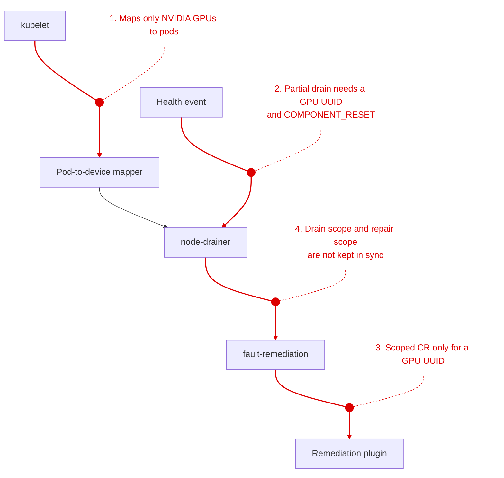

# ADR-071: Configuration — Device Scope for Partial Drains and Scoped Remediation

Status: Proposed (tracking issue [#2417](https://github.com/NVIDIA/NVSentinel/issues/2417)). Implements [Device scope from configuration](070-vendor-neutral-core.md#device-scope-from-configuration) of ADR-070.

## Table of Contents

1. [Context](#context)
2. [Decision](#decision)
3. [Implementation](#implementation)
   - [Configuration](#configuration)
   - [Where each component reads the map](#where-each-component-reads-the-map)
   - [Partial drain decision](#partial-drain-decision)
   - [Scope check](#scope-check)
   - [Pod device mapper](#pod-device-mapper)
      - [Device-plugin devices](#device-plugin-devices)
      - [DRA devices](#dra-devices)
   - [Backwards compatibility](#backwards-compatibility)
4. [Rationale](#rationale)
5. [Consequences](#consequences)
   - [Positive](#positive)
   - [Negative](#negative)
   - [Mitigations](#mitigations)
6. [Alternatives Considered](#alternatives-considered)
   - [Derive the scoped actions from `impactedEntityScope` in fault-remediation](#derive-the-scoped-actions-from-impactedentityscope-in-fault-remediation)
   - [Watch the node's ResourceSlices](#watch-the-nodes-resourceslices)
   - [Keep an existing annotation after a restart](#keep-an-existing-annotation-after-a-restart)
   - [Use the DRA device name as the entity value](#use-the-dra-device-name-as-the-entity-value)
7. [Notes](#notes)
   - [Non-goals](#non-goals)
8. [References](#references)

## Context

When one device on a node fails, NVSentinel does not always need to take the whole node out of service. A partial drain evicts only the pods that use the failed device, and a scoped remediation repairs only that device. The other pods on the node keep running.

Today this works for one case: a GPU, named by its UUID, with the `COMPONENT_RESET` action. A node can have other devices that fail on their own, such as an accelerator from another vendor. An operator can also define other actions that repair one device, such as a custom action. For these, NVSentinel drains the full node.

A partial drain and a scoped remediation need four steps along the break-fix pipeline. Today each one is either GPU-only or missing:



1. **Know which pods use which device.** Something on each node has to record, for each pod, the devices that Kubernetes gave it, in the same identity that health events use for the device. Today the pod-to-device mapper in metadata-collector does this, and only for NVIDIA GPUs.
2. **Decide when a drain is partial.** node-drainer has to know which remediation actions repair one device, and which entity in the event names that device. Today the only entity type is the GPU UUID, and the only action is `COMPONENT_RESET`. Every other action, including a custom action ([ADR-036](036-custom-remediation-actions.md)), drains the full node.
3. **Repair only that device.** fault-remediation has to create a CR that acts on the device, not on the node. This already works for any action through `impactedEntityScope`, but the scope can only name the GPU UUID.
4. **Agree on the scope.** The drain and the repair have to cover the same thing, but nothing checks this. A scoped repair after a full drain evicts more pods than needed, as for a custom action with `impactedEntityScope` today. A full-node repair after a partial drain stops pods that were not drained. This happens when partial drains are on and `COMPONENT_RESET` maps to `RebootNode`, the chart default, or when a fault-remediation rule set changes the action ([ADR-064](064-node-and-device-selection.md#partial-drains-and-actions-on-the-full-node)). The node-drainer documentation warns about this, but nothing prevents it.

## Decision

1. **The entity-type map becomes configuration.** One Helm value, `global.partialRemediationEntityTypes`, defines each entity type with the devices that belong to it and the actions that are scoped to it. A device is a device-plugin resource name or a DRA driver with its DeviceClasses. Each component that reads the map gets it from that value. The chart default is the NVIDIA `GPU_UUID` entry, so current installs behave the same.
2. **Scoped actions are listed in the map.** node-drainer runs a partial drain for an event when `partialDrainEnabled` is on and the effective action of the event, including a custom action name, is listed under an entity type that the event names. `COMPONENT_RESET` is the default entry.
3. **fault-remediation never runs a full-node action after a partial drain.** The Helm chart checks that each scoped action maps to a `maintenance.actions` entry with the same `impactedEntityScope`. At run time, fault-remediation does not create a CR for an action on the full node after a partial drain. It retries the event and increments a metric.
4. **The mapper reads DRA device identity from ResourceSlices.** For a DRA device, it reads the entity value from a ResourceSlice attribute that the map names, for example `uuid`, instead of from the NVML map. The mapper stays in the metadata-collector binary and DaemonSet.

## Implementation

### Configuration

```yaml
global:
  partialRemediationEntityTypes:
    GPU_UUID:
      devices:
        - resourceNames: ["nvidia.com/gpu", "nvidia.com/pgpu"]
        - driver: gpu.nvidia.com
          deviceClasses: ["gpu.nvidia.com"]
          entityValueAttribute: uuid
      scopedActions: ["COMPONENT_RESET"]
```

An operator adds a device type with another key. This example adds a custom action that repairs one accelerator:

```yaml
global:
  partialRemediationEntityTypes:
    ACCEL_SERIAL:
      devices:
        - driver: accel.example.com
          deviceClasses: ["accel.example.com"]
          entityValueAttribute: serial
      scopedActions: ["accel-reset"]
fault-remediation:
  maintenance:
    actions:
      "accel-reset":
        kind: "AccelReset"
        impactedEntityScope: "ACCEL_SERIAL"
        # ...
```

- `devices` lists the ways a pod can get a device of the entity type. An entry is either a device-plugin entry with `resourceNames`, or a DRA entry with `driver`, `deviceClasses` and `entityValueAttribute`. The chart fails if an entry mixes the two, or if an entity type has no entry. The `GPU_UUID` default has one of each, as the code does today, because a cluster can use either. An entry that a cluster does not use matches no devices.
- `resourceNames` lists the exact resource names that pods request, such as `nvidia.com/gpu`.
- `driver` is the name that the kubelet reports for an allocated DRA device. `deviceClasses` are the names that pods use in their claims. Today one string serves both, which only works because the NVIDIA driver and its DeviceClass share a name.
- `entityValueAttribute` names the ResourceSlice attribute whose value is the entity value in health events (see [DRA devices](#dra-devices)).
- `scopedActions` are action names, as `GetEffectiveActionName` returns them: a built-in action such as `COMPONENT_RESET`, or a custom action name. An action can be scoped to only one entity type, because fault-remediation's [`impactedEntityScope`](../configuration/fault-remediation.md#impactedentityscope) names one entity type for each action. The chart fails if two entries list the same action.

### Where each component reads the map

The chart renders `global.partialRemediationEntityTypes` into the configuration file of each component that needs it. Components do not read each other's configuration.

| Component | Uses | Change |
|---|---|---|
| Pod device mapper | `devices` | Records only the configured resources and drivers |
| node-drainer | All fields | Partial drain for `scopedActions`. The pod filter, the missing-annotation check and the `drainGPUPods` filter read the configured names instead of `GPU_UUID` |
| fault-quarantine | None | Post-remediation validation uses the drain scope that node-drainer recorded on the event (`DrainDecision.scope`). An event drained before v1.31.0 has no drain decision, and validation works for it as today |
| fault-remediation | `scopedActions` | `impactedEntityScope` must name a configured entity type. The [scope check](#scope-check) |

If a component's configuration has no `partialRemediationEntityTypes` key, the code uses a built-in `GPU_UUID` entry with today's values. `global.partialDrainEnabled` stays the switch that turns partial drains off. The built-in entry is removed when NVIDIA-specific code moves out of the core into an NVIDIA plugin ([ADR-070](070-vendor-neutral-core.md#phase-4-move-vendor-code)), and the plugin chart then sets it.

### Partial drain decision

node-drainer takes these steps in order and stops at the first one that decides. Steps 1 and 3 work as today.

1. If `partialDrainEnabled` is off, drain the full node.
2. Find the entity type whose `scopedActions` lists the effective action of the event. If there is none, drain the full node, as today for any action other than `COMPONENT_RESET`.
3. Take the first entity of the event with that type and a non-empty value. If there is none, fail the drain and retry. Otherwise, drain only the pods that use that entity.

In step 3, node-drainer checks the device annotation of each pod. The annotation lists devices under resource names and DRA driver names.

- node-drainer reads the resource names and DeviceClasses of the entity type that a pod requests from its spec, as it does today. If the annotation has no entry for one of them, node-drainer fails the drain and retries. For DRA, it matches a DeviceClass to the annotation through the `driver` of the same `devices` entry. This covers a pod with no annotation, as today, and an annotation that the mapper wrote before the operator added that name. The drain continues after the mapper writes the new annotation.
- If the annotation lists the entity value under a name of the entity type, node-drainer evicts the pod, as today.

### Scope check

The drain and the repair must cover the same thing. A partial drain followed by an action on the full node, such as a reboot, or on a different device, stops pods that were not drained. Two checks keep the scopes of the drain and the repair the same. Both trust `impactedEntityScope`: the template of a scoped action must act only on the entity it names, and the operator who writes the template is responsible for that.

**At install.** When partial drains are on, every action in `scopedActions` needs a `maintenance.actions` entry with the same `impactedEntityScope`. Otherwise the chart fails the install or upgrade. There is no warning period, because the configuration it rejects reboots nodes after a partial drain today.

**At run time.** A fault-remediation rule set ([ADR-064](064-node-and-device-selection.md)) can still pick an action that the partial drain does not cover: an action on the full node, or an action scoped to a different entity type. The chart cannot see this. fault-remediation knows that the drain was partial from the scope that node-drainer records on the event (`DrainDecision.scope`). When node-drainer marks an event `AlreadyDrained` because an earlier drain covers it, it records the scope of that earlier drain. When it marks the event `AlreadyDrained` because of `drainOverrides.skip`, it records an empty scope, because the operator chose to skip the drain. If the drain was partial and it does not cover the action, fault-remediation does not create the CR. It treats the event as an [error in ADR-064](064-node-and-device-selection.md#the-drain-decision): it records no decision, logs both scopes, increments `fault_remediation_processing_errors_total` with a new `error_type`, and retries the event with backoff. Each retry evaluates the rule sets again, so a fix to the configuration lets the event continue. node-drainer behaves the same way today when a partial drain cannot proceed. An event drained by a version before v1.31.0 has no drain decision. This is different from a decision with an empty scope, which records a full drain. fault-remediation does not run the check for an event without a decision, as today.

The other direction is allowed: a full drain followed by a repair of one device evicts more pods than needed, but stops none without a drain.

### Pod device mapper

The mapper stays in the metadata-collector binary and DaemonSet. It behaves as today, with these changes:

- It records device-plugin devices for every configured resource name, and DRA devices for every configured driver.
- For a DRA device, it reads the entity value from the node's ResourceSlices instead of the NVML map (see [DRA devices](#dra-devices)).

The DaemonSet still runs only on NVIDIA GPU nodes, and the mapper still starts only after the NVML collection succeeds. [#2419](https://github.com/NVIDIA/NVSentinel/issues/2419) covers running the mapper on other nodes and separating it from the NVML collection.

#### Device-plugin devices

The kubelet reports the device IDs that the device plugin assigned. The mapper records them as entity values, as today. This works when the device plugin registers each device under the same ID that health monitors put in events. For example, the NVIDIA device plugin registers a GPU as `GPU-8f6d…`, and the monitors report the same GPU as `GPU_UUID = GPU-8f6d…`. The exception is GPU sharing (time-slicing or MPS), where it registers the same GPU with a replica suffix, such as `GPU-8f6d…::0`. GPU sharing is out of scope (see [Non-goals](#non-goals)). A device plugin that uses other IDs, such as an index, cannot use partial drains through `resourceNames`. Its devices can use DRA. The configuration documentation will say this.

#### DRA devices

ResourceSlice attributes are a Kubernetes API, so the mapper needs no vendor library for DRA devices. The kubelet reports each allocated DRA device with its driver, pool and device name. The mapper finds the matching device in the node's ResourceSlices and records the value of `entityValueAttribute`. The NVIDIA DRA driver publishes a [`uuid` attribute](https://github.com/kubernetes-sigs/dra-driver-nvidia-gpu/blob/v0.5.1/cmd/gpu-kubelet-plugin/deviceinfo.go#L168-L176) on each GPU, so the `GPU_UUID` entry gives the same values as today's NVML map, without NVML.

The entity value in the event must equal the attribute value exactly. One attribute is enough, because a DRA driver publishes a single attribute that identifies the device, such as a UUID or the PCI address.

For a device that is identified by its PCI address, the entity type uses the Kubernetes standard attribute [`resource.kubernetes.io/pciBusID`](https://github.com/kubernetes/kubernetes/blob/v1.37.2/staging/src/k8s.io/dynamic-resource-allocation/deviceattribute/attribute.go#L34-L39). Its value has the full `domain:bus:device.function` form, so the monitor must report the address in the same form. The `PCI` entities in NVIDIA events today do not: XID lines have no function, and NVML has an eight-digit domain.

If the mapper cannot find the attribute for any configured device of a pod, it writes no annotation for that pod, and removes an existing one. A partial annotation would make node-drainer miss the pod. Without an annotation, node-drainer sees a pod with a claim and no annotation, and the partial drain waits instead. The mapper checks every annotation on each poll, every 30 seconds. After the upgrade, its first poll also removes a partial annotation that an earlier version of the mapper wrote. [#2454](https://github.com/NVIDIA/NVSentinel/issues/2454) tracks the same fix for earlier versions.

The mapper resolves a DRA device once and remembers the result. A device keeps its identity while the node runs, so the cache needs no refresh and the mapper does not watch ResourceSlices. Like today's NVML map, the cache lasts until the mapper restarts.

To resolve a device, the mapper lists the ResourceSlices of its own node, filtered by `spec.nodeName` and `spec.driver`, with `resourceVersion: "0"` so that the API server answers from its cache instead of etcd. It does this only when a pod on the node has a DRA device that is not in the cache yet, so a node without such pods never calls the API. If the answer does not have the device yet, the mapper tries again on the next poll. The metadata-collector ClusterRole gets `list` on ResourceSlices only when the map has a DRA entry.

### Backwards compatibility

- **Helm values:** no key is renamed or removed. `global.partialRemediationEntityTypes` is new, and its default keeps today's behaviour.
- **Pod annotation and event store:** no change. Old and new components read each other's data.
- **Behaviour:** two changes, both on purpose: the chart check, and the retry of an action on the full node after a partial drain (see [Scope check](#scope-check)).

## Rationale

- **The repair decides the scope.** Whether an action repairs one device depends on the CR that fault-remediation creates for it, so the scope cannot be a fixed property of the action. A list in the configuration, checked against `maintenance.actions`, keeps the drain and the repair in step.
- **Device identity from Kubernetes.** DRA drivers publish device identity in ResourceSlices, a Kubernetes API. The mapper reads it there instead of from a vendor library, so the same code serves every vendor.

## Consequences

### Positive

- Partial drains and scoped remediation work for any device type that has a device plugin with stable IDs or a DRA driver with an identity attribute, on the nodes where the mapper runs.
- Custom actions with `impactedEntityScope` get a partial drain, not only a scoped repair.
- A full-node action after a partial drain is no longer possible through configuration.
- The mapper no longer needs NVML to resolve DRA devices.

### Negative

- Until [#2419](https://github.com/NVIDIA/NVSentinel/issues/2419), the mapper runs only on NVIDIA GPU nodes and only after the NVML collection succeeds. Other device types get partial drains only on those nodes.
- An existing install with partial drains on and a `COMPONENT_RESET` entry without `impactedEntityScope`, such as the chart default `RebootNode`, fails to upgrade until the operator changes the entry to a scoped action such as `GPUReset`.
- An event whose rule set picks an action on the full node after a partial drain retries until an operator changes the configuration. The node stays cordoned until then.

### Mitigations

- The chart error names the action and the entity type, so the operator knows which `maintenance.actions` entry to change before the upgrade.
- The retry metric has its own `error_type`, so an alert can find events that wait for a configuration fix.

## Alternatives Considered

### Derive the scoped actions from `impactedEntityScope` in fault-remediation

node-drainer would partially drain every action whose `maintenance.actions` entry has a scope. **Rejected** because subcharts cannot read each other's values, so the chart would have to move `maintenance.actions` to `global`. It also changes the drain for existing installs that have a scoped custom action and a full drain today.

### Watch the node's ResourceSlices

An informer would see a change to a ResourceSlice at once. **Rejected** because every mapper pod would hold a watch on the API server, one for each GPU node, and a device does not change its identity while the node runs.

### Keep an existing annotation after a restart

The mapper would keep an annotation with one value for each DRA device of the pod, and list ResourceSlices only for other pods. This saves the lists after an upgrade, but not on the first install, where no pod has an annotation. **Rejected** because a changed `entityValueAttribute` would not reach running pods: their annotations keep the old values, and a partial drain would miss them.

### Use the DRA device name as the entity value

**Rejected** because health monitors do not know DRA device names. They report hardware identities, such as a GPU UUID.

## Notes

### Non-goals

- Recovery matching after a reboot or a device replacement, in fault-quarantine and platform-connectors ([#2418](https://github.com/NVIDIA/NVSentinel/issues/2418)).
- MIG devices and prefix matching of resource names ([ADR-072](https://github.com/NVIDIA/NVSentinel/pull/2320)).
- New names for the `dgxc.nvidia.com/devices` annotation ([#2423](https://github.com/NVIDIA/NVSentinel/issues/2423)).
- A mapping from device-plugin IDs to entity values, or a conversion between formats of an attribute value, such as a CEL expression.
- Partial drains on shared GPUs (time-slicing or MPS). The device IDs of shared GPUs do not match the GPU UUID in events, so a partial drain misses their pods ([#2451](https://github.com/NVIDIA/NVSentinel/issues/2451)).

## References

- [ADR-070: Vendor-Neutral Core and Vendor Plugins](070-vendor-neutral-core.md)
- [ADR-020: GPU Reset](020-nvsentinel-gpu-reset.md), origin of partial drains and the mapper
- [ADR-036: Custom Remediation Actions](036-custom-remediation-actions.md)
- [ADR-064: Node and Device Selection in Each Component](064-node-and-device-selection.md)
- [ADR-072: MIG Data Model](https://github.com/NVIDIA/NVSentinel/pull/2320) (proposed)
- [Kubernetes Dynamic Resource Allocation](https://kubernetes.io/docs/concepts/scheduling-eviction/dynamic-resource-allocation/)
