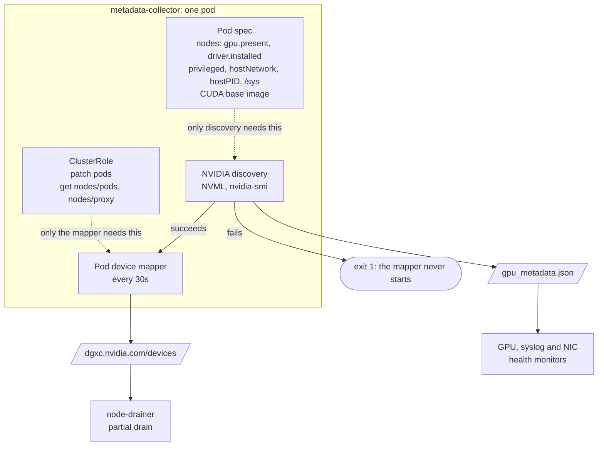

# ADR-072: Architecture — Run the Pod Device Mapper Apart from NVIDIA Discovery

Status: Proposed (tracking issue [#2419](https://github.com/NVIDIA/NVSentinel/issues/2419)). Implements the metadata-collector row of the [component classification](070-vendor-neutral-core.md#component-classification) of ADR-070. Builds on [ADR-071](071-device-scope-from-configuration.md).

## Table of Contents

1. [Context](#context)
2. [Decision](#decision)
3. [Implementation](#implementation)
   - [Module and image](#module-and-image)
   - [DaemonSet](#daemonset)
   - [Chart](#chart)
   - [Upgrade](#upgrade)
   - [Backwards compatibility](#backwards-compatibility)
4. [Rationale](#rationale)
5. [Consequences](#consequences)
   - [Positive](#positive)
   - [Negative](#negative)
   - [Mitigations](#mitigations)
6. [Alternatives Considered](#alternatives-considered)
   - [Run the mapper from a chart of its own now](#run-the-mapper-from-a-chart-of-its-own-now)
   - [Run the mapper as a second container in the metadata-collector DaemonSet](#run-the-mapper-as-a-second-container-in-the-metadata-collector-daemonset)
   - [Keep the mapper in the metadata-collector binary with a flag to skip NVML](#keep-the-mapper-in-the-metadata-collector-binary-with-a-flag-to-skip-nvml)
7. [Notes](#notes)
   - [Non-goals](#non-goals)
8. [References](#references)

## Context

metadata-collector runs two jobs in one pod backed by a DaemonSet:

- **NVIDIA discovery** reads NVML and `nvidia-smi`, then writes `gpu_metadata.json` to `/var/lib/nvsentinel` for the GPU, syslog and NIC health monitors.
- **Pod device mapper** writes the `dgxc.nvidia.com/devices` annotation on pods every 30 seconds. node-drainer reads the annotation to find the pods affected in a partial drain.

Running both jobs in one pod causes three problems:

1. **The mapper runs only on NVIDIA nodes.** The DaemonSet's node selector requires `nvidia.com/gpu.present` and `nvsentinel.dgxc.nvidia.com/driver.installed`. ADR-071 lets operators use other devices for partial drains, but nodes with only those devices get no mapping.
2. **Each job gets the other's permissions.** The mapper runs in discovery's privileged pod, with host networking, the host PID namespace, `/sys` and the CUDA base image. Discovery gets the mapper's ClusterRole, which it never uses.
3. **A discovery failure stops the mapper.** The mapper starts only after discovery succeeds (`metadata-collector/main.go:112-116`). NVML is most likely to fail on a node with a faulty GPU. New pods on that node then get no annotation, so a partial drain there waits. This problem alone does not need the split: `main.go` can start the mapper without waiting for discovery.

## Decision

1. **The mapper becomes its own module, binary and image.** The module is `pod-device-mapper`. It does not import metadata-collector or NVML.
2. **The mapper runs in its own DaemonSet, which the metadata-collector chart renders for now, so the Helm values that operators set today keep working.** The DaemonSet has no vendor settings: no RuntimeClass, no DRA claim, and no host namespaces. Its node selector defaults to `nvidia.com/gpu.present`, so current installs run the mapper on their GPU nodes, as today. The mapper no longer waits for the driver (see [DaemonSet](#daemonset)). See [Chart](#chart) for the keys.
3. **metadata-collector keeps only the NVIDIA discovery, in a DaemonSet renamed to `nvidia-metadata-collector`.** Its binary, CUDA image, pod settings and `gpu_metadata.json` stay as they are. The rename makes the upgrade remove the old mappers on all nodes together (see [Upgrade](#upgrade)). It moves to a new ServiceAccount with no ClusterRole, because the discovery does not call the Kubernetes API. The existing ServiceAccount and ClusterRole stay with the mapper. It becomes part of the NVIDIA plugin of ADR-070.

## Implementation

This work starts after ADR-071 is implemented. After ADR-071, the mapper reads DRA device identity from ResourceSlices and no longer uses the NVML map. So the mapper has no input from the discovery, and moving it changes no mapper logic.

### Module and image

- The code in `metadata-collector/pkg/mapper` moves to a new module, `pod-device-mapper`, with its own `main.go`. The poll loop, the consecutive-failure limit and the metrics move with it.
- The image is built with ko on the default static base, like the other Go modules, so the module has no Dockerfile.
- A lint rule stops the new module from importing `metadata-collector`, as ADR-070 [phase 4](070-vendor-neutral-core.md#phase-4-move-vendor-code) requires for each split.

### DaemonSet

| Setting | metadata-collector today | `nvidia-metadata-collector` | Mapper DaemonSet |
|---|---|---|---|
| Privileged, host network, host PID | Yes | Yes | No |
| User | Root (`runAsUser: 0`) | Root | Root (`runAsUser: 0`), with all capabilities dropped |
| `/sys` and `/var/lib/nvsentinel` mounts | Yes | Yes | No |
| PodResources socket mount | Yes | No | Yes, read-only |
| `nvidia` RuntimeClass, DRA admin claim, NRI CDI annotation | Yes | Yes | No |
| Node selector | `nvidia.com/gpu.present`, `driver.installed`, and `global.nodeSelector` or `nodeSelector` | Unchanged | `podMapper.nodeSelector`, default `nvidia.com/gpu.present`, and `global.nodeSelector` or `nodeSelector` |
| Tolerations, affinity, priority class, update strategy | `global` value or chart value | Unchanged | The same values |
| ServiceAccount and ClusterRole | `metadata-collector`, with `patch` pods, `get` `nodes/pods` and `nodes/proxy` | A new ServiceAccount with no ClusterRole | The existing `metadata-collector` ServiceAccount and ClusterRole, plus `list` on ResourceSlices from ADR-071 |

The mapper reaches the kubelet at the host IP, as today, so it does not need the host network. It still runs as root, because the kubelet's PodResources socket belongs to root, and connecting to a Unix socket needs write permission on it.

The mapper does not need the GPU driver, so its default node selector drops `driver.installed`. The mapper then starts on a GPU node before the driver is ready. That is safe: until the driver is ready, no pod on the node has a GPU, so the mapper writes no annotations.

To run the mapper on nodes with other devices, an operator changes `podMapper.nodeSelector`. The mapper stays independent of the device type: it records the devices that ADR-071 configures, and nothing else.

### Chart

Until ADR-070 creates the NVIDIA plugin chart, the metadata-collector chart renders both DaemonSets, so every key that operators set today keeps working (see [Run the mapper from a chart of its own now](#run-the-mapper-from-a-chart-of-its-own-now)):

- `podMapper.enabled` decides whether the chart renders the mapper DaemonSet. The chart compares the value as a string, as the partial-drain install check does today, so a quoted `"false"` still turns the mapper off. That install check keeps reading the same key.
- `podMapper.maxConsecutiveFailures` and `kubeletHost` apply to the mapper. Off the host network, `localhost` is the mapper pod itself. So when `kubeletHost` is `{}` or a loopback address, the chart gives the mapper the node IP (`status.hostIP`).
- `nodeSelector`, `tolerations`, `affinity`, `priorityClassName`, `updateStrategy`, `podAnnotations`, `logLevel` and `metrics.enabled` apply to both DaemonSets, with the same `global` fallbacks, as they apply to the one pod today.
- `metrics.port` applies only to the discovery, which binds it on the node, where it can collide with another port. The mapper uses `global.metricsPort`, like the other modules on the pod network, because the namespace NetworkPolicy allows only that port.
- `runtimeClassName`, `nriPlugin`, `extraEnv` and the additional volumes apply only to the discovery. Their documented use is the driver libraries.
- `resources` applies to the discovery. The mapper uses `podMapper.resources`, or `resources` when that is unset, so a limit that an operator raised for the mapper still applies.
- `podMapper.image`, `podMapper.resources` and `podMapper.nodeSelector` are new.

`global.metadataCollector.enabled: false` turns off both DaemonSets, as it turns off both jobs today. On a node without NVIDIA GPUs, the discovery DaemonSet runs no pod, so the mapper runs there alone when `podMapper.nodeSelector` selects the node.

### Upgrade

The upgrade creates the `nvidia-metadata-collector` and mapper DaemonSets, then deletes the `metadata-collector` DaemonSet. The garbage collector then deletes the old pods on all nodes together, so the old mappers stop shortly after the upgrade and do not wait for a rollout that can be slow or stuck. Until then, a node can run two mappers. If the upgrade fails before Helm deletes the old DaemonSet, the old mappers run until an upgrade succeeds.

Until its new mapper pod is ready, a node has no mapper. A partial drain on that node waits for the missing annotations, as it does for a pod that the mapper has not seen yet. The discovery pods also start on all nodes at once. The health monitors keep reading the `gpu_metadata.json` that the old pod wrote, because the discovery replaces the file and never deletes it.

Because all mapper pods start at once, every mapper on a node with DRA pods lists ResourceSlices in the same short window. ADR-071 [keeps this list cheap](071-device-scope-from-configuration.md#dra-devices): it is filtered by node and driver, and the API server answers it from its cache.

### Backwards compatibility

- **Annotation:** the name and format of `dgxc.nvidia.com/devices` do not change.
- **`gpu_metadata.json`:** the path and format do not change, and its readers do not change.
- **Helm values:** every `metadata-collector` key keeps working, and the new keys are under `podMapper` (see [Chart](#chart)).
- **Flags:** the metadata-collector binary still accepts `--pod-mapper-enabled` and `--pod-mapper-max-consecutive-failures`, and ignores them with a log line, so an older pod spec keeps starting.
- **Metrics:** the metric names do not change. The pods have new names, so a query that filters by the `metadata-collector` pod name no longer matches. The mapper's metrics port moves from the node IP to the pod IP, and its number comes from `global.metricsPort`, so it changes on a cluster that set `metrics.port`.
- **Images:** the chart and the images are released together. A newer metadata-collector image under an older chart is not supported: the pod then has no mapper, and partial drains wait.

## Rationale

- **Only a separate pod fixes problems 1 and 2.** The node selector, the host namespaces, the RuntimeClass and the ServiceAccount belong to the pod, so a second container in the metadata-collector pod would keep them (see [Alternatives Considered](#alternatives-considered)).
- **ADR-070 puts the mapper in the core and the discovery in the NVIDIA plugin.** Separate modules, images and DaemonSets make that boundary real.
- **One key migration.** ADR-070 moves the metadata-collector chart into the NVIDIA plugin, which migrates its keys. The mapper keys migrate then, with the others, instead of in this change too.

## Consequences

### Positive

- The split fixes the three problems in [Context](#context).
- The mapper image is small and has no CUDA base or NVIDIA license.

### Negative

- One more module, image and DaemonSet to build, release and run. Each GPU node runs one more pod. When `podMapper.resources` is unset, that pod requests as much as the discovery pod (100m CPU and 128Mi memory by default), so the two pods request twice as much as one pod does today.
- Until the NVIDIA plugin chart exists, a core DaemonSet ships in the metadata-collector chart, and turning off metadata-collector also turns off the mapper, as today.
- During the upgrade, the discovery and the mapper restart on all nodes at once, and all mapper pods list ResourceSlices at once (see [Upgrade](#upgrade)).

### Mitigations

- The mapper is light: it polls only the local kubelet, and patches an annotation only when it changes.

## Alternatives Considered

### Run the mapper from a chart of its own now

The mapper would get a core subchart in this change. **Deferred** because that subchart cannot read the `metadata-collector` values that operators set today, so each key would need a migration. A Helm `condition` could carry `podMapper.enabled`, but it skips a quoted `"false"` and starts the mapper. The placement and resource values would stop applying to the mapper without an install check for each one.

### Run the mapper as a second container in the metadata-collector DaemonSet

The mapper gets its own binary and image, but runs as a second container in the existing pod. **Rejected** because the node selector, the RuntimeClass, the host namespaces and the DRA claim belong to the pod, not to a container. The mapper would still run only on NVIDIA GPU nodes, and still in a privileged pod.

### Keep the mapper in the metadata-collector binary with a flag to skip NVML

The binary would skip the discovery on request and run only the mapper. **Rejected** because the mapper would still ship in the CUDA image, in the same module as the NVIDIA code, and ADR-070 moves that code to the NVIDIA plugin.

## Notes

### Non-goals

- The labeler part of [#2419](https://github.com/NVIDIA/NVSentinel/issues/2419): moving the `dcgm.version` and `driver.installed` labels and the GPU Operator discovery to the NVIDIA plugin. It changes other components and has its own decision.
- A new chart layout for the NVIDIA plugin, and a chart of its own for the mapper. The metadata-collector chart stays in the umbrella chart, as today, and renders both DaemonSets.
- MIG and GPU sharing, which ADR-071 also leaves out of scope.

## References

- [ADR-070](070-vendor-neutral-core.md): Vendor-neutral core and vendor plugins
- [ADR-071](071-device-scope-from-configuration.md): Device scope for partial drains and scoped remediation
- [#2419](https://github.com/NVIDIA/NVSentinel/issues/2419): Move NVIDIA node discovery to a plugin
- [#2454](https://github.com/NVIDIA/NVSentinel/issues/2454): Partial drain can miss a pod whose DRA device the mapper cannot resolve
