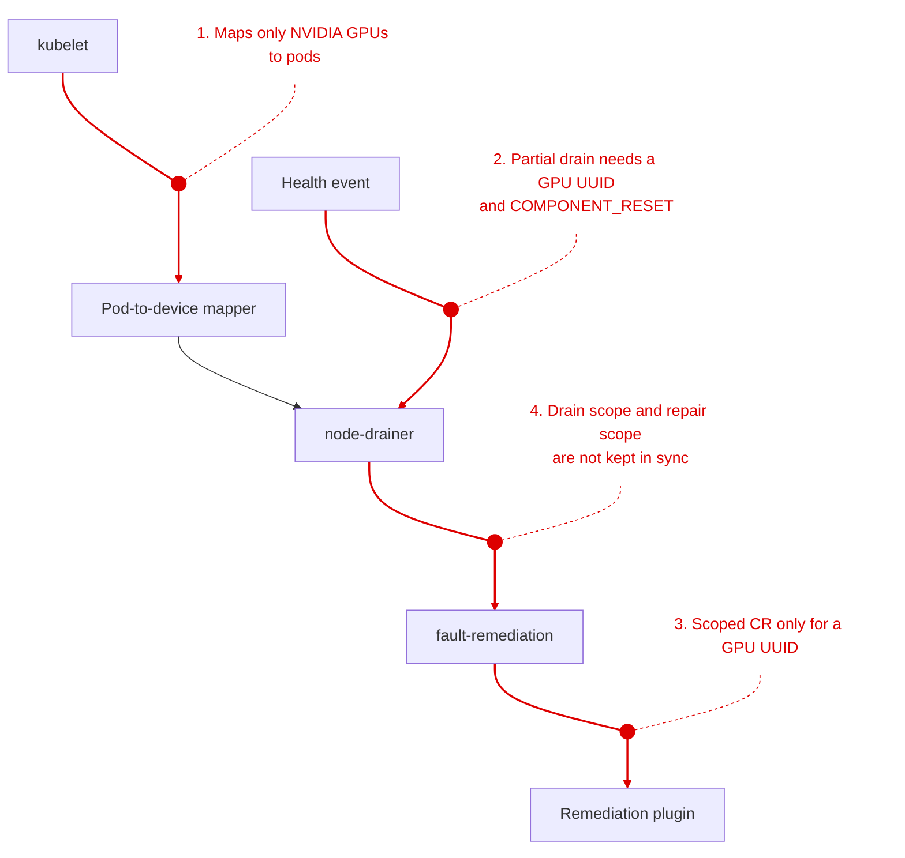

# ADR-075: Configuration — Device Scope for Partial Drains and Scoped Remediation

Status: Proposed (tracking issue [#2417](https://github.com/NVIDIA/NVSentinel/issues/2417)). Implements [Device scope from configuration](070-vendor-neutral-core.md#device-scope-from-configuration) of ADR-070.

## Table of Contents

1. [Context](#context)
2. [Decision](#decision)
3. [Implementation](#implementation)
   - [Configuration](#configuration)
   - [Where each component reads the map](#where-each-component-reads-the-map)
   - [Partial drain decision](#partial-drain-decision)
   - [Scope check](#scope-check)
   - [Pod device mapper](#pod-device-mapper)
      - [Device-plugin devices](#device-plugin-devices)
      - [DRA devices](#dra-devices)
   - [Backwards compatibility](#backwards-compatibility)
4. [Consequences](#consequences)
   - [Positive](#positive)
   - [Negative](#negative)
5. [Alternatives Considered](#alternatives-considered)
   - [Derive the scoped actions from `impactedEntityScope` in fault-remediation](#derive-the-scoped-actions-from-impactedentityscope-in-fault-remediation)
   - [Keep the mapper in the metadata-collector binary with a flag to skip NVML](#keep-the-mapper-in-the-metadata-collector-binary-with-a-flag-to-skip-nvml)
   - [Use the DRA device name as the entity value](#use-the-dra-device-name-as-the-entity-value)
6. [Notes](#notes)
   - [Non-goals](#non-goals)
7. [References](#references)

## Context

When one device on a node fails, NVSentinel does not always need to take the whole node out of service. A partial drain evicts only the pods that use the failed device, and a scoped remediation repairs only that device, for example a reset of one GPU. The other pods on the node keep running.

This needs four steps along the break-fix pipeline. Today each one is either GPU-only or missing:



1. **Know which pods use which device.** Something on each node has to record, for each pod, the devices that Kubernetes gave it, in the same identity that health events use for the device. Today the pod-to-device mapper in metadata-collector does this, and only for NVIDIA GPUs. It starts only after the NVML collection succeeds, and it turns a DRA device into a GPU UUID through a map that NVML provides. Its DaemonSet runs only on NVIDIA GPU nodes. A node with another kind of device gets no mapper.
2. **Decide when a drain is partial.** node-drainer has to know which remediation actions repair one device, and which entity in the event names that device. Today the only entity type is the GPU UUID, and the only action is `COMPONENT_RESET`. Every other action, including a custom action ([ADR-036](036-custom-remediation-actions.md)), drains the full node.
3. **Repair only that device.** fault-remediation has to create a CR that acts on the device, not on the node. This already works for any action through `impactedEntityScope`, but the scope can only name the GPU UUID.
4. **Agree on the scope.** The drain and the repair have to cover the same thing. Today nothing checks this: node-drainer decides from the event, and fault-remediation picks the CR from its own configuration. They can disagree in two directions. A scoped repair after a full drain evicts more pods than needed, which is safe but wasteful. This happens today for a custom action with `impactedEntityScope`. A full-node repair after a partial drain stops the pods that were not drained, which is unsafe. This happens with partial drains on and `COMPONENT_RESET` mapped to `RebootNode`, which is the chart default, and with a fault-remediation rule set that changes the action ([ADR-064](064-node-and-device-selection.md#partial-drains-and-actions-on-the-full-node)). The node-drainer documentation warns about the unsafe case, but nothing prevents it. Extending partial drains to more actions and device types makes this gap larger, so this ADR closes it.

## Decision

1. **The entity-type map becomes configuration.** One Helm value, `global.entityTypes`, defines each entity type with its device-plugin resource names, its DRA drivers and DeviceClasses, and the actions that are scoped to it. Each component that reads the map gets it from that value. The chart default is the NVIDIA `GPU_UUID` entry, so current installs behave the same.
2. **Scoped actions are listed in the map.** node-drainer runs a partial drain for an event when `partialDrainEnabled` is on and the effective action of the event, including a custom action name, is listed under an entity type that the event names. `COMPONENT_RESET` is the default entry.
3. **fault-remediation never runs a full-node action after a partial drain.** The Helm chart checks that each scoped action maps to a `maintenance.actions` entry with the same `impactedEntityScope`. At run time, fault-remediation does not create a CR for an action on the full node after a partial drain. It retries the event and increments a metric.
4. **The mapper becomes its own container in the metadata-collector DaemonSet.** Its code moves to its own package with its own binary and image, and it no longer uses NVML. For a DRA device it reads the entity value from a ResourceSlice attribute that the map names, for example `uuid`. The DaemonSet itself does not change.

## Implementation

### Configuration

```yaml
global:
  entityTypes:
    GPU_UUID:
      resourceNames: ["nvidia.com/gpu", "nvidia.com/pgpu"]
      dra:
        - driver: gpu.nvidia.com
          deviceClasses: ["gpu.nvidia.com"]
          entityValueAttribute: uuid
      scopedActions: ["COMPONENT_RESET"]
```

An operator adds a device type with another key. This example adds a custom action that repairs one accelerator:

```yaml
global:
  entityTypes:
    ACCEL_SERIAL:
      resourceNames: ["example.com/accel"]
      dra:
        - driver: accel.example.com
          deviceClasses: ["accel.example.com"]
          entityValueAttribute: serial
      scopedActions: ["accel-reset"]
fault-remediation:
  maintenance:
    actions:
      "accel-reset":
        kind: "AccelReset"
        impactedEntityScope: "ACCEL_SERIAL"
        # ...
```

The map is keyed by entity type, so Helm merges an operator's entries with the default, and an operator removes the default by setting `GPU_UUID: null`.

- `resourceNames` are device-plugin resource names. Matching is exact.
- `dra` lists DRA drivers. `driver` is the name that the kubelet reports for an allocated device. `deviceClasses` are the names that pods use in their claims. Today one string serves both, which only works because the NVIDIA driver and its DeviceClass share a name.
- `entityValueAttribute` names the ResourceSlice attribute whose value is the entity value in health events (see [DRA devices](#dra-devices)).
- `scopedActions` are action names, as `GetEffectiveActionName` returns them: a built-in action such as `COMPONENT_RESET`, or a custom action name. An action can be scoped to only one entity type. The chart fails if two entries list the same action.

### Where each component reads the map

The chart renders `global.entityTypes` into the configuration file of each component that needs it. Components do not read each other's configuration.

| Component | Uses | Change |
|---|---|---|
| Pod device mapper | `resourceNames`, `dra` | Records only the configured resources and drivers |
| node-drainer | All fields | Partial drain for `scopedActions`. The pod filter, the missing-annotation check and the `drainGPUPods` filter read the configured names instead of `GPU_UUID` |
| fault-quarantine | `scopedActions` | Post-remediation validation uses the same partial-drain decision as node-drainer |
| fault-remediation | `scopedActions` | `impactedEntityScope` must name a configured entity type. The [scope check](#scope-check) |

If a component's configuration has no `entityTypes` key, it uses the NVIDIA `GPU_UUID` entry above, so a configuration file from an earlier chart keeps working. This built-in default is removed when NVIDIA-specific code moves out of the core into an NVIDIA plugin ([ADR-070](070-vendor-neutral-core.md#phase-4-move-vendor-code)). The plugin chart then sets the entry. An empty map, `entityTypes: {}`, turns partial drains off for every event.

### Partial drain decision

node-drainer takes these steps in order and stops at the first one that decides. Steps 1 and 3 work as today.

1. If `partialDrainEnabled` is off, drain the full node.
2. Find the entity type whose `scopedActions` lists the effective action of the event. If there is none, drain the full node, as today for any action other than `COMPONENT_RESET`.
3. Take the first entity of the event with that type and a non-empty value. If there is none, fail the drain and retry. Otherwise, drain only the pods that use that entity.

The pod filter still keeps a pod when its annotation lists the entity value under one of the names of the entity type. A pod that requests one of those resources or DeviceClasses but has no annotation still stops the drain with an error.

### Scope check

The drain and the repair must cover the same thing. A partial drain followed by an action on the full node, such as a reboot, stops the pods that were not drained. Two checks prevent this.

**At install.** When partial drains are on, every action in `scopedActions` needs a `maintenance.actions` entry with the same `impactedEntityScope`. Otherwise the chart fails the install or upgrade. There is no warning period, because the configuration it rejects reboots nodes after a partial drain today.

**At run time.** A fault-remediation rule set ([ADR-064](064-node-and-device-selection.md)) can still pick an action on the full node after a partial drain. The chart cannot see this. fault-remediation knows that the drain was partial from the scope that node-drainer records on the event (`DrainDecision.scope`). In that case, fault-remediation does not create the CR. It treats the event as an [error in ADR-064](064-node-and-device-selection.md#the-drain-decision): it records no decision, logs both scopes, increments `fault_remediation_processing_errors_total` with a new `error_type`, and retries the event with backoff. Each retry evaluates the rule sets again, so a fix to the configuration lets the event continue. node-drainer behaves the same way today when a partial drain cannot proceed. Events from before the upgrade have no recorded scope and are not checked.

The other direction is allowed: a full drain followed by a repair of one device evicts more pods than needed, but stops none without a drain.

### Pod device mapper

The mapper code moves out of the metadata-collector binary into its own package and binary in the metadata-collector module, built as its own image on the default static base. The chart adds it as a second container to the existing metadata-collector DaemonSet:

| Container | Does | Image |
|---|---|---|
| `metadata-collector` | NVML and `nvidia-smi` collection, `gpu_metadata.json` | CUDA base, as today |
| `pod-device-mapper` | Pod device annotations | Static base |

The mapper behaves as today, with these changes:

- It records device-plugin devices for every configured resource name, and DRA devices for every configured driver.
- It does not use NVML or `gpu_metadata.json`. If the NVML collection fails, only the `metadata-collector` container restarts, and the mapper keeps running.
- It mounts only the PodResources socket. It reads `/pods` from the kubelet and patches pod annotations, as today.

The DaemonSet keeps its node selector, RuntimeClass, host settings and DRA claim. These are pod settings, so they also apply to the mapper container. As a result, the mapper still runs only on NVIDIA GPU nodes. Running it on nodes with other devices changes how the DaemonSet is scheduled, and [#2419](https://github.com/NVIDIA/NVSentinel/issues/2419) covers that.

`podMapper.enabled` now adds or removes the `pod-device-mapper` container. The metadata-collector binary no longer runs the mapper.

#### Device-plugin devices

The kubelet reports the device IDs that the device plugin assigned. The mapper records them as entity values, as today. This works when the device plugin registers each device under the same ID that health monitors put in events. For example, the NVIDIA device plugin registers a GPU as `GPU-8f6d…`, and the monitors report the same GPU as `GPU_UUID = GPU-8f6d…`. The exception is GPU sharing (time-slicing or MPS), where it registers the same GPU with a replica suffix, such as `GPU-8f6d…::0`. GPU sharing is out of scope (see [Non-goals](#non-goals)). A device plugin that uses other IDs, such as an index, cannot use partial drains through `resourceNames`. Its devices can use DRA. The configuration documentation says this.

#### DRA devices

ResourceSlice attributes are a Kubernetes API, so the mapper needs no vendor library for DRA devices. The kubelet reports each allocated DRA device with its driver, pool and device name. The mapper finds the matching device in the node's ResourceSlices and records the value of `entityValueAttribute`. The NVIDIA DRA driver publishes a [`uuid` attribute](https://github.com/kubernetes-sigs/dra-driver-nvidia-gpu/blob/v0.5.1/cmd/gpu-kubelet-plugin/deviceinfo.go#L168-L176) on each GPU, so the `GPU_UUID` entry gives the same values as today's NVML map, without NVML.

The entity value in the event must equal the attribute value exactly. One attribute is enough, because each common DRA driver publishes a single attribute that identifies the device. Besides NVIDIA's `uuid`:

- The [AMD driver](https://github.com/ROCm/k8s-gpu-dra-driver/blob/2d00269431e6604c3695e7b72f9340c68bf709e7/cmd/gpu-kubeletplugin/deviceinfo.go#L71-L96) publishes no UUID or serial number. Its unique attribute is the PCI address.
- The [Intel driver](https://github.com/intel/intel-resource-drivers-for-kubernetes/blob/4454278044e41cbab48ff0dd7819155fa19ace5a/cmd/kubelet-gpu-plugin/node_state.go#L132) is moving its own PCI address attribute to the Kubernetes standard one.

For a device that is identified by its PCI address, the entity type uses the Kubernetes standard attribute [`resource.kubernetes.io/pciBusID`](https://github.com/kubernetes/kubernetes/blob/v1.37.2/staging/src/k8s.io/dynamic-resource-allocation/deviceattribute/attribute.go#L34-L39). Its value has the full `domain:bus:device.function` form, so the monitor must report the address in the same form. The `PCI` entities in NVIDIA events today do not: XID lines have no function, and NVML has an eight-digit domain.

If the mapper cannot find the attribute for a device, it does not annotate the pod. node-drainer then sees a pod with a claim and no annotation, and the partial drain waits instead of missing the pod.

The metadata-collector ClusterRole gets `list` and `watch` on `resourceslices.resource.k8s.io`. The chart adds these only when the map has a DRA entry.

### Backwards compatibility

- **Helm values:** no key is renamed or removed. `global.entityTypes` is new, and its default keeps today's behaviour.
- **Flags:** the metadata-collector binary still accepts `--pod-mapper-enabled`, so an older pod spec keeps starting.
- **Pod annotation and event store:** no change. Old and new components read each other's data.
- **Behaviour:** two changes, both on purpose: the chart check, and the retry of an action on the full node after a partial drain (see [Scope check](#scope-check)).

## Consequences

### Positive

- Partial drains and scoped remediation work for any device type that has a device plugin with stable IDs or a DRA driver with an identity attribute, on the nodes where the mapper runs.
- Custom actions with `impactedEntityScope` get a partial drain, not only a scoped repair.
- A full-node action after a partial drain is no longer possible through configuration.
- The mapper no longer depends on NVML, and an NVML failure no longer stops it.

### Negative

- One more image to build and release.
- Until [#2419](https://github.com/NVIDIA/NVSentinel/issues/2419), the mapper runs only on NVIDIA GPU nodes. Other device types get partial drains only on those nodes.
- An existing install with partial drains on and a `COMPONENT_RESET` entry without `impactedEntityScope`, such as the chart default `RebootNode`, fails to upgrade until the operator changes the entry to a scoped action such as `GPUReset`.
- An event whose rule set picks an action on the full node after a partial drain retries until an operator changes the configuration. The node stays cordoned until then.

## Alternatives Considered

### Derive the scoped actions from `impactedEntityScope` in fault-remediation

node-drainer would partially drain every action whose `maintenance.actions` entry has a scope. **Rejected** because subcharts cannot read each other's values, so the chart would have to move `maintenance.actions` to `global`. It also changes the drain for existing installs that have a scoped custom action and a full drain today.

### Keep the mapper in the metadata-collector binary with a flag to skip NVML

The binary would skip the NVML collection on request and run only the mapper. **Rejected** because the mapper would stay in the same binary and CUDA image as the NVIDIA code. [#2419](https://github.com/NVIDIA/NVSentinel/issues/2419) moves that code to the NVIDIA plugin, and the mapper would have to be separated then. A separate container now lets #2419 move the NVIDIA code without changing the mapper.

### Use the DRA device name as the entity value

**Rejected** because health monitors do not know DRA device names. They report hardware identities, such as a GPU UUID.

## Notes

### Non-goals

- Recovery matching after a reboot or a device replacement, in fault-quarantine and platform-connectors ([#2418](https://github.com/NVIDIA/NVSentinel/issues/2418)).
- MIG devices and prefix matching of resource names ([ADR-072](https://github.com/NVIDIA/NVSentinel/pull/2320)).
- New names for the `dgxc.nvidia.com/devices` annotation ([#2423](https://github.com/NVIDIA/NVSentinel/issues/2423)).
- A mapping from device-plugin IDs to entity values, or a conversion between formats of an attribute value, such as a CEL expression.
- Partial drains on shared GPUs (time-slicing or MPS). The device IDs of shared GPUs do not match the GPU UUID in events, so a partial drain misses their pods ([#2451](https://github.com/NVIDIA/NVSentinel/issues/2451)).

## References

- [ADR-070: Vendor-Neutral Core and Vendor Plugins](070-vendor-neutral-core.md)
- [ADR-020: GPU Reset](020-nvsentinel-gpu-reset.md), origin of partial drains and the mapper
- [ADR-036: Custom Remediation Actions](036-custom-remediation-actions.md)
- [ADR-064: Node and Device Selection in Each Component](064-node-and-device-selection.md)
- [ADR-072: MIG Data Model](https://github.com/NVIDIA/NVSentinel/pull/2320) (proposed)
- [Kubernetes Dynamic Resource Allocation](https://kubernetes.io/docs/concepts/scheduling-eviction/dynamic-resource-allocation/)
