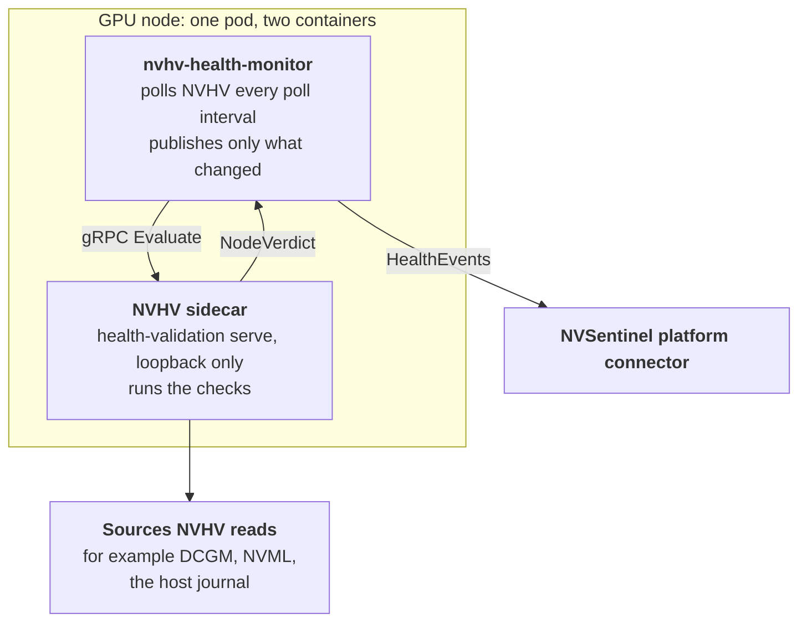

# ADR-076: Health Monitors — Integration with NVHV

## Context

NVHV ([Health Validation](https://github.com/dsx-ai-factory/health-validation)) runs node health checks, such as DCGM's health checks and Xid detection, and reports the result as one verdict for the node. `health-validation serve` serves that verdict over gRPC (`health.verdict.v1.VerdictService/Evaluate`). Each result in the verdict has a severity and an action. NVSentinel plans to use these checks in place of its own, one kind at a time, such as Xid detection, done today by syslog-health-monitor, and the DCGM health checks, done today by gpu-health-monitor (GHM).

Every kind of check needs the same things from NVSentinel: a way to run NVHV on each GPU node, call it, turn its verdict into health events, and handle NVHV being down. This ADR decides those shared parts once; how each kind of check's results become events, and how that check moves from the monitor that runs it today (which monitor acts on it during the move, and in what order), will be designed separately.

## Decision

Add a health monitor, **nvhv-health-monitor**, that runs NVHV as a sidecar in the same pod and calls NVHV's gRPC verdict API on loopback every poll interval. It compares each verdict with the faults it already reported and publishes only what changed. Every kind of NVHV check NVSentinel adopts goes through this one monitor.

## Implementation

- **Pod.** One pod per GPU node, from a DaemonSet in NVSentinel's chart, with two containers: the monitor, and NVHV (`health-validation serve`, loopback only) from the image NVHV publishes. NVSentinel needs that image to carry the native libraries NVHV's checks load (for example DCGM's `libdcgm.so.4`), so the sidecar needs no host mount for them.
  - **NVHV owns:** running the checks, each result's severity and action, and the connections to the sources it reads (for example DCGM, NVML and the host journal).
  - **The monitor owns:** the poll interval, the faults it reported, saved state, and the events.
- **Poll.** Every poll interval (configurable, default 15 s) the monitor calls `Evaluate` and gets one verdict for the node. It turns the results into events in the way designed for each kind of check, and publishes only what changed; when nothing changed, it publishes nothing. A check that is missing from a verdict, or UNKNOWN, never clears a fault the monitor reported: for example, a verdict that holds only `collection_source_busy` leaves every reported fault as it is. Only a result that the check's design treats as a recovery clears a fault.
- **Verdict to health event.** Every kind of check fills NVSentinel's `HealthEvent` from NVHV's `CheckVerdict` the same way; only the fields marked "check's design" differ per kind of check. A result the monitor doesn't publish (UNKNOWN, or PASS with no fault to clear) gives no event. In the table, `result` is one entry in the verdict's `check_results`. The example is a row-remap failure on one GPU from NVHV's DCGM checks; its check name and error code are illustrative and are set in that check's design.

  | `HealthEvent` field | Value | Example |
  |---|---|---|
  | `agent` | `nvhv-health-monitor` | `nvhv-health-monitor` |
  | `nodeName` | the `NODE_NAME` environment variable | `<node>` |
  | `componentClass` | from `result['category']`, for example `gpu` → `GPU` | `GPU` |
  | `checkName` | from `result['check_id']`; check's design, for example a prefix so the name never collides with the current monitor's | `NVHVGpuMemWatch` |
  | `isFatal` | from `result['severity']`: `true` for CRITICAL; `false` for WARNING and INFO | `true` |
  | `isHealthy` | `false` for a new fault; `true` for a recovery | `false` |
  | `message` | `result['messages']` | `DCGM_FR_ROW_REMAP_FAILURE: GPU 0 had uncorrectable memory errors and row remapping failed. …` |
  | `recommendedAction` | from `result['recommended_action']['remediation_actions'][0]`: `reset_gpu` → `COMPONENT_RESET`; `service_required` → `CONTACT_SUPPORT`; `result['recommended_action']['operational_state']` `monitor` → `NONE`; any other action → `CONTACT_SUPPORT` ; a recovery → `NONE` | `COMPONENT_RESET` |
  | `errorCode` | check's design, from `result['check_id']` or `result['observed_values']`, for example a DCGM error code or an Xid number | `["DCGM_FR_ROW_REMAP_FAILURE"]` |
  | `entitiesImpacted` | a GPU UUID from `result['affected_entities']` → `GPU_UUID`; a PCI address in `result['observed_values']` → `PCI`. | `[{GPU_UUID, GPU-<uuid>}, {PCI, <pci-address>}]` |
  | `processingStrategy` | from the chart | `EXECUTE_REMEDIATION` |

- **Publishing.** The events of one poll go to NVSentinel's platform connector in one batch, through NVSentinel's shared publishing client: the node-local platform connector socket, or a central connector when `HEALTH_PUBLISH_TARGET` is set. The monitor updates its record of reported faults only after the batch was delivered. If publishing fails, the record stays as it was, so the next poll computes its events against the same record.
- **NVHV unreachable.** When a call to NVHV fails (`DEADLINE_EXCEEDED`, `UNAVAILABLE` or `INTERNAL`), the monitor logs it and sends no health event for that call; it neither raises nor clears any fault until NVHV answers again. Kubernetes restarts NVHV when it crashes, and, once [NVHV issue 319](https://github.com/dsx-ai-factory/health-validation/issues/319) is done, when a call stays stuck. If NVHV stays unreachable for longer than a threshold (configurable in the chart, default 5 minutes), for example because it keeps crashing, the monitor sends one `NVHVUnreachable` event: `isFatal: true`, `isHealthy: false`, `recommendedAction: CONTACT_SUPPORT`, and no `entitiesImpacted`, because the failure doesn't point to a GPU. The node is cordoned because none of its GPUs are being checked, and a person has to find the cause. Usually it is software or configuration, but it can be hardware: NVHV calls NVML inside its own process, so if NVML or the GPU driver crashes on a faulty GPU (for example one that fell off the bus), NVHV crashes too, and keeps crashing after each restart while the GPU stays faulty. When NVHV answers again, the monitor sends the recovery (`isHealthy: true`).
- **Recovering a stuck NVHV call.** A check can get stuck in a native library call that NVHV can't cancel. NVHV's `serve` keeps serving meanwhile: every later `Evaluate` returns at once with only a `collection_source_busy` check (UNKNOWN, naming the stuck source and when its call started), and no other check runs until that call returns. Only a restart of the NVHV container ends the call, and a probe on NVHV's port or verdict API keeps passing because NVHV still answers. So NVHV must let the kubelet restart it once a call stays stuck past a configurable deadline, set well above NVHV's request timeout. NVHV already tracks each stuck call and when it started (it reports them in `collection_source_busy`), so the deadline is measured from that. Kubelet probes connect to the pod IP, and NVHV's verdict port listens only on loopback, so a probe can't reach it directly. NVHV doesn't do this yet; it is requested in [NVHV issue 319](https://github.com/dsx-ai-factory/health-validation/issues/319). NVHV decides how (for example a health command for an `exec` probe, a gRPC health port on the pod IP, or exiting on its own), and the chart sets up the matching liveness probe.
- **Chart.** NVSentinel's chart provides:
  - `global.nvhvHealthMonitor.enabled`, which turns the monitor on for the whole cluster.
  - one poll interval, configurable in the chart (default 15 s), passed to the monitor and to the NVHV settings that depend on it;
  - NVHV's request budget, derived from the poll interval, so a request never outlives the next poll;
  - the monitor's processing strategy (default `EXECUTE_REMEDIATION`);
  - how long NVHV can stay unreachable before the monitor sends `NVHVUnreachable` (default 5 minutes);
  - host mounts: the state file and the platform connector socket, or the `HEALTH_PUBLISH_*` settings for a central connector;
- **Startup order.** On Kubernetes 1.29 and later, NVHV is a native sidecar: an init container with `restartPolicy: Always` and an `exec` startup probe that checks NVHV's loopback port from inside its container, so the monitor starts only after NVHV is listening, and Kubernetes restarts NVHV on its own. On Kubernetes 1.28 and earlier, NVHV is an ordinary second container, and the monitor's polls fail as NVHV unreachable until NVHV is up. On Kubernetes 1.29 to 1.32 the native sidecar needs the `SidecarContainers` feature gate on the API server and on every node; it is on by default, and a cluster that turns it off can reject the pod or leave it stuck in initialization. From 1.33 the gate is always on.

## Rationale

- **NVHV owns its build.** The sidecar runs the image NVHV publishes, which is to include the native libraries its checks load, such as DCGM's `libdcgm.so.4`, so the library versions come from NVHV, not from each host.
- **Failures stay apart.** Kubernetes restarts each container on its own, so an NVHV crash doesn't take the monitor down, and NVHV gets its own liveness probe.
- **One monitor for every check.** Polling, publishing, deployment and NVHV error handling are written once; a new kind of check adds only how its results become events and its settings.

## Consequences

### Positive

- The checks live in one place, NVHV, and any other NVHV consumer gets the same checks and verdicts.
- NVHV turns sources into a verdict; the monitor turns verdicts into events and keeps the state. Each part is smaller and can be changed and tested on its own.
- No new monitor or sidecar for each new kind of check.

### Negative

- **NVSentinel's detection depends on NVHV.** Everything the monitor reports comes from NVHV's verdict. While NVHV is unreachable (crashed, hung or restarting), no checks run on the node and no fault is raised or cleared. If NVHV never starts (for example a wrong image), on Kubernetes 1.29 and later the monitor doesn't start either: the pod stays in `Init`, which shows in the pod's status, not in the monitor's metric. On 1.28 and earlier the monitor starts and reports it like any other unreachable NVHV.

### Mitigations

- The kubelet restarts NVHV when it crashes, and, once [NVHV issue 319](https://github.com/dsx-ai-factory/health-validation/issues/319) is done, when a call stays stuck past its deadline. The native sidecar keeps the monitor from polling before NVHV is listening.
- When NVHV is unreachable, the monitor logs it and emits a metric for alerting. If the outage outlasts a threshold, as in a crash loop where restarts don't help, it sends the fatal `NVHVUnreachable` node event with CONTACT_SUPPORT, so the unmonitored node takes no new work.

## Alternatives Considered

### Build NVHV's image outside NVHV

The sidecar design stays as it is and only the image's source changes. NVHV's release process already expects users to build deployment images from a source version they choose. NVSentinel provides a short note for building NVHV's image from a pinned NVHV release, with the native libraries its checks load (for example DCGM's `libdcgm.so.4`). The user builds the image, pushes it to their registry, and sets it in the Helm values for the NVHV sidecar (for example `<nvhv-sidecar-image>`).

**Rejected** because:

1. **NVSentinel owns the image build:** it pins the NVHV version and the versions of the libraries NVHV's checks load, and rebuilds for every NVHV release or fix it needs.
2. **The build must add those libraries.** NVHV's image build today leaves out the ones it expects to be mounted from the host (for example DCGM's `libdcgm.so.4`), so the script adds them itself.
3. **Every user has an extra step before installing.** The chart should refuse to turn on the monitor when no NVHV image is set, rather than start a pod that can't pull its sidecar.

### Import NVHV as a Go module

The monitor can import NVHV's Go module and run the checks it needs in its own process, through the same library call NVHV's CLI uses, which returns the same verdict. The monitor builds a catalog with only those checks and passes only their sensors, so there is no check-selection question. There is also no transport to secure, and a breaking API change shows up at build time.

**Rejected** because:

1. **The monitor must handle a hung check itself.** A check can hang in a native library call (for example a DCGM call), which Go can't cancel, so the monitor must not start a new evaluation while one is still running, and its liveness probe must fail once the call runs past a deadline. With the sidecar, NVHV runs one evaluation at a time and the kubelet restarts only the NVHV container; a restart here restarts the whole monitor, not just NVHV.
2. **A crash in a native library NVHV loads stops the monitor** (for example DCGM's or NVML's), because the library is loaded into the monitor's process.
3. **An NVHV fix needs a monitor release**, not just a new image tag.
4. **No stable Go API yet:** NVHV's module is before 1.0 (latest release `toolkit/v0.3.2`), so a minor release can change its Go API.
5. **The monitor must repeat what NVHV's CLI does around the library call:** set the execution context, cadence, node ID and timeouts; and report a failed GPU architecture discovery as a failed verdict, so that a node whose GPUs are all lost doesn't add up to PASS.

### Run NVHV as a child process in the monitor's container

The monitor's image can include NVHV's binary, built from NVHV's source at a pinned version, with the native libraries its checks load. The monitor starts NVHV's server as a long-lived child process and calls `Evaluate` on it over loopback, as it would call the sidecar. NVHV still runs in its own process, so it keeps its connections to its sources, its one-evaluation-at-a-time admission and the work around the library call, and the monitor's own build needs no cgo or NVHV dependencies.

**Rejected** because:

1. **The monitor supervises NVHV itself.** It restarts the child when the child exits, and kills and restarts it when a check hangs past a deadline, which is what the kubelet does for the sidecar. The monitor keeps its own state across these restarts.
2. **One image to build:** the monitor's image carries NVHV's binary and the native libraries its checks load, so an NVHV fix needs a rebuild of the monitor's image, not just a new image tag.

### Add NVHV to the existing health monitors

Instead of a new monitor, each existing monitor gets a flag that switches it between its current logic and NVHV: gpu-health-monitor for the DCGM checks, syslog-health-monitor for Xid detection, each with NVHV as a sidecar in its own pod.

**Rejected** because:

1. **NVHV doesn't fit cleanly into any one existing monitor.** Its checks span areas that NVSentinel's monitors split between them today (DCGM in gpu-health-monitor, Xid in syslog-health-monitor), and more kinds of check will be added. Putting NVHV into one of them would tie unrelated checks to that monitor: a user who wants a new kind of NVHV check would have to turn on gpu-health-monitor for it.
2. **Regressions in monitors already in production.** The existing monitors run in production clusters; adding a second detection path inside them risks breaking what works today.

### A separate monitor for each kind of NVHV check

**Rejected** because: each would run its own NVHV sidecar and repeat the poll, publishing and deployment.

## References (Optional)

- [NVHV (Health Validation) repository](https://github.com/dsx-ai-factory/health-validation)
- [NVHV verdict API](https://github.com/dsx-ai-factory/health-validation/blob/main/proto/health/v1/verdict.proto) (`proto/health/v1/verdict.proto`)
