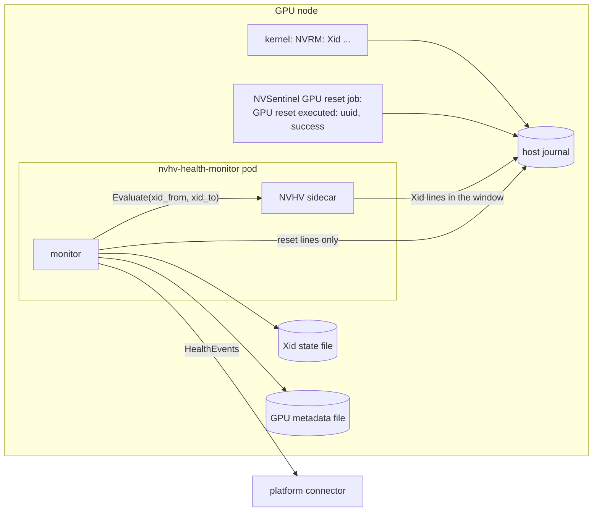
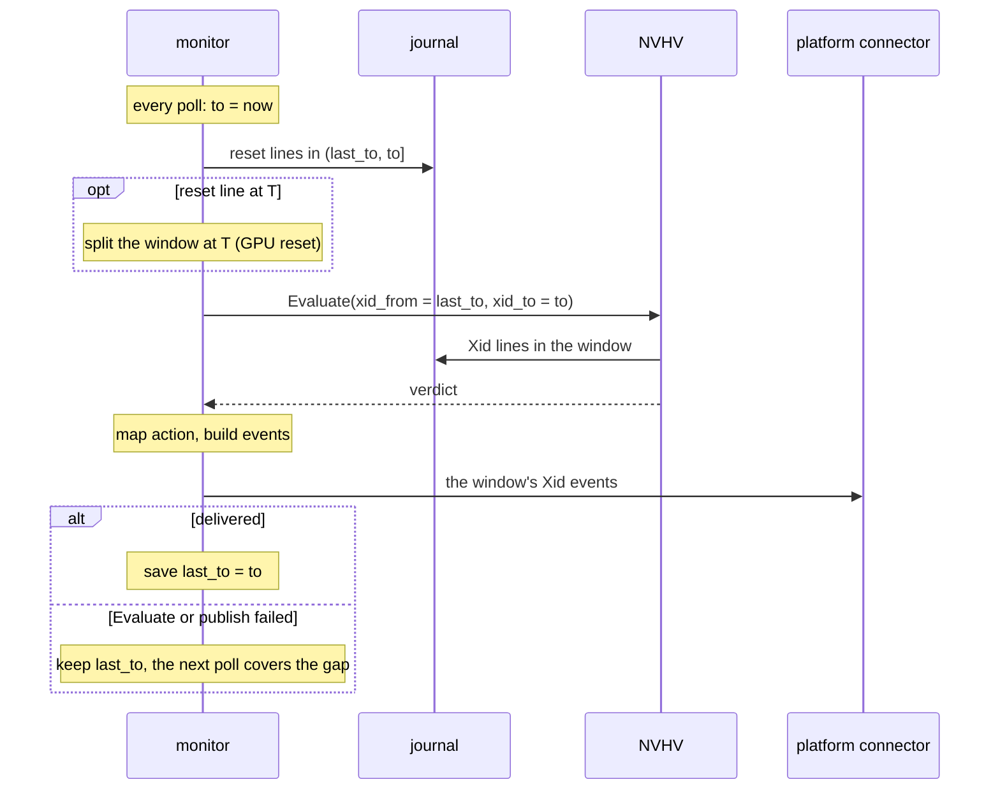
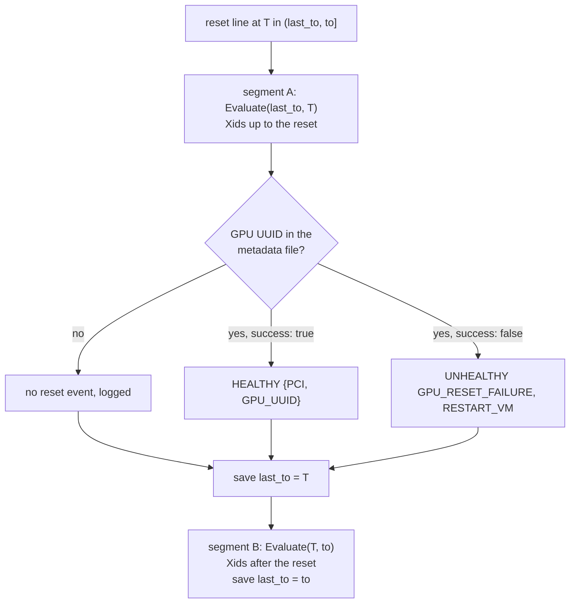
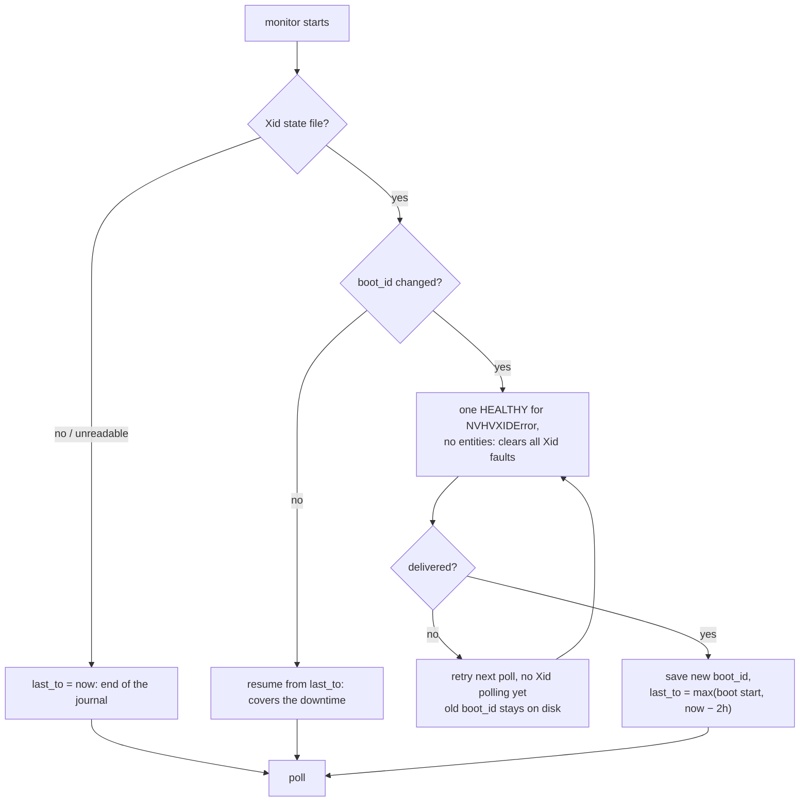

# ADR-077: Health Monitors — Xid detection in nvhv-health-monitor

## Context

syslog-health-monitor detects Xid errors by parsing the kernel journal itself.
NVHV (Health Validation) has its own Xid checks, based on
[NVIDIA's Xid catalog](https://docs.nvidia.com/deploy/xid-errors/latest/analyzing-xid-catalog.html),
and [ADR-076](076-integration-with-nvhv.md) adds **nvhv-health-monitor**, which
runs NVHV as a sidecar and turns its verdict into health events.

This ADR decides how nvhv-health-monitor handles NVHV's Xid checks, so an
operator can use them in place of syslog-health-monitor's Xid check.

An Xid is an event, not a state: the driver logs the line once, and nothing
later says the GPU is fine again. Only a GPU reset, a node reboot or the
driver's Xid 154 back to None clears it. So the monitor must handle the same
cases syslog-health-monitor handles today:

| Case | Expected behaviour |
|---|---|
| An Xid with an action | a fault event for that GPU |
| A fault that persists between polls | reported once, kept until recovery |
| A GPU reset | recovery for that GPU |
| A node reboot | recovery for the whole node |
| Xid 154 back to None | recovery for that GPU |
| A monitor or NVHV restart | no Xid lost |

**Out of scope**, staying with syslog-health-monitor: SXid, Xid on Kata nodes,
and the GPU-fallen-off and NIC checks ([Limitations](#limitations)).

## Decision

Add Xid detection to nvhv-health-monitor, turned on with
`nvhv-health-monitor.xid.enabled` in place of syslog-health-monitor's Xid check.

Every poll, the monitor:

1. asks NVHV for the Xid lines in a sliding time window;
2. turns the results into health events (check name `NVHVXIDError`) with
   NVHV's recommended action;
3. clears a GPU's Xid faults only on a GPU reset, a node reboot or Xid 154 back
   to None.

## Implementation

### Overview



| Part | Owns |
|---|---|
| **NVHV** | Parsing the Xid lines in the requested window, and the recommendation for each Xid: the catalog, the Xid 154 recovery action, NVLink5 decoding. Keeps no state between calls. |
| **Monitor** | Everything that links one window to the next: the window, GPU reset and reboot detection, the action mapping, the events and the Xid state file. |
| **GPU metadata file** (NVSentinel's metadata collector) | What the verdict can't give: the GPU UUID when NVHV can't name the GPU, the PCI address of a reset GPU, and the chassis serial. |

### NVHV's Xid results

NVHV reads the current boot's kernel journal for the requested window and
returns one result per Xid check and GPU. The monitor reads only results with
`category: "xid"`. It ignores the verdict's `overall_severity`, which is the
worst result of every check NVHV ran in the call (for example its GPU and DCGM
checks), not only the Xid checks.

```json
{
  "check_id": "gpu_xid_13",
  "category": "xid",
  "severity": "WARNING",
  "affected_entities": ["GPU-<uuid>"],
  "recommended_action": {
    "operational_state": "monitor",
    "remediation_actions": ["restart_app"]
  },
  "observed_values": {
    "gpu_id": "GPU-<uuid>",
    "pci_address": "0000:<bus>:00.0",
    "xid_counts": {"13": 2},
    "events": [
      {
        "xid_code": 13,
        "message": "NVRM: Xid (PCI:0000:<bus>:00): 13, pid=12345, name=<process>, Graphics SM Warp Exception on (GPC 0, TPC 1, SM 0) ...",
        "count": 2,
        "sequence": 1,
        "pci_address": "0000:<bus>:00.0",
        "pid": 12345,
        "process_name": "<process>",
        "gpc": 0,
        "tpc": 1,
        "sm": 0
      }
    ]
  }
}
```

What shapes the design:

- **Identical lines are grouped:** 50 identical lines in a window are one
  `events[]` entry with `count: 50`.
- **Events have no timestamp,** so one call can't say whether an Xid came
  before or after a GPU reset in the same window.
- **A window with no Xids** gives one node-level PASS per check, with no GPU,
  no entities and no action:

  ```json
  {
    "check_id": "gpu_xid_13",
    "category": "xid",
    "severity": "PASS",
    "observed_values": {
      "gpu_id": "",
      "pci_address": "",
      "xid_counts": null,
      "events": null
    }
  }
  ```

- **Some Xids carry extra fields:** `gpc`, `tpc` and `sm` for Xid 13;
  `nvlink5` (`sub_component`, `link`, `fatal`, `intr_info`, `error_status`) for
  Xid 144–150; `recovery_action` (`from_code`, `to_code` and their names) for
  Xid 154.
- **An NVLink5 line (Xid 144–150) comes in two results** with the same event:
  the code-level check (for example `gpu_xid_149`) and the per-subcode check
  (`gpu_xid_149_4`), whose subcode NVHV derives from `intr_info` and whose
  severity comes from the Xid catalog's decode table.

### The Xid window

Every poll (ADR-076's poll interval, default 15 s), the monitor calls
`Evaluate(xid_from = last_to, xid_to = to)`, where `to` is the time of the
poll, in milliseconds:

- **`(last_to, to]`:** start exclusive, end inclusive, as `journalctl --until`.
  Windows touch without overlapping, so each line is read exactly once.
- **The monitor always sets `xid_to`,** instead of letting NVHV use its own
  clock, and reads the GPU reset lines over the same window, so a reset line
  always falls inside the window NVHV evaluated.
- **`last_to` moves to `to` only after the window's events are delivered,** so
  a late or failed poll only makes the next window longer.



### Verdict to HealthEvent

| Xid result | Monitor sends |
|---|---|
| CRITICAL with events, or any result with events whose operational state is `drain` | one event per distinct message, **fatal**, action from [Action mapping](#action-mapping) |
| WARNING with events, `monitor` or no action (including `gpu_xid_unknown`) | one event per distinct message, `NONE`, **not fatal**: recorded, no action |
| INFO from `gpu_xid_154` with `"0x0"` in `recovery_action_counts`: the GPU's recovery action changed back to None, so the driver no longer needs recovery for it | one HEALTHY event for the GPU ([Xid 154](#xid-154)) |
| Any other INFO, PASS or skipped result | nothing. A PASS only means no new line in the window, not that the GPU recovered |
| UNKNOWN or a collection error | nothing; the window failed and is read again on the next poll ([Restarts and failures](#restarts-and-failures)) |

- **One check name, `NVHVXIDError`, for every Xid,** so one node condition
  holds every Xid fault on the node. It differs from syslog-health-monitor's
  `SysLogsXIDError`, so each monitor's conditions can be told apart.
- **One event per `events[]` entry:** two Xid 13 lines with different text are
  two events; the same line twice is one.

| Field | Value |
|---|---|
| `agent` | `nvhv-health-monitor` |
| `checkName` | `NVHVXIDError`; `NVHVXIDCollectionFailure` for collection that keeps failing |
| `componentClass` | `GPU` |
| `errorCode` | `xid_code`, or `<xid_code>.<sub_component>` for Xid 144–150; **empty on HEALTHY events**, so they clear every Xid fault on their entities |
| `message` | the `NVRM: Xid` line |
| `entitiesImpacted` | `PCI` from `pci_address`; `GPU_UUID` from `gpu_id`, or from the metadata file by PCI address; `GPC`, `TPC`, `SM` for Xid 13 |
| `recommendedAction`, `isFatal` | [Action mapping](#action-mapping); fatal when the action isn't `NONE` |
| `isHealthy` | true only on recovery (GPU reset, reboot, Xid 154 back to None) |
| `processingStrategy` | the monitor's processing strategy |
| `metadata.chassis_serial` | GPU metadata file |

**When NVHV can't name the GPU:** NVHV fills `gpu_id` from the NVML inventory
it read earlier in the same call. When `gpu_id` is empty, the monitor looks up
the UUID by PCI address in the metadata file. If that fails too, the event
names only the PCI address, and `COMPONENT_RESET` becomes `RESTART_VM`.

### Action mapping

A result acts when NVHV asks to act on it: it is CRITICAL, or its operational
state is `drain`. NVHV recommends steps to try in order, for example
`[reset_gpu, service_required]`. An event carries one action, so the monitor
maps only the first step; if a GPU reset fails, NVSentinel's own reset-failure
event takes it further.

| NVHV's first step | NVSentinel action |
|---|---|
| `reset_gpu` | `COMPONENT_RESET` (`RESTART_VM` when the GPU UUID isn't known) |
| `restart_os` | `RESTART_BM` or `RESTART_VM` (Q1) |
| anything else (`stop_p2p_traffic`, `service_required`, `update_swfw`, `restart_app`, a newer step) | `CONTACT_SUPPORT` |

- **A result NVHV asks to act on is always fatal:** a step NVSentinel has no
  action for falls back to `CONTACT_SUPPORT`.
- **A WARNING with `monitor` stays `NONE`,** even with steps such as
  `restart_app` (Xid 13, Xid 45): it asks nothing of the node.
- **`retry_collection` or `check_collection` as first step is a collection
  failure,** not a fault, whatever the severity. NVHV sends these only on
  UNKNOWN today; the rule keeps a future CRITICAL one from becoming
  `CONTACT_SUPPORT`.

### Recovery

#### GPU reset

NVHV doesn't report resets. NVSentinel's GPU reset job logs
`GPU reset executed: <uuid>, success: <bool>`, so the monitor reads that line
itself. Since NVHV's events have no timestamps, the monitor splits the window at
the reset line's time `T` and evaluates each part separately:



- **Order:** Xids before the reset go out before the HEALTHY event, newer ones
  after it. Several resets split the window at each one.
- **An Xid stamped exactly at `T`** counts as before the reset, matching NVHV's
  "strictly after a reset" rule.
- **A GPU missing from the metadata file** gets no reset event, and the line
  isn't retried: its faults stay until another reset or a reboot.
- **Publishing fails partway:** if segment B fails, the next poll starts at
  `T`, so nothing before the reset is sent again. If segment A or the reset
  event fails, the next poll repeats both, in the same order.

#### Node reboot

The monitor saves the boot ID. When it starts on a new boot, it sends one
HEALTHY `NVHVXIDError` with no entities, which clears every Xid fault on the
node, and then reads the new boot from its start
([Saved state and startup](#saved-state-and-startup)). NVHV reads only the
current boot, so Xids from an earlier boot never come back.

#### Xid 154

Xid 154 isn't a fault of its own: the driver logs it each time a GPU's recovery
action changes, for example
`GPU recovery action changed from 0x0 (None) to 0x4 (Drain and Reset)`.

NVHV's `gpu_xid_154` gives one result per GPU, decided by the **GPU's last 154
line in the window** (journal order). None → Drain and Reset → GPU Reset
Required gives one CRITICAL result, for GPU Reset Required. If a source gives
no order, NVHV keeps the most disruptive action, so a None can't hide a later
request.

| Last "to" action | NVHV result | Event |
|---|---|---|
| `0x2` OS Reboot, `0x6` Bus Reset, `0x7` System Reboot | CRITICAL, `restart_os` | `RESTART_BM` or `RESTART_VM` (Q1), fatal |
| `0x1` GPU Reset Required, `0x4` Drain and Reset | CRITICAL, `reset_gpu` | `COMPONENT_RESET`, fatal |
| `0x3` Drain P2P | CRITICAL, `stop_p2p_traffic` | `CONTACT_SUPPORT`, fatal: NVSentinel can't stop P2P traffic |
| a code NVHV doesn't know (for example `0x5` Recover IMEX Domain) or an unreadable line | WARNING, `monitor` | `NONE`, not fatal |
| `0x0` None | INFO | one HEALTHY event for the GPU |
| no 154 line | PASS | nothing |

- **Fault events:** one per distinct 154 line, as for every Xid, with
  `errorCode` `154`.
- **Back to None:** the driver no longer needs recovery for the GPU, for
  example after it cleared a Drain P2P itself. The monitor sends one HEALTHY
  `NVHVXIDError` with `PCI` and `GPU_UUID` and **no `errorCode`**, as
  syslog-health-monitor does, so every Xid fault on that GPU clears. Other GPUs
  and other checks keep theirs. A window with None → Drain P2P → None gives only
  this event.
- **Order in a window:** events go out in journal order (`sequence`), with the
  HEALTHY event in the place of the None line. Xids logged before it are
  cleared by it; Xids logged after it stay.

### Saved state and startup

The Xid state file sits on a host path that survives a reboot and holds:

| Value | Why |
|---|---|
| `boot_id` | to know the node rebooted while the monitor was down |
| `last_to` | end of the last delivered window, so a restart neither skips nor repeats a line |
| `collection_failure_raised` | so a restarted monitor still clears an `NVHVXIDCollectionFailure` it raised ([Restarts and failures](#restarts-and-failures)) |



- **A first start begins at the end of the journal,** as syslog-health-monitor
  does, so a switch doesn't publish again Xids it already reported.
- **After a reboot,** the monitor reads the new boot from its start, at most
  2 h back, so Xids logged while it was starting aren't missed.
- **An unreadable state file** (for example after a crash mid-write) is logged
  and treated as a first start.

### Restarts and failures

| Situation | What happens |
|---|---|
| Monitor, NVHV or pod restart | resumes from `last_to`; the next window covers the downtime |
| NVHV unreachable | `last_to` stays; past threshold (default 5 min) the monitor sends `NVHVUnreachable` |
| NVHV stuck in a call | NVHV answers only `collection_source_busy` (UNKNOWN), so the window fails. Past its stuck-call deadline (default 10 min) NVHV's liveness check fails and the kubelet restarts it |
| Xid collection keeps failing while NVHV answers (UNKNOWN with `retry_collection` or `check_collection`, for example `journalctl` fails or times out) | past the same threshold, one node-level `NVHVXIDCollectionFailure`: fatal, `CONTACT_SUPPORT`, no entities, NVHV's `measurement unavailable: …` message. The first successful window sends its HEALTHY event, also after a restart (`collection_failure_raised`). A reboot doesn't clear it. Not sent while `NVHVUnreachable` is raised |
| Crash between publish and save, or platform connector down | the window is sent again: an event can be sent twice, never lost |
| Clock steps backward | lines at or before `last_to` are skipped; if `now` is before `last_to`, the monitor waits |

### Metrics

| Metric | Type | Labels | What it shows |
|---|---|---|---|
| `nvhv_xid_events_published` | counter | `xid_code`, `gpu_uuid`, `is_fatal` | Xid events published |
| `nvhv_xid_processing_errors` | counter | `reason` | results the monitor couldn't turn into an event |

### Moving from syslog-health-monitor

The operator picks one monitor for Xids per cluster. The two never detect Xids
on the same node at the same time, and syslog-health-monitor keeps running for
everything else.

**Switch:** one chart change on every non-Kata node (L2):
syslog-health-monitor's Xid check off, `nvhv-health-monitor.xid.enabled: true`.

- Nothing is published twice: the monitor starts at the end of the journal.
- syslog-health-monitor's `SysLogsXIDError` conditions and the nodes it
  quarantined for an Xid are left behind, since no recovery comes under that
  check name any more. NVSentinel's node-cleanup job handles them as a disabled
  check ([ADR-075](075-stale-node-condition-cleanup.md), proposed in
  [PR 2449](https://github.com/NVIDIA/NVSentinel/pull/2449)).

**Going back:** `nvhv-health-monitor.xid.enabled: false`, syslog-health-monitor's
Xid check on. `NVHVXIDError` and `NVHVXIDCollectionFailure` are then disabled
checks, cleaned up the same way; other NVHV checks the monitor runs (for
example DCGM) are untouched.

Each monitor keeps its saved position while its Xid detection is off, and would
publish again every Xid the other handled in between. So on each node,
before the chart change, drop the saved position of the monitor coming back:

- **syslog-health-monitor:** with it stopped, remove the `SysLogsXIDError`
  entry from `check_last_cursors` in its state file
  (`/var/run/nvsentinel/syslog_monitor/state.json` on the host with the chart's
  default mounts). Its other checks keep their cursors.
- **nvhv-health-monitor:** delete `nvhv-health-monitor-xid.state` under the
  chart's `xid.stateHostPath`.

A reboot in between needs neither: both monitors drop their old position on a
new boot.

## Rationale

- **One Xid parser.** Catalog and decoding updates land in NVHV only, and every
  NVHV consumer gets the same answer.
- **NVHV stays stateless,** so it can restart or upgrade without touching fault
  state.
- **An Xid is an event, not a state,** so only a GPU reset, a reboot or Xid 154
  back to None clears it, never a PASS.
- **syslog-health-monitor's behaviour where it matters** (start at the end of
  the journal, the same recovery triggers, one check name for every Xid), so a
  switch changes as little as possible. A different check name lets each
  monitor's leftovers be cleaned up by name.

## Consequences

### Positive

- **No Xid catalog to maintain in NVSentinel.** syslog-health-monitor embeds a
  copy of the catalog and needs an NVSentinel release for every update. Here,
  new codes and changed actions arrive with an NVHV image update.
- **Architecture-aware detection:** NVHV runs only the Xid checks the catalog
  lists for the node's GPU architecture, so, for example, Xid 54 on GB200 raises
  an event with syslog-health-monitor and none here.

### Negative

- **Event counts differ from syslog-health-monitor:** identical lines in one
  window are one event, and an NVLink5 line gives two events (code-level and
  per-subcode).
- **Thresholds count within one window,** so an NVHV Xid threshold above one
  occurrence may never fire.
- **Unknown codes aren't fatal:** a code NVHV has no check for is recorded but
  doesn't quarantine the GPU, where syslog-health-monitor sends
  `CONTACT_SUPPORT`.
- **A switch leaves the other monitor's conditions and quarantined nodes**
  until the node-cleanup job handles them, and dashboards on `SysLogsXIDError`
  need the new name.
- **Switching back in the same boot publishes Xids again** unless the operator
  drops the saved position of the monitor coming back first
  ([Moving from syslog-health-monitor](#moving-from-syslog-health-monitor)).

### Mitigations

- **Collection that keeps failing is reported,** not only logged:
  `NVHVXIDCollectionFailure`, next to `NVHVUnreachable`.
- **The node-cleanup job** ([ADR-075](075-stale-node-condition-cleanup.md))
  handles the disabled check's leftovers after a switch, in either direction.

## Limitations

These stay with syslog-health-monitor. A cluster that needs them keeps
syslog-health-monitor running for them, or moves Xid detection back
([Moving from syslog-health-monitor](#moving-from-syslog-health-monitor)).

- **L1. SXid:** NVHV has no SXid checks, so SXid detection stays with
  syslog-health-monitor. Not planned.
- **L2. Kata nodes:** their Xids reach the host through containerd logs, which
  NVHV doesn't read, so this monitor doesn't run there. Not planned.
- **L3. health-events-analyzer's Xid rules:** they match only
  `checkName == 'SysLogsXIDError'`, so they don't see `NVHVXIDError`. And
  grouped lines mean rules that count occurrences within a burst
  (`XIDErrorSoloNoBurst`, the repeated-Xid rules) would see fewer. A cluster
  that relies on them keeps syslog-health-monitor's Xid check.
- **L4. GPU fallen off the bus:** syslog-health-monitor's
  `SysLogsGPUFallenOff` check reports a GPU that is no longer reachable. NVHV's
  Xid checks don't cover it, so it stays with syslog-health-monitor.
- **L5. NIC driver errors:** syslog-health-monitor's `SysLogsNICDriverError`
  check reports NIC driver errors, such as mlx5 TX/RX timeouts. NVHV has no NIC
  driver checks, so it stays with syslog-health-monitor.

## Notes

### Dependencies and blockers

| Needed | Where | Status | Blocks |
|---|---|---|---|
| Millisecond `xid_from` / `xid_to` | NVHV [#297](https://github.com/dsx-ai-factory/health-validation/issues/297) | Open | With whole seconds, an Xid logged in the same second as a reset, but after it, is cleared by it |
| An Xid 74 check | NVHV [PR 311](https://github.com/dsx-ai-factory/health-validation/pull/311) | Open | Xid 74 detection |
| Cleanup of conditions left by a switch | NVSentinel [ADR-075](075-stale-node-condition-cleanup.md), [PR 2449](https://github.com/NVIDIA/NVSentinel/pull/2449) | Proposed | Nothing; leftovers stay until it ships. |

### Upcoming improvements from NVHV

The monitor adopts each once it is released in NVHV.

- **Journal cursor instead of the time window**
  ([#208](https://github.com/dsx-ai-factory/health-validation/issues/208)):
  NVHV returns the cursor of the last line it read and accepts it on the next
  call. Windows then no longer depend on timestamp precision or the clock.
- **GPU reset detection in NVHV**
  ([#133](https://github.com/dsx-ai-factory/health-validation/issues/133)):
  NVHV leaves out Xids logged before a reset. The monitor stops splitting the
  window, and resets that don't go through NVSentinel's GPU reset job are
  covered too.

### Open questions

- **Q1. Which action should a reboot request become?** NVHV's `restart_os`
  step only says the node needs a reboot. NVSentinel has two reboot actions,
  `RESTART_VM` and `RESTART_BM`, and syslog-health-monitor always sends
  `RESTART_BM` for Xid 154.

## References

- [ADR-020: NVSentinel support for GPU reset](020-nvsentinel-gpu-reset.md)
- [ADR-075: Cleanup of stale NVSentinel node conditions](075-stale-node-condition-cleanup.md),
  proposed in [PR 2449](https://github.com/NVIDIA/NVSentinel/pull/2449)
- [ADR-076: Health Monitors — Integration with NVHV](076-integration-with-nvhv.md)
- [NVHV issue 133](https://github.com/dsx-ai-factory/health-validation/issues/133): GPU reset detection
- [NVHV issue 208](https://github.com/dsx-ai-factory/health-validation/issues/208): Xid journal cursor
- [NVHV issue 297](https://github.com/dsx-ai-factory/health-validation/issues/297): Xid time bounds for chained windows
- [NVHV PR 311](https://github.com/dsx-ai-factory/health-validation/pull/311): Xid 74 NVLink error decoding
- [NVHV PR 326](https://github.com/dsx-ai-factory/health-validation/pull/326): liveness check for stuck native calls
