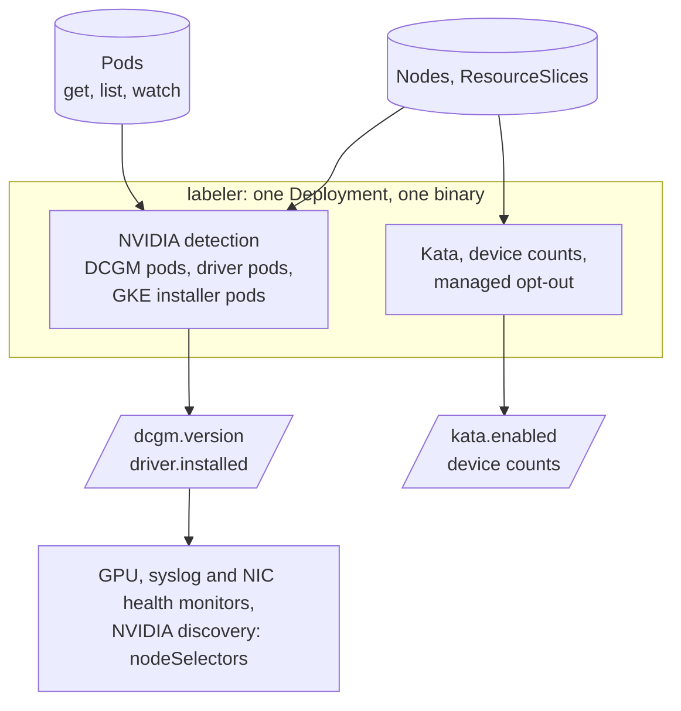

# ADR-077: Architecture — Move NVIDIA Detection out of the Labeler

Status: Proposed (tracking issue [#2419](https://github.com/NVIDIA/NVSentinel/issues/2419)). Implements the labeler row of the [component classification](070-vendor-neutral-core.md#component-classification) of ADR-070.

## Table of Contents

1. [Context](#context)
2. [Decision](#decision)
3. [Implementation](#implementation)
   - [Module and image](#module-and-image)
   - [Label ownership](#label-ownership)
   - [Chart](#chart)
   - [Upgrade](#upgrade)
   - [Backwards compatibility](#backwards-compatibility)
4. [Rationale](#rationale)
5. [Consequences](#consequences)
   - [Positive](#positive)
   - [Negative](#negative)
   - [Mitigations](#mitigations)
6. [Alternatives Considered](#alternatives-considered)
   - [Run the NVIDIA detection as a second container in the labeler pod](#run-the-nvidia-detection-as-a-second-container-in-the-labeler-pod)
   - [Keep the NVIDIA detection in the labeler binary behind a flag](#keep-the-nvidia-detection-in-the-labeler-binary-behind-a-flag)
   - [Detect the driver and DCGM from a DaemonSet](#detect-the-driver-and-dcgm-from-a-daemonset)
   - [Select on GPU Operator labels instead](#select-on-gpu-operator-labels-instead)
7. [Notes](#notes)
   - [Non-goals](#non-goals)
8. [References](#references)

## Context

The labeler is one Deployment with one replica. It watches nodes, and writes these labels on each node:

- `nvsentinel.dgxc.nvidia.com/dcgm.version` is `3.x` or `4.x`, from the image tag of the DCGM pod on the node. The labeler finds DCGM pods by their `app` label (`nvidia-dcgm`, `nvidia-dcgm-dra`). Until a node has the `nvsentinel.dgxc.nvidia.com/dcgm-bootstrap-completed` annotation, only a ready DCGM pod counts. The labeler sets that annotation the first time it sets the label.
- `nvsentinel.dgxc.nvidia.com/driver.installed` is `true` when the node has a ready NVIDIA driver pod. The labeler looks for GPU Operator driver pods (`app: nvidia-driver-daemonset`), driver pods of the NVIDIADriver CRD (`app.kubernetes.io/component: nvidia-driver`), and GKE driver installer pods (`k8s-app: nvidia-driver-installer`). With `assumeDriverInstalled`, a node with `nvidia.com/gpu.present: "true"` gets the label without a driver pod. Without a driver, the label is removed.
- `nvsentinel.dgxc.nvidia.com/kata.enabled` is `true` or `false`, from the node's Kata runtime labels.
- **Device counts**, such as `gpu.count.current` and `gpu.count.expected`, from the CEL classes of `expectedDeviceCounts` ([ADR-043](043-expected-device-count-labels.md)).

A node with `nvsentinel.dgxc.nvidia.com/managed: "false"` is opted out ([ADR-040](040-external-remediation-request.md)): the labeler removes `dcgm.version`, `driver.installed` and `kata.enabled` from it.

ADR-070 puts `dcgm.version`, `driver.installed` and the GPU Operator pod discovery in the NVIDIA plugin, and keeps the device-count engine, Kata detection and the opt-out in the core. Today both halves share one binary, one ClusterRole and one reconcile function, which causes two problems:

1. **The core binary holds NVIDIA logic.** The DCGM image regex, the GPU Operator and GKE pod labels, and `nvidia.com/gpu.present` are in `labeler/pkg/labeler/labeler.go`. ADR-070 does not allow vendor code in the core.
2. **The core needs access to every pod in the cluster.** The ClusterRole grants `get`, `list` and `watch` on pods only for the NVIDIA detection. Kata and the device counts read only nodes and ResourceSlices.

Only NVIDIA components read `dcgm.version` and `driver.installed`. The GPU health monitor DaemonSets select on `dcgm.version`. The syslog and NIC health monitors and the NVIDIA discovery (`nvidia-metadata-collector`, [ADR-072](072-pod-device-mapper-daemonset.md)) select on `driver.installed`. No Go code and no core chart reads them.

## Decision

Split the labeler into two Deployments:

- **`nvidia-labeler`** (new) writes the NVIDIA labels: `dcgm.version`, `driver.installed` and the `dcgm-bootstrap-completed` annotation. It is part of the NVIDIA plugin of ADR-070.
- **`labeler`** keeps the vendor-neutral labels, `kata.enabled` and the device counts, and stops watching pods.

Each one writes and removes only its own labels. The label names and values, and the Helm values, do not change.

## Implementation

### Module and image

- The NVIDIA parts of `labeler/pkg/labeler` move to a new module, `nvidia-labeler`, with its own `main.go`: the three pod informers and their indexes, the DCGM and driver resolution, the bootstrap gate, the `gpu.present` trigger, and the `--dcgm-app-label`, `--driver-app-label`, `--gke-installer-app-label`, `--assume-dcgm-available`, `--assume-driver-installed` and `--require-dcgm-ready-for-bootstrap` flags.
- Both binaries patch nodes with `commons/pkg/kubeclient.NodePatcher`, which writes only the keys that changed, and check the opt-out with `commons/pkg/managed`. Neither needs code from the other.
- The image is built with ko on the default static base, like the other Go modules.
- `nvidia-labeler` gets its own ServiceAccount, and a ClusterRole with `get`, `list` and `watch` on pods and `get`, `list`, `watch` and `patch` on nodes. The labeler's ClusterRole loses its pod rules.
- A `depguard` rule stops `labeler` from importing `nvidia-labeler`, as ADR-070 [phase 4](070-vendor-neutral-core.md#phases) requires for each split.

### Label ownership

| Key | Owner | Removed when |
|---|---|---|
| `dcgm.version` | `nvidia-labeler` | No DCGM pod gives a version, unless `--assume-dcgm-available` keeps an existing value; and on opt-out, also when an operator set it |
| `driver.installed` | `nvidia-labeler` | No driver pod is ready, unless `--assume-driver-installed` applies; and on opt-out, also when an operator set it |
| `dcgm-bootstrap-completed` annotation | `nvidia-labeler` | Never, as today |
| `kata.enabled` | `labeler` | On opt-out |
| Device-count labels | `labeler` | Never, as today |

Each binary removes a label only after its own informers have synced, as the labeler does today. Before that, a missing pod in the cache would look like a removed driver.

### Chart

Until ADR-070 creates the NVIDIA plugin chart, the labeler chart renders both Deployments, so every key that operators set today keeps working:

- `dcgmAppLabel`, `driverAppLabel`, `gkeInstallerAppLabel`, `assumeDriverInstalled` and `requireDCGMReadyForBootstrap` apply to `nvidia-labeler`. So does `global.dcgm.mode`, which turns on `--assume-dcgm-available` in the `external-hostengine` and `embedded-mode` modes ([ADR-044](044-dcgm-source-modes.md)).
- `kataLabelOverride` and `expectedDeviceCounts` apply to labeler.
- `replicaCount`, `logLevel`, `podAnnotations`, `podLabels`, `resources`, `qps`, `burst` and the scheduling values apply to both.
- `nvidiaLabeler.enabled` (default `true`) and `nvidiaLabeler.image` are new. The umbrella chart refuses `nvidiaLabeler.enabled: false` while a component that selects nodes on `dcgm.version` or `driver.installed` is enabled: the GPU, syslog or NIC health monitor, or metadata-collector. Otherwise nothing would remove those labels from an opted-out node, and those components would stay on it. So the NVIDIA detection is turned off together with the components that read its labels, as ADR-070 removes a plugin. The chart cannot see readers outside NVSentinel: after `nvidiaLabeler.enabled: false`, nothing updates these labels, so check that no external automation still reads them.
- `global.labeler.enabled: false` turns off both Deployments, as it turns off the labeler today.

The `gpu` and `nic` classes of `expectedDeviceCounts` stay in the labeler chart's defaults. They are configuration: the device-count engine has no vendor names in its code.

### Upgrade

The upgrade updates the labeler Deployment and creates the `nvidia-labeler` Deployment. The NVIDIA monitors and the discovery select nodes on `driver.installed` and `dcgm.version`, so the upgrade must not remove either label: a node that loses one loses those pods. Neither binary removes them during the upgrade:

- The new labeler never writes or removes `dcgm.version` or `driver.installed`. Between the stop of the old labeler pod and the first reconcile of `nvidia-labeler`, the labels stay as they are, so the monitor pods keep running.
- `nvidia-labeler` removes a label only after its informers have synced, and it computes the same values as the old labeler from the same pods. So the two agree while both run, and most nodes get no patch.
- The bootstrap annotation is already on the nodes, so `nvidia-labeler` does not wait for DCGM pods to be ready again.

A rollback brings back the old labeler, which owns all labels again. The `nvidia-labeler` Deployment is deleted, and its labels stay on the nodes.

### Backwards compatibility

- **Flags:** the labeler binary still accepts the moved flags, and ignores them with a log line, so an older pod spec keeps starting.
- **Metrics:** the names do not change. `labeler_events_processed_total` and `labeler_event_handling_duration_seconds` count pod events, so they move to the `nvidia-labeler` pods. Both Deployments report `labeler_node_update_failures_total` and `labeler_node_labels_skipped_managed_total`, so a query that sums them across pods counts both. A query that filters by the labeler pod name does not match the new pods.
- **Images:** the chart and the images are released together. A newer labeler image under an older chart is not supported: nothing then writes the NVIDIA labels.

## Rationale

- **The labels belong to the components that read them.** Only NVIDIA components read `dcgm.version` and `driver.installed`, so moving the writer to the NVIDIA plugin removes nothing from the core.
- **Ownership by key makes two writers safe.** Each binary patches only its own keys, and only the keys that changed, so the two never undo each other's writes. This also fills a gap in ADR-070, which lists the versioned contracts between the core and the plugins but not node labels. For a label that a plugin writes, the contract is its name and values, and the core does not read it.
- **The labeler chart renders both Deployments, so operators change their Helm values once.** A chart of its own for `nvidia-labeler` would move keys such as `dcgmAppLabel` and `driverAppLabel` now, and the NVIDIA plugin chart of ADR-070 would move them again.

## Consequences

### Positive

- The labeler has no NVIDIA code, and its ClusterRole has no access to pods.
- A cluster without NVIDIA GPUs can run the labeler without the NVIDIA detection.
- The device counts no longer wait for the NVIDIA pod informers to sync.

### Negative

- One more module, image and Deployment to build, release and run.
- Both Deployments watch and cache all nodes, so the API server serves two node watches instead of one, and the cluster holds two node caches.
- A node change that affects both Kata and the driver label gets two patches instead of one.

### Mitigations

- `nvidia-labeler` caches only node names, labels and one annotation, so its cache is smaller than the labeler's.
- Most reconciles change no label, and the patches carry only changed keys, so the extra writes are rare.

## Alternatives Considered

### Run the NVIDIA detection as a second container in the labeler pod

The NVIDIA detection gets its own binary and image, but runs as a second container in the labeler pod. **Rejected** because the ServiceAccount belongs to the pod, so the core would keep access to every pod in the cluster.

### Keep the NVIDIA detection in the labeler binary behind a flag

A flag such as `--nvidia-detection=false` would turn off the NVIDIA informers. **Rejected** because the NVIDIA code would stay in the core module and image, and the ClusterRole would still need pod access whenever the flag is on. ADR-070 moves the code, not only its default.

### Detect the driver and DCGM from a DaemonSet

Today one Deployment watches the DCGM and driver pods through the API server. Instead, a pod on each GPU node would check the driver and DCGM on the host, for example inside the NVIDIA discovery. **Rejected** because the discovery's own nodeSelector needs `driver.installed`, so it cannot set that label. A new DaemonSet would add a pod to every GPU node to replace one Deployment. ADR-044 also rejected a per-node DaemonSet for the DCGM version, because the `dcgm.version` label already carries that signal.

### Select on GPU Operator labels instead

The monitors would select on labels that the GPU Operator sets, such as `nvidia.com/gpu.deploy.driver`, and NVSentinel would stop writing its own. **Rejected** because GKE driver installers and preinstalled drivers do not set those labels, and `dcgm.version` and `driver.installed` are public: external automation keys off them.

## Notes

### Non-goals

- The NVIDIA plugin chart, and moving the `gpu` and `nic` count classes into it. Both follow ADR-070 phase 4.
- Making the driver pod selectors configurable, which ADR-070 [phase 2](070-vendor-neutral-core.md#phases) covers. The hardcoded `app.kubernetes.io/component: nvidia-driver` selector moves to `nvidia-labeler` unchanged.
- New label names. ADR-070 changes public names only by addition, in a later decision.
- Leader election. Each Deployment keeps one replica by default, as the labeler does today.

## References

- [ADR-070](070-vendor-neutral-core.md): Vendor-neutral core and vendor plugins
- [ADR-072](072-pod-device-mapper-daemonset.md): Run the pod device mapper apart from NVIDIA discovery
- [ADR-043](043-expected-device-count-labels.md): Expected device count labels
- [ADR-044](044-dcgm-source-modes.md): DCGM source modes
- [ADR-040](040-external-remediation-request.md): External remediation request, which defines the `managed` opt-out
- [#2419](https://github.com/NVIDIA/NVSentinel/issues/2419): Move NVIDIA node discovery to a plugin
