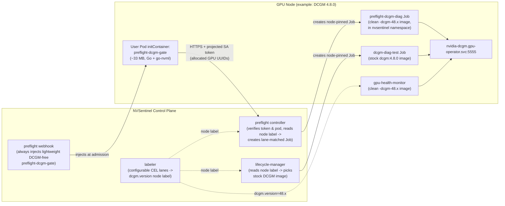
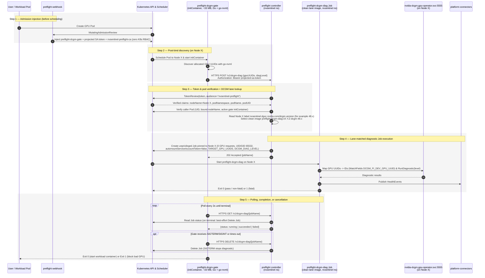
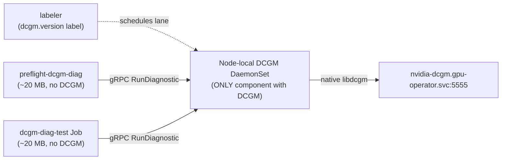

# ADR-078: DCGM — Unified Version-Lane Client Selection for DCGM 4.x and Later

Status: Proposed (tracking issues [#2446](https://github.com/NVIDIA/NVSentinel/issues/2446), [#2447](https://github.com/NVIDIA/NVSentinel/issues/2447), [#2448](https://github.com/NVIDIA/NVSentinel/issues/2448)). Extends [ADR-044](044-dcgm-source-modes.md) to a unified per-lane client architecture across `gpu-health-monitor`, `preflight`, and `lifecycle-manager`. Covers DCGM 4.x and later.

## Context

Three NVSentinel components connect to the DCGM hostengine (`nv-hostengine`) on each GPU node:

| Component | Workload | DCGM interface | Current client |
|---|---|---|---|
| `gpu-health-monitor` | DaemonSet (long-running) | Python bindings (`libdcgm`) | Per-lane image (`-dcgm-4.x`, 4.7.0) |
| `preflight-dcgm-diag` | Init container ([ADR-026](026-preflight-checks.md)) | Python bindings (`libdcgm`) | Single pinned image (4.7.0) |
| `lifecycle-manager` `dcgm-diag-test` | Validation Job ([ADR-049](049-node-validation.md)) | `dcgmi diag --run 2 --json` | Stock DCGM 4.7.0 image |

In `operator-service` and `external-hostengine` modes ([ADR-044](044-dcgm-source-modes.md)), the GPU Operator or host OS controls the hostengine version. NVSentinel upgrades independently and routinely moves ahead of cluster hostengines, while rolling GPU Operator upgrades run hostengine versions on different nodes inside one cluster.

DCGM's compatibility contract ([DCGM product lifecycle](https://github.com/NVIDIA/DCGM/blob/master/docs/support_EOL.md)) is one-directional within major version 4.x:

- `client <= hostengine` **(supported):** Hostengines preserve backward compatibility for older 4.x wire commands across minor releases. DCGM supports two minor releases at a time (current and maintenance, up to one year).
- `client > hostengine` **(not guaranteed):** Upgrading the client ahead of the hostengine fails in two ways when a newer 4.x client talks to an older hostengine (verified against DCGM 4.5.2):
  - **Hard protocol rejection (**`DCGM_ST_VER_MISMATCH`**,** `-12`**):** The 4.8.0 `dcgmi diag` CLI (used by `lifecycle-manager`) sends `dcgmRunDiag_version12` (wire v14), which every hostengine older than 4.8.0 rejects with `-12`. In live testing against 4.5.2, neither `gpu-health-monitor`'s 4.8.0 Python bindings (discovery, health watches, field watches) nor `preflight-dcgm-diag`'s 4.8.0 `pydcgm` `RunDiagnostic` triggered `-12`.
  - **Missing-API errors (**`DCGM_ST_FUNCTION_NOT_FOUND`**):** Newer 4.x clients (observed with both 4.7.0 and 4.8.0 clients against a 4.5.2 hostengine) fail with `DCGM_ST_FUNCTION_NOT_FOUND` on `GetGpuAttributes` and `dcgmEntitiesGetLatestValues`. `gpu-health-monitor` handles this by omitting GPU serial numbers; `preflight-dcgm-diag` avoids it by mapping GPU UUIDs through field watches (`DCGM_FI_DEV_GPU_UUID` with `dcgmGetValuesSince_v2`).

Today, only `gpu-health-monitor` uses per-lane images scheduled by `labeler`'s `nvsentinel.dgxc.nvidia.com/dcgm.version` node label. `lifecycle-manager` hardcodes one image in `ValidationConfiguration`, and `preflight` injects its DCGM init container at pod admission — before Kubernetes picks a node — so the webhook cannot know which DCGM version runs on the target node.

Four candidate architectures were evaluated:

- **Architecture A (chosen):** Clean per-lane official DCGM images driven by `labeler`'s configurable CEL `dcgm.version` label across all three components, with a lightweight DCGM-free gate init container and controller-launched lane-matched Job for `preflight`.
- **Architecture B:** Single node-local DCGM gRPC DaemonSet isolating all DCGM libraries to one component.
- **Architecture C:** Single clean image per component with a cluster-wide Helm version pin (the `dcgm-exporter` and GPU Operator upgrade model).
- **Architecture D:** Multi-client bundling inside one container image with a runtime `dcgm-select` shell wrapper (`LD_LIBRARY_PATH` / `PYTHONPATH` switching).

## Decision

Adopt **Architecture A**: all three DCGM client components run **clean, dedicated images built on official NVIDIA DCGM base images** — one per active DCGM version lane — selected from one shared source of truth: the `nvsentinel.dgxc.nvidia.com/dcgm.version` node label maintained by `labeler` through configurable CEL rules.

- `gpu-health-monitor` runs one DaemonSet per active lane with a clean per-lane image (`-dcgm-4.x`, `-dcgm-48.x`, and any future breaking DCGM lane).
- `lifecycle-manager` resolves the validation Job's stock NVIDIA DCGM image from the target node's `dcgm.version` label through an additive `imageByNodeLabel` map on `TestConfig`.
- `preflight` decouples pod admission from DCGM execution: the webhook injects a lightweight (~33 MB compressed), DCGM-free Go `preflight-dcgm-gate` init container into GPU pods, and after scheduling the `preflight` controller reads the bound node's `dcgm.version` label and runs an unprivileged, lane-matched `preflight-dcgm-diag` Job in the `nvsentinel` namespace against the pod's allocated GPU UUIDs.

## Implementation



### 1. Labeler: configurable CEL version lanes ([#2508](https://github.com/NVIDIA/NVSentinel/pull/2508))

`labeler` replaces hardcoded DCGM image regexes with an ordered `dcgmVersionLanes` Helm list rendered as `dcgm-version-lanes.toml` in its ConfigMap. The first lane whose CEL semver expression returns `true` sets `nvsentinel.dgxc.nvidia.com/dcgm.version` on the node. Only the numeric `major.minor.patch` core of the DCGM pod image tag is parsed (ignoring package suffixes such as `-1-ubuntu24.04`).

```yaml
dcgmVersionLanes:
  - label: "4.x"
    expression: "version.major() == 4 && version.isLessThan(semver('4.8.0'))"
  - label: "48.x"
    expression: "version.major() == 4 && !version.isLessThan(semver('4.8.0'))"
```

- **Upper-major guard:** Every 4.x lane checks `version.major() == 4` so a 4.8+ lane never captures a future major DCGM release.
- **Compatibility preserved:** Existing nodes on `< 4.8.0` keep the `4.x` label (including `external-hostengine` and `embedded-mode` nodes under [ADR-044](044-dcgm-source-modes.md) with `--assume-dcgm-available`). Both `ClusterPolicy` (`nvidia-dcgm`) and `GPUCluster`/DRA (`nvidia-dcgm-dra`) pods are matched.
- **ADR-040 opt-out preserved:** `labeler` continues stripping `nvsentinel.dgxc.nvidia.com/dcgm.version` when a node carries `nvsentinel.dgxc.nvidia.com/managed=false`, so External Remediation Requests evict `gpu-health-monitor` cleanly.
- **ADR-070 / ADR-077 alignment:** `dcgmVersionLanes` lands in `labeler` today and moves intact to `nvidia-labeler` once [ADR-077](077-nvidia-labeler.md) splits NVIDIA detection out of the vendor-neutral core ([ADR-070](070-vendor-neutral-core.md)). The `nvsentinel.dgxc.nvidia.com/dcgm.version` label contract and Helm values stay unchanged, and both `lifecycle-manager` (`imageByNodeLabel.labelKey`) and `preflight` (`dcgmDiagRunner.nodeLabelKey`) consume the label key through configuration.

### 2. GPU health monitor: per-lane official images and DaemonSets ([#2187](https://github.com/NVIDIA/NVSentinel/pull/2187))

- One shared Helm helper renders one DaemonSet per active lane, selecting nodes on `nvsentinel.dgxc.nvidia.com/dcgm.version`.
- Each lane builds a clean container image directly on its official NVIDIA DCGM base (`-dcgm-4.x` on `4.7.0-ubuntu24.04`, `-dcgm-48.x` on `4.8.0-ubuntu24.04`).
- `DCGM_ST_VER_MISMATCH` **(**`-12`**) handling:** On `-12`, `gpu-health-monitor` stays running instead of crash-looping, increments `dcgm_api_failures_total{error_name="version_mismatch"}`, and emits a fatal `GpuDcgmConnectivityFailure` (`CONTACT_SUPPORT`, subject to `runtimeDebounce.failureThreshold`); `wait-for-dcgm` hands off immediately so the main container reports the mismatch. Once the matching lane pod connects and emits a healthy event, the node uncordons automatically. (DCGM 4.8.0 against 4.5.2 does not hit `-12` on the health-watch path today; this handler protects against future breaking releases.)

### 3. Lifecycle manager: node-label image selection using stock DCGM images ([#2448](https://github.com/NVIDIA/NVSentinel/issues/2448))

`lifecycle-manager` already knows the target `nodeName` and watches `Node` objects before creating each validation Job. Add an optional, backwards-compatible `imageByNodeLabel` field to `TestConfig` (`lifecycle-manager/api/v1alpha1/validationconfiguration_types.go`):

```yaml
config:
  tests:
    dcgm-diag-test:
      provider: k8s-job-provider
      image: nvcr.io/nvidia/cloud-native/dcgm:4.7.0-ubuntu24.04
      imageByNodeLabel:
        labelKey: nvsentinel.dgxc.nvidia.com/dcgm.version
        images:
          "4.x": nvcr.io/nvidia/cloud-native/dcgm:4.7.0-ubuntu24.04
          "48.x": nvcr.io/nvidia/cloud-native/dcgm:4.8.0-ubuntu24.04
```

- In `renderTestGroupObject` (`lifecycle-manager/internal/controller/validationrequest_provider.go`), when `imageByNodeLabel` is set for a single-node test group (`supportsBatchingNodes: false`), the controller reads the target node's `labelKey` label from its informer cache and selects the matching stock NVIDIA DCGM image. If the label is absent or unmapped, it falls back to `image` and logs a warning. Keep `image` pinned to the backward-compatible lowest active 4.x lane (`4.x` / `4.7.0`) so validation Jobs created during the brief label-absence window on a DCGM pod restart continue working against older hostengines.
- Because the controller calls `renderTestGroupObject` fresh on each retry attempt (`k8s-job-provider.retries`), a `ValidationRequest` that hits `-12` against a stale label self-heals on a subsequent attempt once `labeler` updates the node label. The existing `dcgm-diag-test` `runtime_error` retry script in `values.yaml` is preserved unchanged.
- `lifecycle-manager` continues using official stock NVIDIA DCGM images directly — no custom NVSentinel DCGM image is built or maintained for validation Jobs.
- Existing `ValidationConfiguration` files without `imageByNodeLabel` behave identically to today.

### 4. Preflight: lightweight DCGM-free gate and controller-launched lane-matched Job ([#2447](https://github.com/NVIDIA/NVSentinel/issues/2447))

#### High-level idea

Because the mutating webhook runs before scheduling, it cannot know which DCGM version runs on the target node. Instead of injecting a multi-gigabyte DCGM container at admission, the webhook always injects one lightweight (~33 MB compressed), DCGM-free Go init container (`preflight-dcgm-gate`). Once Kubernetes schedules the pod onto a node, `preflight-dcgm-gate` asks the `preflight` controller to run the diagnostic, and the controller reads that node's `dcgm.version` label and launches an unprivileged, lane-matched `preflight-dcgm-diag` Job in the `nvsentinel` namespace.



#### Key details

- **Zero user-pod RBAC and anti-spoofing:** The webhook mounts a projected ServiceAccount token (`audience: nvsentinel-preflight`) and the `nvsentinel-preflight-ca` CA bundle into `preflight-dcgm-gate`. The `preflight` controller validates the token with Kubernetes `TokenReview` and verifies the caller Pod's UID, node, and active gate container before creating a Job, so tenant pods need zero RBAC or `hostPath` volumes and cannot spoof another node or pod.
- **Unprivileged, zero-GPU diagnostic Job:** `preflight-dcgm-gate` (Go + `go-nvml`) reads only the pod's allocated GPU UUIDs. The controller runs `preflight-dcgm-diag` in `nvsentinel` with zero GPU requests, `runAsNonRoot: true` (UID/GID `65532`), `allowPrivilegeEscalation: false`, and `automountServiceAccountToken: false`. The Job maps `TARGET_GPU_UUIDS` to hostengine GPU IDs through `DCGM_FI_DEV_GPU_UUID` field watches (compatible across 4.x hostengines), runs `RunDiagnostic`, and publishes `HealthEvent`s to `platform-connectors`.
- **Polling and cleanup:** `preflight-dcgm-gate` starts the Job (`POST`), polls status (`GET` every 2s), and cancels it (`DELETE`) on `SIGTERM`/`SIGINT` or timeout so the Job stops the running diagnostic. The controller deletes finished Jobs immediately, with `ttlSecondsAfterFinished` and `activeDeadlineSeconds` as backstops.
- **Module boundary:** All interaction stays inside `preflight` and the Kubernetes API — no NVSentinel module calls another module directly.

### Adding a future DCGM release

Every new breaking DCGM release follows one uniform, hack-free workflow:

1. Build clean per-lane images on the new official NVIDIA DCGM base for `gpu-health-monitor` and `preflight-dcgm-diag` (for example `-dcgm-5.x.y`).
2. Add the new CEL lane entry to `labeler`'s `dcgmVersionLanes` Helm values.
3. Add the lane-to-image entry in `gpu-health-monitor`, `preflight`, and `lifecycle-manager` (stock NVIDIA DCGM image) Helm values.
4. Retire old lanes once supported clusters move past them (typically keeping at most two active lanes).

### Backwards compatibility and upgrade

- `labeler`**:** Existing nodes running DCGM `< 4.8.0` keep `nvsentinel.dgxc.nvidia.com/dcgm.version=4.x`, so upgrading `labeler` causes no `gpu-health-monitor` pod churn on existing nodes.
- `gpu-health-monitor`**:** The `gpu-health-monitor-dcgm-4.x` DaemonSet remains unchanged; `gpu-health-monitor-dcgm-48.x` is additive and schedules zero pods until a node carries `dcgm.version=48.x`.
- `lifecycle-manager`**:** `imageByNodeLabel` is strictly optional (`omitempty`) on `TestConfig`. Existing `ValidationConfiguration` resources without it keep using `image`.
- `preflight`**:** Existing pods admitted before the upgrade keep running the legacy `preflight-dcgm-diag` init container directly. With the chart default `replicaCount: 1`, the webhook and `/v1/dcgm-diag` endpoint roll over together. Clusters running `preflight` with `replicaCount > 1` must roll out the updated `preflight` image before enabling `dcgmDiagRunner.enabled: true` so a `POST /v1/dcgm-diag` from a newly admitted `preflight-dcgm-gate` pod is never routed to an older replica lacking that route.

## Rationale

- **Zero packaging hacks:** Every image is a clean, reproducible build on one official NVIDIA DCGM base image — no cross-stage `.so`/binary copying, no `LD_LIBRARY_PATH` shell wrappers, and no cross-OS ABI risks when DCGM upgrades base images or ships future releases.
- **One source of truth across all three components:** `labeler`'s `dcgm.version` label drives `gpu-health-monitor`, `preflight`, and `lifecycle-manager` consistently, including mixed-version clusters during rolling GPU Operator upgrades.
- **Respects NVSentinel boundaries and security:** All coordination stays through the Kubernetes API and within each module's own boundary; user pods require zero Kubernetes RBAC, zero `hostPath` volumes, and pull a ~33 MB compressed init container instead of a multi-gigabyte DCGM image.
- **Builds directly on completed work:** Directly reuses [#2508](https://github.com/NVIDIA/NVSentinel/pull/2508) and [#2187](https://github.com/NVIDIA/NVSentinel/pull/2187) and preserves [ADR-040](040-external-remediation-request.md) eviction and [ADR-044](044-dcgm-source-modes.md) source modes.

## Consequences

### Positive

- 100% clean, unmodified official NVIDIA DCGM base images across every component (and stock DCGM images for `lifecycle-manager`).
- Supports mixed hostengine versions inside one cluster across `gpu-health-monitor`, `preflight`, and `lifecycle-manager` — including future breaking DCGM releases.
- Shrinks `preflight`'s injected init container in user pods from a multi-gigabyte DCGM image to ~33 MB compressed and removes DCGM network access from tenant namespaces (`preflight-dcgm-diag` Jobs run in `nvsentinel`).
- Preserves [ADR-040](040-external-remediation-request.md) `managed=false` eviction and NVSentinel's no-cross-module-RPC invariant.

### Negative

- `preflight-dcgm-diag` now joins `gpu-health-monitor` in building and publishing one multi-GB image per active DCGM lane (plus `preflight-dcgm-gate`), increasing CI build/scan overhead and node disk usage when `preflight.imageCache` is enabled.
- All three components now depend on the `dcgm.version` node label: a DCGM pod restart or upgrade leaves a brief (few-second) window where the label is absent or stale, and `external-hostengine` / `embedded-mode` clusters still rely on operators to keep that label accurate ([ADR-044](044-dcgm-source-modes.md)).

### Mitigations

- Keep active lanes capped at two by retiring old lanes once fleets upgrade (aligned with DCGM's two-minor-release lifecycle).
- Handle `DCGM_ST_VER_MISMATCH` (`-12`) in `gpu-health-monitor` without crash-looping by emitting `GpuDcgmConnectivityFailure` (`CONTACT_SUPPORT`, subject to `runtimeDebounce.failureThreshold`), so persistent mismatches cordon visibly and auto-uncordon once the matching lane connects.
- Cache lane images on GPU nodes with `preflight.imageCache` so controller-launched `preflight-dcgm-diag` Jobs start immediately without cold pulls.
- Set `ttlSecondsAfterFinished`, `activeDeadlineSeconds`, and explicit Job deletion on completion or gate `DELETE` cancellation in the `preflight` controller to prevent Job accumulation.

## Alternatives Considered

### Architecture B: Single node-local DCGM gRPC DaemonSet

Run DCGM libraries in only **one** per-lane node-local DaemonSet (selected by `labeler`'s `dcgm.version` label). It exposes a stable `RunDiagnostic` gRPC API over a node-local Unix socket or `internalTrafficPolicy: Local` Service; `preflight` and `lifecycle-manager` become tiny (~20 MB) DCGM-free gRPC clients.



**Pros:**

- Isolates DCGM upgrades to **one** component; `preflight` and `lifecycle-manager` never change when DCGM updates.
- Shrinks both `preflight` and `lifecycle-manager` clients to ~20 MB with no extra Job startup hop.
- Serializes concurrent diagnostics per node, preventing `DCGM_ST_IN_USE` ([#1363](https://github.com/NVIDIA/NVSentinel/issues/1363)).

**Cons:**

- Adds a cross-module gRPC service boundary and a new protobuf API to maintain and version.
- Couples `preflight` and `lifecycle-manager` availability to the DCGM DaemonSet being installed and healthy.
- Needs both Unix socket and `internalTrafficPolicy: Local` Service transport for clusters without `hostPath`.

**Rejected** because Architecture A keeps strict module independence with no new cross-module RPC surface and builds directly on [#2508](https://github.com/NVIDIA/NVSentinel/pull/2508) and [#2187](https://github.com/NVIDIA/NVSentinel/pull/2187).

### Architecture C: Single clean image per component + cluster-wide Helm version pin

Publish clean per-version images (`-dcgm-4.7`, `-dcgm-4.8`) and switch all three components together through one cluster-wide Helm value (defaulting to the backward-compatible `4.7` floor during `4.x -> 4.8.0` GPU Operator rollouts, then switching to `4.8` afterward — the same model used by `dcgm-exporter`).

**Pros:**

- Simplest to build: no per-lane DaemonSets, no `labeler` CEL lanes, and no new preflight controller logic.
- Clean official DCGM base images with zero hacks.
- Safe during 4.x upgrades while the older floor client stays backward-compatible.

**Cons:**

- Cannot run two DCGM client versions simultaneously on different nodes inside one cluster.
- Requires a manual operator Helm update after every GPU Operator DCGM upgrade.
- User pods keep pulling a multi-gigabyte DCGM init container for `preflight`.

**Rejected** because NVSentinel must handle heterogeneous clusters and automatic per-node transitions without manual per-cluster Helm choreography.

### Architecture D: Multi-client bundling inside one image (`dcgm-select`)

Bundle `dcgmi`, `libdcgm.so*`, and Python bindings copied from multiple DCGM images into `/opt/dcgm/<version>` inside one container image, and use a startup shell wrapper (`dcgm-select`) to probe the hostengine and rewrite `LD_LIBRARY_PATH` and `PYTHONPATH`.

**Pros:**

- Single image and DaemonSet per component with no label lag and no `preflight` or `lifecycle-manager` controller changes.
- Small image overhead (~10 MB per extracted 4.x client set).

**Cons:**

- Copies raw binaries and `.so` libraries across container images and relies on shell wrappers — fragile against upstream path, packaging, or OS ABI changes.
- Unpackaged binaries complicate CVE scanning and SBOM auditing.
- Probing with `dcgmi -v` hits DCGM's hardcoded 100 ms timeout and adds non-idiomatic container startup logic.

**Rejected** because production Kubernetes workloads must use clean, self-contained builds on official base images rather than stitching binaries across stages with shell scripts.

## Notes

- **Non-goals:** DCGM 3.x support (end-of-life 30 November 2026, [#2102](https://github.com/NVIDIA/NVSentinel/pull/2102)); diagnostic serialization across concurrent callers on the same node (`DCGM_ST_IN_USE`, already handled via bounded retries in `preflight-dcgm-diag` and `dcgm-diag-test`, [#1363](https://github.com/NVIDIA/NVSentinel/issues/1363)); `pods/exec` into privileged `nvidia-dcgm` pods (rejected for security — cluster-admin-equivalent privilege escalation into `gpu-operator` — and because it covers neither `gpu-health-monitor` nor `external-hostengine`/`embedded-mode`).

## References

- [#2446](https://github.com/NVIDIA/NVSentinel/issues/2446), [#2447](https://github.com/NVIDIA/NVSentinel/issues/2447), [#2448](https://github.com/NVIDIA/NVSentinel/issues/2448) — DCGM 4.8.0 support across `gpu-health-monitor`, `preflight`, and `lifecycle-manager`.
- [#2102](https://github.com/NVIDIA/NVSentinel/pull/2102) — Removal of end-of-life DCGM 3.x support.
- [#2187](https://github.com/NVIDIA/NVSentinel/pull/2187), [#2508](https://github.com/NVIDIA/NVSentinel/pull/2508) — `gpu-health-monitor` 4.8+ lane and `labeler` configurable CEL version lanes.
- [ADR-026](026-preflight-checks.md), [ADR-040](040-external-remediation-request.md), [ADR-044](044-dcgm-source-modes.md), [ADR-049](049-node-validation.md), [ADR-070](070-vendor-neutral-core.md), [ADR-077](077-nvidia-labeler.md).
