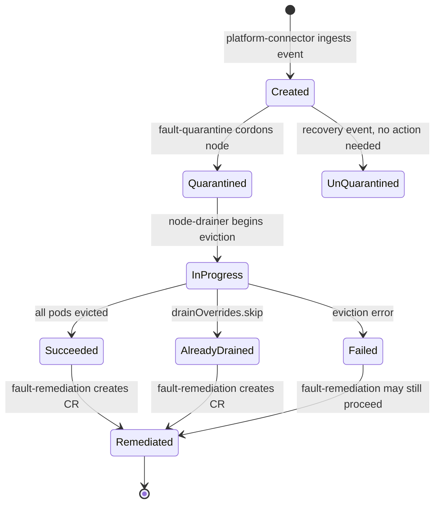

# HealthEvent Data Model Reference

This document is the authoritative reference for the `HealthEvent` data model. A health event is the fundamental unit of data that flows through NVSentinel. Each health monitor represents every fault that it detects as a `HealthEvent`. Every downstream module (quarantine, drain, remediation, export) consumes and enriches this structure.

> **Audience**: Developers who build custom health monitors, write CEL quarantine rules, integrate external systems through the event exporter, or debug the fault-remediation pipeline.

## Table of Contents

- [Where the Model Lives](#where-the-model-lives)
- [Core Message: HealthEvent](#core-message-healthevent)
- [Field Reference](#field-reference)
- [RecommendedAction Enum](#recommendedaction-enum)
- [ProcessingStrategy Enum](#processingstrategy-enum)
- [BehaviourOverrides](#behaviouroverrides)
- [Entity (Impacted Resources)](#entity-impacted-resources)
- [Storage Wrapper: HealthEventWithStatus](#storage-wrapper-healtheventwithstatus)
- [HealthEventStatus Lifecycle](#healtheventstatus-lifecycle)
- [Drain and Remediation Decisions](#drain-and-remediation-decisions)
- [CRD Projection: HealthEventResource](#crd-projection-healtheventresource)
- [External Remediation Request](#external-remediation-request)
- [Tracing Correlation](#tracing-correlation)
- [Examples](#examples)

---

## Where the Model Lives

| Artifact | Path | Purpose |
|----------|------|---------|
| Protobuf definition | `data-models/protobufs/health_event.proto` | Wire format and CRD generation source |
| Generated Go types | `data-models/pkg/protos/health_event.pb.go` | Import as `github.com/nvidia/nvsentinel/data-models/pkg/protos` |
| Go extensions | `data-models/pkg/model/health_event_extentions.go` | Helper constants and `GetEffectiveActionName()` |
| gRPC service | `data-models/protobufs/health_event.proto` → `PlatformConnector` service | Ingestion RPC that all health monitors use |
| External remediation | `data-models/protobufs/external_remediation.proto` | CRD for handoff to external repair systems |

---

## Core Message: HealthEvent

```protobuf
message HealthEvent {
  uint32 version = 1;
  string agent = 2;
  string componentClass = 3;
  string checkName = 4;
  bool isFatal = 5;
  bool isHealthy = 6;
  string message = 7;
  RecommendedAction recommendedAction = 8;
  repeated string errorCode = 9;
  repeated Entity entitiesImpacted = 10;
  map<string, string> metadata = 11;
  google.protobuf.Timestamp generatedTimestamp = 12;
  string nodeName = 13;
  BehaviourOverrides quarantineOverrides = 14;
  BehaviourOverrides drainOverrides = 15;
  ProcessingStrategy processingStrategy = 16;
  string id = 17;
  string customRecommendedAction = 18;
}
```

---

## Field Reference

If you build a custom health monitor, use the table below. It shows what happens when you omit a field or leave it at its zero value. For the end-to-end walkthrough, see [Writing a Health Monitor](./tutorials/writing-a-health-monitor.md).

| # | Field | Type | Description | If omitted / zero value |
|---|-------|------|-------------|------------------------|
| 1 | `version` | `uint32` | Protocol version. The value is `1`. | Ingestion does not check this field. Always set it to `1`. |
| 2 | `agent` | `string` | Name of the health monitor that produced the event, for example `"gpu-health-monitor"`, `"syslog-health-monitor"` or `"csp-health-monitor"`. NVSentinel uses it in metrics labels, log correlation, and the fault-quarantine rule matching for cordon and taint actions. Always set this field to a stable identifier, for example the deployment name of the monitor. Then quarantine rules can reliably match on it. | Metrics and logs lose source attribution. Quarantine rules that match on `agent` do not fire. The platform connector still accepts the event. |
| 3 | `componentClass` | `string` | Category of the affected component. Common values: `"GPU"`, `"gce_instance"`, `"EC2"`, `"Software"`, `"NIC"`. CEL quarantine rules use it for filtering. | CEL rules that filter on `componentClass` do not match. It is possible that quarantine does not trigger. |
| 4 | `checkName` | `string` | Identifier of the specific check that fired, for example `"xid-check"`, `"sxid-check"` or `"CSPMaintenance"`. The deduplication transformer uses this field as its suppression key. | Deduplication skips the health event if `platformConnector.dedup.includeChecks` lists only other check names, as the default list does. Every poll then produces a new actionable event. If `includeChecks` is empty, deduplication applies to every check and downgrades repeats with an empty name too. |
| 5 | `isFatal` | `bool` | Whether the monitor considers the fault fatal: remediation is required, and the node or component cannot process user workloads. Quarantine rules typically require `isFatal == true` to cordon a node. | Defaults to `false`. Most quarantine rules do not match, and the node stays schedulable. |
| 6 | `isHealthy` | `bool` | `false` for fault events, `true` for recovery events. If all active faults have cleared, a recovery event can un-quarantine a node. | Defaults to `false` (NVSentinel treats the event as a fault). A recovery monitor **must** set this field to `true`. Otherwise, the event re-quarantines the node instead of clearing it. |
| 7 | `message` | `string` | Human-readable description of the fault. NVSentinel shows it in Kubernetes node conditions and exported CloudEvents. | The node condition shows an empty message. Operators see the fault but not what it is. |
| 8 | `recommendedAction` | `RecommendedAction` | Enum that specifies the remediation to do. See [RecommendedAction Enum](#recommendedaction-enum). | Defaults to `NONE`. NVSentinel stores the event but does not create a maintenance CR. |
| 9 | `errorCode` | `repeated string` | Machine-readable error identifiers, for example `["XID_48", "XID_79"]`. CEL rules and alerting use them. | CEL rules that match on `errorCode` do not fire. Alerting integrations lose granularity. |
| 10 | `entitiesImpacted` | `repeated Entity` | The specific hardware entities that the fault affects. See [Entity](#entity-impacted-resources). | GPU Reset cannot target a specific GPU. It uses a node-level action instead, or it skips the reset. |
| 11 | `metadata` | `map<string, string>` | Arbitrary key-value pairs. Monitors attach diagnostic context (driver version, PCI address, XID details). NVSentinel propagates the metadata to the CloudEvents export. | Exported events have no diagnostic context. Debugging requires correlation with the monitor logs. |
| 12 | `generatedTimestamp` | `Timestamp` | When the monitor detected the fault. NVSentinel uses it for deduplication windows and metric duration calculations. | Deduplication window anchoring and remediation-duration metrics become inaccurate. |
| 13 | `nodeName` | `string` | Name of the Kubernetes node where the monitor detected the fault. It is the primary routing key for all downstream modules. | **Required** for an allowlisted cross-node publisher: the platform connector rejects its event without a node name (`missing_node_name`). For a node-local publisher, the platform connector sets this field to the node of the publisher. These rules apply when `global.platformConnectorAuth.enabled` is `true` (the default). |
| 14 | `quarantineOverrides` | `BehaviourOverrides` | Per-event override for quarantine behavior. See [BehaviourOverrides](#behaviouroverrides). | No override — CEL rules evaluate normally. |
| 15 | `drainOverrides` | `BehaviourOverrides` | Per-event override for drain behavior. See [BehaviourOverrides](#behaviouroverrides). | No override — per-namespace eviction strategies apply normally. |
| 16 | `processingStrategy` | `ProcessingStrategy` | Controls whether downstream modules are allowed to modify cluster state. See [ProcessingStrategy Enum](#processingstrategy-enum). | The platform connector normalizes `UNSPECIFIED` to `EXECUTE_REMEDIATION` at ingestion. The full remediation pipeline runs. |
| 17 | `id` | `string` | Unique event identifier. If the monitor does not set it, the platform connector assigns it at ingestion. | The platform connector generates a UUID. No action needed from the monitor. |
| 18 | `customRecommendedAction` | `string` | Free-form action name when `recommendedAction == CUSTOM`. It must not be empty, and the platform connector validates it at ingestion. It maps to a Helm-configured remediation action. | If `recommendedAction == CUSTOM` and this field is empty, the platform connector **rejects the event at ingestion**. |

---

## RecommendedAction Enum

Tells the fault-remediation module which repair action to trigger.

| Value | Numeric | Meaning | Typical Remediation |
|-------|---------|---------|---------------------|
| `NONE` | 0 | No remediation action recommended | No maintenance CR created. `processingStrategy` still controls storage and cluster mutations (quarantine, drain). |
| `COMPONENT_RESET` | 2 | Reset a specific component (GPU, NIC) | GPU Reset CR that targets `entitiesImpacted` |
| `CONTACT_SUPPORT` | 5 | Automated remediation is not possible. Human intervention is required. | Alert or ticket creation. The human action can be anything from a pod restart to a hardware escalation. |
| `RUN_FIELDDIAG` | 6 | Run field diagnostics | Diagnostic job |
| `RESTART_VM` | 15 | Restart virtual machine | CSP reboot through janitor-provider |
| `RESTART_BM` | 24 | Reboot bare-metal node | CSP reboot or generic Job-based reboot |
| `REPLACE_VM` | 25 | Terminate and replace VM | CSP terminate through janitor-provider |
| `RUN_DCGMEUD` | 26 | Run DCGM End-User Diagnostics | Diagnostic pod |
| `CUSTOM` | 27 | Action that you define | Resolved through `customRecommendedAction` → Helm `maintenance.actions` map |
| `UNKNOWN` | 99 | Unrecognized action | Logged and skipped |

**Routing logic** (in `fault-remediation`):

```go
// data-models/pkg/model/health_event_extentions.go
func GetEffectiveActionName(he *protos.HealthEvent) string {
    if he.RecommendedAction == protos.RecommendedAction_CUSTOM {
        return he.CustomRecommendedAction
    }
    return he.RecommendedAction.String()
}
```

The fault-remediation module finds the effective action name in the Helm-configured `maintenance.actions` map. From that entry, it gets the CR template, the API group, the kind, and the completion condition of the CR to create.

---

## ProcessingStrategy Enum

Controls whether the downstream modules (fault-quarantine, node-drainer, fault-remediation) are allowed to modify cluster state in response to this event.

| Value | Numeric | Behavior |
|-------|---------|----------|
| `UNSPECIFIED` | 0 | The platform connector **normalizes it to `EXECUTE_REMEDIATION`** at ingestion. Custom monitors that omit this field get full remediation. |
| `EXECUTE_REMEDIATION` | 1 | Normal behavior. All downstream modules process the event and can cordon, drain, and remediate. |
| `STORE_ONLY` | 2 | Observability only. NVSentinel persists and exports the event, but **no module modifies cluster resources**. |
| `STORE_AND_ANALYSE` | 3 | NVSentinel persists and exports the event, and the health-events-analyzer can use it. There are **no direct cluster modifications** (no cordon, no drain, no remediation). |

**Where NVSentinel enforces the strategy**:

- **Platform connector** normalizes `UNSPECIFIED` → `EXECUTE_REMEDIATION` at ingestion.
- **Deduplication transformer** downgrades repeated unhealthy events to `STORE_AND_ANALYSE` within a suppression window.
- **Fault-quarantine** skips events where `processingStrategy != EXECUTE_REMEDIATION`.
- **Health-events-analyzer** queries specifically for `STORE_AND_ANALYSE` events.

---

## BehaviourOverrides

```protobuf
message BehaviourOverrides {
  bool force = 1;
  bool skip = 2;
}
```

Per-event overrides that let a health monitor bypass default pipeline behavior.

### `quarantineOverrides`

| Field | Effect |
|-------|--------|
| `force = true` | fault-quarantine quarantines the node, regardless of the CEL rule evaluation. |
| `skip = true` | fault-quarantine does not quarantine the node, even if the rules match. |

### `drainOverrides`

| Field | Effect |
|-------|--------|
| `force = true` | With the built-in eviction, node-drainer uses `Immediate` for every pod that it drains, and ignores the configured eviction modes. It does not add pods that no `userNamespaces` entry or `podDrainPolicies` policy selects. With custom drain, node-drainer does not use this field. The drain template can pass it to the [drain plugin](./tutorials/writing-a-drain-plugin.md), which decides how to evict the pods. |
| `skip = true` | node-drainer skips the drain entirely. It marks the `UserPodsEvictionStatus` of the event as `AlreadyDrained`, so fault-remediation proceeds immediately. If the [state label](./state-manager.md) of the node is `quarantined`, node-drainer sets it to `drain-succeeded`. |

> **Use case**: Debug and test events, for example fault-injection demos, set `drainOverrides.skip = true`. This lets them exercise the remediation pipeline without waiting for pod eviction.

---

## Entity (Impacted Resources)

```protobuf
message Entity {
  string entityType = 1;
  string entityValue = 2;
}
```

Identifies the specific hardware entities that the fault affects.

| `entityType` | `entityValue` example | Used by |
|--------------|----------------------|---------|
| `"GPU"` | `"0"`, `"GPU-a1b2c3d4-..."` | GPU Reset CR (targets a specific GPU UUID) |
| `"PCI"` | `"0000:17:00.0"` | Tracing span attributes, diagnostics |
| `"NIC"` | `"mlx5_0"` | NIC health correlation |

NVSentinel propagates the `entitiesImpacted` array to:

- **Tracing**: each entity becomes a span attribute `health_event.entities_impacted.<type>`.
- **Event exporter**: serialized into the CloudEvents payload.
- **GPU Reset**: the janitor uses the GPU UUIDs from the entities as the targets of the GPU Reset CR.

---

## Storage Wrapper: HealthEventWithStatus

NVSentinel stores events in MongoDB (or PostgreSQL), wrapped in a status envelope:

```go
// data-models/pkg/model/health_event_extentions.go
type HealthEventWithStatus struct {
    CreatedAt         time.Time                 `bson:"createdAt"`
    HealthEvent       *protos.HealthEvent       `bson:"healthevent,omitempty"`
    HealthEventStatus *protos.HealthEventStatus `bson:"healtheventstatus"`
}
```

The `HealthEvent` portion is **immutable after ingestion**, except for the strategy downgrade by deduplication. Each downstream module **progressively enriches** the `HealthEventStatus` portion when it processes the event.

---

## HealthEventStatus Lifecycle

```protobuf
message HealthEventStatus {
  string nodeQuarantined = 1;
  google.protobuf.Timestamp quarantineFinishTimestamp = 2;
  OperationStatus userPodsEvictionStatus = 3;
  google.protobuf.Timestamp drainFinishTimestamp = 4;
  google.protobuf.BoolValue faultRemediated = 5;
  google.protobuf.Timestamp lastRemediationTimestamp = 6;
  map<string, string> spanIds = 7;
  DrainDecision drainDecision = 8;
  RemediationDecision remediationDecision = 9;
}
```

A specific module writes each field at a specific pipeline stage:

| Field | Written by | Values / Meaning |
|-------|-----------|------------------|
| `nodeQuarantined` | **fault-quarantine** | `"Quarantined"`, `"UnQuarantined"`, `"AlreadyQuarantined"`, `"Cancelled"` |
| `quarantineFinishTimestamp` | **fault-quarantine** | When quarantine processing completed |
| `userPodsEvictionStatus` | **node-drainer** | `OperationStatus{status, message}` — see below |
| `drainFinishTimestamp` | **node-drainer** | When drain processing completed |
| `faultRemediated` | **fault-remediation** | `BoolValue` — `nil` (absent) = not processed; `true` = maintenance CR created and confirmed; `false` = repair failed or skipped |
| `lastRemediationTimestamp` | **fault-remediation** | When fault-remediation last created the maintenance CR |
| `spanIds` | **all modules** | Distributed tracing span IDs for each service, for example `{"platform-connector": "abc123", "fault-quarantine": "def456"}` |
| `drainDecision` | **node-drainer** | The drain method chosen for the event. node-drainer writes `ruleSet`, `method` and `scope` one time, and only when no decision is stored. It writes them before it reads or evicts pods or creates a custom drain CR. Every drain action follows the stored record. |
| `remediationDecision` | **fault-remediation** | The remediation action chosen for the event. fault-remediation writes it before it runs the log collector and creates the maintenance CR. |

### Drain and Remediation Decisions

`drainDecision` is the drain decision that node-drainer records for an event before it acts:

- `ruleSet`: the rule set that applies, which is the winner or the rule set of the `reusedFrom` event. Empty for the default.
- `method`: `BuiltIn` or `Custom`. Empty when stopped.
- `stopped`: true when a stop rule set matched.
- `scope`: the entity type and value of a partial drain. Empty for a drain of the full node.
- `reusedFrom`: the event of the quarantine session whose method this event uses. Empty when this event selected it.

node-drainer writes `ruleSet`, `method` and `scope` before it acts. `ruleSet` is `custom-drain-node-selector` when `customDrain.nodeSelector` selects `Custom`. It is empty when node-drainer uses the default method. `scope` is the entity of a partial drain. node-drainer writes no `scope` for a drain of the full node.

node-drainer marks an event `AlreadyDrained` when an earlier drain covered it. If that event has no decision, node-drainer records only `scope` for it. `method` is then empty because this event did not drain the node. An empty `scope` means the earlier drain covered the full node.

An event that already has a decision, such as `BuiltIn` or `Custom`, keeps that decision. The already-drained check reads this record. It derives the scope only for an event that has no record.

`remediationDecision` is the remediation decision that fault-remediation records for an event before it acts:

- `ruleSet`: the rule set that won. Empty when no rule set matched.
- `action`: an entry of `maintenance.actions`. Empty when stopped.
- `stopped`: true when a stop rule set matched.

A status update that omits a decision does not change the saved decision. Omit means the field is nil. A present decision replaces the saved decision. Each module sends only the fields it owns.

MongoDB and PostgreSQL store these field names in lowercase, as they store the other status fields. For example, the keys are `draindecision`, `ruleset` and `scope.entitytype`.

### OperationStatus values (`userPodsEvictionStatus.status`)

| Status | Meaning |
|--------|---------|
| `NotStarted` | Drain has not started |
| `InProgress` | Pod eviction in progress |
| `Succeeded` | All user pods evicted successfully |
| `Failed` | Eviction had an error |
| `AlreadyDrained` | node-drainer skipped the drain (because of `drainOverrides.skip` or an earlier completed drain) |

### Status progression diagram



---

## CRD Projection: HealthEventResource

For Kubernetes-native storage (experimental), the HealthEvent maps to a CRD:

```protobuf
message HealthEventResource {
  option (protoc_gen_crd.k8s_crd) = {
    api_group: "healthevents.dgxc.nvidia.com",
    kind: "HealthEventResource",
    plural: "healtheventresources",
    singular: "healtheventresource",
    categories: ["nvidia", "gpu"]
  };
  HealthEvent spec = 1;
  HealthEventStatus status = 2;
}
```

The `spec` field holds the immutable `HealthEvent`. The `status` field holds the progressively enriched `HealthEventStatus`. This follows the standard Kubernetes spec and status convention.

---

## External Remediation Request

The configured remediation action can produce an `ExternalRemediationRequest` (ExtRR) for any `recommendedAction`, not only `CUSTOM`. In that case, NVSentinel embeds the full `HealthEvent` in the spec of the ExtRR:

```protobuf
message ExternalRemediationRequestSpec {
  HealthEvent healthEvent = 1;
}
```

The ExtRR is cluster-scoped, like the RebootNode, TerminateNode, and GPUReset CRDs. It carries status conditions for coordination with external repair systems:

| Condition Type | Set by | Meaning |
|---------------|--------|---------|
| `NVSentinelOwnershipReleased` | ExtRR reconciler | NVSentinel has released the node (taint applied, ready for external work) |
| `ExternalRemediationComplete` | External system | External repair is complete. NVSentinel can re-admit the node. |

---

## Tracing Correlation

Each module that processes an event writes its span ID into `HealthEventStatus.spanIds[serviceName]`. This enables end-to-end trace correlation:

```text
platform-connector → fault-quarantine → node-drainer → fault-remediation
```

The span ID that a module writes to the datastore becomes the **parent span** for the processing in the next module. This creates a causal chain across independent services. These services communicate only through the change streams of the datastore.

For setup and queries, see [Distributed Tracing](./tracing.md).

---

## Examples

### GPU XID fault (fatal, triggers reboot)

```json
{
  "version": 1,
  "agent": "syslog-health-monitor",
  "componentClass": "GPU",
  "checkName": "xid-check",
  "isFatal": true,
  "isHealthy": false,
  "message": "XID 79: GPU has fallen off the bus",
  "recommendedAction": "RESTART_BM",
  "errorCode": ["XID_79"],
  "entitiesImpacted": [
    {"entityType": "GPU", "entityValue": "GPU-a1b2c3d4-e5f6-a7b8-c9d0-e1f2a3b4c5d6"},
    {"entityType": "PCI", "entityValue": "0000:17:00.0"}
  ],
  "metadata": {"driverVersion": "570.86.15"},
  "nodeName": "gpu-node-42",
  "processingStrategy": "EXECUTE_REMEDIATION"
}
```

### Recovery event (un-quarantine)

```json
{
  "version": 1,
  "agent": "gpu-health-monitor",
  "componentClass": "GPU",
  "checkName": "dcgm-health-check",
  "isFatal": false,
  "isHealthy": true,
  "message": "All GPU health checks passing",
  "recommendedAction": "NONE",
  "nodeName": "gpu-node-42",
  "processingStrategy": "EXECUTE_REMEDIATION"
}
```

### Custom remediation with drain skip

```json
{
  "version": 1,
  "agent": "custom-monitor",
  "componentClass": "Software",
  "checkName": "memory-pressure",
  "isFatal": true,
  "isHealthy": false,
  "message": "Uncorrectable memory pressure detected",
  "recommendedAction": "CUSTOM",
  "customRecommendedAction": "slack-notify-ops",
  "drainOverrides": {"skip": true},
  "nodeName": "worker-7",
  "processingStrategy": "EXECUTE_REMEDIATION"
}
```

---

## Related Documentation

- [Data Flow](./DATA_FLOW.md) — end-to-end sequence diagrams
- [Platform Connectors](./platform-connectors.md) — ingestion and validation
- [Fault Quarantine](./fault-quarantine.md) — CEL rule evaluation
- [Node Drainer](./node-drainer.md) — eviction strategies
- [Fault Remediation](./fault-remediation.md) — CR creation and action routing
- [Event Exporter](./event-exporter.md) — CloudEvents transformation
