# NVSentinel end-to-end scale test — report

Markers: `[M]` measured, `[S]` simulated harness constant, `[I]` reader-supplied input.

## Table of contents

- [Summary](#summary)
- [A1. Component sizing](#a1-component-sizing)
  - [kubernetes-object-monitor](#kubernetes-object-monitor)
  - [fault-quarantine](#fault-quarantine)
  - [labeler](#labeler)
  - [node-drainer](#node-drainer)
  - [fault-remediation](#fault-remediation)
  - [preflight](#preflight)
  - [health-events-analyzer](#health-events-analyzer)
  - [janitor](#janitor)
  - [Node agents, per GPU node](#node-agents-per-gpu-node-m)
  - [platform-connector, deployment mode](#platform-connector-deployment-mode-m)
    - [Connections to the datastore](#connections-to-the-datastore)
    - [Resources against fleet size](#resources-against-fleet-size)
    - [Ingest rate and sizing](#ingest-rate-and-sizing)
    - [Scaling out](#scaling-out)
- [A2. Load on external components](#a2-load-on-external-components)
  - [Kubernetes API](#kubernetes-api)
  - [Health-monitor authentication](#health-monitor-authentication-m)
  - [etcd](#etcd)
  - [MongoDB](#mongodb)
  - [Network bandwidth and ports](#network-bandwidth-and-ports-m)
  - [What etcd actually holds](#what-etcd-actually-holds-m)
  - [QPS](#qps)
  - [What a remediation costs the API server](#what-a-remediation-costs-the-api-server-m)
  - [MongoDB per member](#mongodb-per-member)
  - [Cost per event, by component](#cost-per-event-by-component-m)
- [A3. Customer-facing SLAs](#a3-customer-facing-slas)
  - [Continuous load](#continuous-load-m)
  - [Full-chain run, 200-node burst](#full-chain-run-200-node-burst-m)
  - [MTTR decomposition](#mttr-decomposition)
  - [Correctness under load](#correctness-under-load-m)
  - [Event consumption rate](#event-consumption-rate-m)
  - [Drain latency with real pods](#drain-latency-with-real-pods-m)
  - [Publish latency](#publish-latency)
  - [Against the DaemonSet](#against-the-daemonset)
  - [Recovery from a full outage](#recovery-from-a-full-outage)
  - [Losing a MongoDB member](#losing-a-mongodb-member)
  - [Loss, duplication and upgrades](#loss-duplication-and-upgrades)
  - [Burst absorption](#burst-absorption)
  - [Circuit breaker](#circuit-breaker-m)
- [Appendix](#appendix)
  - [Fanning out node-local writers](#fanning-out-node-local-writers-m)
  - [DaemonSet queue under burst](#daemonset-queue-under-burst-m)
  - [Majority acknowledgement against replication lag](#majority-acknowledgement-against-replication-lag-m)
  - [Connector memory: connections against label cache](#connector-memory-connections-against-label-cache-m)
  - [Connector mode latency breakdown](#connector-mode-latency-breakdown-m)
  - [Scale-out rebalancing](#scale-out-rebalancing-m)
  - [Rolling upgrade during a burst](#rolling-upgrade-during-a-burst-m)
  - [API server load produced by the simulation harness](#api-server-load-produced-by-the-simulation-harness-m)
    - [Node heartbeats and pod status](#node-heartbeats-and-pod-status)
  - [Simulated nodes and the AWS cloud-controller-manager](#simulated-nodes-and-the-aws-cloud-controller-manager-m)
  - [NetworkPolicy enforcement broke and stayed broken](#networkpolicy-enforcement-broke-and-stayed-broken-m)
  - [The EBS CSI provisioner runs out of memory at fleet scale](#the-ebs-csi-provisioner-runs-out-of-memory-at-fleet-scale-m)
  - [Component versions](#component-versions)
  - [Methodology](#methodology)
    - [Deployed configuration](#deployed-configuration)
    - [Traps](#traps)

---

## Summary

The scale test ran NVSentinel on fleets of up to 100k nodes. Resource consumption increases predictably with fleet size. It stays within ordinary limits at reasonable throughput.

At 100,000 nodes with a pod on every node, the full control plane needs about 187 GB of memory in deployment mode:

- 84 GB for the NVSentinel modules.
- 103 GB (32 Gi per member) for the three MongoDB members, at 0.01 health events per node per second.

The modules that use the most memory are, in order:

- platform-connector: 47.7 GB across three replicas. Each replica uses an estimated 15.9 GB when MongoDB accepts health events more slowly than they arrive. The worst-case model in [Ingest rate and sizing](#ingest-rate-and-sizing) gives up to 17.1 GB, which the recommended 16 Gi limit covers. Each replica uses 7.6 GB when MongoDB accepts health events as fast as they arrive.
- kubernetes-object-monitor: 19.8 GB (15 GB with minimal pods).
- labeler: 6.6 GB.
- janitor: 4.9 GB.
- fault-quarantine: 3.3 GB.
- node-drainer: 1.0 GB.
- All other modules: 0.6 GB or less.

The event rate, not the number of connections, sets the memory that MongoDB needs. Each member needs 4 Gi at 10,000 nodes, 12 Gi at 25,000, 24 Gi at 50,000 and 32 Gi at 100,000. For details, see [Sizing the WiredTiger cache](#sizing-the-wiredtiger-cache).

CPU is a constraint for only one component, kubernetes-object-monitor. It used 0.99 to 3.24 cores at 75,005 nodes, so it needs four cores at that size. It used 4.09 to 5.48 cores at 100,005 nodes, so it needs eight cores at that size. Every other component stayed well inside its limit with no throttling.

Under continuous load, the time to cordon was 26 ms P50 and 165 ms P99. The time to remediate was 0.08 s P50 and 0.17 s P99. This time starts when the drain completes and ends when fault-remediation creates the maintenance CR. Outside the drain, all the work of NVSentinel took 91 ms P50 in total.

The drain is the one term that the speed of NVSentinel does not set. For a node with one evictable pod, the drain takes about ten seconds. This time is one recheck cycle of node-drainer, not the eviction time. When five hundred nodes failed at the same time, the drain time increased to 52 s, and the drain completed on every node.

The failures during the test were in the infrastructure around NVSentinel, not in NVSentinel. Two failures also stopped MongoDB:

- The AWS VPC CNI stopped rebuilding `PolicyEndpoint` objects and continued to enforce stale rules. These rules blocked the MongoDB traffic.
- The EBS CSI provisioner ran out of memory and stopped attaching volumes across the cluster. This failure left the MongoDB volumes unattached.

A third failure did not affect MongoDB. etcd went above its 16 GB threshold, and this made the cluster read-only. The Kubernetes API then refused writes, but the running database continued to serve. The appendix describes the first two failures. A2 gives the etcd budget.

**DaemonSet or Deployment for platform-connector.** Both modes work below a few thousand nodes. From about 10,000 nodes, use the Deployment. The two modes have these costs:

- The DaemonSet opens 7 MongoDB connections per node. These connections cost MongoDB about 1.7 MB per node (85 GB measured at 50,000 nodes).
- The replicas of the Deployment cost about 0.5 MB per node.
- The Deployment loses burst capacity: it has a fixed ceiling of about 3,500 events/s at 100,000 nodes.
- The Deployment adds about 1,700-2,000 TokenReviews/s to the API server.

---

## A1. Component sizing

**Memory at a glance.** The control plane costs about 1.87 MB per node, with no meaningful fixed term. From 25,000 to 100,000 nodes, the marginal cost is 1.66 GB per 1,000 nodes. The table below gives the split. The sections after the table give the data for each module.

These totals are for the central modules, and the fleet pays for them one time. The node agents have a cost on each node. A GPU node runs gpu-health-monitor, syslog-health-monitor and metadata-collector for about 0.002 cores and 84 MB. The test measured this value on real A100 hardware, not on the simulated fleet. The chart reserves much more than that: 300m CPU and 384Mi per node. This reservation is the number that multiplies by fleet size.

**How this report derives the recommendations.** The request is the measured peak of the working set, rounded up to the next whole Gi. The limit is 1.5x the request. The request follows the peak, not a steady state, because the working set is a high-water mark that the process holds for its lifetime. `heap_released` stays at 0.26 GB, so the process never returns freed memory to the OS. A request at the steady-state value is thus an overcommit that the scheduler cannot see.

The limit gives headroom against an OOM kill, not against throttling, because memory is incompressible. Two rows do not follow these rules for the request and the limit. The recommendations for fault-remediation cover a queued backlog, and the recommendations for health-events-analyzer cover a triggered path. The working set of an idle pod shows neither case. The sections of these two components explain this.

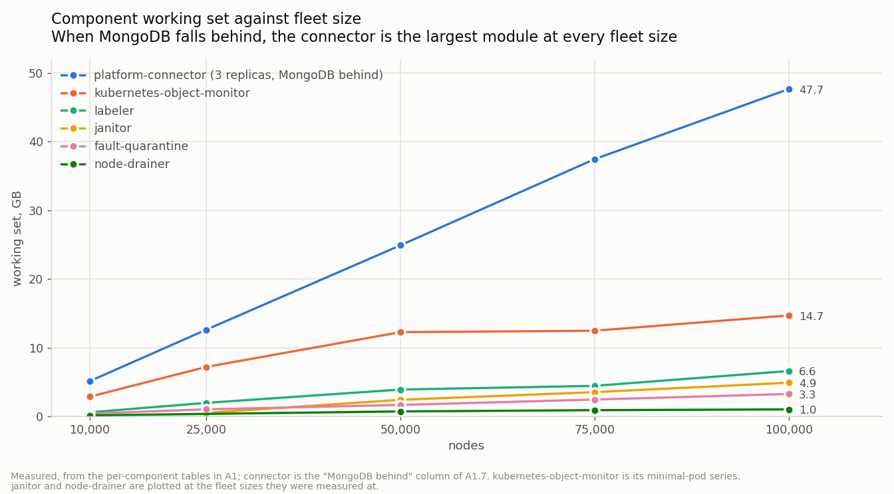


| Nodes   | Total   | platform-connector | kubernetes-object-monitor | fault handling | other services | MongoDB  |
| ------- | ------- | ------------------ | ------------------------- | -------------- | -------------- | -------- |
| 10,000  | ~22 GB  | 5.1 GB             | 2.9 GB                    | 0.5 GB         | 0.9 GB         | 12.9 GB  |
| 25,000  | ~62 GB  | 12.6 GB            | 7.2 GB                    | 1.5 GB         | 2.2 GB         | 38.7 GB  |
| 50,000  | ~123 GB | 24.9 GB            | 12.3 GB                   | 4.8 GB         | 4.1 GB         | 77.3 GB  |
| 100,000 | ~187 GB | 47.7 GB            | 19.8 GB                   | 9.2 GB         | 7.2 GB         | 103.1 GB |


Two columns of the table contain more than one component:

- fault handling: fault-quarantine, node-drainer, fault-remediation and janitor.
- other services: labeler, preflight and health-events-analyzer.

Each column is the sum of the values in the tables below for those components, at that fleet size. The platform-connector column uses the figure for when MongoDB is behind, from the ten-point sweep in [Resources against fleet size](#resources-against-fleet-size). The 100,000-node row is the loaded fleet, with a pod on every node. The labeler measurements used two pods per node at all sizes, because the DCGM and driver DaemonSets scale with the fleet. The MongoDB column is the sum of the recommended container limits of the three members, at 0.01 health events per node per second. The limit per member is 4, 12, 24 and 32 Gi, from [Sizing the WiredTiger cache](#sizing-the-wiredtiger-cache).

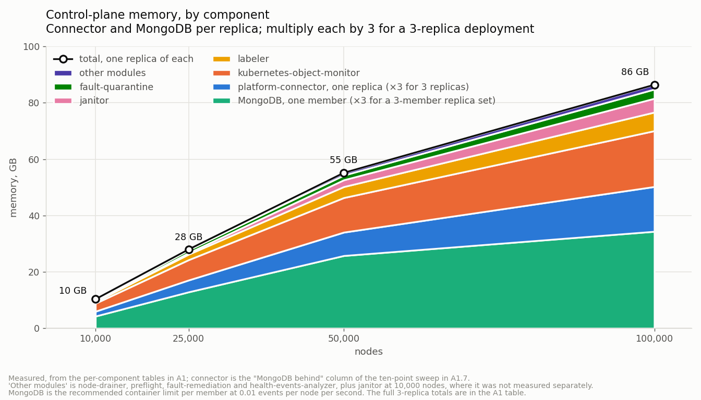

The graph above shows peak memory, not steady-state memory. The two values can differ by a large margin, because a module that prunes an object holds the full object while it prunes it. For example:


| Component | peak    | settled | peak per node | vs raw wire |
| --------- | ------- | ------- | ------------- | ----------- |
| labeler   | 6.54 GB | 2.0 GB  | 247,550 B     | 4.5x        |


The same effect occurred with pod objects:


| Component                 | settled B/pod | peak B/pod | computed B from transform            |
| ------------------------- | ------------- | ---------- | ------------------------------------ |
| kubernetes-object-monitor | ~3,700        | ~4,400     | ~175                                 |
| node-drainer              | ~4,900        | ~6,200     | 599 if drain eligible, 205 otherwise |
| preflight                 | ~4,200        | ~5,200     | ~110                                 |


The sections below give the data for each component.

### kubernetes-object-monitor

kubernetes-object-monitor watches Nodes and Pods, with one watch for each enabled policy. It applies a transform that it derives from the CEL expressions of the policies. A cluster-wide Pod policy, such as the `PodOnUnschedulableNode` policy without the benchmark changes in [Deployed configuration](#deployed-configuration), watches every pod in the cluster. The benchmark policy for the grid below has a scope of one namespace, so that the number of watched pods is the controlled variable. The marginal cost per node is **132,000 B/node**: from 2.86 G at 10,005 nodes to 14.70 G at 100,005 nodes, with no watched pods. CPU did not limit the process in either of these two measurements.

**The Pod transform can remove almost all of the object.** In the test, a pod arrived at 40,644 B on the wire. If a Pod policy reads only `status.phase` and `spec.nodeName`, the transform keeps eight fields: `apiVersion`, `kind`, five pieces of `metadata`, `spec.nodeName` and `status.phase`. These fields are **~175 B, under half a percent of what the API server sent**. The transform drops all other fields before they reach the cache. In a production pod, these other fields are mostly the container spec and env.

For each row, the test restarted the process and let it converge. The rows use the benchmark Pod policy in [Deployed configuration](#deployed-configuration). This policy reads `metadata.annotations` as a whole map, so the transform keeps all 20,039 B of the annotations of each pod, not ~175 B.


| Nodes   | Watched pods | CPU limit | CPU med/peak `[M]` | Throttled `[M]` | Working set peak `[M]` | Rec. request | Rec. limit |
| ------- | ------------ | --------- | ------------------ | --------------- | ---------------------- | ------------ | ---------- |
| 10,005  | 0            | 2         | 0.06 / 0.07        | 0.0%            | 2.86 G                 | 3 Gi         | 5 Gi       |
| 10,005  | 25,000       | 2         | 0.08 / 0.29        | 0.0%            | 4.05 G                 | 4 Gi         | 6 Gi       |
| 10,005  | 50,000       | 2         | 0.07 / 0.08        | 0.0%            | 5.15 G                 | 5 Gi         | 8 Gi       |
| 10,005  | 100,000      | 2         | 0.07 / 0.78        | 0.0%            | 11.86 G                | 12 Gi        | 18 Gi      |
| 25,005  | 0            | 2         | 0.16 / 0.32        | 0.1%            | 7.20 G                 | 7 Gi         | 11 Gi      |
| 25,005  | 25,000       | 2         | 0.16 / 0.20        | 0.1%            | 8.29 G                 | 8 Gi         | 12 Gi      |
| 25,005  | 50,000       | 2         | 0.17 / 0.41        | 0.1%            | 9.68 G                 | 10 Gi        | 15 Gi      |
| 25,005  | 100,000      | 2         | 0.56 / 0.64        | 3.7%            | 12.26 G                | 12 Gi        | 18 Gi      |
| 50,005  | 0            | 2         | 0.36 / 0.59        | 0.7%            | 12.26 G                | 12 Gi        | 18 Gi      |
| 50,005  | 25,000       | 2         | 0.34 / 0.84        | 0.7%            | 12.19 G                | 12 Gi        | 18 Gi      |
| 50,005  | 50,000       | 2         | 0.33 / 0.69        | 0.4%            | 12.26 G                | 12 Gi        | 18 Gi      |
| 50,005  | 100,000      | 2         | 1.02 / 1.81        | 5.3%            | 12.47 G                | 12 Gi        | 18 Gi      |
| 75,005  | 0            | 4         | 0.99 / 1.54        | 0.9%            | 12.47 G                | 12 Gi        | 18 Gi      |
| 75,005  | 25,000       | 4         | 1.06 / 1.39        | 2.2%            | 12.31 G                | 12 Gi        | 18 Gi      |
| 75,005  | 50,000       | 4         | 1.72 / 2.52        | 6.2%            | 13.02 G                | 13 Gi        | 20 Gi      |
| 75,005  | 100,000      | 4         | 3.24 / 3.68        | 4.3%            | 17.57 G                | 17 Gi        | 26 Gi      |
| 100,005 | 0            | 8         | 4.09 / 5.37        | 4.6%            | 14.70 G                | 14 Gi        | 21 Gi      |
| 100,005 | 25,000       | 8         | 5.34 / 5.37        | 5.0%            | 14.28 G                | 14 Gi        | 21 Gi      |
| 100,005 | 50,000       | 8         | 5.28 / 5.41        | 5.2%            | 14.84 G                | 14 Gi        | 21 Gi      |
| 100,005 | 100,000      | 8         | 5.48 / 6.12        | 2.0%            | 19.81 G                | 19 Gi        | 29 Gi      |


Size the CPU with the fleet. The process used:

- 0.06 cores at 10,005 nodes.
- 0.36 cores at 50,005 nodes.
- One to 3.24 cores at 75,005 nodes, depending on the watched pods.
- 4.09 to 5.48 cores at 100,005 nodes.

Size it at 2 cores up to 50,000 nodes, 4 cores up to 75,000 and 8 cores at 100,000.

Too little CPU costs memory, not latency. The same 100,005-node configuration with zero pods read 19.33 G under a 2-core limit and 14.70 G under an 8-core limit. The difference occurs because a process that cannot run its garbage collector lets the heap grow ahead of the collector. Too little CPU shows as a CPU figure that stops changing with the workload. It does not show as throttling. Throttling stays at a few percent of periods, and each throttled period costs 0.3-0.5 ms, even with ample headroom.

**Working set is a high-water mark, not a measure of retained data.** The initial informer sync sets the working set, and the process then holds it. `heap_sys` reached ~12.25 GB during the sync of 50,005 nodes, and `heap_released` stayed at 0.26 GB. As a result, the container keeps ~12.26 GB, whatever happens after the sync.

For this reason, the 50,005-node rows are flat at 12.2-12.5 GB across a 100,000-pod range. The pod data fits inside spare memory that the process already held. When the node cache is small, there is no spare memory to hide the pods, and their full cost is visible. At 10,005 nodes, the first 50,000 pods cost 2.29 GB of working set.

The heap shows the other half, and it was consistent where the test measured it. At 50,005 nodes, the median `go_memstats_heap_alloc_bytes` over the same window was:


| Watched pods | heap median | per pod |
| ------------ | ----------- | ------- |
| 0            | 8.77 GB     | --      |
| 25,000       | 9.75 GB     | 39 KB   |
| 50,000       | 10.47 GB    | 34 KB   |
| 100,000      | 10.76 GB    | 20 KB   |


The table shows that the live cost of a watched pod is about **20 KB**. This value matches the 20,039 B of annotations that the transform keeps. The working-set cost goes from nothing to 134 KB per pod. It depends only on how much sync headroom the node cache left.

For sizing, the limit must cover the sync peak. A sync occurs on every restart, rollout and leader change, not only at install. If you provision from a settled steady-state figure, you under-provision for the most frequent case.

### fault-quarantine

The cost per node is **32,567 B/node**. The retained bytes per node are `33,144-34,337` `[I]`. fault-quarantine derives from its configured rules the label and annotation keys that it reads. It drops all other keys when each object enters the informer, so the rules, not the node, set what it caches for each node:


| Nodes   | CPU med/peak `[M]` | Working set peak `[M]` | B/node | Rec. request | Rec. limit |
| ------- | ------------------ | ---------------------- | ------ | ------------ | ---------- |
| 10,005  | 0.015 / 0.017      | 0.390 G                | 38,980 | 1 Gi         | 2 Gi       |
| 25,010  | 0.052 / 0.152      | 1.024 G                | 40,944 | 2 Gi         | 3 Gi       |
| 50,010  | 0.061 / 0.187      | 1.660 G                | 33,193 | 2 Gi         | 3 Gi       |
| 75,010  | 0.116 / 0.199      | 2.448 G                | 32,636 | 3 Gi         | 5 Gi       |
| 100,010 | 0.123 / 0.204      | 3.257 G                | 32,567 | 4 Gi         | 6 Gi       |


The cost per node settles at about **32.3 KB** from 50,000 nodes upward. The smaller fleets are near 39-41 KB, because fewer nodes share a fixed term.

There is one qualification when you use these rows for sizing. The test measured them with no load of health events. As a result, they cover the cache, but not the cache plus an active stream of health events. The test measured one build both ways at 100,000 nodes. On that build, 0.1 health events per second per node, with a 1:4 ratio of fatal to non-fatal, cost 1.71 G above idle. The request column does not include headroom of this order.

### labeler

labeler creates five informers at startup (eager informers):

- One for Nodes, with a fixed field projection.
- **Three pod informers**, each with a label scope: `app in (dcgm, driver)`, the driver-component label except on pods of the driver app, and `k8s-app=<gke-installer>`.
- One for ResourceSlice objects.


| Nodes   | Labelled pods           | Settled | Sync peak | CPU med/peak | Rec. request | Rec. limit |
| ------- | ----------------------- | ------- | --------- | ------------ | ------------ | ---------- |
| 100,005 | 200,010 (DCGM + driver) | 6.60 G  | 7.0 G     | 0.06 / 0.16  | 7 Gi         | 11 Gi      |
| 75,005  | 150,000 (DCGM + driver) | 4.44 G  | 5.53 G    | 0.11 / 0.78  | 6 Gi         | 9 Gi       |
| 50,005  | 100,000 (DCGM + driver) | 3.90 G  | 3.97 G    | 0.11 / 0.45  | 4 Gi         | 6 Gi       |
| 25,005  | 50,000 (DCGM + driver)  | 1.96 G  | 2.58 G    | 0.05 / 0.33  | 3 Gi         | 5 Gi       |
| 10,005  | 20,000 (DCGM + driver)  | 0.59 G  | 0.59 G    | 0.01 / 0.19  | 768 Mi       | 2 Gi       |


The bootstrap sweep is serial: one node and one PATCH at a time. Because labeler uses client-go informers directly, not a controller-runtime manager, it has no concurrency setting that you can increase.

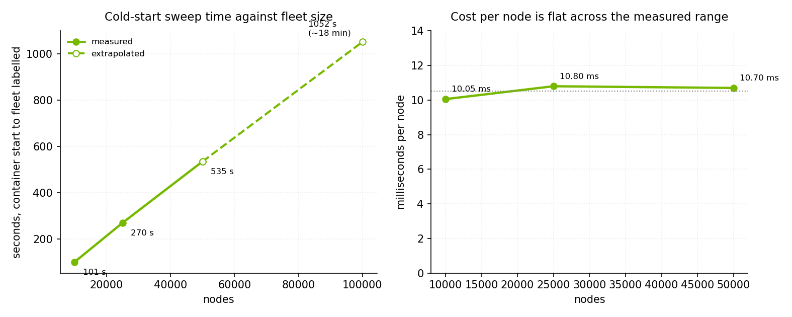

The test measured a cold start of a first install:

- The test created a new fleet with none of the labeler labels.
- Every node had a Ready DCGM pod and a Ready driver pod, so the full label path ran.
- A check confirmed that KWOK renewed the node leases during the full run.

The timer started at container start and stopped at the `Completed initial node label reconciliation` log line, so the time includes the informer sync. `[M]`


| Nodes  | Cold start | Per node |
| ------ | ---------- | -------- |
| 10,005 | 100.6 s    | 10.06 ms |
| 25,005 | 270 s      | 10.80 ms |
| 50,005 | 535 s      | 10.70 ms |


The cost per node is flat across a 5x change in fleet size, so the estimate for a 100,000-node first install is roughly **18 minutes**. This point is an extrapolation. It needs 200,010 pods, and the harness was not able to keep that many pods Running and Ready at all times. Each node costs one PATCH, whatever changes. The sweep writes four labels.

The sweep repeats on every restart and leader election, but only a first install has that cost. A restart on a fleet that already has the labels costs **0.50 ms per node**. For the same 10,005 nodes that took 100.6 s cold, the restart took 5.0 s, with no writes. The restart is fast because labeler drops an empty patch and does not make the API call. As a result, a restart at 100,000 nodes takes seconds, not the 18 minutes of a first install. `[M]`

The `--kube-api-qps=500` limit had spare capacity during all runs. At 10.5 ms per node, a serial sweep sends fewer than 100 PATCHes per second, a fifth of the limit. In steady state, labeler writes only when a relevant informer event occurs.

### node-drainer

Before node-drainer caches a pod, it strips the pod object. What it keeps depends on whether the pod is drain-eligible:


| Pod type        | Cost per pod | Basis                                                                                         |
| --------------- | ------------ | --------------------------------------------------------------------------------------------- |
| drain-eligible  | 4,850 B      | measured: 731 -> 200,731 pods at fixed 10,000 nodes, on 44,593 B pod objects                  |
| DaemonSet-owned | 3,406 B      | derived: 2.34 GB at 53,513 nodes / 642,243 pods, minus the node term, on ~9,626 B pod objects |


The scale sweep gave these results:


| Nodes   | Pods     | CPU med/peak `[M]` | Working set peak `[M]` | Rec. request | Rec. limit |
| ------- | -------- | ------------------ | ---------------------- | ------------ | ---------- |
| 10,005  | 0        | 0.01 / 0.01        | 0.14 G                 | 256 Mi       | 512 Mi     |
| 50,005  | 0        | 0.08 / 0.16        | 0.715 G                | 768 Mi       | 2 Gi       |
| 75,005  | 0        | 0.09 / 0.21        | 0.898 G                | 1 Gi         | 2 Gi       |
| 75,005  | ~100,000 | 0.19 / 0.48        | 1.00 G                 | 1 Gi         | 2 Gi       |
| 100,005 | 0        | 0.13 / 0.20        | 1.01 G                 | 1 Gi         | 2 Gi       |
| 100,005 | ~100,000 | 0.10 / 0.38        | 1.04 G                 | 1 Gi         | 2 Gi       |


These figures are for an empty queue. For each pending health event, node-drainer holds one entry, so the figures do not include the memory of a backlog. The entry has a node name, an event ID and a document ID, whichever path the health event arrives on. The two runs agree:


| Backlog source | Queued events | Working set      | Per event `[M]` |
| -------------- | ------------- | ---------------- | --------------- |
| replay         | ~200,000      | 182 → 315 MB     | 0.67 KB         |
| replay         | 1,048,415     | 255.7 → 979.7 MB | 0.69 KB         |


### fault-remediation

fault-remediation has no Kubernetes watches. It reads Nodes directly from the API server, not from a cache. Its working set is **flat at 0.014-0.019 GB from 4,933 to 53,513 nodes**, and the pod count has no effect on it. CPU use is 0.09 median and 0.18 peak.


| Nodes   | Pods     | CPU med/peak `[M]` | Working set peak `[M]` | Rec. request | Rec. limit |
| ------- | -------- | ------------------ | ---------------------- | ------------ | ---------- |
| 4,933   | 731      | 0.09 / 0.18        | 0.015 G                | 2 Gi         | 4 Gi       |
| 53,513  | 642,243  | 0.09 / 0.18        | 0.019 G                | 2 Gi         | 4 Gi       |
| 75,005  | ~100,000 | 0.07 / 0.08        | 0.07 G                 | 2 Gi         | 4 Gi       |
| 100,005 | ~100,000 | 0.01 / 0.04        | 0.02 G                 | 2 Gi         | 4 Gi       |


The flat profile is the main result: the remediation rate, not the fleet size, sets the size of fault-remediation.

These figures are for an empty queue, and the memory of fault-remediation goes to the queue. For each pending health event, fault-remediation holds one entry. On both paths, the entry keeps a document ID, not the decoded health event.


| Backlog source | Queued events | Per event `[M]` |
| -------------- | ------------- | --------------- |
| cold start     | 1,037,329     | 0.55 KB         |
| live stream    | 1,113,804     | 1.40 KB         |


Each per-event figure is the working-set increase above the baseline of that run, divided by the number of queued health events. The graph below shows these figures, with the two node-drainer paths on the same axes:

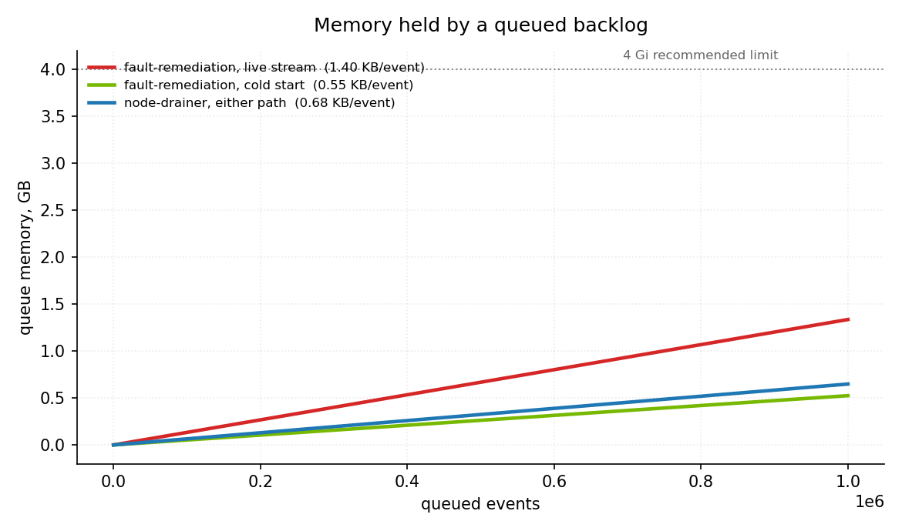

The recommendation is **2 Gi / 4 Gi**. The working set is negligible, but a queued backlog is not. 4 Gi covers roughly three million health events on the live path.

### preflight

preflight has only a Pod informer and no Node cache.


| Nodes   | Pods     | CPU med/peak `[M]` | Working set peak `[M]` | Rec. request | Rec. limit |
| ------- | -------- | ------------------ | ---------------------- | ------------ | ---------- |
| 4,933   | 731      | 0.01 / 0.01        | 0.24 G                 | 256 Mi       | 512 Mi     |
| 10,000  | 364,217  | 0.01 / 0.02        | 1.92 G                 | 2 Gi         | 3 Gi       |
| 25,005  | 731      | 0.01 / 0.01        | 0.24 G                 | 256 Mi       | 512 Mi     |
| 75,005  | ~100,000 | 0.02 / 0.04        | 0.44 G                 | 512 Mi       | 768 Mi     |
| 100,005 | ~100,000 | 0.03 / 0.16        | 0.54 G                 | 768 Mi       | 2 Gi       |


preflight is the only component on the Pod admission path, so its cost is per admission, not per node. The handling in the webhook is cheap and does not saturate. preflight ran with one replica. The webhook admitted pods in a selected namespace at **3 ms P50 and 5 ms P99, flat to 380 admissions/s**, with no rejections. `[M]`

The full cost of a pod creation is larger than that handling time. This cost applies to every ordinary pod, not only to gangs, so this report gives it separately. The test created identical non-gang pods in two namespaces. One namespace had `nvsentinel.nvidia.com/preflight: enabled`, and the other did not. The test alternated between the two namespaces, so both namespaces got the same API-server load. The test preset `spec.nodeName`, so the scheduler was not in the path:


| Arrival       | With preflight | Without       | Added       |
| ------------- | -------------- | ------------- | ----------- |
| serial        | 357.6 ms P50   | 352.1 ms P50  | **+5.6 ms** |
| 32 concurrent | 797.2 ms mean  | 787.3 ms mean | **+9.9 ms** |


The table shows that preflight adds roughly **6 to 10 ms per pod creation**. The baseline is about 350 ms for a GPU-requesting pod through the API server. This cost is more than the 3 ms of webhook handling above, and the difference is not overhead in the webhook. An admitted pod carries three injected init containers and an extra volume, so the CREATE stores a larger object.

Under concurrency, the P90 and P99 were within 2 ms of each other in both namespaces. This is because the tail there comes from API-server queueing, not from admission. For this reason, the table gives the mean for that row, not a percentile. The test got the admitted pods from the API server to confirm the injection. The pods in the selected namespace carried all three init containers, and the pods in the control namespace carried none. `[M]`

Gang coordination is the expensive path. It is also the only path that calls the Kubernetes API: one peer discovery and one ConfigMap write for each gang member. The test created each gang as one burst from 64 concurrent writers, in a namespace of its own, on one replica. The test configured the three shipped checks. Every CREATE blocks on the webhook, so the rate is gang members admitted per second:


| Gang size | Admitted in | Members/s | Admission P50 | Admission P99 | `fail_open` | Peers registered |
| --------- | ----------- | --------- | ------------- | ------------- | ----------- | ---------------- |
| 512       | 5.1 s       | 99.9      | 14.8 ms       | 24.9 ms       | 0           | 512 of 512       |
| 1,028     | 8.4 s       | 122.8     | 15 ms         | 25 ms         | 0           | 1,028 of 1,028   |
| 2,048     | 14.2 s      | 143.8     | 14.6 ms       | 24.8 ms       | 0           | 2,048 of 2,048   |


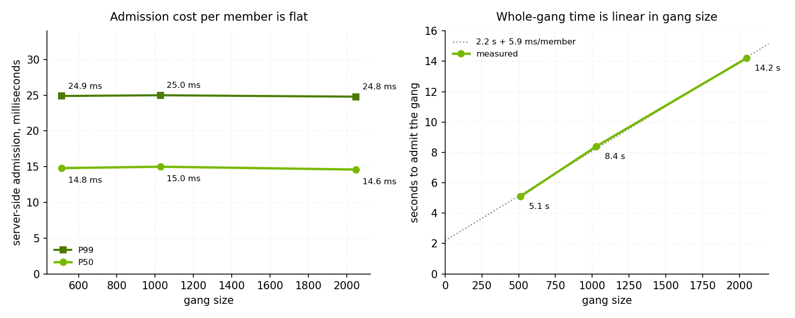

The admission cost per member did not change across a 4x change in gang size. Every gang registered all of its peers, with no fail-open. Gang size is therefore not a scaling axis for preflight. A gang costs what its members cost. The ConfigMap write for each member does not become more expensive as the file grows.

Across the three points, the time for the full gang fits 2.2 s + 5.9 ms per member. That slope comes from the API server and the 64-writer harness, not from preflight. The preflight share is 15 ms, spread across 64 concurrent admissions.

Members/s is not a preflight ceiling. This is why it increases with gang size and does not decrease. The client-observed CREATE latency was 0.37-0.43 s P50, compared to 15 ms of webhook time. Thus, almost all of that latency comes from the API server and the writers, not from preflight. In the larger gangs, the ramp of the harness is a smaller part of the total time. At 15 ms per admission, 64 concurrent writers must reach roughly 4,000/s before preflight becomes the constraint.

preflight has no client-side rate limit and no setting to add one, and this is why the gang path works. Because preflight is synchronous on admission, a rate limit becomes latency against the fixed 10 s deadline of the webhook, not queueing. The test ran the 1,028-member gang against a build with a limit of 5 QPS. The results were:

- The run took 167.0 s.
- The admission P50 was 17,500 ms.
- The API server failed open 1,006 times.
- The gang stopped at 51 registered peers out of 1,028. Five minutes later, the count had not changed.

The result was a gang that stayed incomplete permanently and advertised a quorum that never existed. Such a gang is worse than no gang. `[M]`

### health-events-analyzer

health-events-analyzer does not use the Kubernetes API. It reads the stream of health events from MongoDB, so its cost follows the event rate, not the fleet size.


| Event rate    | CPU peak `[M]` | Working set `[M]` | Rec. request | Rec. limit |
| ------------- | -------------- | ----------------- | ------------ | ---------- |
| idle          | 0.002          | 25.5 MB           | 128 Mi       | 256 Mi     |
| 36.9 events/s | 0.214          | 19.6-20.1 MB      | 128 Mi       | 256 Mi     |


Memory is a fixed cost of about 25 MB at any rate. CPU is not a sizing lever. For most of the handling time of each health event, health-events-analyzer waits for a MongoDB aggregation. As a result, it used about 0.2 cores at saturation, against a 2-core limit, and it recorded zero throttled CFS periods. The recommendation is **256 Mi / 512 Mi**. The deployed 500m CPU request already covers the use at saturation, and a higher request does not increase throughput.

Two factors set the throughput: that round trip for each health event, and the number of round trips at the same time. The `health_event_analyzer_event_handling_duration_seconds` histogram reported **17.6 ms** per health event, with about 5.8 ms of CPU. From 1.8 to 55 events/s, the wall time per health event stayed between 17.5 and 19.4 ms. This shows that the cost per health event is flat under load.

One worker reaches its maximum near 55 events/s, whatever the fleet size. The `--workers` flag partitions health events by node across concurrent workers. Its default is 1.

The test injected a backlog of 20,000 health events onto a live change stream at 100,010 nodes. It read the drain rate from that histogram:


| Workers | Sustained throughput `[M]` | Speedup |
| ------- | -------------------------- | ------- |
| 1       | 54.3 events/s              | --      |
| 8       | 308.8 events/s             | 5.7x    |


Both runs drained the full backlog, so these numbers show sustained rates, not peaks. Eight workers gave 5.7x, not 8x, because the cost of each health event is a database round trip, and MongoDB becomes the shared bottleneck. Thus, what the datastore can absorb limits the useful worker count, not the CPU of this container.

A 100,000-node fleet at 0.1 health events per node per second offers 10,000 events/s, which is well above either figure. Set the worker count for the expected event rate. Do not keep the default.

### janitor

janitor creates its Node informer **lazily**, on the first `TerminateNode` reconcile, so an idle janitor is **flat at 0.022 GB regardless of fleet size**. After the first trigger, it costs **19,616 B/node.**

The computed retained bytes per node are `~10,120` `[I]`. The measured 19,616 B is 1.94x that value. Go map and pointer overhead cause the difference. **Size for the triggered case**: 1 GB at 50k nodes, not the 22 MB that an idle pod shows. The recommendation is **2 Gi / 4 Gi** at 50k.

The table gives each scale point for the triggered case. An untriggered janitor read 0.022-0.055 G at every fleet size, so the idle row is not a sizing figure.


| Nodes   | Pods     | CPU med/peak `[M]` | Working set peak `[M]`           | Rec. request | Rec. limit |
| ------- | -------- | ------------------ | -------------------------------- | ------------ | ---------- |
| any     | any      | 0.01 / 0.01        | 0.03 G untriggered               | —            | —          |
| 25,005  | 731      | 0.02 / 0.04        | 0.93 G sync peak, 0.50 G settled | 1 Gi         | 2 Gi       |
| 50,005  | 731      | 0.03 / 0.07        | 2.41 G                           | 3 Gi         | 5 Gi       |
| 75,005  | ~100,000 | 0.13 / 0.29        | 3.52 G                           | 4 Gi         | 6 Gi       |
| 100,005 | 731      | 0.05 / 0.09        | 4.17 G                           | 4 Gi         | 6 Gi       |
| 100,005 | ~100,000 | 0.10 / 0.36        | 4.90 G                           | 5 Gi         | 8 Gi       |


### Node agents, per GPU node `[M]`

Each component above is a central component, and the fleet pays its cost one time. The four agents in the table below run as DaemonSets, so their cost applies to each node and multiplies by fleet size. The simulated fleet cannot show their cost, because KWOK nodes run no containers, and metadata-collector exits immediately on a node without NVML. As a result, the measurements in this section come from three real 8-GPU A100 nodes (`Standard_ND96amsr_A100_v4`) in a separate cluster. The agents ran at v1.23.0, and each value is the median per node.


| Agent                 | Idle CPU | Idle working set | Under load | Load working set |
| --------------------- | -------- | ---------------- | ---------- | ---------------- |
| gpu-health-monitor    | 0.0009   | 37.9 MB          | 0.0010     | 38.8 MB          |
| syslog-health-monitor | 0.0010   | 17.0 MB          | 0.0188     | 18.0 MB          |
| metadata-collector    | 0.0001   | 28.9 MB          | 0.0007     | 41.4 MB          |
| platform-connector    | 0.0011   | 21.2 MB          | —          | —                |


At rest, a GPU node uses about **0.003 cores and 105 MB**. Under the loads below, this use increases to roughly 0.021 cores and 120 MB.

**Only syslog-health-monitor responds to a noisy journal, and only to kernel messages.** At 1,622 kernel lines per second per node, its CPU use increased from 0.0010 to 0.0188 cores (19x), and its memory stayed flat. User-space log volume has no cost. On a separate cluster, 5,628 lines per second through `logger` changed nothing. This is because syslog-health-monitor matches `_TRANSPORT=kernel` inside the journald query and resumes from a stored cursor. Thus, the journald query excludes non-kernel entries before syslog-health-monitor reads them.

**Pod density affects metadata-collector.** With 80 additional pods on one node, its CPU use increased from 0.0005 to 0.0007 cores, and its memory increased from 34 to 41 MB. The pod mapper of metadata-collector lists all pods from the kubelet `/pods` endpoint, so it tracks all pods on the node, not only GPU-allocated pods.

**Network is not a cost term.** The three loaded nodes had 2.4-2.9 Mbit/s in and 4.0-4.3 Mbit/s out. The medians across all 26 GPU nodes on that cluster were 2.09 and 2.86 Mbit/s, so the contribution of the agents is inside the noise. The conntrack table had 1,134-1,666 entries of 262,144, about 0.5%.

**The requests are the cost that matters, not the usage.** The chart requests 100m CPU and 128Mi for each of the three health agents. In total, a GPU node reserves 300m and 384Mi for work that measured about 3m and 105 MB. This is a CPU over-reservation of roughly a hundred times. On a 1,000-node GPU fleet, it reserves 300 cores for work that three cores can do.

These numbers have two limits:

- They do not include per-pod network or CFS throttling, because that cluster does not scrape `container_network_`* and `container_cpu_cfs_throttled_seconds_total`. This section uses the node-level network data instead. This report did not verify the throttling against the 500m limit.
- The agents ran with `STORE_AND_ANALYSE`, not the shipped `EXECUTE_REMEDIATION`. The test used this mode because, with the shipped mode, a real DCGM fault causes a cordon, and this cluster was a shared cluster. This difference changes what happens after detection, not the detection work that the test measured.

### platform-connector, deployment mode `[M]`

In deployment mode, platform-connector runs as a central Deployment, and publishers connect to it over gRPC. The Helm value `platformConnector.deployment.enabled` enables this mode. The test used a build of the upstream main branch, with three replicas. Each publisher holds one gRPC connection, and each node runs three publishers. In a run with the shape of a real fleet, this gives three connections per node: 299,985 connections at 100,000 nodes. If a run used a different number of connections, the text says so.

#### Connections to the datastore

In deployment mode, the number of datastore connections drops to a fixed 48 sockets, whatever the fleet does. Eighteen of them are connections that monitor the servers: two for each replica-set member, for each platform-connector replica. The MongoDB driver opens these connections at any load and never closes them.

The other connections are the write pool. The pool connects only to the primary, because the read preference is Primary and all writes go to the primary. The `DATASTORE_MAX_CONNECTIONS` setting limits the pool for each server, so three replicas hold a maximum of thirty connections. The pool grows to the peak number of concurrent writes and does not shrink. If you remove every publisher, the count stays the same. This makes 48 both the ceiling and the count that platform-connector continues to hold after any busy period.

The DaemonSet mode opens seven connections for each node: three to the primary and two to each secondary. Compared to the DaemonSet mode, deployment mode uses four orders of magnitude fewer connections. It replaces a cost for each node with a fixed cost that the replica count and the pool size set. This change also removes the memory that MongoDB uses for each node. In the DaemonSet mode, that memory is 170 GB resident across three members at 100,000 nodes. A2 measures 7.1 GB for deployment mode at the same fleet size.

#### Resources against fleet size

The test measured ten fleet sizes, with three connections per node: one for each health-monitor DaemonSet that a GPU node runs. The nodes carried the label set that the chart ships. Each connection published 0.3 health events a minute. At the 100,000-node point, this rate is about 1,500 events/s, which is well inside the ingest ceiling. Thus, no request in this sweep waited for the datastore. For the cost of a blocked connection, see [Ingest rate and sizing](#ingest-rate-and-sizing).


| Nodes   | Connections | Total working set | Per replica | Per replica, MongoDB behind | CPU, three replicas | Rec. memory request | Rec. memory limit | Rec. CPU request | Rec. CPU limit |
| ------- | ----------- | ----------------- | ----------- | --------------------------- | ------------------- | ------------------- | ----------------- | ---------------- | -------------- |
| 2,000   | 6,000       | 515 MB            | 172 MB      | 361 MB                      | 0.04                | 1 Gi                | 2 Gi              | 50m              | 100m           |
| 5,000   | 15,000      | 1,231 MB          | 410 MB      | 861 MB                      | 0.08                | 1 Gi                | 2 Gi              | 50m              | 100m           |
| 7,500   | 22,500      | 1,842 MB          | 625 MB      | 1,313 MB                    | 0.12                | 1 Gi                | 2 Gi              | 50m              | 100m           |
| 10,000  | 30,000      | 2,441 MB          | 814 MB      | 1,709 MB                    | 0.15                | 1 Gi                | 2 Gi              | 50m              | 100m           |
| 15,000  | 45,000      | 3,621 MB          | 1,214 MB    | 2,549 MB                    | 0.22                | 2 Gi                | 3 Gi              | 100m             | 150m           |
| 25,000  | 75,000      | 6,009 MB          | 2,003 MB    | 4,206 MB                    | 0.35                | 2 Gi                | 4 Gi              | 150m             | 250m           |
| 35,000  | 105,000     | 8,346 MB          | 2,784 MB    | 5,846 MB                    | 0.46                | 3 Gi                | 6 Gi              | 200m             | 300m           |
| 50,000  | 150,000     | 11,863 MB         | 3,954 MB    | 8,303 MB                    | 0.74                | 4 Gi                | 8 Gi              | 250m             | 400m           |
| 75,000  | 224,985     | 17,797 MB         | 5,945 MB    | 12,485 MB                   | 1.70                | 6 Gi                | 12 Gi             | 600m             | 900m           |
| 100,000 | 299,985     | 22,698 MB         | 7,566 MB    | 15,889 MB                   | 1.94                | 8 Gi                | 16 Gi             | 650m             | 1000m          |


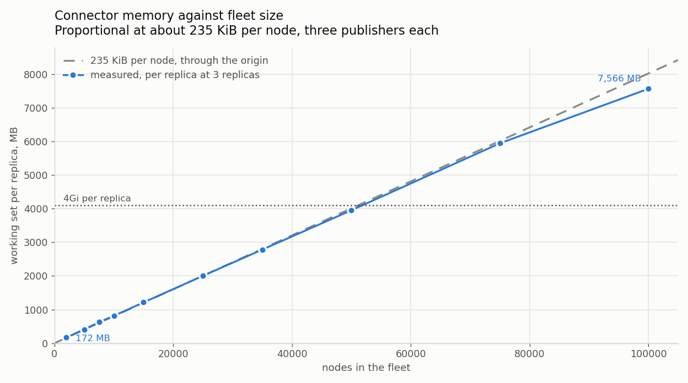

Memory is proportional to fleet size, at about 235 KiB per node. The cost per node is flat to within 6.5% across a fiftyfold range of fleet sizes. About 97% of the memory is for the connections of a node, and 3% is for the cached labels of the node. For this reason, one publisher fewer per node removes about a third of the cost, but an empty `allowedLabels` removes only 3%. For the measurement, see [Connector memory: connections against label cache](#connector-memory-connections-against-label-cache-m).

Requests and limits are per replica. The CPU figures are the measured use divided by three. The memory limits do not include the headroom for one replica down that step 4 of [Ingest rate and sizing](#ingest-rate-and-sizing) gives.

The working-set columns are from the **quiet** sweep. In this sweep, MongoDB accepted health events as fast as publishers sent them, so almost no request waited. A connection then cost about 79 KiB. MongoDB is behind when it accepts health events more slowly than publishers send them. Each connection then also holds a request that waits for its write. Such a connection costs 165-171 KiB, about 2.1x quiet.

The "MongoDB behind" column is the quiet per-replica figure times 2.1. The memory limit covers that figure and the saturated cost from step 2 of [Ingest rate and sizing](#ingest-rate-and-sizing). It is the next whole Gi above both, and at least 2 Gi. The 1.5x rule that the rest of this report uses does not apply to platform-connector. Its memory follows the requests in flight, and the quiet sweep has none. The resource requests stay at the measured values, and a limit costs nothing until the process uses it.

#### Ingest rate and sizing

The datastore connection pool of the chart limits the ingest throughput, not platform-connector or MongoDB. The test drove the same 40,000 connections at one health event per second per node, which is an offer of 20,000 events/s. The path settled at 4,925 events/s, and publishers blocked for seconds while they waited for their turn. CPU and memory did not block them: platform-connector and mongod both stayed well inside their limits, with no throttling. The pool is the resource that is at its limit, and the chart sets it per replica:

```text
DATASTORE_MAX_CONNECTIONS=10
```

The MongoDB driver applies that limit per server, not per client. As a result, each replica can hold up to ten connections to each of the three members. Writes go only to the primary, so the ingest limit is three replicas times ten connections to that one member: thirty writes in flight. A write takes 6-7 ms, the steady P50 in [Publish latency](#publish-latency), which gives 4,300-5,000 events/s. With the limit at 30 per replica and no other change, the results were:


|                           | Pool 10 per replica | Pool 30 per replica                |
| ------------------------- | ------------------- | ---------------------------------- |
| Achieved rate             | 4,925 events/s      | 10,525 events/s, peaking at 13,367 |
| platform-connector memory | 7.4 GB              | 6.4 GB                             |
| Busiest replica CPU       | 0.51 of 2 cores     | 0.89 of 2 cores                    |
| CPU per event             | 0.237 ms            | 0.132 ms                           |


The ceiling is the pool size divided by the time that one write holds a pooled connection. Almost all of that time is the majority write concern, not the write. On the primary, a write took 130 microseconds at 2,000 events/s and 223 microseconds at saturation. Nothing inside the server had contention. The cost is the acknowledgement, which the NVSentinel datastore client explicitly requests:

A write to the primary alone costs 0.8 ms and scales to 26,667 inserts/s, so the write capacity of MongoDB is not a factor. A wait for a second member costs an order of magnitude more, and the throughput is the pool divided by that wait. The wait is not constant. It follows how far behind the secondaries are: under 1.3 ms with no lag, and about 5 ms with two seconds of lag. This feedback makes the returns of the pool diminish. When the test tripled the pool, the throughput increased 2.1x, not 3x ([measurements](#majority-acknowledgement-against-replication-lag-m)).

The time per operation is the number of pooled connections divided by the throughput. For the measured range, 30 pooled connections at 4,925 events/s give 6.1 ms per operation, and 90 at 10,525 events/s give 8.5 ms. Both values are inside the band above. A pooled connection spends under 4% of its time on the write, and the rest on the wait for a second member. This makes the pool a concurrency budget for waiting. The chart sets it to 10 per replica.

These numbers depend on the acknowledgement, which is a property of the replica set and its placement. Here, the replica set had three members in one cluster, on gp3 EBS volumes. If the members are in different zones or regions, the acknowledgement is even slower. For this reason, a value that you tune in one environment does not transfer to another environment.

To get a higher ceiling, increase `DATASTORE_MAX_CONNECTIONS` instead of adding replicas, because replicas cost memory (see [Scaling out](#scaling-out)). MongoDB can absorb much more concurrency than three pools of ten give it. Do not lower the write concern. A lower write concern increases the ceiling severalfold, but the majority acknowledgement is what makes a stored health event durable.

**Recommended default: `DATASTORE_MAX_CONNECTIONS=30`.** The test measured this setting. It more than doubles the ceiling, to 10,525 events/s. platform-connector also uses less memory than at 10, because fewer publishers block. The extra concurrency has no effect on the primary, which accepts 26,667 inserts/s when it does not wait for a second member.

**Pool or replicas.** They control different limits:

- The pool sets the throughput. If the event rate that you need is above the ceiling, increase the pool.
- The replica count sets how many connections the deployment can hold. If the connections per replica are more than the memory limit allows, add a replica. This is step 2 of the procedure below.

More replicas also give more throughput. But a replica costs memory, and a larger pool gives the same throughput without that cost.

For comparison, a 50,000-node fleet at 0.3 events/node/minute, the rate that this report uses elsewhere, sends 250 events/s. The shipped default gives 4,925 events/s, so the default is ample for steady state. The default becomes the limit during a burst. When this occurs, the path blocks publishers. It loses no health events unless one waits longer than the retry window of the publisher, 5 minutes by default.

platform-connector holds memory for each blocked publisher, so the pool sets the memory and the ceiling. The health events in flight on a replica are its throughput times the time of a write, with the connection count as the maximum.

When the test increased the pool from 10 to 30 across the same 40,000 connections, memory decreased 14%, from 7.4 GB to 6.4 GB. In the same change, the throughput doubled. The [sweep](#resources-against-fleet-size) measures the quiet case, so a size that you calculate from its slope leaves no headroom for a slow datastore. A blocked connection costs about 1.85x a quiet connection, roughly 89 KB per held health event.

Per replica:

```text
M_replica  =  M_fixed  +  a x (connections per replica)  +  b x (events held per replica)

M_fixed ~ 8 MB         a ~ 78 KiB per connection      b ~ 89 KB per event held
events held per replica  =  min(connections per replica, throughput x how long a write takes)
```

The `min` is the bound: the health events in flight can never be more than the connections. The worst case is a datastore so slow that every connection blocks at the same time. A saturated connection then costs `a + b`, about 167 KiB, against 78 KiB quiet. The same 40,000 connections cost 4.0 GB quiet and 7.4 GB saturated.

Size the pool first. Then size the replica count:


| Step | Quantity                                                                        | Basis                                                                                                                                       |
| ---- | ------------------------------------------------------------------------------- | ------------------------------------------------------------------------------------------------------------------------------------------- |
| 1    | pool size per replica (`DATASTORE_MAX_CONNECTIONS`) = target throughput x how long a write takes / replicas | the write time that you measure on the cluster that you size, at that throughput and not at rest. The result is the writes in flight, not the publisher connections |
| 2    | publisher connections per replica `<= (M_limit - M_fixed) / (a + b)` | 25,000 at a 4Gi limit if the datastore saturates, 53,500 in the quiet case |
| 3    | `R = ceil(publisher connections / publisher connections per replica)` | how many publishers the fleet has, and the limit from step 2 |
| 4    | size for one replica down: each remaining replica holds `R / (R - 1)` times its connections, 1.5x at three replicas | the PodDisruptionBudget permits one replica down, and the other replicas absorb its connections. One measurement went from 2,265 MB to 2,851 MB per replica |


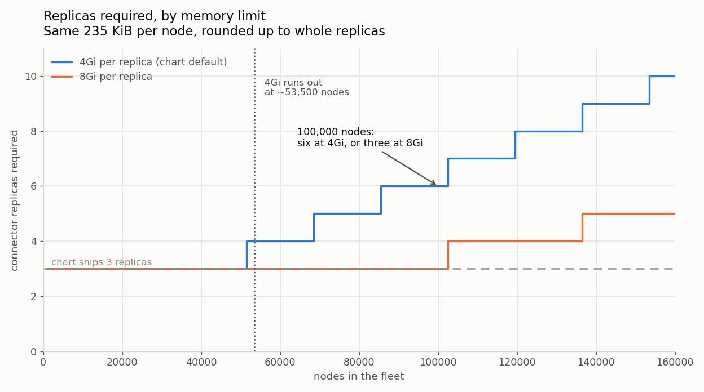

The figure shows the quiet case, at 235 KiB per node. This example is for the saturated case, with three publishers per node and MongoDB behind. Step 2 then shows that three replicas at 4Gi support about **25,000 nodes**, or 16,500 with one replica down. A 100,000-node fleet needs about 16 GiB per replica: three replicas at 16Gi, or twelve at 4Gi. With step 4, the fleet needs three replicas at 24Gi, or thirteen at 4Gi.

Replicas give throughput and memory capacity, so when you scale for one, the other also changes. Nothing in the chart or the metrics shows this. Replicas are also not a free substitute, for the reason in [Scaling out](#scaling-out). CPU is never the limit in either case: 1.94 cores across three replicas at 100,000 nodes, against a limit of 2 cores for each replica.

#### Scaling out

After you add a replica, the connections rebalance automatically in about twelve minutes. Only a client redial moves a connection, and `MaxConnectionAge` is 10m. Because of this delay, scale out before you reach the ceiling, not when you cross it. Each replica keeps its own cache of token verdicts. With one token per publisher, these caches do not add TokenReviews (see [Health-monitor authentication](#health-monitor-authentication-m)).

## A2. Load on external components

*Measured at 50,021 nodes carrying 642,243 pods*

If a table below shows three columns, the columns are conditions on that fleet, not scale points. The three conditions are idle, continuous load at 0.47 nodes/s, and a 100-node burst.

**Why 50,000 nodes and not 100,000.** etcd, not NVSentinel, set this ceiling. A fleet of 100,000 nodes with one pod on each node is already close to the 16 GB threshold of the 4XL control-plane tier. The run with 203,411 pods went above that threshold. Then etcd refused every write, including the deletes that the recovery needed. It accepted writes again only after the churn became older than the revision window and compaction removed it.

A smaller simulated node does not give much more room. Almost all of the bytes in the five-minute revision window of etcd are churn from simulated kubelets, not writes from NVSentinel. A 50,000-node fleet with 642,243 pods stays far below the threshold. Thus the measurements come from a stable cluster, not from a cluster that is near the read-only state.

**Extrapolating to 100,000.** The quantities in this section are costs per node or per health event. These costs stay the same at a larger fleet size. A remediation costs a fixed number of API requests at any fleet size. The two instantaneous stages scale linearly with the number of nodes that fail at the same time. Across a 10x range of burst sizes, cordon held 61-71 nodes/s and maintenance CR creation held 11.9-13.0 nodes/s ([Burst absorption](#burst-absorption)).

Thus, at the same fault rate, a fleet of two times the size causes two times the external load. The difference between continuous and burst conditions is the event rate, not the fleet size. A quantity that the 16 GB etcd threshold limits does not extrapolate. This threshold is a cliff, not a slope. At 100,000 nodes, the usable pod budget is approximately 100,000 pods at the 50 KB object size. Above this budget, the cluster does not become slower: it stops.

**Almost none of this traffic is NVSentinel's.** Over a five-minute idle window, the API server handled 585,415 audited requests. Of these, 568,470 requests (**97.1%**) came from `kwok`, which simulates the kubelets. In a breakdown by resource on a 10,005-node fleet, 78% of PUTs were `pods/status`. The kwok controller writes this status periodically for every simulated pod. [Node heartbeats and pod status](#node-heartbeats-and-pod-status) gives the rest of the breakdown.

Next to this traffic, all NVSentinel components together are in the noise. node-drainer made 1.85 requests/s and fault-remediation made 0.49/s. All of the fault-remediation traffic was leader-election lease renewal. The other components were below the reporting threshold.

This result is important for two reasons. First, the harness causes most of the API server and etcd load in this section. Thus these figures give an upper bound for the cost of NVSentinel, not a measurement of it. Second, a real cluster of the same size gets the same kubelet traffic from real kubelets. Thus the etcd budget is not an artifact of the simulation. The full breakdown is in [API server load produced by the simulation harness](#api-server-load-produced-by-the-simulation-harness-m).

### Kubernetes API

The table gives the request rate of NVSentinel against the API server. The rates come from the `rest_client_requests_total` metric of each component. Three components register no client-go metrics, so their rates come from EKS audit logs:


| Component                 | Steady-state rate `[M]` | Per remediated node `[M]`   | What it spends it on                                                                                       |
| ------------------------- | ----------------------- | --------------------------- | ---------------------------------------------------------------------------------------------------------- |
| node-drainer              | 1.85/s                  | 3.7 + 3.0 per evictable pod | pod GETs on each recheck, plus a POST to the `eviction` subresource of the pod                              |
| fault-remediation         | 0.49/s                  | 9                           | 5 get, 3 update, 1 create                                                                                  |
| janitor                   | below threshold         | 6                           | 2 get, 2 update, 1 create, 1 delete                                                                        |
| janitor-provider          | below threshold         | 2.2                         | get                                                                                                        |
| fault-quarantine          | below threshold         | 1                           | 1 patch, the cordon                                                                                        |
| kubernetes-object-monitor | below threshold         | not per node                | 1 PUT per policy-match transition                                                                          |
| labeler                   | below threshold         | 0                           | 1 PATCH per relevant event                                                                                 |
| preflight                 | below threshold         | 0                           | per pod admission                                                                                          |


The steady-state rate of 0.49/s for fault-remediation is all leader-election lease renewal. fault-remediation does no work until a health event arrives. The per-node column comes from the burst measurement in [What a remediation costs the API server](#what-a-remediation-costs-the-api-server-m). On nodes with nothing to evict, the column totals about 22 requests for each remediated node.

node-drainer is the one row that does not stay fixed, because node-drainer evicts pods. Its value of 3.7 is the baseline on a node with no drain-eligible pods. Each evictable pod adds 3.0 calls, not one. The reason is that, on each recheck, node-drainer evicts again every pod that is still present, and does not wait. In the test, five pods on one node took 15 eviction calls over three retry cycles. Thus a fleet with 5 evictable pods per node costs 18.7 calls per node, and node-drainer becomes the binding stage in the QPS table below.

Flow control has headroom that the fleet size does not threaten. APF peaked at **116 of 1,085 seats** (11%) and rejected no requests in any window. The seat figure is for the whole cluster, so it includes the simulation harness. The harness generates 97% of the requests on this cluster. The share of those seats that NVSentinel uses is smaller in proportion. Thus 11% is an upper bound, not the cost of NVSentinel.

### Health-monitor authentication `[M]`

Authentication costs the API server a TokenReview on most health events. The fleet sets this cost, not the fault rate. The check runs in a unary interceptor, so the check is on the path of every RPC. A positive verdict stays in the cache for a fixed two minutes, not until the token expires. TokenReview is the only check that detects the deletion of the bound pod. Thus this TTL is also the time in which the token of a deleted pod continues to work.

The cache key is the token. In production, every publisher has its own token on its own connection. Thus only the replica that gets the connection checks the token. The test used one token per connection, with 5,000 connections that each sent one health event per minute:


| Replicas | TokenReviews/s | Publish P50 | Publish P99 |
| -------- | -------------- | ----------- | ----------- |
| 3        | 17.2           | 4.6 ms      | 53 ms       |
| 5        | 19.8           | 4.5 ms      | 47 ms       |


More replicas cause almost no change to the TokenReview rate. Extra replicas add budget: each replica can send up to `TokenReviewQps` (1,000) reviews per second. A 100,000-node fleet with five publishers per node has 500,000 tokens, which is 100 times the measured run. Thus this fleet needs about 1,700-2,000 TokenReviews/s. On three replicas, that is about 570-660 per replica, which is less than the budget.

A publisher that sends less often than the two-minute TTL needs a new review for each send. The test timed this from the publisher side, at 1,000 events/s through 40,000 connections. Publishers that sent every 200 seconds saw 12.7 ms P50 and 127 ms P99. Publishers that hit the cache saw 10.5 ms and 65 ms.

Above the budget, platform-connector does not queue publishes. Each review has 8 seconds to complete. If the rate limiter cannot fit a review into that time, platform-connector replies `Unavailable` at once, and the publisher retries. In steady state, the fleet does not reach the budget.

After a restart of platform-connector, every publisher needs a new review at the same time. Each replica admits about 8,000 reviews in one review window. Thus, at 100,000 nodes, platform-connector refuses most first publishes, and the publishers retry. At 1,000 reviews per second per replica, the fleet gets new reviews in about three minutes. That is inside the five-minute retry window of the publisher. The three-minute figure comes from the measured behaviour, not from a measurement at 100,000 nodes.

platform-connector does not cache negative verdicts. Thus every request with a bad token costs a review, from the same per-replica budget that good publishers use. To show this, the test lowered the budget to 15 reviews per second across three replicas and added 500 publishers with bad tokens. The successful sends of the good publishers fell from 16 to 5 per second. In 204 seconds, 2,565 of their publishes failed, and their P90 increased from 37 ms to 5.4 s.

CPU did not bind at any measured fleet size. At 100,000 nodes, the three replicas used 1.94 cores, against a total CPU limit of six cores. The marginal cost is about 0.2 ms for each health event. At a fixed fleet size, a tenfold increase of the event rate increased CPU 2.5x. Most of this CPU is the fixed cost of the held connections, not work for each health event.

### etcd


|                         | Idle            | Continuous                                  | Burst                                        |
| ----------------------- | --------------- | ------------------------------------------- | -------------------------------------------- |
| DB size, file-allocated | 16.73-16.75 GB  | 16.70 GB                                    | 15.76-16.75 GB                               |
| growth                  | none over 139 s | +288 objects / 638 s (0.45 obj/s, ~449 B/s) | +97 objects per 97 remediated nodes, ~94 KiB |


Under continuous load, all growth was RebootNode CRs, at a median of 993 B. The number of pods and nodes did not change.

`apiserver_storage_size_bytes` changes by up to 983 MB between consecutive scrapes. Each API server instance reports the file size of its own etcd backend, and each etcd member allocates its file independently. This metric also never decreases, because etcd reuses freed space inside the file and does not return it.

The etcd threshold is 16 GB across tiers. However, only CloudWatch publishes the in-use size, and CloudWatch itself degrades under the load that matters. Its peak reading was 14.59 GB, about 91% of the 16 GB of the 4XL tier. Thus this reading is the only available signal, not an authoritative measurement. Do not use this figure, or the 91% that comes from it, as a margin. This gap in the metrics is real: no in-cluster metric reports the in-use size, because `apiserver_storage_size_bytes` is file-allocated:

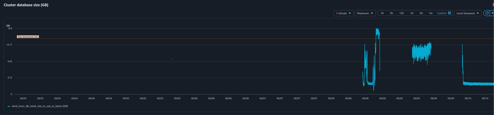

### MongoDB

Every figure below is from **Percona Server for MongoDB 8.0.12-4**, operator `crVersion` 1.21.1. The replica set had three members, and each member had a limit of 8 cores and 4 Gi, on a 32 Gi volume. The operator derives the WiredTiger cache from that limit. Thus each member runs with `--wiredTigerCacheSizeGB=1.50`, and the resident memory stays bounded and does not grow to fill the available memory. By default, the chart installs Bitnami MongoDB 8.0.3, so these runs set `mongodb-store.useBitnami` to `false` to use Percona.

A separate benchmark of the two backends found identical write throughput: 500.0/s against 499.9/s sustained, and 1,382/s against 1,361/s on an uncapped burst. That benchmark also found a connection-memory fit of 0.651 MB per connection. This fit does not apply here, because in deployment mode the connection count does not scale with the fleet. The whole replica set holds 166 connections at 100,000 nodes. The test enabled encryption at rest, and it made no visible difference.

The measurements in this subsection are at **100,000 nodes**, with 299,985 publishers connected to the three connector replicas. This is the fleet size that the test used to size the deployment connector, not the 50,021 nodes that the rest of A2 uses. The rates are deltas of the `serverStatus` counters over a measured 617-second window:


|                      | Idle                              | Under load, 1,495 events/s                                          |
| -------------------- | --------------------------------- | ------------------------------------------------------------------- |
| MongoDB connections  | 135 (51 / 44 / 40)                | 166 (81 / 44 / 41)                                                  |
| resident, per member | 1.86 / 0.74 / 1.60 GB             | 2.27 / 2.20 / 2.13 GB                                               |
| ops/s, primary       | --                                | insert 1,495.3, update 0.1, delete 0.5, query 10.4, getmore 1,875.8 |
| command/s, primary   | --                                | 2,016.5                                                             |
| oplog window         | 9.65 h                            | 1.32 h                                                              |
| storage              | 9,694 MB across 39,534,386 events | +785.40 MB across +2,735,879 events                                 |


The offered load is three times the fleet rate that other sections of this report use. Each node holds three publisher connections, and each connection publishes 0.3 health events per minute. Thus the fleet offers 0.9 health events per node per minute, not 0.3. Inserts matched sends exactly, at 1,495.3/s against 1,495/s. Thus there was no buffering and no loss, and these figures are conservative for a fleet at 0.3.

Most of the command rate is work, not chatter, which is the opposite of the DaemonSet arrangement. With 166 connections, almost no heartbeat traffic remains: the primary handled 2,016.5 command/s against 1,495.3 inserts. The secondaries carry only `getmore` from replication. One secondary handled 1,734.3/s, and the other secondary, which no member tails, handled 6.8 command/s in total. Under load, the connection count changes only when the write pool opens: from 135 when idle to 166 when busy. The DaemonSet arrangement holds seven connections per node.

A remediated node costs **6.1 oplog entries, about 4 KB, and 1.96 stored documents**. The stored documents are the health event and its status record. At this size, the allocated storage does not change, because these documents fit inside an extent that the collection already holds. `[M]`

### Network bandwidth and ports `[M]`

Neither is close to binding. Across the 100,000-node runs, the busiest real node peaked at 3.27 Gbit/s in and 3.17 Gbit/s out. This is 13% of the 25 Gbit/s baseline of a `c8a.16xlarge`. The conntrack table peaked at 11,013 entries against a limit of 2,097,152, which is half a percent. Five real nodes carry the traffic of the whole simulated fleet, so this figure is an aggregate cost, not a per-node cost. A production node that runs one agent is far below it.

Ports are not the constraint on the connection side. With the deployment connector, the whole replica set holds 166 connections at 100,000 nodes. Thus the per-node term, which made a check of the ports necessary, is not present. What remains is the 299,985 gRPC connections that the three connector replicas terminate. These connections spread across three pods and do not concentrate on a database.

The host TCP counters are not the correct signal here. `node_netstat_Tcp_CurrEstab` peaked at 27, because node-exporter sees only the host network namespace, and pod traffic runs in its own namespace. The conntrack table covers the paths that use NAT, and it is the source of the number above.

### What etcd actually holds `[M]`

etcd holds the live objects and every revision written in the last five minutes. Thus its size is the live data plus five minutes of churn. None of that churn comes from NVSentinel. At 25,000 nodes, the churn is about 2 GB of simulated kubelet traffic, and [Node heartbeats and pod status](#node-heartbeats-and-pod-status) gives the breakdown. The contribution of NVSentinel is the remediation cost above: 1.96 stored documents per remediated node. At this size, these documents do not change the allocated storage.

Bulk changes make this size much larger, because their revisions are also in the window. In one hour, 140,000 node creates and 90,000 deletes took the in-use size to **14.59 GB, about 91% of the 4XL tier's threshold**. CloudWatch reported this figure, and CloudWatch is the unreliable source noted above. Thus use this figure only as an indication. The settled floor at 10,000 nodes was 2.33 GB. Measure after the churn leaves the revision window, not during the churn.

The test ran 100,000 nodes two times, and the pod population decided whether the cluster stayed stable. With **100,005 nodes and 101,533 pods**, the cluster ran normally. With the same fleet and **203,411 pods** at the 50 KB user profile, etcd went above the threshold. Then etcd refused every write, including the deletes that the recovery needed, until the churn became older than the revision window and compaction removed it. Nodes alone are about 5.5 GB, so at 100,000 nodes the usable pod budget is approximately 100,000 pods at that object size. `[M]`

### QPS

Compare the "Nodes/s at the limit" column across the rows. A client limit is meaningful only after you divide it by the calls that the component makes for each node. A high-limit component with an expensive path can be the bottleneck, while a low-limit component with one call is not.


| Component                 | `--kube-api-qps` / burst | API calls per node                                                                                                                           | Nodes/s at the limit                         | Throughput measured                                |
| ------------------------- | ------------------------ | -------------------------------------------------------------------------------------------------------------------------------------------- | -------------------------------------------- | -------------------------------------------------- |
| fault-quarantine          | 100 / 200                | 1 PATCH per cordon                                                                                                                           | 100                                          | 41.2 cordons/s (100-node burst)                    |
| node-drainer              | 400 / 800                | 3.7 mean per node over a 100-node burst (audit logs, mostly nodes with nothing to evict). Each evictable pod adds 3.0, so 18.7 at 5 pods/node | 108 with nothing to evict, 21 at 5 pods/node | 19.2 evictions/s = 3.85 nodes/s (1,000-node burst) |
| labeler                   | 500 / 1000               | 1 PATCH per relevant event                                                                                                                   | 500                                          | 50,005-node cold start in 535 s                    |
| fault-remediation         | unset, so unlimited      | 9 per remediated node: 5 GET, 3 PUT, 1 POST                                                                                                  | unbounded client-side                        | 1.1 nodes/s at 10.4 req/s                          |
| janitor                   | unset, so unlimited      | >=5.7 per reboot: 2 GET, 1.8 PUT, 1 POST, 0.8 DELETE                                                                                         | unbounded client-side                        | —                                                  |
| kubernetes-object-monitor | unset, so unlimited      | 1 PUT per policy-match transition, cache-served read                                                                                         | —                                            | —                                                  |
| preflight                 | unset, so unlimited      | per gang admission, not per node: 1 peer discovery and 1 ConfigMap write per gang member                                                     | unbounded client-side                        | 143.8 members/s admitting a 2,048-pod gang         |


health-events-analyzer is not in the table, because it makes no Kubernetes API calls.

The limits in the `--kube-api-qps` / burst column are the values on this cluster, not the chart defaults. If you do not set a value, the templates for fault-quarantine, node-drainer and labeler use 5 QPS and a burst of 10. Thus a stock install runs these three components with much tighter limits than the rows above. For background controllers, a tight limit causes queueing, and the controllers continue to operate. preflight has no client-side limit, and you cannot configure one. This is because preflight runs synchronously on the Pod admission path, where throttling becomes admission latency against a fixed webhook deadline.

With this normalisation, the two rate-limited stages of the fault path are almost balanced: fault-quarantine at 100 nodes/s and node-drainer at 108. This is the correct shape, because a cordon that is faster than the drain after it only builds a queue. This balance holds only at the measured 3.7 calls per node. node-drainer adds 3.0 calls per evictable pod to that baseline. Thus a fleet with 5 evictable pods per node costs 18.7 calls per node, and node-drainer drops to 21 nodes/s. This rate is approximately a fifth of the budget of fault-quarantine, so node-drainer becomes the binding stage.

### What a remediation costs the API server `[M]`

The cost of a remediation for each node, during a 100-node burst:

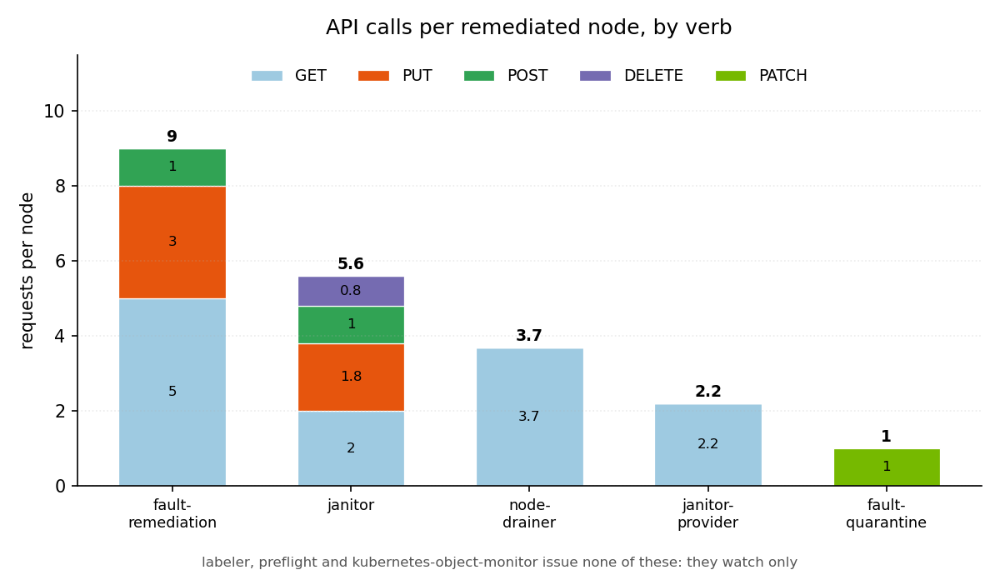

kubernetes-object-monitor is not in the per-node column above, because its cost is per policy-match transition, not per remediated node. Each transition writes one PUT of a full Node object. A conflict retry adds one more PUT, and a reconcile that changes nothing costs nothing.

The per-component figures total about 22 requests per node. Thus a remediation of a complete 53,513-node fleet costs approximately 1.2 million requests. If all of these requests occur in ten minutes, the rate is 2,000 requests per second. This rate is about the same as the load that the simulation harness generates alone. It is also well inside APF, which peaked at 116 of 1,085 seats.

Under sustained load at 0.50 nodes/s, the costs stayed within about 20% of the burst costs:

- fault-remediation: 11 requests per node, against 9 in the burst
- janitor: 5.9 requests per node, against 6 in the burst

The extra GETs were retries, spread over a longer wall-clock time.

Sustained load also showed a result that the burst did not show: **7 `POST 409` conflicts across 300 remediations**. This is node-lock contention at 2.3%, and every retry succeeded.

### MongoDB per member


| Member        | Role      | Connections | Resident | WiredTiger cache | Non-cache | Oplog window |
| ------------- | --------- | ----------- | -------- | ---------------- | --------- | ------------ |
| mongodb-rs0-0 | primary   | 81          | 2.27 GB  | 1.31 of 1.50 GB  | 0.96 GB   | 1.32 h       |
| mongodb-rs0-1 | secondary | 44          | 2.20 GB  | 1.20 of 1.50 GB  | 1.00 GB   | 1.32 h       |
| mongodb-rs0-2 | secondary | 41          | 2.13 GB  | 1.18 of 1.50 GB  | 0.94 GB   | 1.32 h       |


The three members had 7.1 GB resident in total, at a 4 Gi limit per member. [Sizing the WiredTiger cache](#sizing-the-wiredtiger-cache) gives the limit that a fleet needs. Most of the memory of each member is cache, and the 4 Gi limit bounds the cache at 1.50 GB. The memory outside the cache is about 1 GB per member, and it is almost the same at idle and under load. No member restarted or was OOM-killed during the run.

The capped cache has a cost. Over the 617-second window, application threads evicted 406 pages on the primary and no pages on either secondary. Thus no writer stalled to wait for space. Over the same window, the primary read 5,312,670 pages into the cache, about 8,600 per second against a 1.50 GB bound. This is the churn that a 10 GB dataset causes when the cache cannot hold it. At this fleet size, that churn makes writes slower, and the sizing section below measures by how much.

### Sizing the WiredTiger cache

Size MongoDB by the event rate. At 0.01 events per node per second, each member needs the container memory limit in this table:


| Fleet   | Events/s | Memory limit | Cache   | Publish mean | Volume IOPS | Queue depth |
| ------- | -------- | ------------ | ------- | ------------ | ----------- | ----------- |
| 10,000  | ~100     | 4 Gi         | 1.5 GB  | 11 ms        | 1,474       | 2.2         |
| 25,000  | ~250     | 12 Gi        | 5.5 GB  | 11 ms        | 2,013       | 4.3         |
| 50,000  | ~500     | 24 Gi        | 11.5 GB | 14 ms        | 2,539       | 6.7         |
| 100,000 | ~1,000   | 32 Gi        | 15.5 GB | 19.8 ms      | 2,739       | 6.9         |


The operator sets the WiredTiger cache to `(limit - 1Gi) / 2`, so the limit also sets the cache. Do not set the cache higher than that value. In the test, a 10.25 GB cache in a 12 Gi container was OOM-killed.

**How the test measured the limits.** Each fleet size ran at its production event rate, and the test decreased the limit in steps. A limit passed if all of these conditions were true:

- every publish succeeded, and the datastore accepted everything that the fleet sent
- no member restarted or was OOM-killed
- the secondaries were not behind the primary

Publish time and the queue depth of the volume showed when a limit started to slow the datastore. The recommended limit is the smallest limit that passed and did not slow the datastore, on a default gp3 volume (3,000 IOPS).

**One step lower.** The datastore lost nothing, but publishing was slower. At 8 Gi for 25,000 nodes, a publish took 15 ms. At 16 Gi, it took 17 ms for 50,000 nodes and 24.4 ms for 100,000 nodes. For the larger fleet, the volume also went above 3,000 IOPS, with a queue depth of 11.3.

**Too low.** MongoDB is behind before it uses all of its memory. At 8 Gi for 100,000 nodes, each write took about 33 ms. The connector pool of ten per replica then had a capacity of about 900 events/s. The fleet sent 973 events/s, so the backlog grew until 91,000 publishes failed. No member was OOM-killed at any limit in the sweep.

**Disk.** At 100,000 nodes, the volume serves about 2,500 write IOPS for 1,000 events/s, at any memory limit. That is close to the gp3 baseline of 3,000. If the volume is IOPS-constrained for your usage pattern, provision more IOPS.

**Conditions.** The sweep ran against a collection of about 100 million health events. 100,000 nodes at 32 Gi passed with the recommended pool of 30, with a 20 ms publish and no loss.

**Ceiling.** At 100,000 nodes with 32 Gi and the recommended pool of 30, MongoDB is behind at about 3,500 events/s (3,464 measured). This is about 3.5 times the steady rate. The test did not measure the ceiling at the smaller recommended limits. The ceiling of a smaller cache is probably at a lower event rate.

**Why memory follows the event rate.** The cache must hold the index pages that new entries go to. Consumers read the change stream, not the collection, so only writes use the cache.

An index whose keys increase with time writes to one page, which stays in the cache. An index whose keys are spread over the key range writes to pages across the whole index. Each such write reads a page from disk if the page is not in the cache. The table shows the reads for each index on the primary, at 2,000 nodes and 1,000 events/s. For this measurement, the test fixed the cache at 3,500 MB and used a random idempotency key:


| Index                                                 | Reads per insert | Where new entries go    |
| ----------------------------------------------------- | ---------------- | ----------------------- |
| `healthevent.metadata.idempotencyKey` (unique)         | 0.801            | anywhere in the index   |
| `nodename + entitiesimpacted + gts`                    | 0.738            | per node, per entity    |
| `nodename + ishealthy + gts`                           | 0.659            | per node                |
| `nodename + faultremediated + isfatal + gts`           | 0.651            | per node                |
| `agent + componentclass + checkname + nodename + ...`  | 0.607            | per node, per check     |
| `_id_`                                                 | 0.001            | one point, time-ordered |
| `createdAt + _id`                                      | 0.000            | one point, time-ordered |
| `createdAt` (TTL)                                      | 0.000            | one point, time-ordered |


The time-ordered indexes cost almost nothing. Each spread-out index costs about one page read per insert, at any index size: indexes of 53 MB and 157 MB both cost about 0.7. Thus the number of spread-out indexes sets the memory needed, not their size. The idempotency key in NVSentinel is time-ordered. Its index costs 0.008 reads per insert, against 0.801 for the random key above.

### Cost per event, by component `[M]`

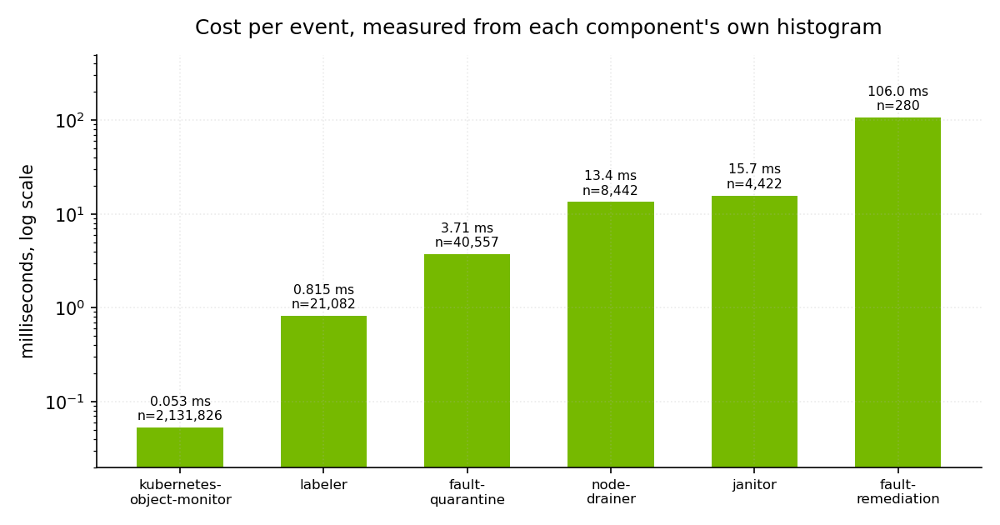

The values come from the handling histogram of each component. They are lifetime means:


| Component                 | Metric                                              | Events timed | Mean     |
| ------------------------- | --------------------------------------------------- | ------------ | -------- |
| kubernetes-object-monitor | `workqueue_work_duration_seconds`                   | 2,131,826    | 0.053 ms |
| labeler                   | `labeler_event_handling_duration_seconds`           | 21,082       | 0.815 ms |
| fault-quarantine          | `fault_quarantine_event_handling_duration_seconds`  | 40,557       | 3.71 ms  |
| node-drainer              | `node_drainer_event_handling_duration_seconds`      | 8,442        | 13.4 ms  |
| janitor                   | `workqueue_work_duration_seconds`                   | 4,422        | 15.7 ms  |
| fault-remediation         | `fault_remediation_event_handling_duration_seconds` | 280          | 106 ms   |


The spread follows the work of each handler:

- kubernetes-object-monitor and labeler mostly return without an action.
- fault-quarantine writes one node patch.
- node-drainer, janitor and fault-remediation each make several API calls and wait for the cluster.

The mean of the slowest handler is two thousand times the mean of the fastest. The slowest handler also has the lowest volume.

An update that matches no policy costs even less. A patch of 5,000 nodes with an irrelevant label drove 17,803 items through the workqueue of kubernetes-object-monitor, at **0.045 ms of handler time each**. The counts of the other components did not change, because the update reaches their caches but does not become an event for their handlers.

That is 3.56 queue items per node write. When idle, this fleet makes 250 node writes per second, which come to about 890 items and 40 ms of handler time per second. This handler time is serial wall time, not a CPU counter. Thus it is an upper bound for the CPU cost, not a measurement of it.

---

## A3. Customer-facing SLAs

### Continuous load `[M]`

The test measured these values in windows without bursts, so the tails show steady state, not burst contention. The cordon row is a 314-node window on the 50,000-node fleet. In this window, 0.47 nodes/s is the rate at which nodes completed, not the rate at which the test offered health events. The test did not control the input rate. The drain, remediation and MTTR rows come from a later run that injected at a fixed **0.5 nodes/s** across 400 nodes. Each node had a drain-eligible pod, and all 400 nodes completed, so in that run the input and output rates are the same.


| SLA                            | P50                                              | P90            | P99            | Max            | Conditions                                                                                                                                                                                                                                                                               |
| ------------------------------ | ------------------------------------------------ | -------------- | -------------- | -------------- | ---------------------------------------------------------------------------------------------------------------------------------------------------------------------------------------------------------------------------------------------------------------------------------------- |
| Time to cordon                 | 26 ms                                            | 48 ms          | 165 ms         | 373 ms         | 50k nodes, 11 pods/node, all DaemonSet; 314 nodes completed over the window (0.47/s)                                                                                                                                                                                                     |
| Time to label                  | 59 s                                             | 61 s           | 61 s           | 61 s           | driver and DCGM pods appear on a new node → labels on the node object, across 200 nodes `[M]`. The band is narrow because labeler applies labels on its 30-second informer resync, not on the event. Thus the wall time is two resync cycles. The handling itself is 3.8 ms |
| Time to drain                  | 10.09 s                                          | 10.14 s        | 10.27 s        | 10.92 s        | cordon → drained, 400 nodes at 0.5 nodes/s, one drain-eligible pod each `[M]`. The 10 s is the recheck backoff of node-drainer, not eviction time |
| Time to remediate              | 0.08 s                                           | 0.09 s         | 0.17 s         | 0.24 s         | drained → remediation dispatched across 400 nodes at 0.5 nodes/s `[M]`. Under a 200-node burst, the same stage is 3.20 s, almost all of it change-stream queue wait |
| NVSentinel MTTR                | 0.091 s                                          | 0.101 s        | 0.241 s        | 0.529 s        | detect → remediation dispatched, with the drain wait of each node subtracted, across 400 nodes at 0.5 nodes/s `[M]`. Detect to cordon is 16 ms, and drained to dispatch is 75 ms. This row excludes the drain, because the drain is a policy-dependent wait on the workload. The Time to drain row reports the drain separately |
| Simulated reboot wait `[S]`    | 46.5 s                                           | 77.0 s         | 81.0 s         | 82.0 s         | CR created → `NodeReady=True`, across 200 nodes `[M]`. Not part of MTTR, and not physical: the simulated reboot is 5 s, and the rest is the readiness re-poll of janitor. Of this wait, CR → `SignalSent` is p50 13 s / p99 30 s |
| Customer end-to-end MTTR `[I]` | 0.09 s + D + R                                   | 0.10 s + D + R | 0.24 s + D + R | 0.53 s + D + R | the NVSentinel MTTR row plus **D**, your own drain time, and **R**, your reboot-to-Ready time. With the D of 10.09 s and the R of 46.5 s from this harness, the end-to-end median is 57 s `[S]` |
| Observed completion rate       | 0.47 nodes/s sustained with no degradation `[M]` |                |                |                | The test did not control the input rate, so this is the rate that the run completed, not the maximum rate that it can sustain. [Burst absorption](#burst-absorption) gives the capacity figure: maintenance CR creation by fault-remediation is the slowest instantaneous stage, at 11.9-13.0 nodes/s |
| Burst absorption               | see below                                        |                |                |                |                                                                                                                                                                                                                                                                                          |


The percentiles come from per-document timestamps, so they are exact and not snapped to Prometheus histogram buckets.

The drain is a wait, not work. node-drainer evicts the pod and requeues the node at its 10 s base backoff. Then it confirms that the pod is gone and marks the node as drained. All other work of NVSentinel, outside that wait, takes 91 ms in total. This is two orders of magnitude below the backoff constant.

### Full-chain run, 200-node burst `[M]`

The rows above for remediation and reboot come from one injection of 200 fatal `SysLogsXIDError` health events, one per node. The 200 nodes had no remediation history. The test selected nodes that had no `dgxc.nvidia.com/nvsentinel-state` label, had `Ready=True` and were schedulable. The test did not use the five real EC2 nodes. All 200 nodes reached `faultRemediated: true` within 32 seconds of the injection, and then all 200 reached `NodeReady=True`.


| Stage                            | p50     | p90     | p99     | max     |
| -------------------------------- | ------- | ------- | ------- | ------- |
| detect → quarantined             | 2.94 s  | 4.73 s  | 5.10 s  | 5.14 s  |
| quarantined → drained            | 16.18 s | 19.94 s | 21.34 s | 21.47 s |
| drained → remediation dispatched | 3.20 s  | 5.21 s  | 5.77 s  | 5.77 s  |
| detect → remediation dispatched  | 21.10 s | 28.79 s | 30.51 s | 30.70 s |
| CR created → `SignalSent=True`   | 13.0 s  | 27.0 s  | 30.0 s  | 31.0 s  |
| CR created → `NodeReady=True`    | 46.5 s  | 77.0 s  | 81.0 s  | 82.0 s  |
| detect → node back in service    | 70.0 s  | 86.0 s  | 89.0 s  | 90.0 s  |


These are burst figures. Two hundred health events arrived in a single insert, so the tail of each stage measures the queue position, not the per-node work. The warm path for a single health event through fault-remediation is 0.05 s, against the 3.20 s median here. For continuous load, use the steady-state rows above.

The rows that come from the CR have the one-second timestamps of the API server. The rows that come from MongoDB are exact.

The drain figures come from a workload simulator (`--mode=workload` in `k8s-object-scaler`) that ran against `test-workload`. This namespace is outside the system-namespace exclusion of node-drainer. The pods had no `ownerReferences`, so node-drainer did not treat them as DaemonSet-owned. Jobs arrived at 5/s: 30% as gangs of 8-64 pods on consecutive nodes, and the rest as single pods. Each job lived 30 minutes, and the counted pods reached a steady state of 109,000.

### MTTR decomposition


| Phase                                 | Measured? | Notes                                                                                                                                                                                                            |
| ------------------------------------- | --------- | ---------------------------------------------------------------------------------------------------------------------------------------------------------------------------------------------------------------- |
| Detect → cordon                       | yes `[M]` | 17 ms P50 continuous; 3.47 s P50 under a 500-node burst                                                                                                                                                          |
| Cordon → drained                      | yes `[M]` | 10.09 s P50 continuous with one drain-eligible pod per node; 52.06 s P50 under a 500-node burst. One recheck cycle under continuous load, several under a burst                                                  |
| Drained → maintenance CR created      | yes `[M]` | 0.08 s P50 continuous; 3.20 s P50 / 5.77 s P99 under a 200-node burst, which is change-stream queue wait, not work |
| CR created → signal sent to provider  | yes `[M]` | 13.0 s P50 / 30.0 s P99 over 200 nodes                                                                                                                                                                           |
| CR created → provider returns         | no `[S]`  | simulated constant with no physical meaning (`simulatedRebootDuration: 5s`) |
| Provider returns → back in service    | yes `[M]` | CR creation → `NodeReady=True` 46.5 s P50 / 81.0 s P99 over 200 nodes. The readiness re-poll of janitor dominates this time, not the reboot |
| Whole chain, detect → back in service | yes `[M]` | 70.0 s P50 / 89.0 s P99 under a 200-node burst, correlated per node. Under continuous load, the share of NVSentinel is 0.09 s without the drain wait. The drain and the reboot are the rest of the cost |


### Correctness under load `[M]`

Every incorrect action has an impact on the customer. Thus the question is not only whether the pipeline is fast enough, but also whether it ever acts on the wrong node. The test drove 200 nodes with fatal GPU health events and 1,800 nodes with non-fatal health events into a 10,005-node fleet in one write. The non-fatal health events had the same shape in all other respects. The test inserted all of them directly into MongoDB. Thus the health monitors were not in the path, and any wrong action comes from NVSentinel itself.

NVSentinel cordoned every fatal node and no other node in the fleet. The set of cordoned nodes was exact within 45 seconds and had not changed four minutes later. NVSentinel remediated no node without a drain or before the drain finished. A repeat of the run on a second node range had the same result. Bursts of 100, 500 and 1,000 nodes all reached full drain completion. Normal operation and bursts of that size cause no incorrect action and no runaway behaviour.

The reboot-after-drain order had a stronger test than intended. On 129 of the 200 nodes, pods remained in a namespace mapped to `AllowCompletion`. Thus node-drainer waited for those pods to finish on their own and did not evict them. It logged `waiting for pods to complete: 2 pods remaining` and requeued the node. NVSentinel remediated none of these nodes.

The other 71 nodes had evictable pods. Every time, these nodes drained first, and then NVSentinel remediated them. Thus a node whose drain cannot complete stays cordoned and unremediated for an unlimited time. This is the safe direction to fail. NVSentinel does not reboot a node that it has not finished draining. This behaviour holds under a burst, not only in the quiet case.

Outside that envelope, there are three scenarios in which a module acts against its own stated intent. No configuration closes any of them.

1. **A consumer that is behind the oplog skips health events that are already stored.** The failure is on the read side: the change-stream watcher puts `ChangeStreamHistoryLost` in the same class as the corrupt-token errors. Thus it deletes the resume token and opens the stream again at the current cluster time. It never delivers the health events between the old position and the current time.

   A skipped fatal health event is a node that is never quarantined. A skipped healthy event is a node that stays cordoned until someone runs `kubectl uncordon`. Only node-drainer and fault-remediation find part of their own gap again, through status-filtered cold-start queries.

   The only setting that helps is the oplog size, `mongodb-store.oplogSizeMB` (990 MB by default). For details, see [Oplog size](../configuration/mongodb-store.md#oplog-size). The `change_stream_resume_token_recoveries_total` metric has only the labels `(client, phase)`, so it cannot show the difference between loss and a corrupt token. The deployment mode of platform-connector does not close this gap. It changes how platform-connector acknowledges writes, but this failure is on the read side, in the consumer.
2. **The circuit breaker limits a rate, not a level.** It trips when the unique nodes cordoned inside the sliding window reach `percentage` of the GPU fleet. Thus, if fault-quarantine cordons fewer nodes in each window than `percentage` of the GPU fleet, the breaker never trips, however many it cordons in total. The rate that trips the breaker grows with the fleet size, but the consumption rate does not. No value of `percentage` and `duration` can express "at most this share of the fleet cordoned at once". On every check, fault-quarantine computes the set of cordoned nodes and then discards it.
3. **A reset of a tripped breaker cordons the recently released nodes again.** If you delete the ConfigMap, fault-quarantine creates it again with `cursor: RESUME` and replays the accumulated backlog. fault-quarantine watches only inserts. Thus it does not see the `Cancelled` status that a manual uncordon writes. When it applies the quarantine again, it also clears the manual-uncordon annotation.

   An intact backlog converges. A backlog that the oplog truncated, as in scenario 1, leaves those nodes cordoned, and nothing remains to release them. The setting that skips the backlog is `cursor: CREATE`. But a deletion of the ConfigMap is the action that resets the cursor to `RESUME`.

### Event consumption rate `[M]`

The test measured this directly, with an empty collection and a change stream opened at the current oplog position:


| Offered | Written | Handled by fault-quarantine | Per event | Nodes cordoned |
| ------- | ------- | --------------------------- | --------- | -------------- |
| 50/s    | 29.6/s  | 33.4/s                      | 4.0 ms    | 50 of 50       |
| 200/s   | 106.0/s | 74.3/s                      | 3.9 ms    | 200 of 200     |


At the lower rate, the handled rate was higher than the write rate, because fault-quarantine also consumes the status updates that it writes itself. Thus fault-quarantine was not behind. At the higher rate, it sustained **74 events/s** and cordoned every target node. The cost for each health event is **about 4 ms**.

The test bracketed the ceiling but did not find it. At 200/s offered, consumption was still lower than the write rate, so the limit is somewhere above 74/s. An empty collection is the easy extreme. A long-lived cluster with a large oplog is the other extreme. On such a cluster, a consumer that is behind reads at a much lower rate. A rate measured in that state shows how fast a starved consumer reduces its lag, not the rate that it can handle.

Two metrics of fault-quarantine are misleading while it is behind. `event_backlog_count` reads 0, because the in-process queue is empty and the real queue is the oplog. `events_received_total` reads 0 while the handling histogram counts past 31,000, so this path does not update this metric.

### Drain latency with real pods `[M]`

The test made two runs, both on new nodes with no quarantine history. Each node had one drain-eligible pod in `e2e-pods`, which is the only namespace that node-drainer maps to `Immediate` eviction. The percentiles come from the per-document protobuf timestamps on each health event, so they are exact, not bucketed.


| Stage                            | Continuous, 400 nodes at 0.5/s | Burst, 500 nodes at once |
| -------------------------------- | ------------------------------ | ------------------------ |
| detect → quarantined             | 0.017 s                        | 3.47 s                   |
| cordon → drained                 | 10.09 s                        | 52.06 s                  |
| drained → remediation dispatched | 0.08 s                         | 10.52 s                  |


In every continuous row, P90 is within one second of P50. In every burst row, P90 is within eight seconds of P50. All 500 burst nodes and all 400 continuous nodes completed.

Under continuous load, a drain costs one recheck cycle of node-drainer. node-drainer evicts the pod and requeues the node at its 10 s base backoff. Then it sees that the pod is gone and marks the node as drained. Thus the whole distribution is in a 0.8-second band around 10 s and does not spread. Under a burst, the same cycle repeats while the node waits for its turn. This gives 52 s for five hundred nodes that arrive together.

The backoff base is the node-drainer Helm value `requeueBackoffBase`, 10 s by default. Every drain figure in this report uses 10 s. The first retry occurs after the base interval, and each later retry doubles the interval, up to a 2-minute ceiling. The backoff resets only when the node drains.

A lower base reduces latency, but it costs more eviction calls. The doubling sets the exchange rate, not the base. The number of attempts to reach a pod termination time T is approximately log2(T/base). Thus a 90-second termination costs 4 attempts at a 10 s base and 6 at 2 s, against the measured 3.0 eviction calls per pod. A 2 s base therefore cuts the drain from 10.09 s to about 2.1 s, a 4.8x improvement, for about 1.4x the eviction calls. At a 1,000-node burst, node-drainer then goes from approximately 15% of its 400 QPS budget to 21%.

A 1 s base gives 9x for 2.3x the calls and 35% of the budget. Below that value, the base is shorter than the time that a pod needs to terminate. Then every retry that occurs before the pod can be gone evicts again a pod that has not finished its termination. This effect is the source of the 3.0 multiplier.

The useful floor is the termination time of the workload itself. This time is about a second for the zero-grace pods in this test. For a pod with `terminationGracePeriodSeconds: 30`, it is at least 30 s. For such a pod, termination dominates, and the requeue interval is not the binding term.

This applies only to namespaces in `Immediate` mode. `AllowCompletion` and `DeleteAfterTimeout` wait for the workload, so the backoff does not control them.

### Publish latency

Publish latency is 7 ms at the median and seconds in the tail. Neither figure changes with the size of the datastore. The test held the replica count at three and the load at 40,000 connections that published 2,000 events/s. It read the `platform_connector_request_duration_seconds` histogram of platform-connector as a windowed distribution, not as a running average. The measurement lasted 36 minutes, while the collection grew from 14.2 to 19.2 million documents:


|      | Minimum   | Median of samples | Maximum     |
| ---- | --------- | ----------------- | ----------- |
| P50  | 6.18 ms   | 7.06 ms           | 7.42 ms     |
| P90  | 9.63 ms   | 43.81 ms          | 266.71 ms   |
| P99  | 222.80 ms | 2.31 s            | 3.97 s      |
| Mean | 11.93 ms  | 101.83 ms         | 182.10 ms   |


The typical publish is fast and stays fast. P50 stayed between 6.18 and 7.42 ms across a 35% increase in collection size, and the tail did not become wider.

Some writes stall for seconds, far below saturation. P99 was between 223 ms and 3.97 s, while throughput stayed constant at 2,000 inserts/s against the 4,925 ceiling. The stalls are cyclic, and they occurred while the working set was fully in the cache. This pattern points to the 60-second checkpoint flushes of WiredTiger, but this run did not measure them directly.

At half that rate, the stalls do not occur. A rerun at 1,000 events/s through 40,000 connections also timed the publishes from the publisher side. None of about 643,000 publishes took longer than 1 second. Half of the publishers sent healthy events, and the other half sent unhealthy non-fatal events. MongoDB had 96 Gi per member and about 100 million stored health events.


|                                | P50     | P90     | P99    |
| ------------------------------ | ------- | ------- | ------ |
| Publisher, healthy events      | 15.4 ms | 48.1 ms | 198 ms |
| Publisher, unhealthy non-fatal | 13.9 ms | 52.6 ms | 192 ms |
| Connector histogram            | 15.6 ms | 49.5 ms | 223 ms |


[Health-monitor authentication](#health-monitor-authentication-m) gives the cost of the token check. Healthy events that only read the node took about 1.5 ms longer at the median. Fatal events, and healthy events that clear a condition, also write the node condition. This write took 17 ms P50 and 73 ms P99. P99 increased and decreased at the same moments for healthy and unhealthy publishers. Thus the tail comes from the MongoDB write, not from the node update.

In the customer-facing numbers in [MTTR decomposition](#mttr-decomposition), publish latency comes before detect → cordon. At the median, publish latency is not visible. In the tail, it is the largest part of that stage. If a fault lands in a stall, NVSentinel cordons the node seconds after the report, not milliseconds after it. But publish latency is still a few percent of detect → back in service, which is 70 s P50 and 89 s P99. Drain and reboot dominate that time.

### Against the DaemonSet

The advantage of the Deployment is not speed. Centralising gives a stronger acknowledgement and a bounded number of MongoDB connections. The cost of centralising is a ceiling that does not grow with the fleet. The latency is similar enough in both modes that it does not decide the choice:

A node-local connector drains its queue one write at a time, so a 5 ms acknowledgement limits it to approximately 200 events/s. The drain rate measured here was 197 events/s. Above that rate, the queue grows without a limit, but the queue holds health events at a low cost ([burst run](#daemonset-queue-under-burst-m)).

What matters is the time from the fault report on a node until the fault is visible to the rest of the pipeline. The reason is that health-events-analyzer and fault-quarantine both read the change stream of the datastore. The table shows two trials of 1,500 health events each, at 200 events/s:


| Publish to visible on the change stream | DaemonSet, one per node | Deployment, three replicas |
| --------------------------------------- | ----------------------- | -------------------------- |
| P50                                     | 2.6, 2.7 ms             | 3.1, 3.4 ms                |
| P90                                     | 3.9, 4.0 ms             | 4.6, 4.7 ms                |
| P99                                     | 5.9, 6.3 ms             | 6.1, 6.3 ms                |
| Maximum                                 | 18.0, 72.9 ms           | 11.3, 10.9 ms              |


At the median, the difference is half a millisecond on a three-millisecond figure. The P99 values differ by 0.2 ms or less, and the Deployment has the smaller maximum. Centralising added no measurable time before a fault becomes actionable.

Capacity is the one area where the two modes differ. N node-local connectors offer about 200N events/s, and this capacity grows with the fleet. The Deployment serialises all writes through `DATASTORE_MAX_CONNECTIONS` per replica, so its ceiling is constant. At the chart default of 10, the DaemonSet carries more from 27 nodes. At 30, it carries more from 55 nodes.

A larger pool moves the crossover point but never removes it. Thus, for any pool setting, there is a fleet size above which the DaemonSet carries more. This is true only if health events are spread evenly across the nodes, because only then is the total the sum of the per-node ceilings. The test used up to 60 node-local writers, more than the five real nodes ([how](#fanning-out-node-local-writers-m)):


| Node-local writers | Events/s attempted | Events/s reaching MongoDB | Per writer |
| ------------------ | ------------------ | ------------------------- | ---------- |
| 5                  | 1,500/s  | 1,172/s  | 234/s      |
| 15                 | 4,500/s  | 2,817/s  | 188/s      |
| 30                 | 9,000/s  | 5,381/s  | 179/s      |
| 60                 | 18,000/s | 10,143/s | 169/s      |


Sixty node-local connectors carried 10,143 events/s. This is twice the ceiling of the Deployment at the chart default pool, and the rate continued to increase with the writer count. It is below the majority-write capacity of MongoDB itself, which is approximately 14,000 events/s. The growth is sublinear: the output per writer fell from 234 to 169 events/s. This is contention on the shared replica set, not a hard limit.

Thus the choice is a trade, not an upgrade. The Deployment bounds the MongoDB connections, and its acknowledgement means that the health event is in MongoDB, not in a queue. In exchange, its ceiling does not grow with the fleet. `DATASTORE_MAX_CONNECTIONS` sets this ceiling, not MongoDB. MongoDB accepts more than twice the load that three replicas with ten connections each give it.

The differences that matter are structural:


|                               | DaemonSet                                                               | Deployment                                                                                      |
| ----------------------------- | ----------------------------------------------------------------------- | ----------------------------------------------------------------------------------------------- |
| Throughput ceiling            | about 200 events/s per node, growing with the fleet                     | about 4,900 events/s for the whole fleet, see [Ingest rate and sizing](#ingest-rate-and-sizing) |
| What an acknowledgement means | queued in one pod's memory                                              | stored on a majority of the replica set                                                         |
| MongoDB connections           | 7 per node                                                              | 166 for the whole replica set, measured in A2                                                   |
| Under overload                | queue grows without bound; acknowledged events are lost if the pod dies | backpressure, publishers block; nothing is lost unless a health event waits longer than the retry window of the publisher, 5 minutes by default |


### Recovery from a full outage

The recovery from a full outage takes about 80 seconds, and re-authentication does not cause a storm. The test deleted all three replicas at the same time, with 40,000 established connections. TokenReviews went from 150-180/s to a peak of 329, with no failed reviews, and P99 stayed at 5.0 ms. The expected cliff, with 20,000 distinct tokens against three empty verdict caches, does not occur. The reason is that authentication has a cost per request, not per connection. Thus re-established connections cost nothing, and the re-authentication spreads over the next health event of each publisher.

The retry window of the publisher, not platform-connector, decides what survives the outage. By default, the shared publisher client holds a health event for 5 minutes. Thus an 80-second outage loses no health events, but an outage longer than the retry window loses health events. The `HEALTH_PUBLISH_RETRY_WINDOW` environment variable of the publisher changes this window. The load generator of this test does not retry, so its 14,319 recorded failures measure the interruption, not loss.

### Losing a MongoDB member

The loss of one secondary has no measurable cost, which is the result that the structure predicts. A majority of three is two, so the primary never waited for more than one acknowledgement, and the remaining secondary still gives it. The test took 26 samples while healthy and 5 samples with one secondary unreachable. The acknowledgement stayed at 5.02 against 4.97 ms, and ingest stayed at 5,140 against 4,850 events/s. These values are inside the spread of the healthy run. There were no publisher errors, and the member rejoined about 65 seconds after the deletion.

### Loss, duplication and upgrades

Under saturation, the path loses no health events unless one waits longer than the retry window of the publisher, 5 minutes by default. The count comes from the datastore, not from the counters of platform-connector. The test offered 20,000 events/s through 20,000 connections against a pool that drains about 4,900 events/s. Then it let the backlog finish:


|                       |           |
| --------------------- | --------- |
| Published             | 2,663,837 |
| Publish errors        | 0         |
| Inserted into MongoDB | 2,663,837 |
| Difference            | 0         |


Published equals inserted because the Deployment writes inside the request. Thus oversubscription becomes backpressure, not buffering.

MongoDB refuses a resend and does not store it twice. The test sent each batch again under its original `idempotency-key` header, which is what the shared client does when a reply is lost. This produced no duplicate rows. Across 4,532,914 documents written in the window, each with a key, MongoDB stored no key twice. The unique partial index refuses the second write, and this makes the five-minute retry window safe to depend on.

A rolling upgrade causes interrupted requests. At three replicas, `RollingUpdate` with `maxSurge: 25%` and `maxUnavailable: 25%` rounds to one surge pod and zero unavailable pods. Thus a replacement pod is Ready before Kubernetes removes the pod that it replaces. The test restarted platform-connector under 4,000 connections that published 2,000 events/s:


| Seconds after the restart | Reaching MongoDB | Cumulative publish errors | Ready | Pods |
| ------------------------- | ---------------- | ------------------------- | ----- | ---- |
| 31                        | 1,924/s          | 135                       | 4/4   | 4    |
| 66                        | 1,922/s          | 1,148                     | 3/3   | 3    |
| 102                       | 2,000/s          | 1,148                     | 3/3   | 3    |
| 206                       | 2,003/s          | 1,148                     | 3/3   | 3    |


The rollout completed in 31 seconds. Ingestion decreased by about 4% and then recovered, and no publisher failed to connect. But platform-connector refused 1,148 requests. This count follows throughput, not the rollout: each terminating pod cuts approximately half a second of its own traffic. Thus a quieter fleet loses proportionally fewer requests.

These refused requests are not necessarily lost health events. During shutdown, a connector replies `Unavailable`, and the shared publisher retries the request inside its retry window. The load generator of this test does not retry, and it records these requests as failures.

---

### Burst absorption

In each run, N nodes failed at the same time. The nodes were new KWOK nodes with no quarantine history and no pods. Thus the two measured stages are the cordon by fault-quarantine and the maintenance CR creation by fault-remediation, without a drain between them. The test injected each size as a single insert and ran it in isolation. Each size used new node names, and the test deleted the nodes, health events and CRs before the next size started.

Every figure below is a per-node latency from the generation timestamp of the health event itself. Thus the completion columns show the slowest node of that run, not a bound from separate polling.

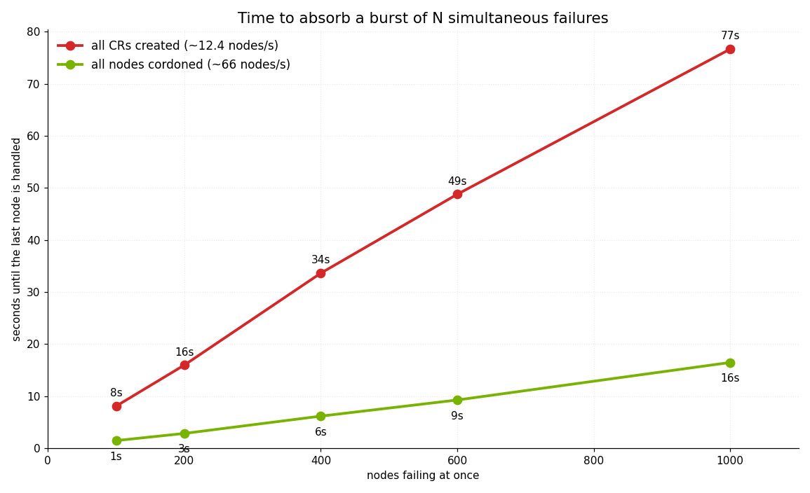


| Burst | Last node cordoned | cordon P50 / P99 | Last CR created | CR P50 / P99    |
| ----- | ------------------ | ---------------- | --------------- | --------------- |
| 100   | 1.44 s             | 0.74 / 1.44 s    | 8.06 s          | 4.12 / 8.06 s   |
| 200   | 2.82 s             | 1.38 / 2.80 s    | 15.95 s         | 7.85 / 15.87 s  |
| 400   | 6.15 s             | 3.01 / 6.10 s    | 33.61 s         | 16.53 / 33.37 s |
| 600   | 9.24 s             | 4.37 / 9.16 s    | 48.77 s         | 24.18 / 48.35 s |
| 1000  | 16.45 s            | 8.51 / 16.33 s   | 76.66 s         | 38.03 / 75.77 s |


Both stages degrade linearly and do not hit a cliff, because each stage consumes its change stream serially. Across a 10x range, cordon held 61-71 nodes/s and maintenance CR creation held 11.9-13.0 nodes/s. P50 is at half of the window, and P99 is at the window itself. This is the result of fixed-rate processing of a simultaneous arrival. The last node in a 1,000-node burst waits 16 s for its cordon and 77 s for its CR.

fault-quarantine also stretches the burst for all downstream components. A burst injected in a single insert arrives at fault-remediation spread over the cordon window, which is 16 s at N=1000. Thus the components after fault-quarantine never see the whole burst at the same time.

The table above does not include the drain. The drain depends on the pods on the node and on the eviction mode of the namespace, not only on the burst size. The test measured the drain separately, at 5 pods/node:


| Burst      | Evictions | Time  | Throughput       | Share of the 400 QPS budget |
| ---------- | --------- | ----- | ---------------- | --------------------------- |
| 100 nodes  | 500       | 160 s | 3.1 evictions/s  | 0.8%                        |
| 500 nodes  | 2,500     | 200 s | 12.5 evictions/s | 3.1%                        |
| 1000 nodes | 5,000     | 260 s | 19.2 evictions/s | 4.8%                        |


Throughput increased sixfold while the wall-clock time stayed flat, so larger bursts pipeline better. The client-side rate limit is not the constraint. At the largest burst, node-drainer used less than 5% of its budget if each pod costs one call. With the measured 3.0 calls per pod, it used about 15%. The recheck cadence limits the total drain throughput, not the API rate limit.

node-drainer requeues each node at a 10 s base backoff. It marks the node as drained only after it confirms that the pod is gone. Thus, under continuous load, a drain takes exactly one cycle (10.09 s P50 across 400 nodes). Under a burst, a drain takes as many cycles as the depth of the queue (52.06 s P50 across 500 nodes that arrived together). `[M]`

The test checked the calls-per-pod figure directly. It used five evictable pods on one node and one fatal health event. In this test, node-drainer evicted all five pods, but it used 15 eviction calls, not 5. First, node-drainer sends the evictions and logs `immediate eviction completed, requeuing for status verification`. On each requeue, it evicts again every pod that is still present. The pods took about 90 s to disappear, over three retry cycles.

Thus the multiplier follows the time that a pod needs to terminate, not the number of pods. Pods that honour a real `terminationGracePeriodSeconds` cost more than the zero-grace pods in this test. `[M]`

### Circuit breaker `[M]`

The circuit breaker of fault-quarantine stops cordoning when fault-quarantine has cordoned too many nodes inside a sliding window. It has two independent bounds:

- `percentage`, against the current count of GPU nodes
- `maxNodes`, an absolute count

If you set both bounds, the lower one binds. The test exercised both bounds against a 10,005-node fleet, in which 10,000 nodes had `nvidia.com/gpu.present=true`. Each run started from zero cordoned nodes. The test injected 5,500 fatal GPU health events in a single insert. It read the cordon count from the `quarantinefinishtimestamp` of each health event.


| Configured                          | Threshold reported         | Nodes cordoned before trip | Utilisation at trip |
| ----------------------------------- | -------------------------- | -------------------------- | ------------------- |
| `percentage = 50`                   | 5,000 `bound="percentage"` | 5,000                      | 0.50                |
| `maxNodes = 500`, `percentage = 50` | 500 `bound="maxNodes"`     | 500                        | 0.05                |


Each bound tripped at exactly the node count that its threshold names. When the test configured both bounds, the lower bound won. The recovery is the same in both cases and has two steps:

1. Write `status: CLOSED` into the `circuit-breaker` ConfigMap.
2. Restart fault-quarantine.

The restart is necessary, because a tripped breaker blocks the event loop until the process restarts. After the reset, cordoning resumed within 41 s. fault-quarantine consumed the remaining health events and did not trip again. The sliding window is only in memory, so a restart starts it empty. The existing cordons of the fleet do not count against the new window.

The threshold is not a fixed number. On every health event, fault-quarantine computes the threshold again from the live count of nodes with the configured GPU label. Thus the threshold changes with the fleet. On a 10,000-node fleet where 600 nodes do not have the label, `percentage = 50` trips at 4,700, not 5,000. That is correct against a 9,400-node denominator, but an operator who reads `percentage = 50` against a 10,000-node cluster expects 5,000. Thus node labelling is part of the configuration surface of the breaker.

An enabled breaker reduces the cordon throughput. The breaker check runs once per health event, and each check lists the entire node cache to compute the denominator again. The table shows the same 5,500-event injection on the same fleet:


|                                   | Cordon rate  | Outcome            |
| --------------------------------- | ------------ | ------------------ |
| `--circuit-breaker-enabled=true`  | 35.8 nodes/s | tripped at 5,000   |
| `--circuit-breaker-enabled=false` | 45.9 nodes/s | all 5,500 cordoned |


That is a 22% reduction at 10,000 nodes. The work per health event is proportional to the fleet size, so the gap grows with the fleet and does not stay fixed. The test measured every other burst and drain figure in this report with the breaker disabled.

## Appendix

This appendix describes how the test made the measurements. It also describes the behaviour of the test environment, which is not the behaviour of NVSentinel. The appendix is separate, so that the sections above describe the product and this appendix describes the harness and the cloud under it.

### Fanning out node-local writers `[M]`

Only two things bind a node-local connector to a node: its socket path and the node-binding check. Both of them also work inside a pod. Thus each writer in the capacity measurement was a pod that ran a real `platform-connectors` instance next to its generator, over a shared `emptyDir` socket. The test disabled the Kubernetes connector of each instance, so only the datastore path was in use. This method removes the limit of five real nodes, and it does not change what the test measures.

### DaemonSet queue under burst `[M]`

The test delivered 5,000 events/s across five nodes for two minutes. This rate is five times the aggregate drain rate of these nodes:


|                               |                             |
| ----------------------------- | --------------------------- |
| Events published              | 610,523                     |
| Received by the connectors    | 610,523                     |
| Inserted into MongoDB         | 610,523                     |
| Lost                          | 0                           |
| Peak queue depth              | 444,221                     |
| Peak connector working set    | 239 MB, against a 4Gi limit |
| Time to drain after the burst | 573 s                       |
| Connector restarts            | none                        |


In this test, 444,221 queued health events cost about 150 MB above an 89 MB baseline, approximately 0.34 KB each. On this path, the drain rate limits burst absorption, not memory. A 512Mi connector holds several hundred thousand health events and drains a burst of that size in minutes. But if a node produces more than 200/s for long enough, its queue grows without a limit.

Queue depth is not the only term in connector memory. The working set can also increase with held connections and repeated generator churn while the queue is empty. Read the queue depth before you attribute connector memory to a backlog.

### Majority acknowledgement against replication lag `[M]`

The test drove `w:1` load at about 26,000 inserts/s to build a backlog. Then it sampled the acknowledgement and the replication lag together:


| Replication lag | `w:1`   | `w:majority` | Acknowledgement |
| --------------- | ------- | ------------ | --------------- |
| 2.00 s          | 0.95 ms | 6.11 ms      | 5.16 ms         |
| 2.00 s          | 1.01 ms | 5.79 ms      | 4.78 ms         |
| 1.00 s          | 0.93 ms | 2.19 ms      | 1.26 ms         |
| 0.00 s          | 0.86 ms | 1.65 ms      | 0.79 ms         |
| 0.00 s          | 0.90 ms | 1.88 ms      | 0.98 ms         |
| 0.00 s          | 0.91 ms | 2.05 ms      | 1.15 ms         |


A write to the primary alone stayed at 0.9 ms the whole time, so the primary does not cause this cost. `w:"majority"` implies `j:true` through `writeConcernMajorityJournalDefault`, and this replica set confirms that this setting is on. Thus each acknowledging member writes its journal before it replies. But the journal is not the cost: the WiredTiger counters show 0.635 ms per sync, with group commit that batches three writes per fsync. The cost is the wait until a second member replicates the write.

### Connector memory: connections against label cache `[M]`

The test held the nodes, connections and event rate fixed, and changed only `allowedLabels`. Thus the metadata augmentor keeps an entry per node in both runs, and only the stored labels differ. Both runs used thirty thousand nodes at three connections each, which is 90,000 connections. Each run started from a restarted connector. The test recorded each run only after three consecutive samples were inside a 1% band:


| `allowedLabels`                                       | Working set above baseline |
| ----------------------------------------------------- | -------------------------- |
| the 25 the chart ships, of which these nodes carry 18 | 6,542 MB                   |
| none                                                  | 6,317 MB                   |


The 225 MB difference is the label storage for 30,000 nodes, about 7.5 KB per node. The remainder is 68.5 KiB per connection. Three connections plus the labels of one node are 213 KiB. This value is within 4% of the 221.7 KiB per node that the sweep gives at 100,000 nodes.

The nodes have 32 labels and 5 annotations, 34,349 bytes serialised. Eighteen of the 25 allowed keys are present, with 743 bytes of keys and values in total:

```text
topology.kubernetes.io/zone              = us-east-1a
topology.kubernetes.io/region            = us-east-1
node.kubernetes.io/instance-type         = gpu-worker
nvidia.com/cuda.driver-version.major     = 550          .minor = 90, .revision = 07, .full = 550.90.07
nvidia.com/cuda.runtime-version.major    = 12           .minor = 4,  .full = 12.4
topology.k8s.aws/capacity-block-id       = cr-000000000000
topology.k8s.aws/network-node-layer-1..3 = nn-000000000000
accelerator.topograph.run/domain         = dom-0000
fabric.topograph.run/tier-0..2           = t0-00000 / t1-0000 / t2-000
```

The seven absent keys are the OCI and GCE sets, which a node modelled on AWS never has. The 743 bytes of label data cost about 7,500 bytes of process memory, approximately tenfold. The extra memory goes to Go map overhead, per-key string headers and allocator size classes. The values here are short and uniform. A fleet with longer values for the same keys pays more. But the per-entry overhead, which is the largest part of this figure, does not change.

### Connector mode latency breakdown `[M]`

This table gives the full instrumentation for the mode comparison, at 1,000 connections and 1,000 events/s, with the chart default pool of 10 per replica:


|                                    | DaemonSet, one per node            | Deployment, three replicas |
| ---------------------------------- | ---------------------------------- | -------------------------- |
| Queue wait before the write starts | 6.44 ms P50, 20.25 P90, 276.97 P99 | none                       |
| Request duration, P50 / P90 / P99  | not exported                       | 4.96 / 8.99 / 9.90 ms      |
| Acknowledged, waiting for the write | 11 items typical, 43 at peak       | none by construction       |


Neither path dropped a health event, and no backlog formed in either queue: the queue depth oscillated between 2 and 43. Thus the node-local writer is fast enough at this rate, and its queue is a latency buffer, not a backlog.

### Scale-out rebalancing `[M]`

The test scaled from three replicas to four under 40,000 established connections. It read the load of each replica as goroutines (three per connection):


| Time after scale-out | Replica 1 | Replica 2 | Replica 3 | New replica |
| -------------------- | --------- | --------- | --------- | ----------- |
| before               | 37,799    | 38,166    | 38,426    | --          |
| 1m42s                | 35,467    | 35,572    | 36,366    | 10,309      |
| 7m49s                | 34,800    | 34,693    | 35,490    | 13,365      |
| 12m27s               |           |           | 29,604    | 29,488      |
| 35m39s               | 29,886    | 29,907    | 30,150    | 30,219      |


An even split is 30,040 per replica, and the load ended at this split and stayed there. The approach was not smooth. The new replica got about a third of its share within two minutes, and then grew slowly for six minutes. Then it got almost all of the rest at the same time, between the eighth and twelfth minute. The cause is `MaxConnectionAge`: it expires a cohort of connections that were all established together during the ramp. Thus the shape of the redistribution follows the shape of the original connect.

If a fleet connects gradually, it also drains gradually. There were no publish errors at any time.

### Rolling upgrade during a burst `[M]`

In this section, an upgrade means only a rollout restart. A real upgrade can also include a backward-incompatible change, a datastore migration, or the replacement of persistent volumes. This section does not cover these cases. Nothing coordinates a rollout with the work in progress on the fault path. Thus the test injected a burst, and then did a rolling restart of the fault-path components while they still processed the burst.

The test restarted fault-quarantine, node-drainer and fault-remediation during a 2,000-event burst. The burst finished with 2,000 nodes cordoned, 2,000 drained and 2,000 remediated. There were no duplicate node entries and no stall. Remediation continued to climb through the restart, and the burst completed in 325 s. The components resume from their stored change-stream position. Their cold-start sweeps recover any health events that the stream did not deliver again.

During the rollout, the memory approximately doubles, but the per-pod figure does not change. The rolling update runs the old and new pods at the same time, and each pod holds a full node cache. Thus the cluster pays the cost, not the component. The table gives the working set summed across all pods of fault-quarantine, node-drainer and fault-remediation. fault-quarantine is the large majority of this sum:


| Fleet   | Before  | During rollout | After   |
| ------- | ------- | -------------- | ------- |
| 50,010  | 2.34 GB | 4.28 GB        | 2.06 GB |
| 100,010 | 3.98 GB | 7.75 GB        | 3.77 GB |


The deployment strategy guarantees this overlap, so it is not incidental. All three components run `RollingUpdate` with `maxSurge: 25%` and `maxUnavailable: 25%`. At one replica, this rounds up to a surge of one and down to zero unavailable. Thus the new pod must be Ready before Kubernetes removes the old pod. A change to `maxSurge: 0` with `maxUnavailable: 1` removes the doubling. The cost is a window in which no replica runs.

The API load did not spike: 3,626 requests/s before the rollout, 3,630 during the rollout and 3,620 after it. Each restarted informer lists the fleet again. But this is a small number of large paginated reads, not many small reads. Thus the cost is in bytes, not in the request rate.

The circuit breaker does not survive the restart. Its sliding window is an in-memory ring buffer. When fault-quarantine starts, it creates a new, empty window that starts at that moment. It restores only the CLOSED or TRIPPED state from the ConfigMap of the breaker. Thus every restart loses the accumulated cordon counts. The window also starts again, so the cordons from immediately before the restart count toward nothing.


| Run             | Burst | Restart          | Outcome                           |
| --------------- | ----- | ---------------- | --------------------------------- |
| undisturbed     | 4,000 | none             | tripped at 2,001 cordons          |
| rolling upgrade | 3,000 | at 1,617 cordons | never tripped; all 3,000 cordoned |


The breaker guarantees that fault-quarantine cordons no more than a set share of the fleet within a window. A restart breaks this guarantee. The second run cordoned 50% more nodes than the threshold, and the breaker reported CLOSED the whole time. The reason is that the new pod needed the full count again, in a window that started with the pod, and saw only 1,383 cordons. A breaker that has already tripped stays tripped, because that state is in the ConfigMap. The restart discards only the progress toward a trip.

Both runs used a 5% threshold, not the default 50%, so that the bursts were small enough to repeat. The threshold is near 2,000, not 2,501, because the denominator is the count of GPU-labelled nodes, about 40,000, not the whole fleet.

### API server load produced by the simulation harness `[M]`

[A2](#a2-load-on-external-components) gives the share of API traffic that comes from the harness, not from NVSentinel. This section gives the breakdown behind that share.

The table gives whole-cluster rates per second, to size the harness, not NVSentinel. Idle and continuous differ mainly in the lease traffic of the simulated nodes:


|                    | Idle  | Continuous | Burst (med / peak) |
| ------------------ | ----- | ---------- | ------------------ |
| GET                | 172   | 81         | 78 / 185           |
| PUT                | 2,965 | 1,664      | 1,657 / 2,930      |
| PATCH              | 1,462 | 1,427      | 1,457 / 1,513      |
| LIST               | 7.5   | 8.0        | 7.8                |
| WATCH              | 6.0   | 6.7        | 6.6 / 8.6          |
| APF seats of 1,085 | 92    | 55         | 64 / 116           |
| APF rejections     | 0     | 0          | 0                  |


PUT traffic is almost all lease renewal and pod status from the simulated nodes, not work of NVSentinel. [Node heartbeats and pod status](#node-heartbeats-and-pod-status) gives the breakdown. `[S]`

#### Node heartbeats and pod status

Simulated kubelets fill almost all of the five-minute revision window that etcd keeps. They simulate the writes of real kubelets. At 25,000 nodes, the window holds about 2 GB:


| Source                         | Rate      | Bytes per 5 min | Share |
| ------------------------------ | --------- | --------------- | ----- |
| `leases/update`                | 1,114.6/s | 290 MB          | 14%   |
| `nodes/patch` + `nodes/update` | 97.9/s    | 1.62 GB         | 79%   |
| `pods/patch`                   | 42.1/s    | 122 MB          | 6%    |
| `events/create`                | 24.5/s    | ~7 MB           | <1%   |
| total                          | 1,285/s   | ~2.04 GB        |       |


Node size is the lever. A lease is 869 B and a node is 55 KB, so node heartbeats are 8% of the writes and 79% of the bytes.

Heartbeats are most of the write traffic, and the fleet size sets their volume, not the activity. Across 50,021 nodes, the API server saw 247 node PATCHes per second when idle and 193 under load. This is approximately one PATCH per node every three and a half minutes. The API server also saw 1,600 to 2,900 lease PUTs per second. A simulated node renews its lease every 30.6 seconds, but a real kubelet on the same cluster renews every 10.3 seconds. The reason is that KWOK sets `leaseDurationSeconds` to 120, and the kubelet sets it to 40.

Lease renewal is only part of that PUT traffic. 53,540 leases that renew every 30.6 seconds give approximately 1,750 PUTs per second, and the rest is pod status. A breakdown by resource on a 10,005-node fleet with 20,733 pods showed that **78% of PUTs are `pods/status`**, at 3,074/s. Endpoints followed at 161/s, nodes at 138/s, and then a tail of controller status subresources.

The kwok controller writes the status of every KWOK pod periodically, so the pod count drives the PUT volume more than the node count does. This is why the 642,243-pod fleet showed PUT traffic that the lease arithmetic did not explain. `[M]`

The CNI policy controller is the one item in this list that fails completely, not gradually. A namespace with a few narrow NetworkPolicies has four `PolicyEndpoint` shards. A single namespace-wide selector produces 83 shards. Above that number, the controller stalls and does not recover without help.

### Simulated nodes and the AWS cloud-controller-manager `[M]`

A simulated node has no EC2 instance behind it, and the cloud-controller-manager reacts badly to that in two ways. Neither behaviour is configurable on a managed control plane. The tagging controller never stops its retries. It reads an instance ID from `spec.providerID`, cannot parse it, and requeues the node with no rate limit. Across 53,513 nodes, this gave **579 log lines a second**, the largest single source of control-plane load in this cluster.

The test tried three values on live nodes. An empty value and `kwok://<name>` both fail to parse, and the controller loops locally. `aws:///us-east-1a/i-<17 hex>` parses and is worse, because it turns the local loop into real EC2 `CreateTags` calls that fail and requeue. Thus the fleet runs with no providerID at all.

The CCM in this EKS control plane does not skip a node whose instance ID cannot be valid. Instead, it returns an error.

The node-lifecycle controller deletes nodes at 2.3 a second, which is about 72 minutes to delete 10,000 nodes. But it deletes a node only when `spec.providerID` parses and names an instance that does not exist. With no providerID, the controller never finds an instance to check, and it deletes nothing. A 14,405-node fleet stayed unchanged for three hours with the field empty.

Thus, if you leave `providerID` unset, the node-lifecycle controller never takes the deletion path. The cost is the tagging loop above, which loops but does not destroy anything.

Under load, the control plane also stops publishing its own metrics. The AWS/EKS stream stopped four minutes after the etcd peak and was unavailable for six days. Every metric ended at the same timestamp. The stream resumed within minutes after the rebuild of the fleet at 10,000 nodes. No signal showed the failure: the `describe-cluster` health stayed `null`. Thus the stream is not useful as a warning near the tier limit.

The load did not affect audit logging. This is why the API attribution in this report was possible.

### NetworkPolicy enforcement broke and stayed broken `[M]`

The AWS VPC CNI expands each `NetworkPolicy` into `PolicyEndpoint` objects. The number of shards depends on the number of pods that the selector matches. The sharding is strictly linear. When the test drove a namespace-wide selector from 1,000 to 51,000 pods, the CNI produced 1, 6, 21 and 51 shards at those points. This is exactly **1,000 pod endpoints per shard**.

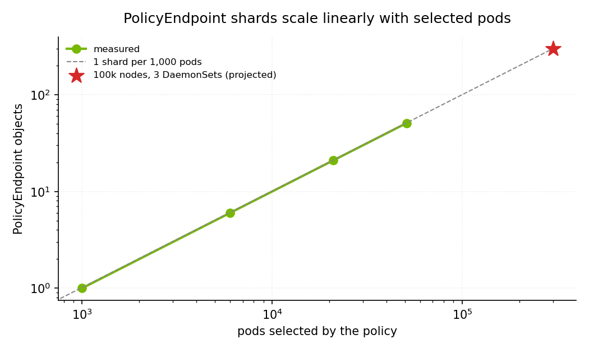

The `metrics-access` policy of NVSentinel selects every pod in its namespace, and the benchmark put approximately 158,000 pods there. Eighty-three shards existed and no more shards appeared. The CNI continued to enforce the rules that it had programmed last. The CNI refused traffic to MongoDB on 27017, because of a source-IP list that named pods that did not exist any more. Policies that `helm uninstall` deleted stayed `Terminating` for three days, and they continued to isolate their pods. The deletion of the 83 stale shards restored connectivity in about two minutes.

This exposure also applies outside the benchmark. The DaemonSets of NVSentinel put four pods per node in that namespace: gpu-health-monitor, syslog-health-monitor, platform-connector and metadata-collector. Three of them use the pod network. Thus a clean install at 100,000 nodes selects approximately 300,000 endpoints and needs about 300 shards. It needs more shards if the CNI also programs the host-networked metadata-collector.

The controller handled 51,000 pods here, and 158,000 pods broke it. The test did not establish whether the controller is behind at some point between these two counts. The test never captured the cause, because the controller runs in the EKS managed control plane, and EKS does not export its logs.

### The EBS CSI provisioner runs out of memory at fleet scale `[M]`

`csi-provisioner` in `kube-system/ebs-csi-controller` runs with `--feature-gates=Topology=true`. Thus it caches every Node and CSINode in the cluster, to place volumes by zone. The cluster holds only 8 PersistentVolumeClaims, but the memory of the provisioner grows with the node count. At this node count, it went above its 10 GiB limit and was OOM-killed repeatedly, with 267 restarts. After that, no `VolumeAttachment` was created for any new pod.

MongoDB is the visible casualty. Its pods are a StatefulSet with EBS-backed volumes. If the restart of a mongod requires a new `VolumeAttachment`, the mongod cannot get its volume back. It stays in `PodInitializing` until the attachment is created and fulfilled. Then the fault-handling components cannot connect to the datastore, and the pipeline stops. Nothing in that chain names the provisioner, and this makes the problem slow to diagnose.

An increase of the limit to 24 GiB resolved the problem, and MongoDB recovered 112 seconds later without more intervention. The controller still shows the restart history from that period.

### Component versions

The table gives the commit on which the test first measured each component, with the date of the commit. It also gives what the test checked again on `aea32ab6` (upstream main, 2026-10-09, images `main-aea32ab`) on the 100,000-node fleet.


| Component | Commit | Commit date | Commit subject | Rechecked on `aea32ab6` |
| --- | --- | --- | --- | --- |
| fault-quarantine | `22fe67ce` | 2026-09-18 | perf(fault-quarantine): prune the node cache to the keys the rules read (#1842) | memory; cordon throughput and per-event handling (A/B against the earlier build, unchanged) |
| fault-remediation | `00582ef5` | 2026-09-15 | perf(fault-remediation): lazy fetch events during changeStreamProcessing instead of storing them into queue (#1811) | memory |
| health-events-analyzer | `85708e3b` | 2026-09-17 | feat: add opt-in rule_matched_entity_total (#1812) | not rechecked; throughput predates #1901 and #1913 |
| platform-connector, deployment mode | `3ec0b630` | 2026-10-09 | perf(platform-connectors): time-ordered idempotency key and datastore pool default of 30 (#1999) | -- |
| node-drainer | `791cd679` | 2026-09-07 | `v1.22.0` | memory |
| kubernetes-object-monitor | `791cd679` | 2026-09-07 | `v1.22.0` | memory |
| janitor, labeler, preflight | `791cd679` | 2026-09-07 | `v1.22.0` | memory, idle only (janitor untriggered; labeler without its DaemonSet pods) |
| MongoDB | -- | -- | Percona Server for MongoDB 8.0.12-4, operator `crVersion` 1.21.1 | -- |


### Methodology

This section describes how the test produced every number in this report, and on which system.

**Cluster.** AWS EKS, control-plane scaling tier 4XL. Five real EC2 nodes carry the NVSentinel control plane and MongoDB, and KWOK simulates the fleet. [Component versions](#component-versions) lists the versions of the components. `janitor-provider` is a bench build that supplies a simulated-reboot CSP.

**Reference object profile.** The `retained_bytes` values in A1 come from the transform of each component, applied to this shape. Thus you can derive those columns again for your own object shape:


| Object        | Serialised size | Composition                                                                                             |
| ------------- | --------------- | ------------------------------------------------------------------------------------------------------- |
| Node          | 55,138 B        | 45,650 B padding in an annotation, 181 labels (~9.6 KB), 2 taints, kwok-generated status with no images |
| Pod           | 9,626 B         | DaemonSet-owned, no padding                                                                             |
| Lease         | 869 B           | one per node                                                                                            |
| RebootNode CR | 993 B           | one per remediation                                                                                     |


The test chose the node size to match production GPU workers (53.6 KB). The padding is in an annotation on purpose. A correct transform that drops annotations shows a slope of zero against the padding. Thus the padding is also a check of transform correctness.

**Fleet control.** The test ran `tests/scale-tests/cmd/k8s-object-scaler` in-cluster from the `e2e-runner` pod, with the service-account token, as `-kind=node -mode=ramp -node-labels=181 -pad-retained-bytes=40650`. That flag gives a 45,650 B annotation, 5,000 B above the value passed. The serialised size above is the POST body. The stored object is about 62 KB after the API server adds `managedFields` and kwok adds the status. The tool creates ~2,500 nodes/s and deletes ~12,000/s.

Do not run bulk operations through `kubectl` for each object. The kubeconfig uses a Teleport exec credential plugin, so every invocation starts a credential fetch, and 53k of them saturate it.

**Reading memory.** The number to provision against is the container working set from cAdvisor, read through Prometheus. The live heap (`go_memstats_heap_alloc_bytes`) has a sawtooth shape between collections. Thus only the trough across a window approximates the live set. A 2-minute window over a 10 GB heap read 47% high, compared to a 16-minute window.

**Reading CPU.** Use `rate(container_cpu_usage_seconds_total{namespace="nvsentinel",pod="<pod>",container!="",container!="POD"}[5m])`. This query reads directly in cores, and it uses the same counter that the CFS quota enforces a limit against. The `container!=""` filter is important, because cAdvisor also exports a pod-level roll-up with an empty container label. Without the filter, a sum counts the CPU two times. The A1 med/peak columns are the median and maximum of that rate across a sampling window at each scale point.

Two other metrics are useful to read with it:

- `container_cpu_cfs_throttled_seconds_total` shows whether a limit throttles the container. A usage figure alone cannot show this.
- `process_cpu_seconds_total` from the `/metrics` endpoint of the component isolates the Go process from any sidecar in the same pod. If the pod has no sidecar, this metric tracks the container rate closely.

For per-event attribution, not steady state, use `usageCoreNanoSeconds` from the kubelet summary API. This counter is cumulative, so you can compute its difference across a burst window.

**Component measurement protocol.** For each scale point, do these steps:

1. Set the fleet.
2. Restart every measured component.
3. Wait for the rollouts to complete.
4. Wait for the informers to sync.
5. Sample.

The restart is essential. The Go runtime does not return freed heap quickly, so a component measured at 5k immediately after 25k still reports the larger figure. During the node sweep, the test held the pods constant across points, and this isolates the node term. The kubernetes-object-monitor grid is the exception. It varies the watched pods from 0 to 100,000 at each node scale, on purpose, to separate the pod term from the node term.

**platform-connector, deployment mode.** Each point starts from a restarted connector. Thus the baseline is an empty process, not one that still holds the connections of the previous point. The working set is the sum over the pods that the Deployment has at that time, found by name, without terminating pods. A prefix match cannot tell a departing pod from its replacement. A count of series that does not identify the pods gives a wrong delta.

The test also increased the limit to 16Gi for the duration. The larger points need up to 7.2 GiB per replica, and with a 4Gi limit, the measurement shows the cap, not the demand.

The simulated nodes have 18 of the 25 labels that the chart allows. These 18 labels are the AWS set, because the OCI and GCE blocks cannot exist together with it on a real node. The nodes also have 14 labels that the augmentor ignores. Earlier connector measurements in this report ran against nodes with one of the 25 labels. That is why those measurements show no per-node term.

**Fitting the memory sweep.** A least-squares fit over these ten points gives `189 MB + 224 KiB/node` with an r-squared of 0.99914, but it is **25.8% high at 2,000 nodes**. A fit in absolute megabytes lets the large points dominate, and the intercept of this fit is an artifact. The measured baseline is 23 to 31 MB, which is an empty process. A fit through the origin removes the problem.

Every histogram that the connectors export has `le=0.01` as its first bucket. Thus any distribution below 10 ms interpolates to the same 5.00/9.00/9.90 at any load. The stored document cannot resolve this either. platform-connector stamps its `createdAt` when it builds the document, before the write. Thus `createdAt` measures the path up to the write, not through it. To time anything below ten milliseconds on this path, measure it from outside the connectors.

**Restart the component before you measure it, or the number is wrong.** The test read the same six components at 50,000 nodes without a restart, after it reduced the fleet from 100,000 nodes. This read gave 31.2 GB, against 24.7 GB after a restart. The reason is that none of the components returns memory when the fleet shrinks.

**Driving faults.** The test inserted health events directly into MongoDB, and did not send them through platform-connector. There are two reasons:

- A direct injection into the datastore is faster and easier to control when you know the document shape. This is important when a run needs a million health events at a chosen rate.
- It keeps platform-connector out of these numbers. [platform-connector, deployment mode](#platform-connector-deployment-mode-m) measures its ingest separately.

This method does not affect the downstream components, because fault-quarantine and the components after it read from the change stream of the datastore. They cannot tell how a document arrived.

The document shape is strict, and a wrong shape fails silently:

- The health event nests under `healthevent`.
- The field names are the Go names in lowercase.
- `generatedtimestamp` must be a `{seconds, nanos}` subdocument.
- `recommendedaction` is the enum integer.
- `errorcode` is an **array**.
- `healtheventstatus.userpodsevictionstatus` must be an empty document, not null.
- `agent` must match the deployed fault-quarantine ruleset.

**Timing the chain.** The percentiles come from per-document timestamps (`generatedtimestamp`, `quarantinefinishtimestamp`, `drainfinishtimestamp`, `lastremediationtimestamp`), which are exact. Timings that come from the CR have the one-second granularity of the API server. End-to-end figures join to the `NodeReady` condition of the maintenance CR, because `faultRemediated: true` marks the dispatch.

**Reading API load.** The test used the difference of `rest_client_requests_total` for each component against an idle control of similar length. Three components (fault-quarantine, labeler and preflight) register no client-go metrics. Their values come from EKS audit logs through CloudWatch Logs Insights. The test sampled after the workload completed. A sample in the middle of the burst of the same run read ~4x lower.

To make a MongoDB member unreachable, delete its pod. `SIGSTOP` does not stop it. `mongod` is PID 1 in its container. The init process of a PID namespace ignores signals from inside that namespace, unless it installs a handler. If the replication lag does not change, the member is still reachable.

Sample on the observed state, not on a schedule. A claim that a component is degraded needs evidence of the degraded state in the same sample as the measurement.

The first bucket of the workqueue histogram is `le=0.01`. Thus every distribution below 10 ms interpolates to the same 5.00 ms median at any load. Little's law on the same samples (mean wait is depth divided by throughput) puts the queue wait near zero below saturation.

A full outage costs recovery time, not memory. Per replica, memory did not increase: 1,227 MB before and 1,046 MB after. During a replacement, a sum of the working set across pods counts the departing pods together with their replacements. In this test, that sum included six pods, not three, and showed an apparent doubling to 6,774 MB.

**Comparing the two connector modes.** The metrics of the two modes do not compare. The node-local connector exports `platform_connector_workqueue_`* and no request histogram, and the Deployment exports a request histogram and no workqueues. Thus a sub-millisecond DaemonSet publish and a five-millisecond Deployment publish are not the same measurement. Instead, every comparison in [Against the DaemonSet](#against-the-daemonset) times the interval from the call of the publisher to the storage of the health event. The change-stream figures do not use the instrumentation of either connector.

**Minting publisher tokens.** Each simulated publisher presents a real ServiceAccount token, bound to a pod that is pinned to its node. The API server sets the node claim from `spec.nodeName`. Thus a pod on a simulated node gets a token that attests to that node, without a kubelet. In-cluster, the minting runs at about 1,000 tokens/s per client.

**MongoDB `opcounters.insert` counts refused writes.** During an idempotency test, the unique index rejects the second write, but the counter still increments. Thus the counter reads about double the true figure, and you cannot use it to check for duplicates. Count distinct keys in the collection instead.

**Cumulative means in the generator.** Client-side publish latency appeared to increase across the scale-out run, from 6.6 ms to 13.0 ms. The `avgPublishMs` value of the generator is a cumulative mean over its whole life, not a windowed reading. Thus it integrates a heavy and variable tail, and does not show a rising typical case.

**The concurrency sweep cannot show the pool's diminishing returns.** At `w:majority`, each writer waits for the acknowledgement before it sends its next write. Thus thirty-two writers generated only 2,004 writes/s. This rate is much too low for a secondary to be behind. The measured quantity itself limited the rate of the writers, so that sweep does not contradict the pool result.

**WiredTiger is not the bottleneck, and the tickets show this.** MongoDB 8.0 sizes the concurrency ticket pool dynamically, so its value is not a configured ceiling that you can reason from. The measured pool size was 6 under light load and 25 under saturation. Operations held at most 2 tickets at any time, and the queue length was 0 at every sample. At the ingest ceiling, there were 2.4 concurrent writes.

**Reading MongoDB.** Two counters are misleading:

- `stats().count` is an estimate that lags a lot. It reported 0 documents against 38,178 actual documents. Thus any document delta must come from `countDocuments`.
- The oplog carries about 2.5 entries/s of background traffic on an idle cluster. Thus measure the cost of a burst against an identical quiet window. Without that subtraction, a 100-node burst reads 9.8 oplog entries per node, not 6.1.

**Reading etcd.** `apiserver_storage_size_bytes` is file-allocated and reports the value from whichever of the three members answered. With no load, it varies by ~983 MB, so it cannot measure growth. Use `apiserver_storage_objects` per resource instead. This metric is exact, but the API server recomputes it periodically.

#### Deployed configuration

Every figure in this report depends on the configuration of the components. Thus this section reproduces the deployed configuration, not a description of it. The test read this configuration from the live cluster, not from the chart defaults.

**kubernetes-object-monitor** watches two policies. Its per-node and per-pod memory depends on these policies, because each enabled policy adds a watch on its resource kind:

```toml
[controller]
  maxConcurrentReconciles = 100

[[policies]]
  name = "NodeNotReady"
  enabled = true
  [policies.resource]
    group = "";  version = "v1";  kind = "Node"
  [policies.predicate]
    expression = "has(resource.status.conditions) && resource.status.conditions.exists(c, c.type == \"Ready\" && c.status == \"False\")"
  [policies.healthEvent]
    componentClass = "Node";  isFatal = true;  errorCode = ["NODE_NOT_READY"]
    recommendedAction = "CONTACT_SUPPORT";  message = "Node is not ready"

[[policies]]
  name = "PodOnUnschedulableNode"
  enabled = true
  [policies.resource]
    group = "";  version = "v1";  kind = "Pod";  namespace = "kom-pod-bench"
  [policies.predicate]
    expression = "has(resource.metadata.annotations) && size(resource.metadata.annotations) > 500"
  [policies.nodeAssociation]
    expression = "resource.spec.nodeName"
  [policies.healthEvent]
    componentClass = "Node";  isFatal = false;  errorCode = ["POD_ON_UNSCHEDULABLE_NODE"]
    recommendedAction = "CONTACT_SUPPORT";  message = "Pod failed on an unschedulable node"
```

The Pod predicate above is a benchmark change to the `PodOnUnschedulableNode` policy, and the difference sets the per-pod cost. Without this change, the `PodOnUnschedulableNode` predicate reads `resource.status.phase`. Thus the CEL-derived transform retains `status.phase` and `spec.nodeName`, and about 175 B per pod stays in the cache. The predicate of the memory grid references `metadata.annotations` as a whole map. The extractor cannot narrow a whole map to individual keys, so the transform retains every annotation. The benchmark pods have **20,039 B of annotations** each.

This is the expensive end of the range, on purpose, so that the pod axis is visible and not lost in noise. It is also why the per-pod figures of the grid are approximately two orders of magnitude above the cost of the `status.phase` predicate. Each row is a restarted process that converged on a fleet with normal KWOK heartbeats, at ~3,000-3,300 lease renewals/s.

The Pod policy is the reason that kubernetes-object-monitor holds a Pod cache. Thus it is the largest component at 100,000 nodes with a pod on every node. Its `--resync-period=24h` means that the fleet-wide relist does not occur within a measurement window. Otherwise, the relist dominates the CPU. Its cache sync timeout is 10m.

**fault-quarantine** cordons on one ruleset, and every injected health event in this report has a shape that matches it:

```toml
label-prefix = "k8saas.nvidia.com/"
[circuitBreaker]
percentage = 50
duration = "5m"

[[rule-sets]]
  enabled = true;  version = "1";  priority = 0
  name = "GPU fatal error ruleset"
  [[rule-sets.match.all]]
    kind = "HealthEvent"
    expression = "event.agent == 'gpu-health-monitor' && event.componentClass == 'GPU' && event.isFatal == true"
  [[rule-sets.match.all]]
    kind = "Node"
    expression = "!('k8saas.nvidia.com/ManagedByNVSentinel' in node.metadata.labels && node.metadata.labels['k8saas.nvidia.com/ManagedByNVSentinel'] == 'false')"
  [rule-sets.cordon]
    shouldCordon = true
```

The circuit breaker configuration is 50% over 5 minutes, but the command line disables the breaker (`--circuit-breaker-enabled=false`). Thus the breaker had no effect on the burst results. The Circuit breaker section in A3 measures it separately. A health event with an agent other than `gpu-health-monitor` matches nothing and causes no cordon. From outside, this looks the same as a stalled pipeline.

**node-drainer** decides for each namespace whether a drain can complete. This decision controls every drain figure in A3:

```toml
evictionTimeoutInSeconds = "60"
systemNamespaces = "^(nvsentinel|kube-system|gpu-operator|gmp-system|network-operator|skyhook)$"
deleteAfterTimeoutMinutes = 60
notReadyTimeoutMinutes = 5
drainGPUPods = false
partialDrainEnabled = false

[[userNamespaces]]
name = "e2e-pods";  mode = "Immediate"
[[userNamespaces]]
name = "*";  mode = "AllowCompletion"
```

With `drainGPUPods = false`, node-drainer never evicts a pod that requests `nvidia.com/gpu`. The catch-all `*` namespace maps to `AllowCompletion`, which waits for pods to exit on their own and does not evict them. Thus drain-latency measurements need pods that request no GPU, in a namespace mapped to `Immediate`.

**Client rate limits, as deployed.** These are the values behind the QPS table:


| Component                 | Flags                                                                                 |
| ------------------------- | ------------------------------------------------------------------------------------- |
| kubernetes-object-monitor | `--max-concurrent-reconciles=100 --resync-period=24h`, no QPS flags                   |
| fault-quarantine          | `--kube-api-qps=100 --kube-api-burst=200`, `--circuit-breaker-enabled=false`          |
| labeler                   | `--kube-api-qps=500 --kube-api-burst=1000`, `--require-dcgm-ready-for-bootstrap=true` |
| node-drainer-bench        | `--kube-api-qps=400 --kube-api-burst=800`                                             |
| janitor                   | `--enable-ttl=false --default-ttl=336h`, no QPS flags                                 |
| fault-remediation         | `--leader-elect=true --enable-log-collector=false`, no QPS flags                      |
| preflight                 | `--config=/etc/preflight/config.yaml`, no QPS flags                                   |
| health-events-analyzer    | `--processing-strategy=EXECUTE_REMEDIATION`, no QPS flags                             |


fault-remediation, janitor and kubernetes-object-monitor have no client-side rate limit. If the component sets no QPS value, `GetConfig` of controller-runtime v0.25.0 sets `cfg.QPS = -1`. Thus the fairness rules of the API server are the only limit.

**labeler** has no resync flag. The code sets its resync period to 30 seconds, and this period sets the two-cycle time-to-label in A3.

**janitor** runs all three controllers with a 25-minute timeout, and it connects to the CSP through a bench provider:

```yaml
global:
  timeout: 25m
  manualMode: false
  cspProviderHost: janitor-provider.nvsentinel.svc.cluster.local:50051
rebootNodeController:   {enabled: true, timeout: 25m}
terminateNodeController: {enabled: true, timeout: 25m}
gpuResetController:      {enabled: true, timeout: 25m}
```

**fault-remediation** maps recommended actions to maintenance CRs:

- `COMPONENT_RESET`, `RESTART_BM` and `RESTART_VM` all create a `RebootNode` that completes on `NodeReady`.
- `REPLACE_VM` creates a `TerminateNode` that completes on `NodeTerminated`.

Both templates have a 336-hour TTL annotation. 62% of production health events recommend `COMPONENT_RESET`, so the reboot path is the one that matters for MTTR.

**preflight** is a mutating webhook on `CREATE pods`. The test measured every gang figure in A1 against these settings:

```yaml
# MutatingWebhookConfiguration/preflight
failurePolicy: Ignore
timeoutSeconds: 10
reinvocationPolicy: Never
namespaceSelector:
  matchLabels:
    nvsentinel.nvidia.com/preflight: enabled
rules:
- apiGroups: [""]
  apiVersions: ["v1"]
  operations: ["CREATE"]
  resources: ["pods"]
  scope: Namespaced
```

```yaml
# ConfigMap/preflight, config.yaml
gangDiscovery:
  annotationKeys:
  - scheduling.k8s.io/group-name
  labelKeys: []
  minCountExpr: podGroup.spec.minMember
  name: volcano
  podGroupGVR:
    group: scheduling.volcano.sh
    resource: podgroups
    version: v1beta1
gangCoordination:
  enabled: true
  timeout: 10m
  masterPort: 29500
  configMapMountPath: /etc/gang
initContainerPlacement: append
initContainers:
- env:
  - name: DCGM_HOSTENGINE_ADDR
    value: nvidia-dcgm.gpu-operator.svc:5555
  - name: DCGM_DIAG_LEVEL
    value: '2'
  - name: DCGM_DIAG_STATUS_RETRY_MAX_ATTEMPTS
    value: '10'
  - name: DCGM_DIAG_STATUS_RETRY_INTERVAL_SECONDS
    value: '10'
  image: ghcr.io/nvidia/nvsentinel/preflight-dcgm-diag:1.0.0
  inheritUserEnv: true
  inheritUserVolumeMounts: true
  name: preflight-dcgm-diag
  volumeMounts:
  - mountPath: /var/run
    name: nvsentinel-socket
- env:
  - name: BW_THRESHOLD_GBPS
    value: '150'
  - name: TEST_SIZE_MB
    value: '256'
  image: ghcr.io/nvidia/nvsentinel/preflight-nccl-loopback:1.0.0
  inheritUserEnv: true
  inheritUserVolumeMounts: true
  name: preflight-nccl-loopback
  volumeMounts:
  - mountPath: /var/run
    name: nvsentinel-socket
- env:
  - name: BW_THRESHOLD_GBPS
    value: '100'
  - name: MESSAGE_SIZES
    value: 4G
  - name: NCCL_DEBUG
    value: INFO
  - name: NCCL_DEBUG_SUBSYS
    value: INIT,NET
  image: ghcr.io/nvidia/nvsentinel/preflight-nccl-allreduce:1.0.0
  inheritUserEnv: true
  inheritUserVolumeMounts: true
  name: preflight-nccl-allreduce
  securityContext:
    capabilities:
      add:
      - IPC_LOCK
  volumeMounts:
  - mountPath: /var/run
    name: nvsentinel-socket
```

The test measured the gang numbers against the 10-second webhook deadline. `failurePolicy: Ignore` decides the failure mode. If the webhook misses the deadline, the API server silently skips the checks and does not fail the Pod creation. With `Fail`, the documented production setting, the Pod creation fails instead.

Because of the namespace selector, a pod created in any other namespace never reaches preflight. Thus a gang benchmark in an unlabelled namespace measures nothing, but still looks successful. The webhook appends the three init containers above to every admitted pod. These containers are most of the admission work for each member. Thus a gang measured with no checks configured is not comparable to these numbers.

**health-events-analyzer** runs 8 rule sets that cover 20 named rules. All of them are correlation rules over the health event history: `MultipleRemediations`, `RepeatedXIDErrorOnSameGPU`, `RepeatedXID31OnSameGPU`, `RepeatedXID31OnDifferentGPU`, `RepeatedXID13OnSameGPCAndTPC`, `RepeatedXID13OnDifferentGPCAndTPC`, `XIDErrorSoloNoBurst`, and thirteen XID74 register-decoding and NIC rules. It evaluates each incoming health event against all of these rules, and this is where its 5.8 ms per health event goes.

#### Traps

The harness never clears the health-event collection between runs. Any SLA query must bound `createdAt` to the run. Without this bound, the cordon P99 of this run read 11 s instead of 1.4 s.

If a component cannot reach MongoDB, the cause is not necessarily MongoDB. Read the `PolicyEndpoint` objects (`networking.k8s.aws/v1alpha1`) before you investigate the database, the certificates or DNS. These objects carry the source-IP allow-lists that the CNI enforces, and they become stale without a warning. A useful one-line test: a port with no listener returns a RST ("Connection refused"), but a port that a policy blocks times out. If an unlisted port times out, enforcement is active. Then read the allow-list.

`fault-quarantine`, `fault-remediation` and `node-drainer` expose readiness on an HTTP metrics server. This server starts before the component tries to connect to the datastore. Thus `ready=True` does not mean that the component reached MongoDB. Confirm the connection from the log line `Successfully pinged database to confirm connectivity`. During this run, reliance on readiness caused two false recoveries.

**A controller can hold a cluster-wide informer that its watch registration never mentions.** controller-runtime creates informers lazily, on the first cached read of a GVK. Thus the watch registration of a controller lists only the resources that it watches eagerly.

For example, janitor registers no Node watch. But on a 25,005-node fleet, one `TerminateNode` CR increased its memory from 11 MB to 500-870 MB. The informer listed the fleet inside a single reconcile. Thus the memory of an idle pod says nothing about the component at scale. Also, after a restart, the first real unit of work blocks for the full list-and-sync.