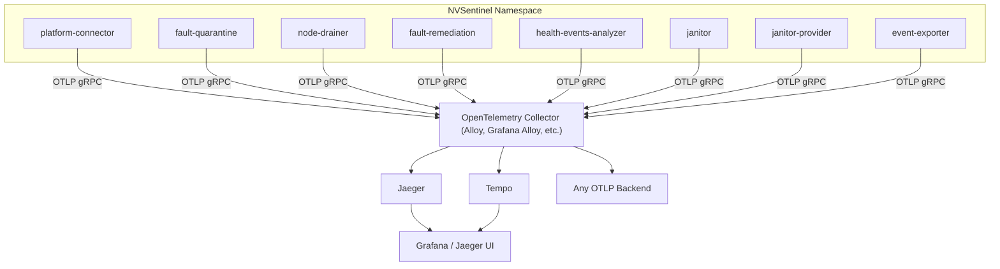

# Distributed Tracing

## Overview

NVSentinel uses OpenTelemetry distributed tracing to provide end-to-end visibility into the lifecycle of every health event as it moves through the break-fix workflow. A single trace follows one health event from detection through quarantine, drain, and remediation across all NVSentinel modules. These modules are platform-connector, fault-quarantine, node-drainer, fault-remediation, health-events-analyzer, janitor, janitor-provider, and event-exporter.

To debug an issue, you do not need to correlate logs across multiple services manually. Instead, you can find a single trace and see the complete journey, timing, and outcome of any health event in one view. This works for issues such as "Why was a node not remediated?" and "Why did fault-quarantine take longer than expected to handle an event?".

### Why Do You Need This?

The break-fix workflow of NVSentinel spans many modules. Sometimes a problem occurs. For example, a health event takes longer than expected to move from detection to remediation, a remediation fails, or a node is not recovered. To understand what happened, you must combine information from multiple services:

- **Manual log correlation is slow**: You must search the logs of each module and match them by health event ID or node name. Then you must align the timestamps and reconstruct the flow in your mind. This work takes a long time and is prone to errors.
- **Timing is manual work**: Logs have timestamps, so you can calculate how long each step took. But you must find the right log lines across multiple modules and calculate the time differences yourself. You must also reconstruct the nesting in your mind. Traces give you the duration of each step and a nested timeline automatically. Thus, you can quickly find the cause of a slow remediation. The cause can be a long drain, a slow database write, or a delayed Kubernetes API call.
- **Context is scattered**: To understand why a health event was skipped, cancelled, or failed, you must log in to the cluster and search its logs.

Distributed tracing solves these problems. It gives you a structured, request-scoped view of the path of every health event through the system. The view shows *where*, *what*, and *how long* each step took.

## How It Works

When a health event enters NVSentinel, NVSentinel creates a **trace**. A trace is a unique identifier that follows the health event through every module. Each module adds **spans** (units of work with start and end times) to the trace while it processes the health event. Spans are nested to show the call hierarchy. Spans also carry **attributes** (key-value metadata) that describe what happened and any errors that occurred.

## Architecture

All NVSentinel modules export traces through OTLP gRPC to an OpenTelemetry Collector.




### Event Lifecycle in a Trace

```text
Health Monitor
    │ send health event
    ▼
platform_connector
    └── platform_connector.process_event
    │  writes trace_id + span_id to MongoDB during event insertion
    ▼
fault_quarantine
    └── fault_quarantine.db.update_status
    │  writes span_id to MongoDB while updating quarantine status
    ▼
node_drainer
    └── node_drainer.drain_session
    └── node_drainer.update_user_pods_eviction_status
    │  writes span_id to MongoDB while updating drainer status
    ▼
fault_remediation
    └── fault_remediation.create_maintenance_resource
    │  writes trace_id + span_id to CR annotations while creating remediation CR
    ▼
janitor
    └── janitor.rebootnode.reboot_session
    │  W3C traceparent via gRPC
    ▼
janitor-provider
```

## What Can You Track?

- **Module-level performance**: The time that each module spends to process a health event. Use it to find the cause of a delay. Possible causes: a slow database write, a retry loop, a resource update conflict, a long-running Kubernetes API call, or a wait between modules
- **Database query latency**: The shared datastore layer of NVSentinel automatically traces every database operation on health events (inserts, status updates, queries, aggregations). Filter slow queries with TraceQL (for example, `{db.duration_ms > 50}`)
- **Kubernetes API call latency**: Individual Kubernetes API calls: cordon, taint, uncordon, pod eviction, and CR creation. The calls also include node condition updates, status patches, node lock acquisition, service teardown and restore, and job creation. Find slow calls in Grafana with TraceQL: `{name =~ "HTTP.*" && duration > 500ms}`
- **CSP API call latency**: Cloud service provider calls: reboot signal, node-ready check, and terminate signal. You can see whether delays are in NVSentinel or in the cloud provider.
- **Remediation lifecycle**:
  - Log collector execution (success, failure, or timeout)
  - Maintenance CR creation (GPUReset, RebootNode, TerminateNode)
  - Skip reasons and cancellation events
  - Final remediation outcome
- **Janitor operations**:
  - GPU reset phases (node lock, service teardown, reset job, service restore)
  - Reboot flow (signal sent, time to node ready, final status)
  - Terminate flow (signal sent, node terminated, node deleted)
  - Kubernetes API call latency for each operation
- **Error diagnosis**: When something fails, every module records `error.type` and `error.message` attributes on its spans. You can see exactly which step failed and which error occurred. Find all error spans with TraceQL: `{status = error}`

### Trace Context Propagation

NVSentinel modules do not communicate with each other through HTTP or gRPC (except janitor → janitor-provider). Instead, NVSentinel propagates the trace context through three mechanisms. The mechanism depends on the boundary:

| Boundary | Channel | How Trace Context Flows |
|----------|---------|------------------------|
| platform-connector → fault-quarantine → node-drainer → fault-remediation | MongoDB change stream or PostgreSQL change stream emulation | `trace_id` in health event metadata + `span_ids` map in status |
| fault-remediation → janitor | Kubernetes CR creation | CR annotations (`nvsentinel.nvidia.com/trace-id`, `nvsentinel.nvidia.com/span-id`) |
| janitor → janitor-provider | Synchronous gRPC | W3C `traceparent` header (automatic with `otelgrpc`) |

Each module reads the upstream trace context, creates a linked span in the same trace, and writes its own span ID for the next module. The result is a single trace that spans all modules.

### Log-Trace Correlation

If tracing is enabled and a module uses trace-correlation logging, its JSON logs include `trace_id` and `span_id` fields. This applies to the logs that the module writes in an active span context. In your log aggregation system, you can then go from a trace to its logs, and from a log line to its trace.

```json
{
  "time": "2026-03-18T10:00:00Z",
  "level": "INFO",
  "msg": "processing event",
  "module": "fault-quarantine",
  "trace_id": "abc123def456...",
  "span_id": "789ghi012..."
}
```

To find all logs of a specific trace, search by `trace_id` in Loki, Kibana, or any other log backend.

## Configuration

Configure tracing through your Helm values:

```yaml
global:
  tracing:
    enabled: true        # Enable/disable tracing for all components
    endpoint: ""         # Required: OTLP gRPC address of your OTel collector (e.g, "alloy.observability.svc.cluster.local:4317")
    insecure: true       # Set to false if the collector endpoint uses TLS
```

When you enable tracing, Helm injects these environment variables into every NVSentinel module:

| Environment Variable | Value |
|---------------------|-------|
| `OTEL_EXPORTER_OTLP_ENDPOINT` | `<global.tracing.endpoint>` |
| `OTEL_EXPORTER_OTLP_INSECURE` | `<global.tracing.insecure>` |

### Resource Attributes

Every span carries resource attributes that identify the module that sent it:

| Attribute | Source |
|-----------|--------|
| `service.name` | The module name, for example `node-drainer` |
| `service.version` | The version of the module build |
| `telemetry.sdk.*` | The OpenTelemetry SDK name, language and version |

Each module also reads the standard `OTEL_RESOURCE_ATTRIBUTES` variable, so the attributes that you set there, for example `deployment.environment.name=production`, appear on every span. A module skips an attribute that it cannot parse, logs a warning, and continues to send traces. The module always sets `service.name` and `service.version` itself, so `OTEL_SERVICE_NAME` or `OTEL_RESOURCE_ATTRIBUTES` cannot rename a service.

To add the pod, namespace and node to spans, enable the `k8sattributes` processor in your collector (`otelcol.processor.k8sattributes` in Grafana Alloy). It adds `k8s.pod.name`, `k8s.namespace.name` and `k8s.node.name` from the connection of the sending pod.

### Prerequisites

- An OpenTelemetry Collector (for example, Grafana Alloy or the standard OTel Collector) that is accessible from the NVSentinel namespace
- A tracing backend (for example, Grafana Tempo or Jaeger) configured as an export destination in your collector, with a UI to query and visualize traces

## Using Traces for Debugging

### Finding a Trace

In your tracing UI (Grafana Tempo, Jaeger), you can find traces by:

- **Trace ID**: If you have a `trace_id` from logs, a health event document, or an exported CloudEvent, search for it directly
- **Health event ID**: If you have the document ID of the health event, find its trace with TraceQL: `{span.health_event.id = "69e1c5b487beb8cfe7bc440e"}`. The `health_event.id` attribute is present on spans from fault-quarantine, node-drainer, and fault-remediation
- **Service name**: To see all traces through a specific module, filter by `service.name` (for example, `fault-quarantine` or `node-drainer`)
- **Span attributes**: Use TraceQL queries to find traces that match specific conditions

### Example: Debugging a Slow Remediation

1. Find the trace for the health event (search by trace ID or health event ID)
2. Examine the top-level spans to see how long each module took
3. Expand the spans of the slow module to see which operation was the bottleneck
4. Check span attributes for details (for example, `node_drainer.drain.scope`, `fault_remediation.log_collector.outcome`)
5. In the slow module, look for slow Kubernetes API calls (`HTTP *` spans) or database operations (`{COLLECTION}.{OPERATION}` spans, for example `HealthEvents.update`). They show whether the delay is from an API call or a database query
6. For more details, copy the `trace_id` or `span_id` from the span. Then search for it in the container logs of the corresponding service to get the full context

### Example: Why Was a Node Not Remediated?

1. Find the trace for the health event
2. Check if the health event is still in progress. The node can still be in the draining stage, and thus not remediated yet. NVSentinel sends a span to the collector only after the span ends, so the backend does not show an active `node_drainer.drain_session` span. Instead, check the `dgxc.nvidia.com/nvsentinel-state` label of the node. The value `draining` means that the drain is still in progress
3. Check if fault-remediation has a `fault_remediation.skip_event` span. If it has one, read the `fault_remediation.skip.reason` attribute to understand why fault-remediation skipped the health event
4. Check if the remediation action itself failed. Look for `janitor.reset_job.failed = true` or `janitor.error.type = "reboot_timeout"` attributes on janitor spans. These attributes show if the GPU reset or reboot failed on the node
5. Look for error spans in all modules. The health event can fail at any stage if Kubernetes API calls, CSP API calls, or database operations still fail after all retries

### Example: Identifying Database Bottlenecks

Database operations appear as spans named `{COLLECTION}.{OPERATION}` (for example, `HealthEvents.update`, `HealthEvents.insert`, `HealthEvents.find`). These spans have attributes such as `db.operation.name`, `db.collection.name`, `db.system.name` (`mongodb`), and `network.peer.address` (the MongoDB host). To find slow database operations, use TraceQL:

```text
{name =~ "HealthEvents.*" && duration > 100ms}
```

This query returns all spans in which a database operation took longer than 100ms. It helps you find slow queries across all modules.

### Example: Finding Slow Kubernetes/CSP API Calls

Kubernetes API calls appear as `HTTP PUT`, `HTTP DELETE`, and `HTTP GET` spans in a trace. Each HTTP span includes `url.full` (for example, `https://10.96.0.1:443/api/v1/nodes/{node}/status`), `http.response.status_code`, and `http.request.method`. Thus, you can identify exactly which API call was slow and to which resource. To find slow calls across all traces, use TraceQL:

```text
{name =~ "HTTP.*" && duration > 500ms}
```

This query returns all spans in which an HTTP call took longer than 500ms. It helps you find slow API calls across all modules.

## Troubleshooting

**Q: Tracing is enabled, but I do not see any traces in my backend**

- Verify that `global.tracing.endpoint` is set to the correct OTLP gRPC address of your collector
- Ensure that the OTel Collector is reachable from the NVSentinel namespace (check the network policies)
- Confirm that the collector is configured to export to your tracing backend
- Check the NVSentinel module logs for OTLP export errors

**Q: Log lines do not have `trace_id` and `span_id` fields**

- Log-trace correlation requires tracing to be enabled. Verify that `global.tracing.enabled` is set to `true` in your Helm values. Also verify that `OTEL_EXPORTER_OTLP_ENDPOINT` is present in the environment of the module. To confirm that tracing is active, you can also look for the startup message `"OpenTelemetry tracing initialized"` in the container logs of the module. If the message is present, the module initialized tracing successfully
- A module adds `trace_id` and `span_id` only to the log lines that it writes during an active span context. Logs outside of event processing do not have these fields

**Q: Can I use tracing without Grafana Tempo?**

- Yes. NVSentinel exports standard OTLP traces. Any OTLP-compatible backend works, for example Jaeger, Zipkin (with an OTLP receiver), Grafana Cloud, Datadog, or any vendor that accepts OTLP gRPC

**Q: I do not see any database spans in my traces**

- Database spans appear only when the database call occurs in an active parent span context. NVSentinel does not trace calls outside of event processing (for example, startup queries and background health checks). This behavior is intentional

**Q: What is the performance impact of enabling tracing?**

- Tracing adds minimal overhead for each span (microseconds to create the span and record its attributes). The primary cost is the OTLP gRPC export. NVSentinel sends this export in asynchronous batches, so it does not block event processing
- NVSentinel traces only event-processing paths. It does not trace background operations and internal polling loops. Thus, the trace volume stays proportional to your event rate
