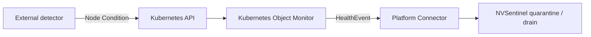

# Tutorial: Integrating an External Health Detector

This tutorial explains how to connect an external health-detection tool to
NVSentinel using the Kubernetes Object Monitor (KOM). After following it you
will understand the integration pattern, the rules a detector must follow, and
how to write a KOM policy for both node-level and GPU-level faults.

The [Node Problem Detector tutorial](integrating-node-problem-detector.md) is a
complete worked example of this pattern for host-log faults. Read the present
page first if you are integrating a different tool, or if you want to understand
the general design before reading the NPD walkthrough.

---

## 1. How the integration works

An external detector publishes its finding as a permanent Kubernetes
**Node Condition** on the affected node. KOM watches every node and fires a
NVSentinel `HealthEvent` when a condition's type, status, and reason match a
configured policy. The existing quarantine, cordon, and drain pipeline then
handles the node exactly as it would any other fault.



No NVSentinel code changes are needed. The detector is fully decoupled: it only
writes a standard Kubernetes resource that KOM already knows how to read.

---

## 2. Rules a detector must follow

A detector that publishes a Node Condition for KOM to consume must follow these
rules to avoid false alarms and split-ownership conflicts.

**Ownership**
- Only one controller writes a given condition type on a given node. If two
  tools write the same condition type, they will overwrite each other.

**Signaling a problem**
- Set `status: "True"` and a stable, non-empty `reason` string when a problem is
  detected.
- The reason string must be constant across repeated firings of the same fault
  class so the KOM CEL predicate can match it reliably.

**Signaling recovery**
- Set `status: "False"` and a matching healthy-reason string *only after the
  detector has confirmed recovery*, not simply because the check interval
  elapsed. Setting `False` before recovery causes KOM to observe a healthy
  transition that can cancel active break-fix processing.

**Policy naming**
- Each condition type should have its own named KOM policy. The policy `name`
  becomes the `checkName` in the resulting `HealthEvent`, so choose a stable,
  descriptive string (for example `ExternalGPUIntegrityCheck`).

---

## 3. Write a KOM policy for the condition

### Node-level faults

Use `componentClass: Node` when the condition represents a problem with the
host that affects the whole node (filesystem errors, hardware memory errors,
kernel panics, and so on). This is the pattern used by Node Problem Detector.

```yaml
- name: ExternalHostFaultDetected
  enabled: true
  resource:
    group: ""
    version: v1
    kind: Node
  predicate:
    expression: |
      resource.status.conditions.exists(c,
        c.type   == "ExternalHostFault" &&
        c.status == "True" &&
        c.reason == "HostFaultDetected")
  healthEvent:
    componentClass: Node
    isFatal: true
    message: "An external host-fault detector reported a problem on this node"
    recommendedAction: CONTACT_SUPPORT
    errorCode:
      - EXTERNAL_HOST_FAULT
```

Replace `ExternalHostFault`, `HostFaultDetected`, the policy `name`, `message`,
`recommendedAction`, and `errorCode` with the values your detector uses.

### GPU-level faults

Use `componentClass: GPU` when the condition represents a problem specific to a
GPU workload rather than the host itself (inference-integrity errors, model
divergence, and similar). NVSentinel will associate the event with the GPU
rather than the whole node.

> **Limitation:** KOM targets the node containing the affected GPU. On a node
> with multiple GPUs, all GPUs on that node will be included in the impacted
> entities. If you need per-GPU precision, see the
> [Writing a Health Monitor](writing-a-health-monitor.md) guide,
> which describes how to send `HealthEvent`s over gRPC with an explicit GPU UUID
> in `entitiesImpacted`.

```yaml
- name: ExternalGPUIntegrityCheck
  enabled: true
  resource:
    group: ""
    version: v1
    kind: Node
  predicate:
    expression: |
      resource.status.conditions.exists(c,
        c.type   == "ExternalGPUIntegrity" &&
        c.status == "True" &&
        c.reason == "GPUIntegrityFailed")
  healthEvent:
    componentClass: GPU
    isFatal: true
    message: "An external GPU integrity checker reported a fault on this node"
    recommendedAction: RUN_FIELDDIAG
    errorCode:
      - EXTERNAL_GPU_INTEGRITY_FAULT
```

### Add the policy to your values file

Append the policy block to the existing
`kubernetes-object-monitor.policies` list in your Helm values file. Helm
replaces the complete list on upgrade, so merge any existing custom policies
before running `helm upgrade`.

```yaml
global:
  kubernetesObjectMonitor:
    enabled: true

kubernetes-object-monitor:
  policies:
    # ... existing policies ...
    - name: ExternalGPUIntegrityCheck
      enabled: true
      resource:
        group: ""
        version: v1
        kind: Node
      predicate:
        expression: |
          resource.status.conditions.exists(c,
            c.type   == "ExternalGPUIntegrity" &&
            c.status == "True" &&
            c.reason == "GPUIntegrityFailed")
      healthEvent:
        componentClass: GPU
        isFatal: true
        message: "An external GPU integrity checker reported a fault on this node"
        recommendedAction: RUN_FIELDDIAG
        errorCode:
          - EXTERNAL_GPU_INTEGRITY_FAULT
```

Apply the updated values:

```bash
NVSENTINEL_VERSION="<your-version>"

helm upgrade --install nvsentinel oci://ghcr.io/nvidia/nvsentinel \
  --version "$NVSENTINEL_VERSION" \
  --namespace nvsentinel \
  --create-namespace \
  --reuse-values \
  --values your-values.yaml \
  --wait
```

Verify KOM loaded the new policy:

```bash
kubectl logs deployment/kubernetes-object-monitor \
  --namespace nvsentinel | grep -i "policy"
# Expected: "Loaded policy configuration" and your policy name in the output
```

---

## 4. Validate the integration

After the detector sets the condition on a test node, confirm the full chain
fires before enabling downstream remediation in production.

**Step 1 — confirm the condition is set**

```bash
NODE="<your-test-node>"

kubectl get node "$NODE" \
  -o jsonpath='{range .status.conditions[*]}{.type}={.status} reason={.reason}{"\n"}{end}' \
  | grep ExternalGPUIntegrity
# Expected:
# ExternalGPUIntegrity=True reason=GPUIntegrityFailed
```

**Step 2 — confirm KOM published a HealthEvent**

```bash
kubectl logs deployment/kubernetes-object-monitor \
  --namespace nvsentinel \
  | grep "ExternalGPUIntegrityCheck"
# Expected: an entry showing the policy matched and a HealthEvent was published
```

**Step 3 — confirm the node was cordoned** (only if downstream remediation is
enabled)

```bash
kubectl get node "$NODE" -o jsonpath='{.spec.unschedulable}'
# Expected: true
```

**Step 4 — confirm recovery**

Once the detector clears the condition (`status: "False"`), verify that KOM
observes the transition and that any pending break-fix is resolved before
uncordoning the node.

---

## 5. Worked example: Node Problem Detector

[Node Problem Detector (NPD)](https://github.com/kubernetes/node-problem-detector)
publishes permanent Node Conditions from kernel log patterns. It is the
canonical example of this integration pattern for host-level faults.

See the full walkthrough, including installation, policy configuration, and
end-to-end validation with synthetic kernel-message injection, in the
[Node Problem Detector tutorial](integrating-node-problem-detector.md).

The key difference between NPD and a GPU-workload checker is the
`componentClass` in the KOM policy:

| Detector type | Fault class | `componentClass` | Clears condition when |
|---|---|---|---|
| Node Problem Detector | Host/kernel errors | `Node` | NPD process restarts |
| GPU workload checker | Inference / compute errors | `GPU` | Detector confirms GPU recovery |

---

## Troubleshooting

### KOM does not publish a HealthEvent after the condition is set

- Confirm `global.kubernetesObjectMonitor.enabled: true` in your Helm values.
- Confirm the policy has `enabled: true`.
- Compare the actual condition type, status, and reason on the node with the
  CEL predicate in the policy — they must match exactly, including case.

```bash
kubectl get node "<node>" \
  -o jsonpath='{range .status.conditions[*]}{.type}={.status} reason={.reason}{"\n"}{end}'

kubectl logs deployment/kubernetes-object-monitor --namespace nvsentinel
# Expected when healthy: "Loaded policy configuration", "Registered controller",
# and "Starting manager" entries, with no predicate errors.
```

### The condition is set but KOM reports a predicate error

CEL expressions are strict about quoting and field paths. Test the predicate
against a node's JSON with `kubectl get node <node> -o json` and the
[CEL Playground](https://playcel.undistro.io/) before deploying.

### A node is cordoned but the condition was already cleared

This is expected: NVSentinel cordons on the fatal HealthEvent and waits for a
human operator or the fault-remediation component to uncordon after break-fix
completes. Clearing the Node Condition does not automatically uncordon the node.
