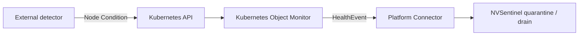

# Tutorial: Integrating an External Health Detector

This tutorial explains how to connect an external health-detection tool to NVSentinel with the Kubernetes Object Monitor (KOM). When you complete this tutorial, you know:

- The integration pattern.
- The rules that a detector must follow.
- How to write a KOM policy for node-level faults and for GPU-level faults.

The [Node Problem Detector tutorial](integrating-node-problem-detector.md) is a complete example of this pattern for host-log faults. If you integrate a different tool, read this page first. If you want to learn the general design before the Node Problem Detector walkthrough, also read this page first.

---

## 1. How the integration works

An external detector publishes its finding as a permanent Kubernetes **node condition** on the affected node. KOM watches all nodes. When the type, status and reason of a condition match a configured policy, KOM publishes an NVSentinel `HealthEvent`. Then the existing quarantine, cordon and drain pipeline handles the node in exactly the same way as any other fault.



You do not need to change NVSentinel code. The detector does not depend on NVSentinel. It only writes a standard Kubernetes resource that KOM can already read.

---

## 2. Rules a detector must follow

A detector that publishes a node condition for KOM must follow these rules. The rules prevent false alarms and split-ownership conflicts.

**Ownership**

- Make sure that only one controller writes a given condition type on a given node. If two tools write the same condition type, each tool overwrites the condition of the other tool.

**Signaling a problem**

- When the detector finds a problem, set `status: "True"` and a stable, non-empty `reason` string.
- The reason string must be constant for all detections of the same fault class, so that the KOM CEL predicate can match it reliably.

**Signaling recovery**

- Set `status: "False"` and a matching healthy-reason string *only after the detector confirms recovery*. Do not set it only because the check interval elapsed. If you set `False` before recovery, KOM sees a healthy transition that can cancel an active break-fix workflow.
- While a fault is active, do not set `status: "Unknown"`. The KOM predicate matches `status == "True"`. If the condition changes to `Unknown`, the predicate becomes false, and KOM publishes a healthy event. This healthy event can cancel an active break-fix workflow. The condition must stay `True` with the same `reason` string until the detector confirms recovery.

**Policy naming**

- Give each condition type its own named KOM policy. The policy `name` becomes the `checkName` in the resulting `HealthEvent`. Select a stable, descriptive name, for example `ExternalGPUIntegrityCheck`.

---

## 3. Write a KOM policy for the condition

### Node-level faults

If the condition shows a problem with the host that affects the whole node, use `componentClass: Node`. Examples are filesystem errors, hardware memory errors, kernel panics and other host problems. Node Problem Detector uses this pattern.

```yaml
- name: ExternalHostFaultDetected
  enabled: true
  resource:
    group: ""
    version: v1
    kind: Node
  predicate:
    expression: |
      resource.status.conditions.exists(c,
        c.type   == "ExternalHostFault" &&
        c.status == "True" &&
        c.reason == "HostFaultDetected")
  healthEvent:
    componentClass: Node
    isFatal: true
    message: "An external host-fault detector reported a problem on this node"
    recommendedAction: CONTACT_SUPPORT
    errorCode:
      - EXTERNAL_HOST_FAULT
```

Replace `ExternalHostFault`, `HostFaultDetected`, the policy `name`, `message`, `recommendedAction` and `errorCode` with the values that your detector uses.

### GPU-level faults

If the condition shows a problem that is specific to a GPU workload and not to the host, use `componentClass: GPU`. Examples are inference-integrity errors, model divergence and similar problems. The health event has `componentClass: GPU`, but its impacted entity is the Node, not a GPU.

> **Limitation:** KOM publishes the Node as the impacted entity in the `HealthEvent`. It does not list the individual GPUs on that node. As a result, the health event is node-scoped. A consumer that needs a GPU UUID cannot get one from this health event. If you need per-GPU precision, see the [Writing a Health Monitor](writing-a-health-monitor.md) guide. That guide shows how to send `HealthEvent` messages over gRPC with an explicit GPU UUID in `entitiesImpacted`.

```yaml
- name: ExternalGPUIntegrityCheck
  enabled: true
  resource:
    group: ""
    version: v1
    kind: Node
  predicate:
    expression: |
      resource.status.conditions.exists(c,
        c.type   == "ExternalGPUIntegrity" &&
        c.status == "True" &&
        c.reason == "GPUIntegrityFailed")
  healthEvent:
    componentClass: GPU
    isFatal: true
    message: "An external GPU integrity checker reported a fault on this node"
    recommendedAction: RUN_FIELDDIAG
    errorCode:
      - EXTERNAL_GPU_INTEGRITY_FAULT
```

### Add the policy to your values file

Append the policy block to the existing `kubernetes-object-monitor.policies` list in your Helm values file. On upgrade, Helm replaces the complete list. As a result, your values file must include **all** the policies that you need:

- Your existing custom policies.
- The default policies of the chart, such as `ReplaceNotReadyNode`.

If you omit a policy from the list, Helm removes it on the next upgrade without a warning.

Before you edit the list, examine the default policies in the KOM subchart. In the first command, set your NVSentinel version:

```bash
NVSENTINEL_VERSION="<your-version>"

# Inspect the KOM subchart defaults (policies live there, not in the umbrella chart)
# Pull the umbrella chart and inspect the bundled KOM subchart defaults:
helm pull oci://ghcr.io/nvidia/nvsentinel \
  --version "$NVSENTINEL_VERSION" --untar
grep -A 60 'policies:' nvsentinel/charts/kubernetes-object-monitor/values.yaml
rm -rf nvsentinel/

# On an existing release, also check the currently active effective values
# (--all includes chart defaults, not just user-supplied overrides):
helm get values nvsentinel --namespace nvsentinel --all
```

```yaml
global:
  kubernetesObjectMonitor:
    enabled: true

kubernetes-object-monitor:
  policies:
    # Include all default policies (e.g. ReplaceNotReadyNode) and any
    # existing custom policies here before adding the new one below.
    - name: ExternalGPUIntegrityCheck
      enabled: true
      resource:
        group: ""
        version: v1
        kind: Node
      predicate:
        expression: |
          resource.status.conditions.exists(c,
            c.type   == "ExternalGPUIntegrity" &&
            c.status == "True" &&
            c.reason == "GPUIntegrityFailed")
      healthEvent:
        componentClass: GPU
        isFatal: true
        message: "An external GPU integrity checker reported a fault on this node"
        recommendedAction: RUN_FIELDDIAG
        errorCode:
          - EXTERNAL_GPU_INTEGRITY_FAULT
```

Apply the updated values:

> **Warning:** **Use a non-production cluster for this validation step.** On an existing release, `--reuse-values` keeps all enabled remediation components. A matching condition on any node triggers a fatal `HealthEvent`. NVSentinel can then cordon or drain that node before you reach the validation steps below.
>
> If you do not have a non-production cluster, you can disable all downstream remediation components. If you disable `faultQuarantine`, there is an additional risk. While fault quarantine restarts, it can miss health events. KOM does not publish an unchanged match again. Also, MongoDB change streams do not replay missed change events on cold start. Use this approach only if you understand and accept this risk:
>
> ```yaml
> global:
>   faultRemediation:
>     enabled: false
>   faultQuarantine:
>     enabled: false
>   nodeDrainer:
>     enabled: false
> ```

```bash
helm upgrade --install nvsentinel oci://ghcr.io/nvidia/nvsentinel \
  --version "$NVSENTINEL_VERSION" \
  --namespace nvsentinel \
  --create-namespace \
  --reuse-values \
  --values your-values.yaml \
  --wait
```

To verify that KOM loaded the new policy, check the rollout and the rendered configuration:

```bash
# Confirm the new pod is running
kubectl rollout status deployment/kubernetes-object-monitor \
  --namespace nvsentinel

# Inspect the rendered policy list loaded by KOM
kubectl logs deployment/kubernetes-object-monitor \
  --namespace nvsentinel | grep -i "loaded policy"
# Expected: a "Loaded policy configuration" entry appearing after the
# most recent pod start, confirming KOM read its configuration successfully.
# Cross-check by viewing the ConfigMap KOM reads from:
kubectl get configmap -n nvsentinel -l app.kubernetes.io/name=kubernetes-object-monitor \
  -o yaml | grep -A 5 "ExternalGPUIntegrityCheck"
```

---

## 4. Validate the integration

Before you enable downstream remediation in production, confirm that the full chain runs on a test node. After the detector sets the condition on the test node, do these steps:

**Step 1 — confirm that the detector set the condition**

```bash
NODE="<your-test-node>"

kubectl get node "$NODE" \
  -o jsonpath='{range .status.conditions[*]}{.type}={.status} reason={.reason}{"\n"}{end}' \
  | grep ExternalGPUIntegrity
# Expected:
# ExternalGPUIntegrity=True reason=GPUIntegrityFailed
```

**Step 2 — confirm that KOM matched the policy and that the HealthEvent arrived downstream**

```bash
kubectl logs deployment/kubernetes-object-monitor \
  --namespace nvsentinel \
  | grep "ExternalGPUIntegrityCheck"
# Expected: a log entry showing the policy matched

# Confirm the HealthEvent was received downstream by checking for the
# condition the platform connector sets, named after the policy check:
kubectl get node "$NODE" \
  -o jsonpath='{range .status.conditions[*]}{.type}={.status}{"\n"}{end}' \
  | grep "ExternalGPUIntegrityCheck=True"
# Expected: ExternalGPUIntegrityCheck=True
#
# Note: if kubernetes-object-monitor.processingStrategy is set to STORE_ONLY,
# the platform connector does not write a node condition, so this check will
# return no output even when delivery succeeded. In that mode, confirm receipt
# by querying the datastore (MongoDB or PostgreSQL) for the stored HealthEvent
# instead of checking the node condition.
```

**Step 3 — if you enabled downstream remediation, confirm that NVSentinel cordoned the node**

```bash
kubectl get node "$NODE" -o jsonpath='{.spec.unschedulable}'
# Expected: true
```

**Step 4 — confirm recovery**

After the detector clears the condition (`status: "False"`), and before you uncordon the node, do these checks:

- Verify that KOM sees the transition.
- Verify that the break-fix workflow for the node is complete.

---

## 5. Worked example: Node Problem Detector

[Node Problem Detector (NPD)](https://github.com/kubernetes/node-problem-detector) publishes permanent node conditions from kernel log patterns. It is the standard example of this integration pattern for host-level faults.

For the full walkthrough, see the [Node Problem Detector tutorial](integrating-node-problem-detector.md). It includes installation, policy configuration and end-to-end validation with synthetic kernel-message injection.

The key difference between NPD and a GPU-workload checker is the `componentClass` in the KOM policy:

| Detector type | Fault class | `componentClass` | Clears condition when |
|---|---|---|---|
| Node Problem Detector | Host or kernel errors | `Node` | NPD process restarts |
| GPU workload checker | Inference or compute errors | `GPU` | Detector confirms GPU recovery |

---

## Troubleshooting

### KOM does not publish a HealthEvent after the condition is set

- Confirm that your Helm values set `global.kubernetesObjectMonitor.enabled: true`.
- Confirm that the policy has `enabled: true`.
- Compare the actual condition type, status and reason on the node with the CEL predicate in the policy. They must match exactly, including case.

```bash
kubectl get node "<node>" \
  -o jsonpath='{range .status.conditions[*]}{.type}={.status} reason={.reason}{"\n"}{end}'

kubectl logs deployment/kubernetes-object-monitor --namespace nvsentinel
# Expected when healthy: "Loaded policy configuration", "Registered controller",
# and "Starting manager" entries, with no predicate errors.
```

### The condition is set but KOM reports a predicate error

CEL expressions are strict about quoting and field paths. Before you deploy the policy, test the predicate against the JSON of a node. Use `kubectl get node <node> -o json` and the CEL Playground.

### A node is cordoned but the condition was already cleared

NVSentinel cordons the node when it receives the fatal `HealthEvent`. Your deployment configuration controls whether NVSentinel then uncordons the node automatically:

- **With fault quarantine enabled:** fault quarantine tracks all active `HealthEvent`s for the node. When all tracked health events recover (the detector sets `status: "False"`), fault quarantine can uncordon the node automatically. It does this after all configured validation gates pass.
- **Without fault quarantine, or with manual gates configured:** After the remediation is complete, a human operator must uncordon the node.

If you only clear the node condition, NVSentinel does not uncordon the node. KOM must see the `False` transition and publish a healthy event. Then the downstream pipeline can act on it.
