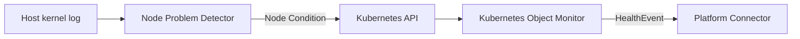

# Tutorial: Integrating Node Problem Detector

> **Note:** For a generic guide on this pattern, see [Integrating External Health Detectors](integrating-external-health-detectors.md).

In this tutorial, you install Kubernetes [node-problem-detector (NPD)](https://github.com/kubernetes/node-problem-detector). Then you configure NVSentinel to watch selected NPD node conditions. Finally, you validate the integration.

When you complete this tutorial, you have:

- NPD, which runs on each Linux node and monitors kernel messages.
- Kubernetes Object Monitor (KOM), which watches the opt-in `XfsShutdown`, `CperHardwareErrorFatal` and `ReadonlyFilesystem` NPD conditions.
- A safe procedure to validate NPD detection and KOM publication.
- A pattern to monitor more node conditions from a custom NPD configuration.

> **Who is this for?** Cluster administrators who run NVSentinel and want to use the permanent node conditions that NPD produces.

> **Do you want an AI agent to do it?** Go to [Appendix: One-shot AI prompt](#appendix-one-shot-ai-prompt).

> **Safety:** The opt-in NPD policies recommend `REPLACE_VM`. Validate them only in a non-production cluster, or with the downstream quarantine and remediation components disabled. Inject test messages only on a disposable node with no running jobs.

## Prerequisites

- Kubernetes 1.25 or later
- Helm 3 and `kubectl`.
- Cluster-admin access to install a privileged DaemonSet and patch Node status.
- Shell or SSH access to at least one disposable Linux node for end-to-end validation.

See the NVSentinel Helm chart guide (`distros/kubernetes/README.md` in the NVSentinel repository) for the complete NVSentinel prerequisites.

---

## 1. Understand the integration

NPD detects a host problem and publishes a permanent condition in `Node.status.conditions`. KOM watches the Node. When the condition type, status and reason match a configured policy, KOM publishes a fatal NVSentinel `HealthEvent`.



This integration watches these condition and reason pairs:

| Condition type | Problem reason | KOM policy | Action |
| --- | --- | --- | --- |
| `XfsShutdown` | `XfsHasShutdown` | `NPDXfsShutdown` | `REPLACE_VM` |
| `CperHardwareErrorFatal` | `CperHardwareErrorFatal` | `NPDCperHardwareErrorFatal` | `REPLACE_VM` |
| `ReadonlyFilesystem` | `FilesystemIsReadOnly` | `NPDReadonlyFilesystem` | `REPLACE_VM` |

These three policies are in a separate opt-in overlay. The overlay has them because the upstream NPD configuration enables their conditions by default, and NVSentinel has approved actions for these conditions. KOM can also watch other conditions. If a custom NPD configuration publishes another permanent node condition, add a KOM policy for it. The policy must match the type, status and reason of the condition. See [Configure a custom NPD Node Condition](#configure-a-custom-npd-node-condition).

---

## 2. Install NPD if not already present

These instructions deploy NPD as a Kubernetes DaemonSet. Some cloud providers already run NPD as a DaemonSet or a host service. If your provider runs NPD, use the documentation of the provider to install and upgrade it. Do not deploy a second copy. Multiple NPD instances can compete to own the same node conditions.

Check whether NPD runs as a Kubernetes workload:

```bash
kubectl get daemonsets,pods --all-namespaces | grep node-problem-detector
# Expected when NPD is installed:
# <namespace>   daemonset.apps/<daemonset-name>   <desired>   <current>   <ready>   ...
# <namespace>   pod/<pod-name>                    1/1         Running     ...
```

If NPD already runs in the cluster, do not install another instance. A configuration from a provider can differ from the upstream defaults. Confirm that the existing installation defines all three condition and reason pairs in the table above.

If NPD does not run in the cluster, follow the upstream [NPD installation guide](https://github.com/kubernetes/node-problem-detector#installation). Use the installation method that is correct for your cluster. NVSentinel does not install, configure or manage NPD.

Before you continue, confirm that the NPD installation:

- runs on every node that you want NVSentinel to monitor;
- loads the upstream `kernel-monitor.json` and `readonly-monitor.json` definitions.

For a DaemonSet installation, use the namespace and DaemonSet name from the check above, or the names from your installation. Then do these steps:

1. Get its pod selector.
2. Check that its desired and ready counts match.
3. List the nodes that run its pods.

```bash
NPD_NAMESPACE="<npd-namespace>"
NPD_DAEMONSET="<npd-daemonset-name>"

NPD_SELECTOR=$(kubectl get daemonset "$NPD_DAEMONSET" \
  --namespace "$NPD_NAMESPACE" \
  -o go-template='{{range $key, $value := .spec.selector.matchLabels}}{{printf "%s=%s," $key $value}}{{end}}')
NPD_SELECTOR=${NPD_SELECTOR%,}

kubectl get daemonset "$NPD_DAEMONSET" \
  --namespace "$NPD_NAMESPACE" \
  -o custom-columns=DESIRED:.status.desiredNumberScheduled,READY:.status.numberReady
# Expected:
# DESIRED   READY
# <eligible-node-count>   <same-count>

kubectl get pods --namespace "$NPD_NAMESPACE" \
  --selector "$NPD_SELECTOR" \
  -o 'custom-columns=NAME:.metadata.name,NODE:.spec.nodeName,READY:.status.containerStatuses[0].ready'
# Expected: one row per eligible node, with READY=true
# NAME                         NODE          READY
# node-problem-detector-<id>   <node-name>   true
```

---

## 3. Configure NVSentinel and KOM policies

The default KOM values intentionally do not include NPD policies, because NVSentinel does not install NPD or control how an operator handles its conditions. The repository supplies an explicit NPD remediation overlay, `distros/kubernetes/nvsentinel/values-npd-remediation.yaml`. Use it for clusters where you want NVSentinel to own these conditions.

Download or copy `values-npd-remediation.yaml`. Use it as the values file. The overlay enables KOM, keeps the default `ReplaceNotReadyNode` policy and adds the three supported NPD policies.

Helm replaces a list completely when a values file sets it. As a result, on an existing release, the overlay replaces the complete KOM policy list, including your custom policies. Before you install or upgrade, add each existing policy that you need to the `kubernetes-object-monitor.policies` list of the overlay. To show your values for the release, run `helm get values nvsentinel --namespace nvsentinel`.

### Configure a custom NPD Node Condition

NPD can publish more permanent node conditions from custom monitor configurations. When NPD publishes such a condition, add a matching policy to the existing `kubernetes-object-monitor.policies` list in your copy of `values-npd-remediation.yaml`.

For example, a custom NPD monitor publishes this condition:

```yaml
type: FileSystemErr
status: "True"
reason: FileSystemError
```

Add this policy to the existing list:

```yaml
- name: NPDFileSystemErr
  enabled: true
  resource:
    group: ""
    version: v1
    kind: Node
  predicate:
    expression: |
      resource.status.conditions.exists(c,
        c.type == "FileSystemErr" &&
        c.status == "True" &&
        c.reason == "FileSystemError")
  healthEvent:
    componentClass: Node
    isFatal: true
    message: "A NPD monitor reported the filesystem error"
    recommendedAction: CONTACT_SUPPORT
    errorCode:
      - NPD_FILESYSTEM_ERR
```

For custom condition policies:

- Use a stable, unique policy name. The name becomes the HealthEvent `checkName`.
- Match the exact condition type and reason that the custom NPD monitor sets.
- Assign a unique error code. Before you enable downstream remediation, validate the policy in a non-production cluster.
- Make NPD set the same condition to `False` only after a validated recovery.

For more CEL expression examples, see [KOM policy configuration](../configuration/kubernetes-object-monitor.md).

### Install or upgrade NVSentinel

Use one command for both installation and upgrade. For an existing release, `--reuse-values` keeps its current user-supplied values, and then Helm applies the NPD overlay. For a new release, Helm has no previous values to reuse. It installs from the chart defaults and the overlay.

```bash
NVSENTINEL_VERSION="<version>"

helm upgrade --install nvsentinel oci://ghcr.io/nvidia/nvsentinel \
  --version "$NVSENTINEL_VERSION" \
  --namespace nvsentinel \
  --create-namespace \
  --reuse-values \
  --values values-npd-remediation.yaml \
  --wait
```

Verify the KOM rollout:

```bash
kubectl rollout status deployment/kubernetes-object-monitor \
  --namespace nvsentinel \
  --timeout=5m
# Expected:
# deployment "kubernetes-object-monitor" successfully rolled out
```

---

## 4. Validate the integration

To validate NPD and KOM end to end, inject a synthetic kernel message. This message causes a synthetic fatal HealthEvent. Before you inject it, confirm one of these conditions:

- The cluster is a non-production cluster.
- The downstream quarantine, drain and remediation components are disabled.

The upstream NPD [Try It Out guide](https://github.com/kubernetes/node-problem-detector#try-it-out) shows how to inject synthetic messages into the kernel message stream to test rules. This injection does not damage the filesystem or the hardware, but it creates real NPD conditions. Run only one test at a time.

Select a disposable node:

```bash
NODE="<node-name>"
```

Connect to `$NODE` with SSH. Then inject one of these messages:

```bash
# XfsShutdown
sudo sh -c \
  "echo 'kernel: XFS (test): Shutting down filesystem' >> /dev/kmsg"

# CperHardwareErrorFatal
sudo sh -c \
  "echo 'kernel: mce: [Hardware Error]: event severity: fatal' >> /dev/kmsg"

# ReadonlyFilesystem
sudo sh -c \
  "echo 'kernel: EXT4-fs (test): Remounting filesystem read-only' >> /dev/kmsg"
```

From your workstation, examine the resulting source conditions:

```bash
kubectl get node "$NODE" \
  -o jsonpath='{range .status.conditions[*]}{.type}={.status}{" reason="}{.reason}{"\n"}{end}' |
  grep -E '^(XfsShutdown|CperHardwareErrorFatal|ReadonlyFilesystem)='
# Expected for the messages that were injected:
# XfsShutdown=True reason=XfsHasShutdown
# CperHardwareErrorFatal=True reason=CperHardwareErrorFatal
# ReadonlyFilesystem=True reason=FilesystemIsReadOnly
```

Confirm that KOM published each matched policy, and that platform-connector applied the resulting NVSentinel node condition:

```bash
kubectl get node "$NODE" \
  -o jsonpath='{range .status.conditions[*]}{.type}={.status}{" reason="}{.reason}{"\n"}{end}' |
  grep -E '^(NPDXfsShutdown|NPDCperHardwareErrorFatal|NPDReadonlyFilesystem)='
# Expected for the messages that were injected:
# NPDXfsShutdown=True reason=NPDXfsShutdownIsNotHealthy
# NPDCperHardwareErrorFatal=True reason=NPDCperHardwareErrorFatalIsNotHealthy
# NPDReadonlyFilesystem=True reason=NPDReadonlyFilesystemIsNotHealthy
```

> **Note:** If you enabled the downstream remediation components, NVSentinel also cordons the affected node for each matched fatal policy. These policies recommend `REPLACE_VM`, so fault-remediation creates a `TerminateNode` remediation custom resource for the node.

The permanent conditions of `SystemLogMonitor` stay latched. Injected messages stay eligible during the default five-minute lookback. After the final injection, wait at least five minutes before you restart NPD.

Do not restart the DaemonSet. A DaemonSet restart restarts NPD on every eligible node and resets all process-owned conditions. Delete only the NPD pod on the tested node. Then wait for its replacement. Reuse `NPD_NAMESPACE` and `NPD_SELECTOR` from step 2:

```bash
NPD_POD=$(kubectl get pods \
  --namespace "$NPD_NAMESPACE" \
  --selector "$NPD_SELECTOR" \
  --field-selector "spec.nodeName=$NODE" \
  -o jsonpath='{.items[0].metadata.name}')

kubectl delete pod "$NPD_POD" --namespace "$NPD_NAMESPACE"
# Expected:
# pod "<old-npd-pod>" deleted

kubectl wait --for=create pod \
  --namespace "$NPD_NAMESPACE" \
  --selector "$NPD_SELECTOR" \
  --field-selector "spec.nodeName=$NODE" \
  --timeout=2m
# Expected:
# pod/<new-npd-pod> created
```

After the restart, a `False` condition only shows that the NPD process reset its state. It does not prove recovery from a real failure. An NPD restart can also make KOM see a healthy transition, which can cancel an active break-fix workflow. For this reason, use this procedure only on the test node, after validation.

---

## Troubleshooting

### NPD does not publish the source condition

- Confirm that the NPD pod mounts `/dev/kmsg`.
- Confirm that the process loads `kernel-monitor.json` and `readonly-monitor.json`.
- Confirm that the injected message contains the `kernel: ` prefix and exactly matches the expected capitalization.

```bash
kubectl logs "daemonset/$NPD_DAEMONSET" --namespace "$NPD_NAMESPACE"
# Expected when healthy: NPD starts without monitor configuration or
# /dev/kmsg access errors.
```

### KOM does not publish a HealthEvent

- Confirm that your Helm values set `global.kubernetesObjectMonitor.enabled: true`.
- Confirm that the relevant policy has `enabled: true`.
- Compare the type, status and reason of the node condition with the CEL predicate.

```bash
kubectl logs deployment/kubernetes-object-monitor --namespace nvsentinel
# Expected when healthy: "Loaded policy configuration",
# "Registered controller", and "Starting manager" entries.
```

### A source condition remains `True`

This behavior is normal for the permanent conditions that `SystemLogMonitor` produces. Do these steps in this order:

1. Validate the remediation.
2. Let the lookback window of the monitor expire.
3. Restart NPD.

Never use an NPD restart alone as proof that the host recovered.

---

## Appendix: One-shot AI prompt

Paste this prompt into an AI coding agent that has access to your NVSentinel checkout. Before you run it, replace the bracketed values.

```text
Help me integrate Kubernetes node-problem-detector (NPD) with NVSentinel in this cluster:

- Kubernetes context: [context]
- Existing NPD installation: [provider-managed, DaemonSet, or not installed]
- NPD namespace: [namespace, if known]
- NPD DaemonSet: [name, if known]
- NVSentinel version: [version]
- Validation node: [node]
- Downstream remediation enabled: [yes or no]

Follow these requirements:

1. Inspect before changing anything.
   - Check whether NPD already runs as a DaemonSet.
   - If the provider manages NPD as a DaemonSet or host service, do not install
     another copy. Tell me to use the provider's install and upgrade procedure.
   - If NPD is absent, install it by following the upstream installation guide:
     https://github.com/kubernetes/node-problem-detector#installation
   - For a DaemonSet, use its actual namespace, name, and
     .spec.selector.matchLabels. Confirm desired and ready counts match and
     that one ready pod runs on every eligible node.

2. Verify the healthy NPD baseline before fault injection:
   - XfsShutdown=False, reason XfsHasNotShutDown
   - CperHardwareErrorFatal=False, reason CperHardwareHasNoFatalError
   - ReadonlyFilesystem=False, reason FilesystemIsNotReadOnly
   Confirm that the NPD installation loads upstream kernel-monitor.json and
   readonly-monitor.json definitions and can read the host kernel log. Verify
   the corresponding True status and problem reason only after injecting its
   synthetic matching message in step 5.

3. Configure NVSentinel.
   - Start from
     distros/kubernetes/nvsentinel/values-npd-remediation.yaml.
   - Preserve every existing KOM policy that the cluster needs. Helm replaces
     the complete policies list, so merge existing custom policies into this
     file before installation or upgrade.
   - Use one `helm upgrade --install` command with --reuse-values and the NPD
     values file.
   - Wait for deployment/kubernetes-object-monitor to roll out.

4. Optionally add a custom NPD Node Condition policy when I provide a condition
   type, problem reason, policy name, fatality, action, message, and error code.
   The CEL predicate must match the exact condition type, status "True", and
   reason. Add it to the existing policies list rather than creating a second
   list.

5. Validate end to end only after confirming the node is disposable and either
   the cluster is non-production or downstream remediation is disabled.
   - Follow the upstream NPD synthetic-kernel-message testing method.
   - Inject only one matching /dev/kmsg message at a time on the selected node.
   - Confirm the matching problem condition:
     XfsShutdown=True with reason XfsHasShutdown,
     CperHardwareErrorFatal=True with reason CperHardwareErrorFatal, or
     ReadonlyFilesystem=True with reason FilesystemIsReadOnly.
   - Confirm the matching NVSentinel Node Condition is True:
     NPDXfsShutdown, NPDCperHardwareErrorFatal, or NPDReadonlyFilesystem.
   - If remediation is intentionally enabled, also confirm that the node is
     cordoned and a TerminateNode resource is created for REPLACE_VM.

6. Clean up safely.
   - Wait for NPD's five-minute startup lookback to expire.
   - Never restart the entire NPD DaemonSet.
   - Select only the NPD pod scheduled on the validation node, delete it, and
     wait for its replacement.
   - Explain that restarting NPD resets process-owned permanent conditions and
     does not prove that a real fault recovered.

Show each command before executing it. Do not run Helm, kubectl mutation, SSH,
or kernel-message injection commands until I confirm the Kubernetes context,
target node, and remediation safety.
```
