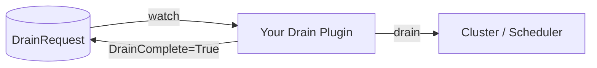

# Tutorial: Writing a Drain Plugin

This tutorial shows how to build a **drain plugin** with [Kubebuilder](https://book.kubebuilder.io). It starts at `kubebuilder init` and ends with a deployed controller that drains a node for NVSentinel.

When you complete this tutorial, you have:

- A Kubebuilder project whose controller reconciles **`DrainRequest`** custom resources and drains a node.
- A **custom drain policy** that the built-in eviction modes do not have. The plugin **drains only on allowed weekdays**, and on other days it defers (requeues) the drain. This policy shows how a plugin can gate a drain, and not only delete pods.
- A container image for the plugin, which you build and deploy with the generated `make` targets.
- A verification of **both paths** (a deferred drain and a completed drain) with a change to one environment variable.

> **Who is this for?** Teams that **already run NVSentinel** and need a custom plugin to do the NVSentinel drain step, instead of a direct eviction of pods. Examples are plugins for Slurm, NVCF, a custom workload manager and other systems.

> **Do you want an AI agent to do it?** Go to [Appendix: One-shot AI prompt](#appendix-one-shot-ai-prompt).

---

## Prerequisites

- **`go`** 1.24+ — builds the controller.
- **`kubebuilder`** 4.x — scaffolds the project. Its generated `Makefile` downloads `controller-gen` and `kustomize`, so you do not install these tools separately.
- **`docker`** — builds and pushes the container image (`make docker-build docker-push`).
- **`kubectl`** with access to any Kubernetes cluster — deploys and verifies the plugin (`make deploy`).

If you do not have Kubebuilder, install it:

```bash
# https://book.kubebuilder.io/quick-start#installation
curl -L -o kubebuilder "https://go.kubebuilder.io/dl/latest/$(go env GOOS)/$(go env GOARCH)"
chmod +x kubebuilder && sudo mv kubebuilder /usr/local/bin/
```

---

## 1. What is a drain plugin

NVSentinel remediates a faulty node in stages: **detect → quarantine (cordon) → drain → remediate**. **node-drainer** owns the **drain** stage. By default, node-drainer evicts pods itself with one of its built-in eviction modes: `Immediate`, `AllowCompletion` or `DeleteAfterTimeout`.

The built-in eviction modes are not always enough. Some clusters need custom policies to coordinate the drain. A **drain plugin** lets you replace the eviction step of node-drainer with your own logic.

When you enable **custom drain**, node-drainer does not evict pods. Instead, node-drainer does these steps:

1. It renders a Go template that you supply (a **drain-template** ConfigMap) into a **`DrainRequest`** custom resource. It creates **one `DrainRequest` for each health event**.
2. It **polls** the status of that `DrainRequest`, and waits for a configured condition (`DrainComplete=True`).
3. After your plugin sets the condition, node-drainer marks the drain as complete and **deletes** the `DrainRequest`.

Your plugin is a standard **Kubernetes controller** that reconciles `DrainRequest` objects. It does the drain that your environment needs. Then it sets `status.conditions[DrainComplete]=True`.



You supply **two items** and change **one setting**:

| You supply | What it is |
|----------|------------|
| A **controller** | Reconciles `DrainRequest` objects, drains the node and sets `DrainComplete=True`. |
| A **drain-template ConfigMap** | Tells node-drainer how to render a `DrainRequest` from a health event. |
| **node-drainer Helm values** | `customDrain.enabled=true`. |

---

## 2. The contract — the `DrainRequest` CRD

The CRD is `DrainRequest` in the group and version **`nvsentinel.nvidia.com/v1alpha1`**. It is **namespaced**, and node-drainer creates the `DrainRequest` objects in the namespace that `customDrain.namespace` sets (`nvsentinel` in this tutorial). You define this CRD yourself. This section describes its `spec` and `status` fields.

**`spec`**: node-drainer uses your template to fill this field from the `HealthEvent` that started the drain. A plugin needs to define only the fields that it uses. The spec in this tutorial has only **two fields**:

| Field | Type | Notes |
|-------|------|-------|
| `nodeName` | string | The node to drain. Useful for logs and status. The plugin in this tutorial puts it in the completion message. |
| `podsToDrain` | map<string,[]string> | Maps each namespace to the names of the pods that node-drainer found evictable for this health event. Your plugin drains exactly these pods. If the map is empty, the plugin has nothing to do. |

> node-drainer can supply more optional context. If your drain logic needs it, add these fields: `checkName`, `recommendedAction`, `errorCode`, `healthEventID`, `entitiesImpacted`, `metadata` and `reason`. Kubernetes prunes the fields that your CRD does not declare. Your CRD needs none of these fields, because node-drainer does not use `spec` for the name or the namespace of the CR. The name comes from the health event (`drain-{NODE}-{EVENTID}`), and the namespace comes from the `customDrain.namespace` Helm value.

**`status`**: the field that *your plugin* writes:

```go
type DrainRequestStatus struct {
    Conditions []metav1.Condition `json:"conditions,omitempty"`
}
```

### The completion contract

node-drainer waits for a `status.conditions[]` entry whose **Type** and **Status** match its configuration. This tutorial uses the usual convention:

```
Type: DrainComplete   Status: True
```

When the drain of the node is complete, your reconcile must set that condition. This is the **one thing that your reconcile must guarantee**. You decide all other behavior.

### The golden rules

1. **Make Reconcile idempotent.** controller-runtime can call it many times for the same `DrainRequest`. If the `DrainRequest` already has `DrainComplete=True`, make Reconcile a no-op.
2. **Set `DrainComplete=True` only when the drain is complete.** Until then, requeue and check again.
3. **One `DrainRequest` for each health event.** node-drainer deletes it after completion.

---

## 3. Scaffold the project with Kubebuilder

Create an empty directory. Then initialize a Kubebuilder project in it. The `--domain` value becomes the suffix of the CRD group. The `--repo` value is your Go module path. Neither value needs to be inside the NVSentinel repository.

```bash
mkdir demo-drainer && cd demo-drainer
kubebuilder init --domain nvidia.com --repo github.com/example/demo-drainer
```

Scaffold the API **and** its controller. The `--group nvsentinel` flag with the `nvidia.com` domain gives the contract group `nvsentinel.nvidia.com`:

```bash
kubebuilder create api \
  --group nvsentinel --version v1alpha1 --kind DrainRequest \
  --resource --controller
```

This command generates the standard Kubebuilder layout:

```text
demo-drainer/
├── PROJECT                                  # Kubebuilder project metadata
├── Makefile                                 # generate/manifests/docker-build/deploy targets
├── Dockerfile                               # multi-stage, distroless, non-root
├── cmd/main.go                              # manager entrypoint (DrainRequest already registered)
├── api/v1alpha1/
│   ├── drainrequest_types.go                # ← you edit: spec/status fields
│   ├── groupversion_info.go                 # GroupVersion = nvsentinel.nvidia.com/v1alpha1
│   └── zz_generated.deepcopy.go             # generated by `make generate`
├── internal/controller/
│   └── drainrequest_controller.go           # ← you edit: reconcile logic + RBAC markers
└── config/                                  # kustomize: CRD, RBAC, manager Deployment, samples
```

You edit only three files: `drainrequest_types.go`, `drainrequest_controller.go` and `cmd/main.go`. Kubebuilder and the `Makefile` generate all other files.

---

## 4. Define the API types

Open `api/v1alpha1/drainrequest_types.go`. Replace the scaffolded `DrainRequestSpec` and `DrainRequestStatus` with the contract fields. Keep the generated `DrainRequest`, `DrainRequestList` and `SchemeBuilder.Register(...)` as Kubebuilder wrote them.

```go
// DrainRequestSpec is filled in by node-drainer from the triggering HealthEvent.
// We keep it minimal: the node being drained plus the pods to evict.
type DrainRequestSpec struct {
	// NodeName is the node being drained (context for logging/status).
	NodeName string `json:"nodeName,omitempty"`
	// PodsToDrain maps namespace -> pod names that node-drainer determined are
	// evictable for this event. Empty means "nothing to do".
	PodsToDrain map[string][]string `json:"podsToDrain,omitempty"`
}

// DrainRequestStatus is written by your plugin. node-drainer polls Conditions.
type DrainRequestStatus struct {
	Conditions []metav1.Condition `json:"conditions,omitempty"`
}
```

Make sure that the `DrainRequest` type keeps the status subresource marker that Kubebuilder added:

```go
// +kubebuilder:object:root=true
// +kubebuilder:subresource:status
type DrainRequest struct {
	metav1.TypeMeta   `json:",inline"`
	metav1.ObjectMeta `json:"metadata,omitempty"`

	Spec   DrainRequestSpec   `json:"spec,omitempty"`
	Status DrainRequestStatus `json:"status,omitempty"`
}
```

Regenerate the deepcopy methods and the CRD manifest from these markers:

```bash
make generate   # api/v1alpha1/zz_generated.deepcopy.go
make manifests  # config/crd/bases/nvsentinel.nvidia.com_drainrequests.yaml
```

> If you use the standard `DrainRequest` kind, the drain template in section 7c renders directly into the object. If you need a different schema, change these types and your template together. node-drainer does not depend on the schema. It uses only the GVK and the completion condition.

---

## 5. Implement the controller

In `internal/controller/drainrequest_controller.go`, make these changes:

- Replace the generated `Reconcile` body and `SetupWithManager`.
- Add two small helpers.
- Update the RBAC markers.

The example in this tutorial does something that the built-in eviction modes do not do: it **drains only on allowed weekdays**.

- On an allowed day, it evicts exactly the pods that node-drainer listed in `spec.podsToDrain`.
- On all other days, it records *why* on the CR and **requeues until the next allowed day**. It does not touch any pod.

The key pattern for a gated drain is to return `ctrl.Result{RequeueAfter: …}` instead of a completion. The allowed days come from a `DRAIN_DAYS` environment variable (default `Mon,Tue,Wed,Thu,Fri`). This variable also makes both paths easy to verify.

```go
package controller

import (
	"context"
	"fmt"
	"strings"
	"time"

	corev1 "k8s.io/api/core/v1"
	apierrors "k8s.io/apimachinery/pkg/api/errors"
	"k8s.io/apimachinery/pkg/api/meta"
	metav1 "k8s.io/apimachinery/pkg/apis/meta/v1"
	"k8s.io/apimachinery/pkg/runtime"
	ctrl "sigs.k8s.io/controller-runtime"
	"sigs.k8s.io/controller-runtime/pkg/client"
	logf "sigs.k8s.io/controller-runtime/pkg/log"

	nvsentinelv1alpha1 "github.com/example/demo-drainer/api/v1alpha1"
)

// node-drainer polls for this exact condition; it MUST match the
// statusConditionType/Status configured in node-drainer's customDrain block.
const drainCompleteConditionType = "DrainComplete"

// drainDeferredConditionType is set while the weekday gate is holding the drain back.
const drainDeferredConditionType = "DrainDeferred"

// DrainRequestReconciler reconciles a DrainRequest object. It only drains on the
// weekdays in DrainDays (evaluated in UTC); on any other day it defers.
type DrainRequestReconciler struct {
	client.Client
	Scheme    *runtime.Scheme
	DrainDays map[time.Weekday]bool
}

// +kubebuilder:rbac:groups=nvsentinel.nvidia.com,resources=drainrequests,verbs=get;list;watch;update;patch
// +kubebuilder:rbac:groups=nvsentinel.nvidia.com,resources=drainrequests/status,verbs=get;update;patch
// +kubebuilder:rbac:groups="",resources=pods,verbs=get;delete

func (r *DrainRequestReconciler) Reconcile(ctx context.Context, req ctrl.Request) (ctrl.Result, error) {
	log := logf.FromContext(ctx)

	dr := &nvsentinelv1alpha1.DrainRequest{}
	if err := r.Get(ctx, req.NamespacedName, dr); err != nil {
		return ctrl.Result{}, client.IgnoreNotFound(err)
	}

	// Idempotent: once we've reported completion there is nothing left to do.
	if meta.IsStatusConditionTrue(dr.Status.Conditions, drainCompleteConditionType) {
		return ctrl.Result{}, nil
	}

	// --- The gate. This is what makes the plugin different: only drain on an
	// allowed weekday. On any other day, record why and requeue until the next
	// allowed day instead of touching any pods. ---
	now := time.Now().UTC()
	if !r.DrainDays[now.Weekday()] {
		wait := durationUntilNextAllowedDay(now, r.DrainDays)
		log.Info("drain deferred: outside drain window",
			"today", now.Weekday(), "requeueAfter", wait)

		meta.SetStatusCondition(&dr.Status.Conditions, metav1.Condition{
			Type:    drainDeferredConditionType,
			Status:  metav1.ConditionTrue,
			Reason:  "OutsideDrainWindow",
			Message: fmt.Sprintf("%s is not an allowed drain day; deferring", now.Weekday()),
		})
		if err := r.Status().Update(ctx, dr); err != nil {
			return ctrl.Result{RequeueAfter: 5 * time.Second},
				fmt.Errorf("update deferred status for %s/%s: %w", dr.Namespace, dr.Name, err)
		}

		return ctrl.Result{RequeueAfter: wait}, nil
	}

	// --- Allowed day: evict exactly the pods node-drainer listed for us.
	// spec.podsToDrain maps each namespace to the pod names to evict; it is
	// already filtered by the drain policy (namespace scope, partial-drain
	// entity impact, evictability), so we just act on it.
	//
	// Delete only *starts* termination, so we must NOT report completion here.
	// We issue the delete once per pod (idempotent) and requeue, reporting
	// completion only once every listed pod has actually disappeared. ---
	total, remaining := 0, 0
	for ns, names := range dr.Spec.PodsToDrain {
		for _, name := range names {
			total++

			pod := &corev1.Pod{}
			switch err := r.Get(ctx, client.ObjectKey{Namespace: ns, Name: name}, pod); {
			case apierrors.IsNotFound(err):
				continue // already gone — this pod is drained
			case err != nil:
				return ctrl.Result{RequeueAfter: 10 * time.Second},
					fmt.Errorf("get pod %s/%s: %w", ns, name, err)
			}

			// Still present: issue the delete once (idempotent), then wait.
			if pod.DeletionTimestamp.IsZero() {
				if err := r.Delete(ctx, pod); err != nil && !apierrors.IsNotFound(err) {
					return ctrl.Result{RequeueAfter: 10 * time.Second},
						fmt.Errorf("delete pod %s/%s: %w", ns, name, err)
				}
			}
			remaining++
		}
	}

	if remaining > 0 {
		// Pods are still terminating: do NOT mark complete yet. Requeue and
		// re-check until the node is actually drained.
		log.Info("waiting for pods to terminate",
			"node", dr.Spec.NodeName, "remaining", remaining, "total", total)

		return ctrl.Result{RequeueAfter: 10 * time.Second}, nil
	}

	log.Info("node drained", "node", dr.Spec.NodeName, "pods", total, "day", now.Weekday())

	// --- All listed pods are gone: NOW report completion. This is the contract
	// node-drainer waits on. ---
	meta.SetStatusCondition(&dr.Status.Conditions, metav1.Condition{
		Type:    drainDeferredConditionType,
		Status:  metav1.ConditionFalse,
		Reason:  "DrainWindowOpen",
		Message: fmt.Sprintf("drained on %s", now.Weekday()),
	})
	meta.SetStatusCondition(&dr.Status.Conditions, metav1.Condition{
		Type:    drainCompleteConditionType,
		Status:  metav1.ConditionTrue,
		Reason:  "DrainComplete",
		Message: fmt.Sprintf("Drained %d pod(s) from %s", total, dr.Spec.NodeName),
	})
	if err := r.Status().Update(ctx, dr); err != nil {
		return ctrl.Result{RequeueAfter: 5 * time.Second},
			fmt.Errorf("update status for %s/%s: %w", dr.Namespace, dr.Name, err)
	}

	return ctrl.Result{}, nil
}

// durationUntilNextAllowedDay returns how long to wait until 00:00 UTC of the
// next day present in allowed, looking up to 7 days ahead.
func durationUntilNextAllowedDay(now time.Time, allowed map[time.Weekday]bool) time.Duration {
	for i := 1; i <= 7; i++ {
		day := now.AddDate(0, 0, i)
		if allowed[day.Weekday()] {
			midnight := time.Date(day.Year(), day.Month(), day.Day(), 0, 0, 0, 0, time.UTC)
			return midnight.Sub(now)
		}
	}
	// No day is allowed at all; re-check in a day rather than never.
	return 24 * time.Hour
}

// ParseDrainDays turns "Mon,Tue,Wed,Thu,Fri" into a weekday set. main.go calls
// this with the DRAIN_DAYS env var so the policy is configurable at runtime.
func ParseDrainDays(csv string) (map[time.Weekday]bool, error) {
	names := map[string]time.Weekday{
		"sun": time.Sunday, "mon": time.Monday, "tue": time.Tuesday, "wed": time.Wednesday,
		"thu": time.Thursday, "fri": time.Friday, "sat": time.Saturday,
	}

	out := map[time.Weekday]bool{}

	for _, part := range strings.Split(csv, ",") {
		key := strings.ToLower(strings.TrimSpace(part))
		if key == "" {
			continue
		}

		day, ok := names[key]
		if !ok {
			return nil, fmt.Errorf("invalid weekday %q", part)
		}

		out[day] = true
	}

	if len(out) == 0 {
		return nil, fmt.Errorf("no valid weekdays in %q", csv)
	}

	return out, nil
}

func (r *DrainRequestReconciler) SetupWithManager(mgr ctrl.Manager) error {
	return ctrl.NewControllerManagedBy(mgr).
		For(&nvsentinelv1alpha1.DrainRequest{}).
		Complete(r)
}
```

Because of the `pods` RBAC marker, you must regenerate the ClusterRole:

```bash
make manifests  # updates config/rbac/role.yaml with pods:delete
```

Then, in `cmd/main.go`, pass the `DRAIN_DAYS` environment variable to the reconciler. Kubebuilder generated a `DrainRequestReconciler{Client, Scheme}` literal. Add the `DrainDays` field and a small helper that reads the environment variable:

```go
// where the reconciler is constructed
drainDays, err := controller.ParseDrainDays(getEnvDefault("DRAIN_DAYS", "Mon,Tue,Wed,Thu,Fri"))
if err != nil {
	setupLog.Error(err, "invalid DRAIN_DAYS")
	os.Exit(1)
}

if err := (&controller.DrainRequestReconciler{
	Client:    mgr.GetClient(),
	Scheme:    mgr.GetScheme(),
	DrainDays: drainDays,
}).SetupWithManager(mgr); err != nil {
	setupLog.Error(err, "unable to create controller", "controller", "DrainRequest")
	os.Exit(1)
}

// ... elsewhere in the file (package main) ...
func getEnvDefault(key, def string) string {
	if v := os.Getenv(key); v != "" {
		return v
	}
	return def
}
```

Build the project to make sure that all code compiles:

```bash
go build ./...
```

This code is a complete drain plugin that obeys the contract. The remaining sections package the plugin, deploy it and connect it to NVSentinel.

---

## 6. Build and push the image

Kubebuilder already generated a multi-stage, distroless `Dockerfile`. Set `IMG` to a registry that your cluster can pull from. This example uses Docker Hub, so replace `{dockerhub-user}`. Then build and push the image with the `Makefile` targets:

```bash
docker login   # once, to authenticate

export IMG=docker.io/{dockerhub-user}/demo-drainer:dev
make docker-build docker-push IMG=$IMG
```

> Use a **public** repository, so that the cluster can pull the image without credentials. For a private repository, add an `imagePullSecret` to the manager in `config/`.

---

## 7. Deploy and verify

Use the generated kustomize harness to install the CRD, the RBAC rules and the controller. Then verify the plugin in two ways:

- **[§7b](#7b-verify-the-plugin-independently)** gives the plugin a `DrainRequest` that you create by hand. This test is fast and needs no other NVSentinel components.
- **[§7c](#7c-verify-the-full-remediation-flow-end-to-end)** connects the plugin to NVSentinel and runs the real end-to-end flow. You inject a real GPU fault. Then you watch NVSentinel cordon the node and create the `DrainRequest`, and you watch your plugin drain the workload.

### 7a. Deploy with `make`

`make install` applies the CRD. `make deploy` applies the RBAC rules and the manager Deployment. The kustomize configuration puts the manager in the `demo-drainer-system` namespace and grants it a cluster-wide ClusterRole. As a result, the manager reconciles `DrainRequest` objects in any namespace:

```bash
make install                 # CRD only
make deploy IMG=$IMG         # RBAC + manager Deployment

kubectl rollout status deploy/demo-drainer-controller-manager -n demo-drainer-system
```

### 7b. Verify the plugin independently

Create a workload. Then give the plugin a `DrainRequest` that you create **by hand**. This section verifies **both** paths of the weekday gate:

- On a day that the policy does not allow, the plugin defers the drain.
- On an allowed day, the plugin completes the drain.

To select a path, change the `DRAIN_DAYS` environment variable. Each change restarts the manager, and the manager then reconciles the request again.

```bash
# Create a workload and let the scheduler place it on some node.
kubectl create namespace workload
kubectl create deployment victim --image=nginx --replicas=1 -n workload
kubectl rollout status deploy/victim -n workload

# Collect the pods on the node they landed on — the set node-drainer would put
# in spec.podsToDrain in production.
NODE=$(kubectl get pods -n workload -l app=victim -o jsonpath='{.items[0].spec.nodeName}')
PODS=$(kubectl get pods -n workload -l app=victim \
  --field-selector spec.nodeName=$NODE -o jsonpath='{.items[*].metadata.name}')

# Two weekday abbreviations: today, and one that is guaranteed NOT today.
TODAY=$(date -u +%a)
NOT_TODAY=$([ "$TODAY" = "Sun" ] && echo Mon || echo Sun)

MGR="deploy/demo-drainer-controller-manager -n demo-drainer-system"
```

**Path 1 — deferred (disallowed day).** Set the policy to a day that is not today. Then submit the request:

```bash
kubectl set env $MGR DRAIN_DAYS=$NOT_TODAY
kubectl rollout status deploy/demo-drainer-controller-manager -n demo-drainer-system

kubectl apply -f - <<YAML
apiVersion: nvsentinel.nvidia.com/v1alpha1
kind: DrainRequest
metadata:
  name: manual-drain-test
  namespace: default
spec:
  nodeName: $NODE
  podsToDrain:
    workload:
$(for p in $PODS; do echo "    - $p"; done)
YAML

# The plugin defers instead of draining: DrainDeferred=True, DrainComplete unset.
kubectl get drainrequest manual-drain-test -n default \
  -o jsonpath='{range .status.conditions[*]}{.type}{"  "}{.status}{"  "}{.reason}{"  "}{.message}{"\n"}{end}'

# The pods are untouched.
kubectl get pods -n workload -o wide
```

Expected (the message names *today*, which is not in the allowed set):

```text
DrainDeferred  True  OutsideDrainWindow  {today} is not an allowed drain day; deferring
```

**Path 2 — completed (allowed day).** Set the policy to allow today. When the manager restarts, it reconciles the existing request again immediately:

```bash
kubectl set env $MGR DRAIN_DAYS=$TODAY
kubectl rollout status deploy/demo-drainer-controller-manager -n demo-drainer-system

# The plugin deletes the pods and requeues until they are actually gone, then
# reports completion. Wait for the condition rather than reading it immediately.
kubectl wait --for=condition=DrainComplete drainrequest/manual-drain-test -n default --timeout=90s

kubectl get drainrequest manual-drain-test -n default \
  -o jsonpath='{range .status.conditions[?(@.type=="DrainComplete")]}{.type}{"  "}{.status}{"  "}{.reason}{"  "}{.message}{"\n"}{end}'

# The pods we listed are gone. (The Deployment schedules replacements with new
# names — in production the node is already cordoned by fault-quarantine, so
# replacements don't land back on it.)
kubectl get pods -n workload -o wide
```

Expected:

```text
DrainComplete  True  DrainComplete  Drained 1 pod(s) from {your-node}
```

> In production, node-drainer creates the `DrainRequest` in `nvsentinel`. Because of the cluster-wide ClusterRole, the same controller handles it there too.

### 7c. Verify the full remediation flow (end-to-end)

This section connects the plugin to NVSentinel and runs the real path: **detect → quarantine (cordon) → drain → complete**. You can see the progress in the state label of the node, which moves through `quarantined → draining → drain-succeeded`.

#### Step 1 — Configure the cluster to use your plugin

node-drainer creates `DrainRequest` objects only when you enable **custom drain** and configure it for your CR. Two configuration items do this. Both items must be part of your NVSentinel deployment:

**a. A drain-template ConfigMap**: node-drainer renders this Go template into a `DrainRequest`. The minimal CRD in this tutorial defines `nodeName` and `podsToDrain`, so the template renders only these fields. `.PodsToDrain` is exactly the set of pods that the controller acts on:

```yaml
apiVersion: v1
kind: ConfigMap
metadata:
  name: demo-drain-template
  namespace: nvsentinel
data:
  drain-template.yaml: |
    apiVersion: nvsentinel.nvidia.com/v1alpha1
    kind: DrainRequest
    spec:
      nodeName: {{ .HealthEvent.NodeName }}
      podsToDrain:
      {{- range $namespace, $pods := .PodsToDrain }}
        {{ $namespace }}:
        {{- range $pods }}
        - {{ . }}
        {{- end }}
      {{- end }}
```

**b. node-drainer Helm values** for your CR. When custom drain applies to the whole cluster, keep `userNamespaces` and `podDrainPolicies` empty. If you set either one, node-drainer does not start. The condition fields must match the condition that your controller sets.

To give only part of the cluster to the plugin, set `customDrain.nodeSelector`. Also keep `userNamespaces` or `podDrainPolicies` configured for the other nodes. See [Scoping custom drain to part of the cluster](../configuration/node-drainer.md#scoping-custom-drain-to-part-of-the-cluster):

```yaml
node-drainer:
  userNamespaces: []            # must be empty when customDrain owns the whole cluster;
                                # with customDrain.nodeSelector set, keep it configured for
                                # the unmatched nodes instead
  customDrain:
    enabled: true
    templateConfigMapName: "demo-drain-template"
    templateMountPath: "/etc/drain-template"
    templateFileName: "drain-template.yaml"
    namespace: "nvsentinel"
    apiGroup: "nvsentinel.nvidia.com"
    version: "v1alpha1"
    kind: "DrainRequest"
    resource: "drainrequests"     # must equal the CRD's spec.names.plural
    statusConditionType: "DrainComplete"
    statusConditionStatus: "True"
```

When you apply these two items, node-drainer does these steps for each node that it decides to drain:

1. It renders the template into a `DrainRequest`.
2. It polls the status of the `DrainRequest`.
3. When your controller sets `DrainComplete=True`, node-drainer marks the node as drained and deletes the CR.

**c. Allow today in the plugin.** The weekday gate must be open. If the gate is closed, the plugin defers the drain, and node-drainer times out while it waits:

```bash
kubectl set env deploy/demo-drainer-controller-manager -n demo-drainer-system DRAIN_DAYS=$(date -u +%a)
kubectl rollout status deploy/demo-drainer-controller-manager -n demo-drainer-system
```

> **Deploy NVSentinel with this configuration.** The rest of this section needs a full NVSentinel install. `platform-connectors`, `fault-quarantine`, `node-drainer` (with the `customDrain` values above) and `gpu-health-monitor` must all run. Your plugin from [§7a](#7a-deploy-with-make) must also run.

#### Step 2 — Run a workload on the node you will fault

Select the GPU node for the fault injection. Then pin the workload to that node, so that the drain acts on the workload pods. In `podsToDrain`, node-drainer puts the evictable pods on the node from **non-system** namespaces:

```bash
# The node you'll inject the error into (replace with your target GPU node).
NODE={your-gpu-node}

kubectl create namespace workload
kubectl create deployment victim --image=nginx --replicas=2 -n workload

# Pin the pods to $NODE so the drain acts on this exact node.
kubectl patch deployment victim -n workload --type merge \
  -p "{\"spec\":{\"template\":{\"spec\":{\"nodeName\":\"$NODE\"}}}}"
kubectl rollout status deploy/victim -n workload
```

#### Step 3 — Inject an XID error

Use DCGM to inject a fatal XID (95, an uncontained ECC error) into a GPU on `$NODE`. `gpu-health-monitor` watches the same DCGM instance and changes the XID into a fatal GPU health event:

```bash
dcgmi test --host nvidia-dcgm.gpu-operator.svc:5555 --inject --gpuid 1 -f 230 -v 95
```

- `-f 230` is `DCGM_FI_DEV_XID_ERRORS`. `-v 95` injects **XID 95**. `--gpuid 1` selects the GPU.
- Run the command against the DCGM instance on `$NODE`. For example, use `kubectl exec` to run it in the `nvidia-dcgm` pod on that node.

#### Step 4 — Verify: cordon → DrainRequest → workload drained

Watch the node move through the stages:

```bash
watch -n2 "kubectl get node $NODE -o custom-columns=\
NAME:.metadata.name,\
CORDONED:.spec.unschedulable,\
STATE:.metadata.labels.dgxc\.nvidia\.com/nvsentinel-state"
```

Expected `STATE` progression: `(none)` → `quarantined` (fault-quarantine cordoned it) → `draining` (node-drainer started) → `drain-succeeded`.

node-drainer creates the CR (`drain-{NODE}-{EVENTID}` in `nvsentinel`), and your plugin acts on it. The CR exists only for a short time. When your plugin sets `DrainComplete=True`, node-drainer **deletes it**. Run these commands quickly, or read the logs of the plugin:

```bash
# The CR node-drainer rendered from your template, with spec.podsToDrain filled in.
kubectl get drainrequests -n nvsentinel
kubectl get drainrequest -n nvsentinel -o yaml | grep -A20 'spec:'

# Your plugin doing the eviction.
kubectl logs -l control-plane=controller-manager -n demo-drainer-system --tail=20
```

Finally, confirm that your plugin drained the workload:

- The node reaches `drain-succeeded`.
- The victim pods are gone. The Deployment schedules replacement pods, but the node stays cordoned, so the replacement pods do not run on it.

```bash
kubectl get node "$NODE" -o jsonpath='{.metadata.labels.dgxc\.nvidia\.com/nvsentinel-state}{"\n"}'
kubectl get pods -n workload -o wide
```

When you finish the test, uncordon the node:

```bash
kubectl uncordon "$NODE"
```

> To remove the plugin, run `make undeploy && make uninstall`. To remove the workload, run `kubectl delete ns workload`.

---

## Appendix: One-shot AI prompt

Paste this prompt into an AI coding agent. The prompt is **self-contained**. The plugin is a standalone Kubebuilder project that you can create in **any repository**. It does not need to be inside the NVSentinel repository. Replace the bracketed parts.

```text
Create a new NVSentinel drain plugin named "[my-drainer]" that drains a node ONLY on allowed
weekdays (a time-gated drain policy): when today is an allowed day it evicts the pods in
spec.podsToDrain; on any other day it defers by requeuing until the next allowed day without
touching any pods. The allowed days come from a DRAIN_DAYS env var (default "Mon,Tue,Wed,Thu,Fri").
Scaffold it with Kubebuilder (go.kubebuilder.io/v4) as a standalone project that can live in any
repo; follow this spec exactly. (The gate and the drain action are swappable — e.g. gate on a
maintenance window/SLO, or drain via the Eviction API or a scheduler call instead of deleting pods.)

A drain plugin reconciles DrainRequest custom resources (group/version
nvsentinel.nvidia.com/v1alpha1, namespaced). In production node-drainer creates one DrainRequest
per health event (name drain-{node}-{eventID} in namespace nvsentinel), polls its status, and
considers the drain done when the controller sets status.conditions[] Type="DrainComplete"
Status="True".

- Scaffold with: `kubebuilder init --domain nvidia.com --repo github.com/{your-org}/[my-drainer]`
  then `kubebuilder create api --group nvsentinel --version v1alpha1 --kind DrainRequest
  --resource --controller`. The nvidia.com domain + nvsentinel group yields the contract group
  nvsentinel.nvidia.com; define the CRD yourself.
- In api/v1alpha1/drainrequest_types.go define a minimal DrainRequestSpec with nodeName (string) and
  podsToDrain (map[string][]string), plus DrainRequestStatus{conditions []metav1.Condition}.
  (node-drainer can also supply checkName, recommendedAction, errorCode, healthEventID,
  entitiesImpacted ([]{type,value}), metadata, reason — add a field only if you use it; unknown
  fields are pruned.) Keep the +kubebuilder:object:root and +kubebuilder:subresource:status markers
  on the DrainRequest type. Run `make generate` (deepcopy) and `make manifests` (CRD) before building.
- In internal/controller/drainrequest_controller.go implement a reconciler that: gets the
  DrainRequest and ignores NotFound; is a no-op once DrainComplete=True (idempotent); THEN evaluates
  the gate — if time.Now().UTC().Weekday() is not in the configured DrainDays set, set a
  DrainDeferred=True condition (reason OutsideDrainWindow) and return ctrl.Result{RequeueAfter:
  durationUntilNextAllowedDay} WITHOUT deleting anything; otherwise evict EXACTLY the pods in
  spec.podsToDrain (a map[namespace][]podName node-drainer already filtered by policy; do not
  re-derive your own set). Because Delete only STARTS termination, do NOT report completion in the
  same pass: for each listed pod Get it, skip if already NotFound, otherwise issue Delete once
  (idempotent) if DeletionTimestamp is zero and count it as still-remaining; if any pod remains,
  return ctrl.Result{RequeueAfter: ...} WITHOUT marking complete; only once every listed pod is gone
  set DrainDeferred=False and DrainComplete=True via meta.SetStatusCondition + Status().Update. Add a
  ParseDrainDays(csv) helper (Mon..Sun ->
  time.Weekday set) and a durationUntilNextAllowedDay(now, allowed) helper (00:00 UTC of the next
  allowed day, up to 7 days ahead). RBAC markers: pods:get;delete (plus drainrequests and
  drainrequests/status). Re-run `make manifests`.
- In cmd/main.go read DRAIN_DAYS from the environment (default "Mon,Tue,Wed,Thu,Fri"), parse it with
  ParseDrainDays, and pass the result as the reconciler's DrainDays field; exit non-zero on a parse
  error.
- Build the image with the generated Dockerfile via `make docker-build docker-push IMG={your-image}`
  (distroless, non-root — already scaffolded).
- Deploy with the generated kustomize harness: `make install` (CRD) and `make deploy IMG={your-image}`
  (RBAC + manager). Then VERIFY BOTH PATHS INDEPENDENTLY: create a demo Deployment, put its pod
  names in a DrainRequest's spec.podsToDrain, then (1) `kubectl set env` the manager DRAIN_DAYS to a
  day that is NOT today and confirm the request gets DrainDeferred=True and the pods are untouched,
  and (2) set DRAIN_DAYS to today (restart re-reconciles) and confirm DrainComplete=True and the
  listed pods are deleted. Separately, as a NON-verification reference, show the production wiring: a
  drain-template ConfigMap whose Go template renders spec.podsToDrain from .PodsToDrain, plus the
  node-drainer Helm customDrain block (enabled=true, userNamespaces=[], templateConfigMapName,
  apiGroup/version/kind/resource for the CR, statusConditionType=DrainComplete,
  statusConditionStatus=True, and a timeout large enough to cover the maximum deferral). Make clear
  the wiring is not needed to verify the plugin.

Ensure `go build ./...` and `make manifests generate` pass.
```
