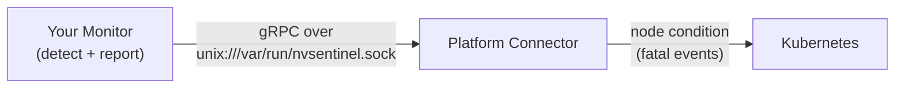

# Tutorial: Writing a New Health Monitor

This tutorial shows how to build a new **health monitor**. It starts with an empty directory and ends with a deployed component that reports faults. You do not need GPU hardware.

When you complete this tutorial, you have:

- A working Go health monitor that detects a fault and reports it to NVSentinel.
- A container image for the monitor, which you deploy to a live cluster as a DaemonSet.
- A verification that NVSentinel sees the fault. The fault shows as a Kubernetes node condition.

> **Who is this for?** Teams that **already run NVSentinel** and want to extend it with a new fault detector.

> **Do you want an AI agent to do it?** Go to [Appendix: One-shot AI prompt](#appendix-one-shot-ai-prompt).

## Prerequisites

- **Tools:** `docker` and `kubectl`.
- **A cluster with NVSentinel running.** The verification needs a running NVSentinel. At minimum, `platform-connectors` must run, because it sets the node condition that this tutorial verifies. To create a local cluster, see `DEVELOPMENT.md` in the root of the NVSentinel repository. *Before* you verify the monitor, use `kubectl get pods -n nvsentinel` to make sure that the core pods are healthy. Otherwise, a failed verification can come from an unhealthy cluster, not from a broken monitor.

---

## 1. What is a health monitor

NVSentinel detects faults on cluster nodes and remediates them (cordon → drain → remediation). The component that *detects* a fault is a **health monitor**.

A health monitor is a standalone process that:

1. Observes a source, for example a GPU through DCGM, kernel logs, a cloud API or a file in `/proc`.
2. Decides whether a node or a component is healthy.
3. Sends a **`HealthEvent`** to the **platform-connector** over a local **gRPC Unix domain socket**.

The platform-connector changes fatal health events into Kubernetes **node conditions**. This tutorial ends at that point. **Your monitor needs only to detect and report.**



This design has these results:

- Your monitor **never talks to the Kubernetes API** to cordon or drain a node. It only sends health events.
- The transport is a **Unix socket on the node**, which a `hostPath` volume shares with the monitor pod.
- The contract is a single gRPC method and a single message type. That is all that you implement.

---

## 2. The contract (the only API you must speak)

The contract is in `data-models/protobufs/health_event.proto`. The [HealthEvent Data Model Reference](../health-event-data-model.md) describes each field. The generated Go types are in the package `github.com/nvidia/nvsentinel/data-models/pkg/protos`.

The contract has exactly **one RPC**:

```protobuf
service PlatformConnector {
  rpc HealthEventOccurredV1(HealthEvents) returns (google.protobuf.Empty) {}
}

message HealthEvents {
  uint32 version = 1;             // set to 1
  repeated HealthEvent events = 2;
}
```

You send a batch (`HealthEvents`) that contains one or more `HealthEvent` messages.

### The `HealthEvent` message

| Field | Type | Required? | Notes |
|-------|------|-----------|-------|
| `version` | uint32 | yes | Set to `1`. |
| `agent` | string | yes | The name of your monitor, for example `"demo-health-monitor"`. Downstream consumers match on this field. |
| `componentClass` | string | yes | The logical component, for example `"GPU"`, `"NIC"` or `"Node"`. |
| `checkName` | string | yes | The specific check, for example `"NetworkReachability"`. |
| `isHealthy` | bool | yes | `true` means a recovery or a clear. `false` means a fault. |
| `isFatal` | bool | yes | `true` means a serious fault, which shows as a node condition. `false` means an informational health event, which becomes a Kubernetes Event. |
| `message` | string | recommended | The raw error or diagnostic message from the source, for example the hardware, DCGM or syslog. |
| `nodeName` | string | yes (node faults) | The affected node. Usually from the `NODE_NAME` environment variable (downward API). |
| `recommendedAction` | enum | recommended | See the `RecommendedAction` table below. Use `NONE` for healthy events. |
| `customRecommendedAction` | string | optional | With `recommendedAction = CUSTOM`, the name of a custom remediation action. |
| `generatedTimestamp` | Timestamp | yes | `timestamppb.Now()`. |
| `processingStrategy` | enum | yes | `EXECUTE_REMEDIATION` (act on it) or `STORE_ONLY` (observe only). |
| `entitiesImpacted` | repeated Entity | optional | The affected subcomponents, for example `{entityType:"GPU", entityValue:"3"}`. |
| `errorCode` | repeated string | optional | Vendor codes or error codes. |
| `metadata` | map<string,string> | optional | Free-form key-value pairs. |

These two enums are important for your monitor:

```protobuf
enum ProcessingStrategy {
  UNSPECIFIED = 0;          // normalized to EXECUTE_REMEDIATION by platform-connector
  EXECUTE_REMEDIATION = 1;  // normal: downstream modules may cordon/drain/remediate
  STORE_ONLY = 2;           // observability-only: persisted/exported, never mutates the cluster
}
```

The `RecommendedAction` values come from `data-models/protobufs/health_event.proto`. Also see [RecommendedAction Enum](../health-event-data-model.md#recommendedaction-enum).

| Value | Meaning |
|-------|---------|
| `NONE` (0) | No action. Use it for healthy events. |
| `COMPONENT_RESET` (2) | Reset the component. |
| `CONTACT_SUPPORT` (5) | Escalate to support. |
| `RUN_FIELDDIAG` (6) | Run field diagnostics. |
| `RESTART_VM` (15) | Restart the VM. |
| `RESTART_BM` (24) | Restart the bare-metal host. |
| `REPLACE_VM` (25) | Replace the VM. |
| `RUN_DCGMEUD` (26) | Run DCGM EUD. |
| `CUSTOM` (27) | Custom action. Set `customRecommendedAction` to its name. |
| `UNKNOWN` (99) | Unknown. |

### The golden rules

1. **`agent` is your identity.** Downstream consumers match on it, so select a stable, unique name.
2. **Prefer to send health events on state transitions, not on every poll.** When a fault appears, send an unhealthy event. When the fault clears, send a healthy event. This rule is a best-effort optimization that decreases noise. It is not a correctness requirement. NVSentinel deduplicates repeated health events, so it is safe to send the same state again.
3. **A healthy event clears the node condition.** When the component recovers, send `isHealthy=true` and `recommendedAction=NONE`.
4. **`isFatal=true` is what triggers action.** A fatal health event shows as a Kubernetes node condition. A non-fatal health event becomes a Kubernetes Event instead.

---

## 3. Choose your workload model

A monitor can observe almost any source: node-local state (`/proc`, `/sys`, GPUs, logs), the Kubernetes API or an external service. This choice affects only the **Kubernetes workload type**:

- **DaemonSet** (one pod on each node) — for node-local state. Each pod reports its own node.
- **Deployment** (single replica) — for a single cluster-wide source, such as the Kubernetes API or an external API. The monitor sets `nodeName` from the observed entity, not from `NODE_NAME`.

The publishing path is the same for both workload types. This tutorial builds a **DaemonSet**, which is the most common type.

The example in this tutorial is a **`demo-health-monitor`**. It periodically opens a TCP connection to a configurable endpoint (`CHECK_TARGET`) that the node depends on. If the endpoint is unreachable, the monitor reports the node as unhealthy. When the endpoint recovers, the monitor reports the node as healthy again.

---

## 4. Scaffold the module

Your monitor is an ordinary, standalone Go module. It depends on two NVSentinel Go modules:

- `github.com/nvidia/nvsentinel/data-models` — the health event contract (the `HealthEvent` types).
- `github.com/nvidia/nvsentinel/commons` — the shared publisher (`commons/pkg/healthpub`), which adds socket-presence gating, retries and Prometheus metrics to the raw gRPC client.

Create the module. You can use any module path:

```bash
mkdir demo-health-monitor && cd demo-health-monitor
go mod init github.com/{your-org}/demo-health-monitor
```

Add the two dependencies. They are in subdirectories of the NVSentinel repository, and the NVSentinel project does not publish them as tagged releases. As a result, they resolve to commit pseudo-versions.

Inside the repository, these subdirectories refer to each other through **local `replace` directives at the placeholder version `v0.0.0`**. No proxy can resolve this version. As a result, outside the repository you must redirect each placeholder to a real version yourself. `commons` has two placeholders: `data-models` (which you import) and `store-client` (which you do not import). Redirect both, and pin them to the **same commit**, so that the build is reproducible:

```bash
export GOTOOLCHAIN=auto   # the modules need Go 1.27+; this fetches it automatically

# 1. Pick the commit to build against. `main` is the tip at the time you run this;
#    pass an explicit SHA (e.g. NVS_REF=4f3d7f93dae1) to reproduce an earlier build.
NVS_REF="${NVS_REF:-main}"

# 2. Fetch the contract module, then capture the exact version go resolved. All three
#    NVSentinel modules are tagged from one commit, so this version pins all of them.
go get github.com/nvidia/nvsentinel/data-models@"$NVS_REF"
PIN=$(go list -m github.com/nvidia/nvsentinel/data-models | awk '{print $2}')

# 3. Point both of commons' v0.0.0 placeholders at that version. store-client is never
#    imported by the publisher, but it stays in the module graph — leave it unreplaced
#    and `go build` still works while `go list -m all` fails on "unknown revision".
go mod edit \
  -replace github.com/nvidia/nvsentinel/data-models=github.com/nvidia/nvsentinel/data-models@"$PIN" \
  -replace github.com/nvidia/nvsentinel/store-client=github.com/nvidia/nvsentinel/store-client@"$PIN"

# 4. Fetch the publisher module at the same commit.
go get github.com/nvidia/nvsentinel/commons@"$PIN"
```

Record `$PIN` (a pseudo-version such as `v0.0.0-20260916061712-4f3d7f93dae1`) together with your `go.mod`. If you run the commands again with `NVS_REF=<that SHA>`, you get exactly this dependency set.

---

## 5. Write the monitor

Create `main.go`. The program does these steps:

1. It parses the configuration from the environment.
2. It dials the socket.
3. It polls the endpoint.
4. It builds a health event on each state change.
5. It publishes the health event through the shared `healthpub` publisher.

```go
package main

import (
	"context"
	"errors"
	"fmt"
	"log/slog"
	"net"
	"os"
	"os/signal"
	"strconv"
	"syscall"
	"time"

	"google.golang.org/grpc"
	"google.golang.org/grpc/credentials/insecure"
	"google.golang.org/protobuf/types/known/timestamppb"

	"github.com/nvidia/nvsentinel/commons/pkg/grpcclient"
	"github.com/nvidia/nvsentinel/commons/pkg/healthpub"
	pb "github.com/nvidia/nvsentinel/data-models/pkg/protos"
)

const (
	agentName      = "demo-health-monitor"
	componentClass = "Node"
	checkName      = "NetworkReachability"
)

func main() {
	if err := run(); err != nil {
		slog.Error("fatal error", "error", err)
		os.Exit(1)
	}
}

func run() error {
	// --- Configuration from environment ---
	nodeName := os.Getenv("NODE_NAME")
	if nodeName == "" {
		return fmt.Errorf("NODE_NAME env var must be set")
	}
	// checkTarget is a host:port the node should always be able to reach. When it
	// becomes unreachable we report the node unhealthy. The default is the in-cluster
	// Kubernetes API, which is reachable from any pod; override it for your dependency.
	checkTarget := envOrDefault("CHECK_TARGET", "kubernetes.default.svc:443")
	socketPath := envOrDefault("SOCKET_PATH", "/var/run/nvsentinel.sock")
	// Projected ServiceAccount token platform-connector authenticates us with.
	// LookupEnv rather than envOrDefault: an explicitly empty PC_TOKEN_PATH has to
	// mean "send no credential", for a cluster with platformConnectorAuth disabled
	// and no token mounted. envOrDefault would turn that back into the default path
	// and every publish would fail reading a file that is not there.
	tokenPath, ok := os.LookupEnv("PC_TOKEN_PATH")
	if !ok {
		tokenPath = "/var/run/secrets/nvsentinel/platform-connector/token"
	}

	pollSeconds, err := strconv.Atoi(envOrDefault("POLL_INTERVAL_SECONDS", "10"))
	if err != nil {
		return fmt.Errorf("invalid POLL_INTERVAL_SECONDS: %w", err)
	}
	// time.NewTicker panics on a zero or negative duration, so reject bad values
	// before we build the ticker.
	if pollSeconds <= 0 {
		return fmt.Errorf("POLL_INTERVAL_SECONDS must be > 0, got %d", pollSeconds)
	}

	dialTimeout, err := strconv.Atoi(envOrDefault("CHECK_TIMEOUT_SECONDS", "3"))
	if err != nil {
		return fmt.Errorf("invalid CHECK_TIMEOUT_SECONDS: %w", err)
	}
	if dialTimeout <= 0 {
		return fmt.Errorf("CHECK_TIMEOUT_SECONDS must be > 0, got %d", dialTimeout)
	}

	ctx, stop := signal.NotifyContext(context.Background(), os.Interrupt, syscall.SIGTERM)
	defer stop()

	// --- Connect to platform-connector over the Unix socket ---
	// The socket is local, so the transport is insecure; the credential that
	// matters is the SA token attached to every call by grpcclient.DialOptions.
	target := "unix://" + socketPath
	opts := []grpc.DialOption{grpc.WithTransportCredentials(insecure.NewCredentials())}
	opts = append(opts, grpcclient.DialOptions(tokenPath)...)

	conn, err := grpc.NewClient(target, opts...)
	if err != nil {
		return fmt.Errorf("dial %s: %w", target, err)
	}
	defer conn.Close()
	client := pb.NewPlatformConnectorClient(conn)

	// Publish through the shared publisher instead of the raw client: it gates on
	// socket presence, retries transient errors, and exports Prometheus metrics.
	pub := healthpub.New(client, target, agentName)

	slog.Info("starting", "agent", agentName, "node", nodeName,
		"checkTarget", checkTarget, "socket", socketPath, "tokenPath", tokenPath)

	// --- Poll loop (edge-triggered: only send on health changes) ---
	ticker := time.NewTicker(time.Duration(pollSeconds) * time.Second)
	defer ticker.Stop()

	var lastHealthy *bool
	for {
		select {
		case <-ctx.Done():
			slog.Info("shutting down")
			return nil
		case <-ticker.C:
			// Healthy when we can open a TCP connection to checkTarget within the timeout.
			checkErr := checkReachable(checkTarget, time.Duration(dialTimeout)*time.Second)
			healthy := checkErr == nil
			slog.Info("connectivity check", "target", checkTarget, "healthy", healthy)

			// Only emit when health state flips.
			if lastHealthy != nil && *lastHealthy == healthy {
				continue
			}

			event := buildEvent(nodeName, checkTarget, checkErr)
			err := pub.Publish(ctx, &pb.HealthEvents{
				Version: 1,
				Events:  []*pb.HealthEvent{event},
			})
			if errors.Is(err, healthpub.ErrPlatformConnectorUnavailable) {
				// PC is down: do NOT advance lastHealthy so the next poll
				// re-emits this state with a fresh timestamp.
				slog.Warn("platform-connector unavailable; will retry next tick")
				continue
			}
			if err != nil {
				slog.Error("publish failed after retries", "error", err)
				continue // also do not advance lastHealthy
			}

			slog.Info("sent health event", "healthy", healthy)
			lastHealthy = &healthy
		}
	}
}

// checkReachable returns nil if a TCP connection to addr (host:port) succeeds within
// timeout, otherwise the underlying dial error (surfaced verbatim in the event message).
func checkReachable(addr string, timeout time.Duration) error {
	conn, err := net.DialTimeout("tcp", addr, timeout)
	if err != nil {
		return err
	}
	return conn.Close()
}

func buildEvent(nodeName, target string, checkErr error) *pb.HealthEvent {
	healthy := checkErr == nil
	event := &pb.HealthEvent{
		Version:            1,
		Agent:              agentName,
		ComponentClass:     componentClass,
		CheckName:          checkName,
		NodeName:           nodeName,
		GeneratedTimestamp: timestamppb.Now(),
		ProcessingStrategy: pb.ProcessingStrategy_EXECUTE_REMEDIATION,
		IsHealthy:          healthy,
		IsFatal:            !healthy,
	}
	if healthy {
		event.Message = fmt.Sprintf("%s reachable", target)
		event.RecommendedAction = pb.RecommendedAction_NONE
	} else {
		// Surface the raw dial error verbatim.
		event.Message = checkErr.Error()
		event.RecommendedAction = pb.RecommendedAction_CONTACT_SUPPORT
	}
	return event
}

func envOrDefault(key, fallback string) string {
	if v := os.Getenv(key); v != "" {
		return v
	}
	return fallback
}
```

Tidy and build the module. Then make sure that the dependency set is sound:

```bash
go mod tidy
go build ./...
go vet ./...
go mod verify    # every downloaded module matches its recorded checksum
go list -m all   # the FULL module graph resolves, not just what you import
```

`go list -m all` is the command that finds the placeholder problem. If the `store-client` replace is missing, the command fails with `github.com/nvidia/nvsentinel/store-client@v0.0.0: invalid version: unknown revision store-client/v0.0.0`. It fails even when `go build` succeeds. With both replaces in place, the command prints the full graph (approximately 150 modules) and exits 0.

> **On tests:** This monitor has no test files, so `go test ./...` prints `[no test files]` and exits 0. Here, a successful exit code proves nothing. `checkReachable` and `buildEvent` are both pure enough for direct unit tests. Before you use the monitor as production code, write those tests.

This code is a complete health monitor that obeys the contract. The remaining work is to package, deploy and harden the monitor.

---

## 6. Containerize

Package the monitor as a container image with a small multi-stage `Dockerfile` in the monitor directory. The build gets the dependencies from the module proxy, not from local paths. As a result, the build context is only the monitor directory:

```dockerfile
FROM public.ecr.aws/docker/library/golang:1.27.3-trixie AS builder
WORKDIR /src

# Manifests first for better layer caching. go.mod/go.sum already pin the
# data-models/commons versions and both replace directives.
COPY go.mod go.sum ./
RUN go mod download

COPY . .
RUN CGO_ENABLED=0 go build -ldflags="-s -w" -o demo-health-monitor .

FROM gcr.io/distroless/static-debian13
COPY --from=builder /src/demo-health-monitor /demo-health-monitor
ENTRYPOINT ["/demo-health-monitor"]
```

Build the image. Then push it to a registry that your cluster can pull from. This example uses Docker Hub, so replace `{dockerhub-user}` with your Docker Hub username. Run these commands from the directory that contains `demo-health-monitor`:

```bash
cd demo-health-monitor

docker login     # once, to authenticate to Docker Hub

docker build -t docker.io/{dockerhub-user}/demo-health-monitor:dev .

# Push so the cluster can pull it.
docker push docker.io/{dockerhub-user}/demo-health-monitor:dev
```

> If you use a **private** repository, make sure that the cluster has the necessary image pull credentials. For example, use an `imagePullSecret` in the `nvsentinel` namespace that the DaemonSet refers to in `spec.template.spec.imagePullSecrets`. A public repository needs no credentials.

---

## 7. Run and verify

Deploy the image as a DaemonSet. Then cause a fault. Watch the fault move through the pipeline. This section needs the [Prerequisites](#prerequisites).

**Apply the DaemonSet.** At first, `CHECK_TARGET` is a reserved TEST-NET address (RFC 5737) that is always unreachable, so the monitor reports a fault immediately. Later, you set `CHECK_TARGET` to a reachable endpoint to clear the fault. The DaemonSet mounts the platform-connector socket (`hostPath` `/var/run/nvsentinel` → `/var/run`). It also sets `NODE_NAME` through the downward API:

```bash
kubectl apply -f - <<'YAML'
apiVersion: apps/v1
kind: DaemonSet
metadata:
  name: demo-health-monitor
  namespace: nvsentinel
  labels:
    app.kubernetes.io/name: demo-health-monitor
spec:
  selector:
    matchLabels:
      app.kubernetes.io/name: demo-health-monitor
  template:
    metadata:
      labels:
        app.kubernetes.io/name: demo-health-monitor
    spec:
      containers:
        - name: demo-health-monitor
          image: docker.io/{dockerhub-user}/demo-health-monitor:dev
          imagePullPolicy: IfNotPresent
          env:
            - name: NODE_NAME
              valueFrom:
                fieldRef:
                  fieldPath: spec.nodeName
            - name: CHECK_TARGET
              value: "192.0.2.1:9"
            - name: POLL_INTERVAL_SECONDS
              value: "10"
            - name: SOCKET_PATH
              value: "/var/run/nvsentinel.sock"
            - name: PC_TOKEN_PATH
              value: "/var/run/secrets/nvsentinel/platform-connector/token"
          volumeMounts:
            - name: socket
              mountPath: /var/run
            - name: platform-connector-token
              mountPath: /var/run/secrets/nvsentinel/platform-connector
              readOnly: true
      volumes:
        - name: socket
          hostPath:
            path: /var/run/nvsentinel
            type: DirectoryOrCreate
        - name: platform-connector-token
          projected:
            sources:
              - serviceAccountToken:
                  audience: platform-connector.nvsentinel.nvidia.com
                  expirationSeconds: 3600
                  path: token
YAML
```

> **The token is not optional.** platform-connector runs a `TokenReview` on each publisher and pins the publisher to the node where its pod runs. If a monitor presents no token, platform-connector rejects its health events, and no downstream action occurs. The `audience` must match the Helm value `global.platformConnectorAuth.audience`. The manifest above uses the default value. A monitor that reports on nodes *other* than its own node must also have its ServiceAccount in `global.platformConnectorAuth.crossNodeServiceAccounts`. An example of such a monitor is a Deployment that watches a cloud API.

Confirm that the pods run:

```bash
kubectl rollout status ds/demo-health-monitor -n nvsentinel
kubectl get pods -l app.kubernetes.io/name=demo-health-monitor -n nvsentinel
```

### Trigger and verify

> These steps work on any cluster that meets the [Prerequisites](#prerequisites).

`CHECK_TARGET` is unreachable, so the monitor sends an **unhealthy, fatal** `HealthEvent` within one poll interval. Then platform-connector automatically changes the fatal health event into a **Kubernetes node condition**. It uses your `checkName` (`NetworkReachability`) as the condition **Type**. Select a node where a monitor pod runs. Then watch the condition appear:

```bash
# Any node running the monitor (each pod reports its own node).
NODE=$(kubectl get pods -n nvsentinel -l app.kubernetes.io/name=demo-health-monitor \
  -o jsonpath='{.items[0].spec.nodeName}')

# 1. Monitor detected the unreachable endpoint and sent an unhealthy (fatal) event.
kubectl logs -l app.kubernetes.io/name=demo-health-monitor -n nvsentinel

# 2. Platform-connector recorded it on the node as a condition (Type == your checkName).
kubectl get node "$NODE" \
  -o jsonpath='{range .status.conditions[?(@.type=="NetworkReachability")]}{.type}{"  "}{.status}{"  "}{.reason}{"  "}{.message}{"\n"}{end}'
```

The output shows the condition as a fault:

```text
NetworkReachability  True  NetworkReachabilityIsNotHealthy  dial tcp 192.0.2.1:9: ... Recommended Action=CONTACT_SUPPORT;
```

> **Inverted semantics:** NVSentinel sets `Status=True` to show that *a fault is present*, and `Status=False` to show a healthy state. The condition `Type` is exactly your `checkName`. The `Reason` is `{checkName}IsNotHealthy` or `{checkName}IsHealthy`. You can also see the same condition under **Conditions** in the output of `kubectl describe node "$NODE"`.

To clear the fault, set `CHECK_TARGET` to a reachable endpoint. Any pod in the cluster can reach `kubernetes.default.svc:443`. On the next poll, the monitor sends a healthy event, and the condition changes back (`Status=False`, `Reason=NetworkReachabilityIsHealthy`, `Message="No Health Failures"`):

```bash
kubectl set env ds/demo-health-monitor -n nvsentinel CHECK_TARGET=kubernetes.default.svc:443
kubectl rollout status ds/demo-health-monitor -n nvsentinel

kubectl get node "$NODE" \
  -o jsonpath='{range .status.conditions[?(@.type=="NetworkReachability")]}{.type}{"  "}{.status}{"  "}{.reason}{"  "}{.message}{"\n"}{end}'
```

The condition then reports a healthy state:

```text
NetworkReachability  False  NetworkReachabilityIsHealthy  No Health Failures
```

This step is the end of the path that this tutorial covers. Your monitor detects a fault, and NVSentinel shows it as a node condition.

> If no health event arrives at the platform-connector, the usual cause is the socket mount. See [`docs/runbooks/health-monitor-uds-failures.md`](../runbooks/health-monitor-uds-failures.md).

---

## Appendix: One-shot AI prompt

Paste this prompt into an AI coding agent. The prompt is **self-contained**. The monitor is a standalone module that you can create in **any repository**. It does not need to be inside the NVSentinel repository. Replace the bracketed parts.

```text
Create a new NVSentinel health monitor named "[my-monitor]" that detects [the condition]
by [the method, e.g. "checking TCP reachability of an endpoint", "reading /proc/loadavg",
or "watching <K8s resource>"]. It is a standalone Go program that can live in any repo;
follow this spec exactly.

- Create a new Go module in its own directory with any module path (e.g.
  github.com/{your-org}/{my-monitor}). It depends on two NVSentinel modules that are NOT
  published as tagged releases, so pin them to one commit. commons refers to BOTH data-models
  and store-client at the internal placeholder version v0.0.0, so replace both — without the
  store-client replace `go build` passes but `go list -m all` fails on an unknown revision:
    export GOTOOLCHAIN=auto
    NVS_REF="${NVS_REF:-main}"   # or an explicit commit SHA for a reproducible build
    go get github.com/nvidia/nvsentinel/data-models@"$NVS_REF"
    PIN=$(go list -m github.com/nvidia/nvsentinel/data-models | awk '{print $2}')
    go mod edit \
      -replace github.com/nvidia/nvsentinel/data-models=github.com/nvidia/nvsentinel/data-models@"$PIN" \
      -replace github.com/nvidia/nvsentinel/store-client=github.com/nvidia/nvsentinel/store-client@"$PIN"
    go get github.com/nvidia/nvsentinel/commons@"$PIN"
- Emit contract-correct HealthEvents (agent="[my-monitor]", a stable componentClass and
  checkName), edge-triggered (only on health-state changes), with
  ProcessingStrategy_EXECUTE_REMEDIATION; healthy events use RecommendedAction_NONE.
- Publish via commons/pkg/healthpub (github.com/nvidia/nvsentinel/commons/pkg/healthpub) to
  the platform-connector Unix socket (unix:///var/run/nvsentinel.sock) and treat
  ErrPlatformConnectorUnavailable as "retry next cycle" without advancing dedup state.
- Authenticate: platform-connector rejects unauthenticated publishers. Append
  grpcclient.DialOptions(tokenPath) (github.com/nvidia/nvsentinel/commons/pkg/grpcclient) to
  the dial options, reading tokenPath from env with a default of
  /var/run/secrets/nvsentinel/platform-connector/token.
- Validate env config: NODE_NAME (required) plus the poll interval and any check timeout;
  reject non-positive durations before constructing a time.Ticker.
- Add a multi-stage Dockerfile whose build context is the monitor directory itself (COPY
  go.mod/go.sum, go mod download, COPY ., build a static binary). No local module copying.
- Provide a DaemonSet manifest (namespace nvsentinel) that mounts the platform-connector
  socket (hostPath /var/run/nvsentinel -> /var/run), sets NODE_NAME via the downward API,
  and projects a ServiceAccount token with audience
  platform-connector.nvsentinel.nvidia.com at /var/run/secrets/nvsentinel/platform-connector.
- Show the deploy commands against a running NVSentinel cluster: docker build, docker push
  to a registry the cluster can pull from (e.g. Docker Hub), then kubectl apply the DaemonSet
  (image referencing the pushed tag).
- Show how to verify: a fatal event surfaces as a Kubernetes node condition whose Type equals
  the checkName (kubectl get node {node} -o jsonpath over .status.conditions; Status=True
  means a fault is present). Stop at the node condition.

- Add unit tests for the pure helpers (event construction and the check function). Do not
  report a passing test suite when `go test` only prints "no test files".

Ensure `go mod tidy`, `go build ./...`, `go vet ./...`, `go test ./...`, `go mod verify`
and `go list -m all` all pass. `go test ./...` must actually run the tests you were asked
to write above; `go list -m all` is what proves the full module graph resolves.
```
